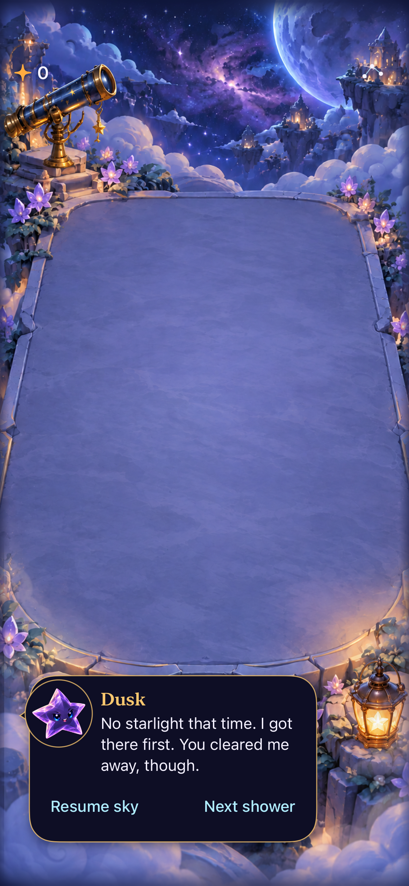

# Copy rewrite reconciled with current main

**Result:** Partially verified · **Owner:** current implementer · **Date:** October 18, 2026

The rewrite retains main through `d2ce8ff`: shared interruption/trace feedback, visible awards, recipe-input refinement and the gesture-only bottom-dialogue design. Arrange controls remain removed. Help now describes direct swaps and tracing shapes. Contextual Dusk guidance preserves the reacting character's voice and uses catalogue templates.

**Next action:** Human comprehension/tone playtest; full largest-text help and actual VoiceOver acceptance before RC. Physical-device delivery was not requested or run.

## Source and checks

Final tested source `20a9ec3` was clean; app sources/resources are identical to `d105c22`. Xcode 27.1, arm64 Debug/Release, iPhone 17e simulator “Starfall Forecast Fallback QA”, iOS 27.0, UDID `1E9DCEF5-BF64-4052-AF8D-A6A205F711EE`. All Xcode commands use `ARCHS=arm64 ONLY_ACTIVE_ARCH=YES`; native tests disable parallel execution. No Core rule/save/RNG change.

| Check | Result and source |
| --- | --- |
| Hygiene / diff | `python3 scripts/ci-hygiene.py` and `git diff --check` pass |
| Core | `swift test`: 149 pass after first main integration; subsequent merges do not change Core |
| Hosted | 121 pass, zero skips on `d105c22`: dialogue, cadence, FallingSkyStore, flow, Dusk, techniques, celebrations, responsive input, trace polish |
| Debug / Release | Debug simulator test build and Release generic iOS Simulator build pass on final app sources; logs `/tmp/starfall-copy-integrated-release.log` and MCP bundles below |
| Native | Four pass on `d105c22`: Dusk five-feed collapse/restore, zero-reward clear, incomplete trace/input recovery, gesture-only recipe/relay. Two pass on `20a9ec3`: help/settings dismissal and message expiry/reopen while steady First Light rain continues |
| Motion / interruption | Hosted normal-motion Dusk/exchange/award checks pass; native normal-motion reactions, restored committed state, menu suspension/reopen pass. Earlier broader checks retain their original source in the parent report |
| Accessibility / visuals | Native default-text Dusk frame inspected below; complete zero-reward wording and separate controls. Long combined Dusk warning still requires scrolling. Full actual VoiceOver, physical feel, full largest-text help and human comprehension remain unverified |

Commands: `test_sim` with `-only-testing:StarfallAppTests/<suite>` for the nine suites above; `-only-testing:StarfallUITests/<class>/<test>` for the six named native scenarios. Release: `xcodebuild -project Starfall.xcodeproj -scheme Starfall -configuration Release -destination 'generic/platform=iOS Simulator' -derivedDataPath /tmp/starfall-copy-ca99-release ARCHS=arm64 ONLY_ACTIVE_ARCH=YES build`.

Local result bundles under `~/Library/Developer/XcodeBuildMCP/workspaces/Starfall-00168e9aae0e/result-bundles/`:

- Hosted: `test_sim_2026-10-18T14-28-17-488Z_pid58838_feb61484.xcresult`
- Native four: `test_sim_2026-10-18T14-28-44-135Z_pid58838_cda7a468.xcresult`
- Native two: `test_sim_2026-10-18T14-32-15-692Z_pid58838_014213c3.xcresult`

Integration exposed old string expectations in main's new trace speech/Dusk tests, a project-membership conflict and stale menu/reopen assumptions. Corrected them without removing ownership assertions. The reopening test now uses steady First Light rain: repeated real threat warnings can legitimately replace the current message before it expires. Earlier failed bundles remain local; final affected checks pass. Main's separate prior full-sky native wait failure remains documented in its own dialogue-only HUD report; this integration does not claim to resolve it.

## Inspected merged presentation

**Native Debug capture — `d105c22`, clean source, runtime `dev.local`, version 0.1.0 build 1, iPhone 17e / iOS 27.0, default text, Calm effects off.** Exported from the native four-case bundle above. Confirms this sampled message fits the gesture-only HUD; a still does not establish smoothness or reading comprehension. Earlier retained screenshots remain historical for their source. Markdown rendering not checked; local paths checked.
