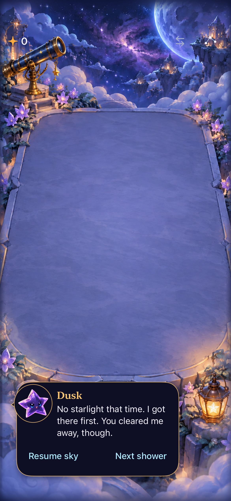
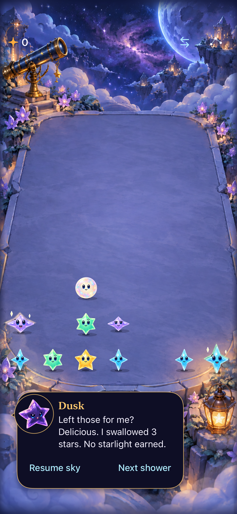
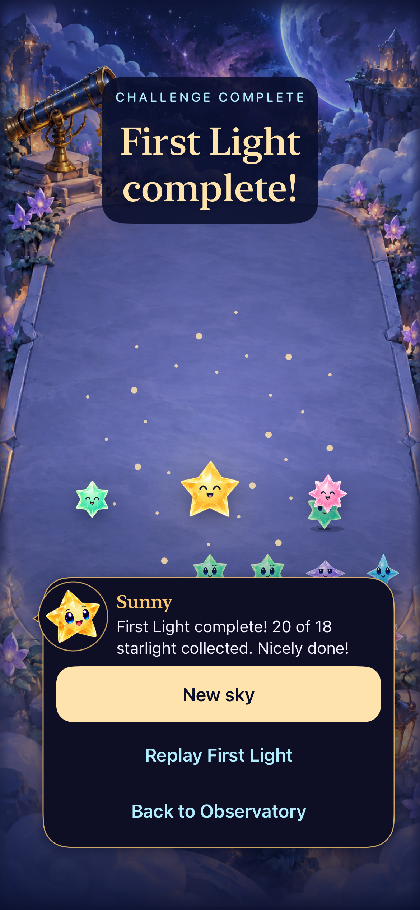
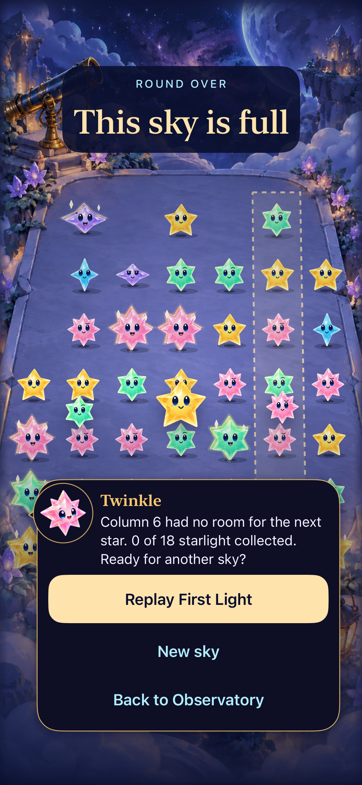
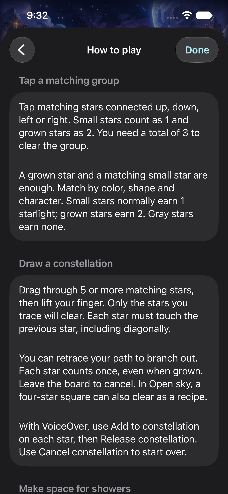

# Clearer copy and distinct character voices

**Result:** Partially verified — implementation/native checks passed; human comprehension unverified · **Owner:** current implementer · **Date:** October 18, 2026

The regular Falling Sky app now authors dialogue and interface wording in one local catalogue. Rewritten instructions distinguish matching weight, star count and earned starlight; each character has a consistent voice. Dusk teases after an actual consumed-star event or zero-reward drained clear. Invalid taps get advice. Core rules, saves, seeded replay, timing and animation ownership are unchanged.

**Next action:** Observe first-play comprehension and whether reactions feel useful rather than repetitive. Capture full largest-text help reading before RC acceptance. No physical-device delivery or human enjoyment claim is made here.

Current-main reconciliation and final checks are in [Integration](INTEGRATION.md). Captures below retain their earlier source; Arrange-mode references are historical after main adopted gestures only.

## What changed and where to edit

[Research](../../design/UX_WRITING_RESEARCH.md) informed the rewrite. The [authoring guide](../../../App/DialogueScripts/README.md) owns vocabulary, speakers, event policy and validation. [observatory-dialogue.json](../../../App/DialogueScripts/observatory-dialogue.json) contains 48 scripts and 215 interface entries. [SkyCopy](../../../App/SkyCopy.swift) supplies typed interface IDs; both dialogue and interface templates reject missing, extra or brace-containing values. The existing bundled file remains the single resource, now with an interface `copy` section. No runtime service, SDK, variant engine or gameplay RNG was introduced.

Sunny is a practical guide, Spark a curious observer, Pip brief and dry, Twinkle gentle, Nova precise and unhurried, and Dusk mischievous about its appetite. Traced clears and shapes have event-specific celebrations; Pip has a dedicated causal-relay line. A joined forecast preserves the original speaker instead of making Nova repeat someone else's reaction. Automatic showers retain the existing limited announcement policy.

Menu/help/results, pacing, input feedback, cast descriptions, prop accessibility and regular-game accessibility wording use the catalogue. The Debug studio and reset-only fixtures retain developer text; the original Debug orthogonal puzzle is outside this rewrite. English only: this content system is not yet localization.

## Inspected native presentation

| Zero-reward clear | Dusk consumes stars |
| --- | --- |
|  |  |

**Native screenshots — Debug runtime `dev.local`, version 0.1.0 build 1, runtime snapshot `da9ce72eca37`, iPhone 17e / iOS 27.0 Simulator, default text, Calm effects off.** Exported from the successful Dusk reaction rerun `test_sim_2026-10-18T13-26-16-845Z_pid58838_13506bbf.xcresult`, tests `testClearEarlyReleasesColorAndZeroRewardMatchStillClears` and `testFiveFeedsCollapseAndRestoreCommittedResult`. Both inspected frames show readable complete messages, Dusk attribution and separate usable control space. They are paused end states and do not prove motion, reading comprehension or physical feel. The large-text/reduced-motion threat capture was also inspected: it uses a separate scrolling footer and requires scrolling for the full long message, without shrinking type.

| First Light win | Full sky |
| --- | --- |
|  |  |

**Native result screenshots — same runtime snapshot/environment, normal motion.** Exported from successful `SkyFlowInteractionTests/testFirstLightWinReplayAndFullSky`, bundle `test_sim_2026-10-18T13-29-32-597Z_pid58838_da765de9.xcresult`. Inspected complete text, score overshoot, failure reason and full action labels. The win frame is during the existing celebration; the still does not establish animation timing. The captured fresh-entry frame occurred during its reveal and is not retained as evidence of settled entry copy.

**Native help screenshot — same runtime snapshot, default text.** Successful `testCelestialHUDGuideAndMenuPagesKeepTheRound` in the final four-case bundle. The inspected screen distinguishes matching weight from reward and gives tracing its own section; Done and back remain readable. The normal pacing and Pip relay captures from the same bundle were inspected without retaining duplicate board frames: composed forecast text and the relay line fit above separate controls. The entire largest-text help page was not visually reviewed; sampled largest-text chat/entry and Dusk scrolling were checked separately. No Markdown renderer was available for this report; local links and embedded files were checked.

## Outcomes against acceptance

| Criterion | Observed result / limit |
| --- | --- |
| Single authoring owner | Implemented; typed inventory exactly matches JSON and every template renders in hosted checks |
| Accurate rule and saved-state wording | Grown stars count twice for tap matching but once in traces; gray rewards are separate. Dusk help receives three/five from the actual rule. Core/save contracts unchanged |
| Distinct reactions and truthful teasing | Hosted checks cover ordinary/trace/shape/relay speakers, consumption and zero-point taunts, invalid-tap advice and stale callback rejection |
| Clear status and endings | Current/forecast tense, heavy/faster distinction and blocked-column reason retained; wins use actual score including overshoot |
| Native presentation and interaction | Selected native checks passed: six-speaker studio, large text, Dusk, rapid double-taps, incomplete traces, pause/menu/background, normal/reduced motion, win/loss/replay, help/settings and shape/relay feedback |
| Human comprehension and preference | Not verified. A passing template test cannot establish that a new player understands or enjoys the wording |
| Actual VoiceOver / physical device | Not run; actual VoiceOver remains an RC gate. No phone installation performed |

## Verification context

**Source:** `5bec506ab2899ff69538fcfd233338ba8a516bb1` plus dirty runtime snapshot `da9ce72eca37`; [all changed app/project/test paths and SHA-256 hashes](source-snapshot.json). Core sources are unchanged. This is working-tree evidence, not acceptance of a published commit.

**Environment:** Xcode 27.1 (27A9275), Debug and Release arm64 simulator builds; Starfall Forecast Fallback QA, iPhone 17e, iOS 27.0, simulator `1E9DCEF5-BF64-4052-AF8D-A6A205F711EE`. Normal effects are used unless a specific Reduce Motion/largest-text scenario says otherwise.

| Check | Command / procedure | Result |
| --- | --- | --- |
| Core | `swift test` | 149 passed, no failures; `/tmp/starfall-copy-core.log` |
| Debug build/run | XcodeBuildMCP `build_run_sim`, Starfall scheme, `ARCHS=arm64 ONLY_ACTIVE_ARCH=YES`; reset-only dialogue/Observatory fixtures | Passed; final hosted/native compilation also checks target membership |
| Release | `xcodebuild -project Starfall.xcodeproj -scheme Starfall -configuration Release -destination 'generic/platform=iOS Simulator' -derivedDataPath /tmp/starfall-copy-ca99-release ARCHS=arm64 ONLY_ACTIVE_ARCH=YES build` | Passed; `/tmp/starfall-copy-release.log` |
| Hosted | Dialogue, store, cadence, flow, Dusk, technique, celebration and responsive-input suites; `test_sim` with arm64 flags and `-parallel-testing-enabled NO` | 103 distinct checks passed on final app/hosted-test source. Final suite run: 101 passed / 2 motion checks skipped because a crashed native run left Reduce Motion on. Restored normal motion, then both motion checks passed without skips |
| UI | `test_sim`, same scheme/destination/arm64 flags, serial selection of the scenarios listed below | 15 distinct native scenarios passed across the initial and bounded follow-up runs; initial failures and closure recorded below |
| Hygiene | `python3 scripts/ci-hygiene.py`; `git diff --check`; local documentation/image-link check | Passed |

Raw native logs, result bundles and attachments remain under the local XcodeBuildMCP workspace `~/Library/Developer/XcodeBuildMCP/workspaces/Starfall-00168e9aae0e/`. Relevant result bundles (same workspace prefix):

- Hosted final source: `test_sim_2026-10-18T13-24-18-143Z_pid58838_cc9dbc9f.xcresult`; normal-motion follow-up: `test_sim_2026-10-18T13-26-03-257Z_pid58838_c71b215f.xcresult`.
- Initial UI: `test_sim_2026-10-18T13-17-18-689Z_pid58838_e886a3d6.xcresult`: seven passed, one assertion failure, two test-runner failures; the MCP call reached its 300-second timeout, but the completed bundle was read directly.
- Dusk and pause follow-up: `test_sim_2026-10-18T13-26-16-845Z_pid58838_13506bbf.xcresult`: all three `DuskInteractionTests`, plus dialogue active-reopen and normal-motion automatic cycles, five passed.
- `SkyFlowInteractionTests/testFirstLightWinReplayAndFullSky`: `test_sim_2026-10-18T13-29-32-597Z_pid58838_da765de9.xcresult`, one passed (win, loss, replay, restore and fresh entry).
- Help/layout/technique/pacing: `test_sim_2026-10-18T13-32-31-058Z_pid58838_b33b3f0a.xcresult`, four passed: `ObservatoryInteractionTests/testCelestialHUDGuideAndMenuPagesKeepTheRound`, `SkyFlowInteractionTests/testLargestTextWelcomeEntryAndBackRemainReachable`, `SkyTechniqueInteractionTests/testExactSquareThenGravityCreatesDeliberateRelay`, and `PacingCueUITests/testNormalMotionWarningFasterBreathing`.

The initial successful UI scenarios also include both responsive-input tests, manual play under system Reduce Motion, all six speakers in the studio and largest-text chat reflow. Their targeted app behavior was unchanged by the later relay/help/default-preview refinements. Final runtime captures and the follow-up suites use the app snapshot recorded above. Test text expectations changed as part of this batch; final changed test files are hashed separately in the same manifest.

## Failures investigated and remaining limits

The initial simulator build attempted an incompatible host architecture for the package product. Selecting arm64 explicitly resolved the error without changing project build settings. A subsequent compilation error required wrapping dynamic accessibility custom-content labels and values in `Text`; the corrected code compiles.

The first hosted run exposed two stale expectations: an extra period in the expected joined forecast and a test expecting Sunny's old third-person Dusk help. Correcting expected text preserved the behavior assertions; the affected 52 tests passed.

One native test queried a shared pause identifier immediately during sheet dismissal, when UIKit briefly exposed both the outgoing menu button and incoming board button. Both equivalent dialogue test paths now wait, with a five-second bounded condition, for the menu to disappear and exactly one Resume sky control to remain, then retain the exact-label assertion. No blanket retries, reduced-motion forcing or app lifecycle changes were added for this failure. Both corrected native paths passed in the five-case rerun. That rerun also passed the two initial Dusk cases whose runners had reported “Test crashed with signal kill” and “Lost connection to testmanagerd.” Those are observed infrastructure failures; their underlying cause was not established. The interrupted run left system Reduce Motion enabled, so normal-motion hosted checks were explicitly rerun with the original normal-motion setting restored, and passed. No unresolved test failure remains in the selected checks.

The rewrite does not evaluate strategic move quality. A zero-point clear can be intentional; Dusk's joke describes the lost light, not the player's intelligence. Frequency and tone need human play. Compatibility gravity copy was clarified without restoring removed production gravity routes. [Engineering follow-ups](../../ENGINEERING.md#copy-ownership-and-acceptance--october-18-2026) cover English-only content, comprehension and the oversized existing store test suite.
