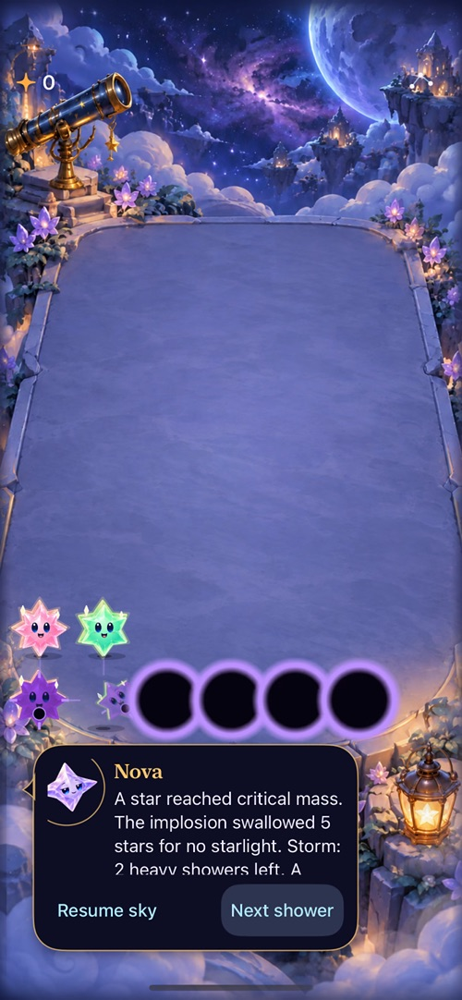
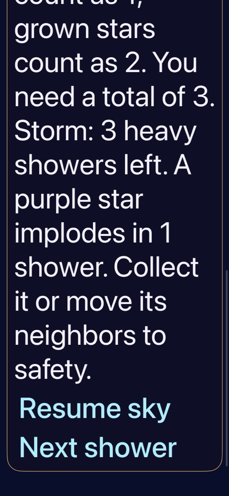

# Universal critical mass is integrated and development-verified

**Result:** Partially verified · **Owner:** current implementer · **Date:** October 18, 2026

Fresh survival skies now age all collectible stars, including buried stars and Opal. Stage three turns purple; stage four briefly becomes a black hole and swallows its current orthogonal neighborhood for no starlight. Players can rescue or exchange before collapse. Dusk stays in retained rounds; First Light is unchanged. [Rule/save contract](../../design/CRITICAL_MASS.md) · [PR #96](https://github.com/lbeezr/starfall/pull/96).

Core, saves, simulator interaction and sampled normal/quiet presentation pass development checks. Human timing/enjoyment, dense-board readability, physical feel and actual VoiceOver remain open. The broad hosted suite has one separately reproduced baseline wording failure, detailed below.

**Next action:** Merge the verified source, then observe the user and husband choosing rescue versus sacrifice before adjusting timing or adding consequences. No physical-device installation was performed.

## Outcomes against acceptance

| Criterion | Result and limits |
| --- | --- |
| Age and collapse | Passed: birth exclusion, buried/Opal aging, stage timing, full warning window, isolated/edge/full-column collapse, simultaneous overlap counted once, no chains, before-arrival headroom and young-column loss. |
| Collection and input | Passed: age never adds points or solo-clear eligibility; matching growth stays worth two; rescue preserves full reward, exchanges preserve age/identity, preview/RNG/replay stay deterministic. Native double-tap rescue awards four and cannot repeat the clear. Main's forgiving swaps and one-gap links are included. |
| Save compatibility | Passed: v8 round-trip and continuation, v7 bytes preserved until activation, no fallback from invalid v8, old envelopes reject new rules, invalid ages/turns/versions rejected, retained Dusk and First Light unchanged. Existing v3–v6 tests also pass. |
| Lifecycle | Passed: commit/save before presentation, board reservation during swallow, stale completion rejection, restart, pause, settings/background, restore and replay. No age catch-up or animation-owned rules. |
| Native/accessibility | Four critical-mass UI tests pass: rescue, warning/swallow/restore/settings/background, real system Reduce Motion, largest-text calm help and shower-control access. Native labels name stage, time and exact current targets. Actual VoiceOver remains RC work. |
| Existing flow | First Light win/replay/full-sky/restore/new-sky UI test passes in 149.410 seconds. Opening clear and short-trace interaction checks passed on the preceding feature source; integrated hosted input/geometry suites pass. |
| Appearance/motion | Purple recoloring, original silhouettes/faces, static non-color marks and grown-value glints inspected. A recorded normal-motion swallow shows inward movement/shrink, disappearance, settling and the subsequent violet arrival. Smoothness on physical devices and dense-board comfort remain unmeasured. |

## Tested source and commands

Tests and captures used **clean local `c9c8d2e58ee9aab3e292db49c9ed1de3d65dc8dc`**. Published `3b76e22a25270735acf0e0e4fb882e26df8e2098` has the identical Git tree `e7305ee20be25e22171b6ab2ff753574d399a9f1`; `git diff --exit-code` confirms equality. Subsequent evidence/index updates change documentation/captures only. Main `9b0f9d3` was then reconciled: it changes UI tests and documentation, with no runtime source, resources, package or Xcode membership difference from this tested build. [Verification manifest](verification.json) records source/resource hashes, captures and the ignored recording hash.

Environment: Xcode 27.1 (`27A9275`), Apple Swift 6.4; Debug/Release arm64 Simulator builds. Native tests ran on iPhone 17e / iOS 27.0, UDID `3447731D-D3C6-4DBC-A823-52E1C84C2A5B` (named Starfall Harvest Feedback QA). Normal capture uses default text and calm effects off; the large-text capture uses accessibility XXXL and calm effects on. The dedicated Reduce Motion test changes/restores the actual system preference.

| Check | Command/procedure | Result |
| --- | --- | --- |
| Core | `swift test` | **160 passed** on integrated source. |
| Hosted | `xcodebuild -project Starfall.xcodeproj -scheme Starfall -configuration Debug -destination id=3447731D-D3C6-4DBC-A823-52E1C84C2A5B -derivedDataPath /tmp/starfall-critical-derived ARCHS=arm64 ONLY_ACTIVE_ARCH=YES test -only-testing:StarfallAppTests -skip-testing:StarfallAppTests/GravityStoreTests/testInvalidHoleTapAndRapidClearCannotSpendTwice` | **236 passed**; one known baseline exclusion, not a full unqualified suite pass. |
| Native | Same Debug command with `-only-testing:StarfallUITests/CriticalMassInteractionTests -only-testing:StarfallUITests/SkyFlowInteractionTests/testFirstLightWinReplayAndFullSky` | **5 passed**; 232.381 seconds. |
| Normal motion | Repeat the passing `CriticalMassInteractionTests/testWarningSwallowRestoreAndSettings` while recording with `xcrun simctl io <UDID> recordVideo`; inspect sequential frames at 0.1-second intervals around collapse | **1 passed**; 21.793 seconds. Four simultaneous wells contract, shared targets disappear once, survivors settle, then violet arrives. |
| Build | `xcodebuild -project Starfall.xcodeproj -scheme Starfall -configuration Release -destination 'generic/platform=iOS Simulator' -derivedDataPath /tmp/starfall-critical-release ARCHS=arm64 ONLY_ACTIVE_ARCH=YES build` | **Passed**; Debug build also exercised by hosted/native tests, including explicit new-file membership. |
| Hygiene | `python3 scripts/ci-hygiene.py`; `git diff --check` | **Passed**. |
| Actual VoiceOver / physical device | Not run; development cadence and no delivery request | RC and physical-play follow-up. |

Raw logs, movie and disposable output are under ignored `artifacts/critical-mass/` or `/tmp/starfall-critical-*`. The movie includes launch/home periods; the sampled swallow is around 15.9–16.3 seconds, followed by the arrival around 16.8–17.0 seconds. A sampled frame alone does not establish animation timing or smoothness.

## Inspected runtime presentation

| Purple warning | Brief inward swallow | Largest-text warning and controls |
| --- | --- | --- |
|  |  |  |

**Runtime evidence, not concepts:** iPhone 17e / iOS 27.0 Simulator, clean `c9c8d2e`. The first frame deliberately retains the introductory message; current warning text is in its scrollable continuation and cell labels. At XXXL, Help and the bottom controls remain reachable by scrolling; they are not claimed to fit beside the board on one screen. Native Help is split into short paragraphs near the beginning. Existing historical Dusk captures remain relevant only to retained rounds; no old binary/media was relabeled as universal-pressure evidence.

## Balance, failed checks and remaining risks

The fixed 40-seed comparison caps each run at 100 showers. Collect-all totals **4,000 showers / 2,309 lost light**; idle totals **3,542 showers / 10,707 lost light**. This sample does not show idle survival dominating active collection. Capped deterministic policies cannot establish long-run balance or enjoyment; observe actual rescue/sacrifice choices before tuning.

The broad hosted run exposed `GravityStoreTests.testInvalidHoleTapAndRapidClearCannotSpendTwice`: it expects “captive”, while the current catalogue says “trapped”. The same assertion fails in an unchanged clean export of main `33ae6fb` on the other booted iPhone 17e simulator. The final 236-test command explicitly excludes it; no product behavior or assertion was weakened. [Engineering follow-up](../../ENGINEERING.md#universal-critical-mass-tuning-and-retained-validation) owns its trigger and verification.

Early UI checks failed on offscreen Help/controls and on expecting gameplay immediately after relaunch. The implemented Help was moved earlier and split; tests now scroll actual native lists/controls and choose Continue. A default multi-architecture build failed on incompatible Core module resolution; explicitly building arm64 passed. One broad run was interrupted by a competing simulator launch; the final hosted and UI runs were serialized and completed. Standalone semantic tap tools reported success without a committed shower on the secondary simulator, so those attempts are not interaction/motion evidence; the retained recording uses the passing XCTest path instead.
