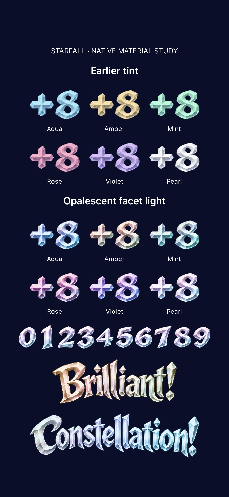
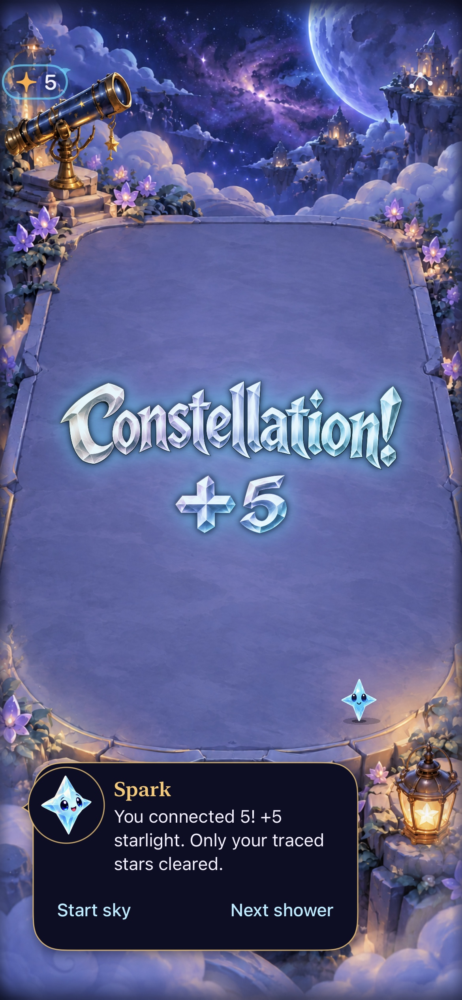
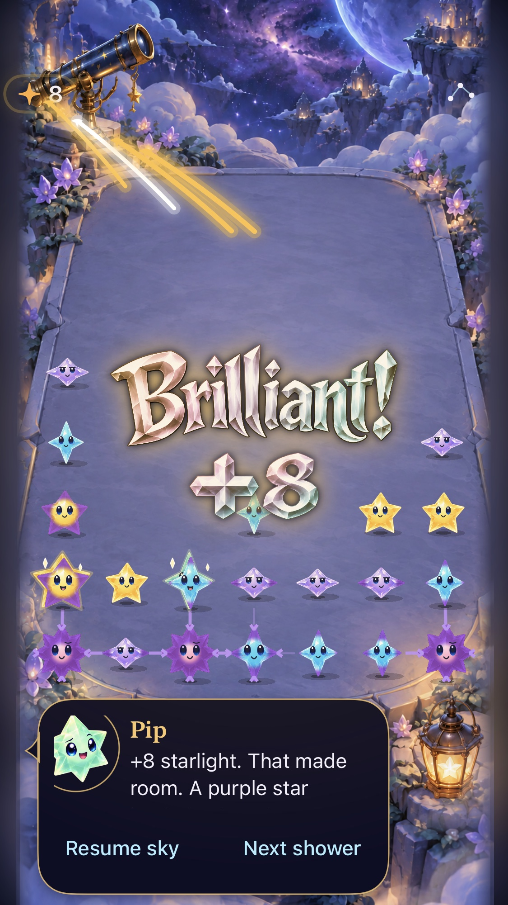

# Opalescent light on the existing crystal artwork

**Result:** User-approved shipping checkpoint; physical/RC acceptance separate · **Owner:** current implementer · **Date:** October 18, 2026

The normal-app revision gives the existing neutral title/numeral art warm and cool refraction, deeper face contrast and a narrower pearl highlight. It replaces the original uniform 55% white-screen layer. The harvested-family tint remains the base. This approaches the approved swatches through native compositing; it does not recreate every painted color boundary in the concept.

**User decision:** accepted this material checkpoint for shipping. No additional saturation change is included.

**Next action:** merge the verified checkpoint and run the canonical phone updater. Physical preference, dense-board comfort and RC VoiceOver remain open; phone installation is confirmed separately by the updater.

## Evidence against the material criteria

- The six-family native comparison includes the earlier renderer and revised renderer, all ten digits and short/long title samples. The new pearl glyph render also passes a meaningful optical regression: at least three populated hue bands within the visible material, excluding near-black and near-neutral pixels.
- The real FallingSkyView/store/SpriteKit render checks exercise ordinary, recipe, constellation and relay scoring; receipts retain exact committed values and expire normally. Quiet/normal award rendering and replacement/cancellation checks pass.
- Only the shared illustrated material and theme colors changed in the app. All titles and glyphs consume that material. Original art/registration/loading, native accessible fallback, scene geometry, Core, stores, save/input and animation/lifecycle ownership are unchanged. No new resource, decode cache, per-frame raster work, shader compiler, timer, framework or app route.
- The first visual pass exposed colored residue around transparent source fringe; its first hue test passed despite that defect. That pass was rejected on screenshot inspection. A final source-alpha mask prevents the luminance/contrast layers from exposing those pixels. The inspected revision has clear counters and edges. Raw initial attachments remain disposable under `artifacts/opal-material/`.

## Inspected native comparison

**Native hosted material sheet — source snapshot below.** Earlier tint appears above the revision. Revised faces show warm/cool color separation, pearl edges and stronger shaded cuts while keeping all six family bases distinguishable. This is the production material rendered through SwiftUI in a native UIKit window, not a generated concept or a player-facing screen.

**Native full-game rendering — same source snapshot, default text, normal effects.** The long title and exact +5 are rendered during a live celebration with the unchanged surrounding game. Sparse deterministic fixture; dense-board comfort and motion smoothness are not certified by the frame.

## Tested source and limits

Base `b24fde8e1084aaabdea8882cb1a299b5b799f450` (#101 merge), dirty build-input snapshot `4eddb85b9f1b`. [Input hashes and capture provenance](opal-source.json) identify both changed app sources and the changed hosted-test source. Documentation edits do not affect the build. Native Xcode 27.1 / arm64, iPhone 17e / iOS 27.0 (24A434), task-owned simulator `3447731D-D3C6-4DBC-A823-52E1C84C2A5B`. Material sheet uses the production material in a native hosted window; gameplay captures use the actual game with non-saving deterministic fixtures and a manual shower clock. Neither is physical-device evidence.

| Check | Result |
| --- | --- |
| `swift test --jobs 2` | 160 pass, zero failures |
| Artwork/celebration hosted tests | 18 pass, zero failures/skips (5 artwork and 13 celebration) |
| Native settings/background, Reduce Motion, win/replay/full-sky | All three pass, zero failures/skips |
| Debug simulator build | Pass as part of hosted tests |
| Release simulator build | Pass |
| Hygiene / whitespace | Pass |
| Actual VoiceOver / phone feel / dense-board play | Not run; existing RC/physical acceptance boundaries remain |

Raw output: ignored `artifacts/opal-material/{core,verified,release}.log`, `Verified.xcresult`, exported attachments. Test/build commands use the [integration reproduction](README.md#verification-context-and-reproduction) and same derived-data paths. Hosted selectors: `StarfallAppTests/CrystalCelebrationArtworkTests` and `StarfallAppTests/StarlightCelebrationTests`; native selectors: `SkyTechniqueInteractionTests/testSettingsAndBackgroundLeaveGesturesReadyWithoutRetoggling`, `FallingSkyInteractionTests/testSystemReduceMotionKeepsManualPlayWorking`, `SkyFlowInteractionTests/testFirstLightWinReplayAndFullSky`. Normal animations stay enabled; the system-motion test restores its setting. No coordinate change, so a new native geometry mapping acceptance is inapplicable.

The material itself introduces no animation. Still images establish sampled colors/edges, not motion smoothness, physical luminosity or enjoyment. Normal-effect gameplay checks render real transient celebrations; performance has not been profiled.

## Approved shipping checkpoint on current main

The user accepted this checkpoint for shipping. Clean runtime/test source `2f0d96c259c8aa036f46d27472a1efe72705ec25` reconciles current main `ab3244b` through #106, including the newer fresh-survival cadence, crowded-award checks and actual-contact diagnosis. Only documentation changed during validation; the two material sources and artwork test remain byte-identical to the approved preview. No extra saturation tuning was applied.

On that source, **162 core, all 253 hosted and three native checks pass**, zero failures/skips. Debug and Release simulator builds, hygiene, diff and changed local links pass. Same Xcode/simulator context and build flags above; raw evidence is `artifacts/opal-shipping/{core,shipping,release}.log` and `Shipping.xcresult`. The hosted selector was broadened to the whole `StarfallAppTests` target; native selectors remain the same three. [Source record](opal-source.json) records this checkpoint separately from the original preview.

**Native hosted current-rule sample — clean runtime source above, 375×667 host on the 17e Simulator, default text, normal effects.** Updated compact-default and large-maximum attachments were inspected. The shared material renders cleanly; accessibility uses the unchanged native exact-value fallback. One survivor is temporarily covered by the existing celebration placement, as documented in [crowded-layout calibration](../calibration-critical-mass-2026-10-18/AWARDS.md). This is not a new compact physical-device or full VoiceOver acceptance claim. Longer-play comfort and physical review remain open. Phone delivery uses the canonical updater after merge; its result is reported separately.
