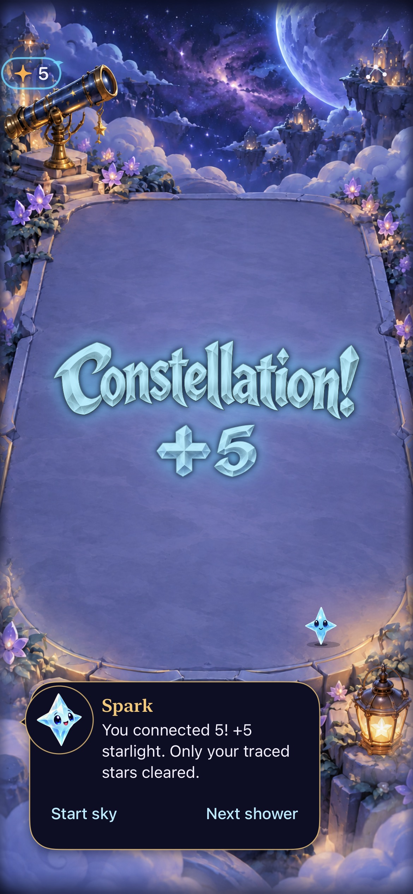
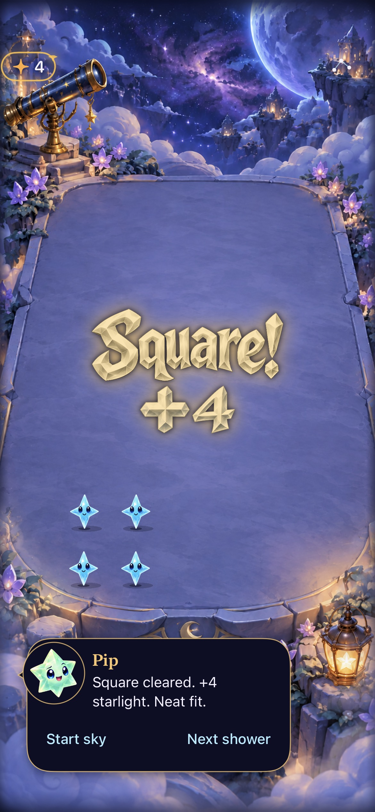
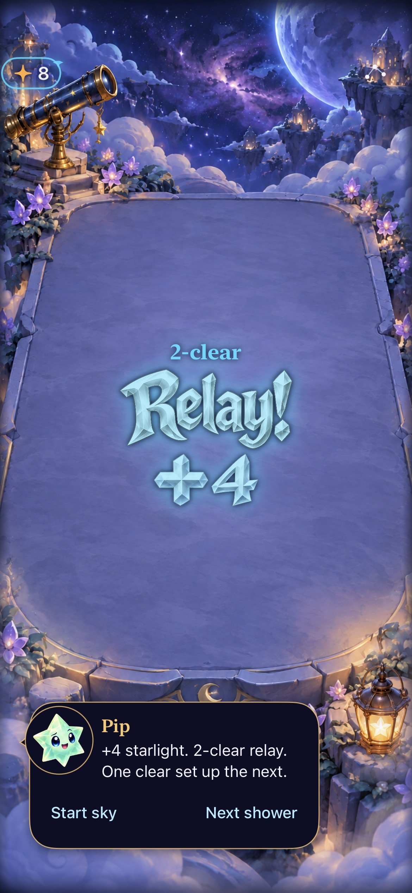

# Crystal Comet lettering is integrated

**Result:** Verified development integration; physical/RC acceptance separate · **Owner:** current implementer · **Date:** October 18, 2026

The user-selected crystal lettering now appears in the normal Debug/Release game: five illustrated title cutouts, matching composable score glyphs, actual harvested-family colors and the central theatrical entrance/hold/dissolve. The immediate score, exact award, rule/save/input owners and current critical-mass behavior remain authoritative. No new reward, target, SDK, font dependency or network feature.

**Next action:** at the next phone/RC review, assess repeated-play feel, dense-board distraction and compact-phone readability. Actual VoiceOver is deferred to RC; not run on this development build. No physical phone installation or haptic/audio audition is claimed.

## Outcomes against acceptance

| Criterion | Observed result |
| --- | --- |
| Selected designs and live values | All five packaged title images and all twelve digit/sign crops pass hosted validation. Repeated digits retain distinct stable identities; exact positive values compose without truncation. Existing recipes and causal relays retain their classifications. Native rendering samples show square, cross, constellation, relay and ordinary awards; the Brilliant asset is validated but not separately retained as a full-game frame. |
| Source-family color and bounded work | Immutable pre-clear contributor identity/reward controls the palette and intensity. Five title materials and twelve glyphs load/crop once; both complete-family success and failure are cached. No art generation or raster scan occurs in the timeline. Neutral PNGs are unchanged copies of generated production art; six Release resource names were independently found in `Assets.car`. |
| Input, interruptions and saves | Existing receipt tests cover independent rapid clears, replacement, zero reward, restore, settings, motion, restart, geometry, shower cancellation and stale callbacks. Seven native checks pass across the source contexts below, including the current critical-mass rescue tap, actual gestures, short trace cancellation, settings/background, normal/largest text, system Reduce Motion and First Light win/replay/full-sky ending/restore. |
| Native presentation | Inspected default-text native hosted captures below show clean silhouettes, correct colors/values, central placement and visible header/menu/dialogue/actions. Shared board/native hit mapping is unchanged. Timed normal-motion rendering samples are evidence of rendered effects, not measured smoothness or enjoyment. |
| Accessible fallbacks | Accessibility text sizes retain the native exact award; unsupported catalogue copy, unusually long awards or a missing/malformed family also fall back to native text. Native result/score semantics and dialogue speech stay unchanged; decorative art is hidden. Normal/quiet render checks and native largest-text/Reduce Motion checks pass. Full actual VoiceOver remains an RC gate. |
| Rules, build and checks | Reconciled with main `c2695e6`: 160 core tests, a final full 247-case hosted run and seven native checks across the recorded source contexts pass, zero failures/skips. Debug and Release simulator builds pass. Core, stores, save contracts, catalogue copy and input rules have no feature diff from that main. Hygiene, diff and changed local links pass. |

## Inspected native captures

| Constellation | Square | Relay |
| --- | --- | --- |
|  |  |  |

**Runtime evidence — not concepts.** Real `FallingSkyView`, store and SpriteKit presentation hosted in a native UIKit window; source `2cfe95c`, iPhone 17e / iOS 27.0, default text, normal effects. Authored non-saving fixtures and a manual shower clock isolate the event; animation uses the real scene. Samples are sparse and do not certify a dense/danger board, all supported screens or physical feel. Raw PNG attachments remain in ignored artifacts; retained JPEG exports preserve the full frame.

The [approved design sheets](../../design/celebration-lettering/crystal-comet-01/README.md) remain concepts. Runtime master PNGs are neutral so one title can take any harvest color; colored concept rows do not permanently assign colors to achievements. PNG illustration preserves the selected painted facets; no SVG/path or font-file authorship is claimed. [Production prompts and registrations](../../../Artwork/Celebrations/README.md) document the package.

## Verification context and reproduction

**Source:** clean runtime/test commit `2cfe95ca895f617416fd1c4b2b8ac4e2aadc22c1`, containing accepted main `c2695e6835750ab30ec5203a755101b8e80235c9`. Documentation/provenance/evidence and the test-only reconciliation described below followed; runtime inputs remain byte-identical. [source.json](source.json) records changed build-input hashes, the complete runtime/test fingerprint and capture hashes. The publishing step verifies uploaded Git blobs and the resulting Git tree against the local final tree, so connector-generated commit metadata does not change tested runtime bytes.

**Environment:** Xcode 27.1 (27A9275), Swift 6.4, arm64; task-owned Starfall Harvest Feedback QA, iPhone 17e / iOS 27.0 (24A434), UUID `3447731D-D3C6-4DBC-A823-52E1C84C2A5B`. No other simulator reset, normal-save migration or phone operation.

Raw output is ignored `artifacts/crystal-lettering/`: `reconciled-core.log`, `reconciled.log`, `Reconciled.xcresult`, `reconciled-summary.json`, `reconciled-release.log`. The final result bundle reports 251 passes: 245 hosted plus six native, zero failures/skips. Core is separate. Release asset membership was checked with `xcrun assetutil --info .../Starfall.app/Assets.car`.

```sh
swift test --jobs 2
xcodebuild -project Starfall.xcodeproj -scheme Starfall -configuration Debug \
  -destination 'platform=iOS Simulator,id=3447731D-D3C6-4DBC-A823-52E1C84C2A5B' \
  -derivedDataPath artifacts/harvest-feedback/DerivedData -jobs 2 \
  ARCHS=arm64 ONLY_ACTIVE_ARCH=YES CODE_SIGN_IDENTITY=- CODE_SIGNING_ALLOWED=YES \
  DEVELOPMENT_TEAM= CODE_SIGN_STYLE=Manual -parallel-testing-enabled NO \
  -collect-test-diagnostics never -only-testing:StarfallAppTests \
  -only-testing:StarfallUITests/SkyTechniqueInteractionTests/testTapRecipesRelayWithoutAnyModeOrMenuToggle \
  -only-testing:StarfallUITests/SkyTechniqueInteractionTests/testSwipeSpendsFiveFromSixAndShortTraceCancels \
  -only-testing:StarfallUITests/SkyTechniqueInteractionTests/testSettingsAndBackgroundLeaveGesturesReadyWithoutRetoggling \
  -only-testing:StarfallUITests/ResponsiveInputUITests/testSixteenPointOrdinaryDriftClearsOnceAtNormalAndLargestText \
  -only-testing:StarfallUITests/FallingSkyInteractionTests/testSystemReduceMotionKeepsManualPlayWorking \
  -only-testing:StarfallUITests/SkyFlowInteractionTests/testFirstLightWinReplayAndFullSky \
  -resultBundlePath artifacts/crystal-lettering/Reconciled.xcresult test
```

Release: same scheme/project, `-configuration Release -destination 'generic/platform=iOS Simulator' -derivedDataPath artifacts/crystal-lettering/ReleaseData -jobs 2 ARCHS=arm64 ONLY_ACTIVE_ARCH=YES CODE_SIGNING_ALLOWED=NO build`. System motion tests restore the original setting; normal tests do not force quiet mode to pass.

## Corrections and remaining limits

The initial integration build caught a parenthesis typo before tests. Initial new title/glyph/cache checks passed. The full-game render probe assumed white ink and failed for the intentionally family-colored art; inspected native captures established that it was visible. Its same region, extra-pixel requirement and threshold are retained, now detecting brightness in any color channel. No state/value assertions or gameplay waits were relaxed.

The first broader hosted run passed 240/241. An unchanged historical gravity fixture expected “captive”; current main's untouched catalogue says “trapped star.” The correction checks the exact current help sentence and retains both no-double-spend state assertions. Main's [critical-mass evidence](../critical-mass-2026-10-18/README.md) independently records this earlier baseline exclusion. The subsequent full suite passes without exclusions or retries. First checkpoint (main `1ed6290` ancestry) had 152 core / 241 hosted / six native passes; all relevant checks were rerun after preserving current main's critical-mass and gesture code and project membership.

The same alpha-bound scan now has one shared owner for jewel and lettering assets. Its source-coordinate/fringe regression and existing material tests pass. The final atlas uses explicit optical row registrations rather than pretending generation yielded a perfectly uniform grid. No per-frame trimming or procedural artwork was introduced.

Central art temporarily occupies some playfield space. Sparse/default-text appearance is verified; dense-board comfort, compact/large-phone visual inspection, localized-art design and physical repeated-play preference remain follow-ups in [Engineering](../../ENGINEERING.md). Native text is the production fallback where illustrated copy cannot be used. The app's canonical updater remains the only future phone-delivery path.


### Final test-only main reconciliation

Before publishing, main advanced to `dc0b3f2` (#99), adding one hosted contact-admission regression and documentation. Merge `9927b85` preserves it. `git diff 2cfe95c..9927b85 -- App Sources Config Starfall.xcodeproj Package.swift` has no non-documentation changes; previous runtime, core/build/native evidence remains applicable. The new `ResponsiveInputTests/testShowerBetweenReadinessQueryAndContactDoesNotQueueAStaleClear` passes on that merged source (`contact.log`, `Contact.xcresult`, one pass, no failures/skips). Thus all 246 current hosted cases have passed: the full 245-case run above plus the one added case. No full-suite or native repetition was needed for a test/documentation-only change. [source.json](source.json) records both source contexts and the added test-file hash.


### Publication checkpoint after evolving-star main

Main `569baa6` (#100) changes only the independent evolving-star shader/cues, its focused tests and documentation. Merge `e7666c1` preserves it. On that clean candidate, the complete **247 hosted tests** pass and `CriticalMassInteractionTests/testRescueRemainsARealScoringTap` passes (the seventh native check). Current Debug and Release builds pass. Raw output: `publication.log`, `Publication.xcresult`, `publication-release.log`. Core sources are unchanged from the 160-pass run. The earlier six native flows retain their explicit `2cfe95c` source; input rules, save owners, lettering, receipt lifecycle and their tests are unchanged. No full VoiceOver or physical review is inferred. [source.json](source.json) records the final runtime/test fingerprint. The retained frames above show the unchanged lettering renderer at their original source, not the newer pressure-warning appearance; main’s [evolving-star frames](../stellar-evolution-2026-10-18/README.md) own that visual evidence.
