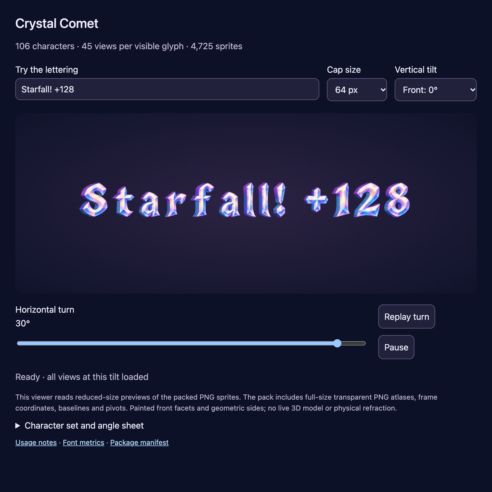

# Complete crystal-depth alphabet sprite pack

**Result:** Verified as an asset deliverable · **Owner:** current implementer · **Date:** October 18, 2026

The user selected depth from the [Relay! / +128 comparison](../../design/celebration-lettering/motion-specimen-01/README.md). The [Crystal Comet package](../../../Artwork/CrystalComet/README.md) now provides 106 characters, including space, with 45 views for each of 105 visible glyphs: **4,725 sprites**. Asset integrity, browser playback and layout checks pass. This is an offline handoff; no native import, gameplay or device-performance claim is made.

**Next action:** none for the requested pack. If app integration is requested, verify bounded texture loading, actual text sizes, native interruptions and motion before adoption. The experiment register records that boundary.

## Outcomes against acceptance

| Criterion | Observed result | Evidence / limitation |
| --- | --- | --- |
| Full character coverage | Passed: 95 printable ASCII characters plus 11 typographic/math symbols; space is metrics-only | [Metrics and angle index](../../../Artwork/CrystalComet/pack/font.json) |
| Every glyph at every angle | Passed: 15 yaw values × three pitch values; nonempty, non-overlapping rectangles, transparent margins, maximum texture edge 1536 | [Asset validation](../../../Artwork/CrystalComet/pack/validation.json) |
| Stable animation layout | Passed: invariant advances, baseline and pivot identities across all 4,725 frames | Frame metadata and validator; proportional and optional tabular digit advances |
| Visual inspection | Complete front contact sheet and nine representative angle samples inspected; source repairs below | [Character sheet](../../../Artwork/CrystalComet/pack/previews/character-set.png), [angle sheet](../../../Artwork/CrystalComet/pack/previews/angle-views.png); small native text remains unverified |
| Animation and interruptions | Passed: changing sprite pixels, pause, replay ending at front, pitch changes stopping playback and rapid changes settling on the latest plane | [Browser checks](../../../Artwork/CrystalComet/pack/browser-validation.json); offline file playback also passed |
| Layout and accessibility | Passed: 27 viewport/yaw/pitch combinations without edge clipping or page overflow; static reduced-motion start, keyboard angle control and explicit unsupported-character message | 900/390/320 CSS px; no actual VoiceOver acceptance |
| Package integrity | Passed: source hashes, closed manifest roster and every packaged file hash; ZIP entries also checked against that manifest | [Manifest](../../../Artwork/CrystalComet/pack/manifest.json); ignored handoff archive under `artifacts/crystal-comet/` |
| Repository checks | Passed: hygiene and whitespace | `python3 scripts/ci-hygiene.py`, `git diff --check` |
| Rules, saves, native builds and physical delivery | Not applicable to this handoff: app inputs unchanged | No Core/Swift/asset-catalog/project/build-setting changes; no app installation |

**Browser asset preview — not native gameplay evidence.** Chrome 155.0.8059.85, 900×900 CSS pixels, 2× raster, 64-pixel cap setting, +30° yaw and zero pitch. The separate playback assertions establish changing frames and a bounded stop. The still does not establish motion comfort.

## Verification context

**Source:** base `0d28c5089c4a34e8f210c35a0157988b47aaffc5` plus snapshot `bbdb9c13081f`. [snapshot.json](snapshot.json) fingerprints 161 relevant source and rendered-input files and the capture. Dirty work consists of the new package, retained motion specimen and linked documentation; the application is unchanged. This is working-tree evidence, not a clean published-commit acceptance.

**Environment:** macOS 27.0.1 (26A434), Node 24.22.0, sharp 0.35.5, @napi-rs/canvas 0.1.100, Playwright 1.62.1 and installed Chrome. The optional `game-dev` CLI was unavailable; the checks used the repository's retained local packaging scripts. No external SDK or app dependency was added.

Commands and ownership are in the [build README](../../../Artwork/CrystalComet/build/README.md). The browser suite used loopback for canvas pixel inspection and separately tested direct `file://` opening. Temporary logs and the first capture remain disposable under `/tmp`; the selected capture above is retained. Markdown source, links and embedded image assets were checked; a rendered Markdown document review was not run.

## Repairs and practical limits

The first generated question mark and division sign joined their separate components; replacement sources now preserve two and three components respectively. The first capital Z resembled a numeral 2 and was replaced with a clearly angular Z. The original ten approved specimen source glyphs remain authoritative.

Export validation then reproduced a front-view join between the exclamation mark and its dot. The renderer expanded the bevel outside the source contour, shrinking narrow gaps at normalized text size. Removing that expansion at the shared geometry boundary preserves the front silhouette. Regression checks cover detached components in `! ? ÷ % : ; i j " “ ” …` as well as margins and pivot identities for every frame. Geometric overlap at oblique angles and tiny-scale legibility still require visual judgment.

Two verification defects were also corrected: WebP delay must be specified for every source frame, and its encoder coalesces identical consecutive views, so the animation check verifies the preserved 3.08-second duration and populated frame sequence. The preview now marks playback active synchronously; the replay check waits for both start and completion. Initial file-origin pixel inspection was blocked by canvas security; loopback inspection and separate offline loading cover those distinct cases.

The full PNG atlases total about 116 MB on disk before previews and metadata. This is a source-resolution handoff, not a native memory budget: import only needed angles through a bounded cache. Front facets are painted and sides are geometric, with no physical refraction. Accented alphabets and a comprehensive kerning table are outside this package.
