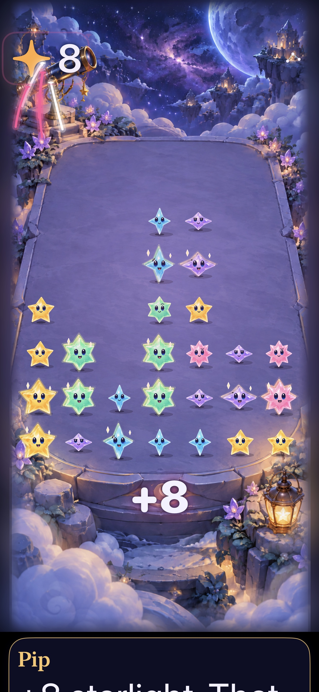

# Crystal-depth lettering on current main

**Result:** Verified in Simulator and installed through the canonical updater · **Date:** October 18, 2026

The approved alphabet renderer is combined with main `c10d409`, including aging retirement, immediate swipes, bounded follow-up input, edge forgiveness, hold feedback and quiet-input response. Local runtime/test source `b6e1d45ee98040b96191ac4cdb0a09398feccf85` has build identity **dev.b7e6e39e20**. The lettering adds no rule, save-schema or input change. [Integration metadata](integration.json) records source identities and captures.

## Verification

| Check | Result and scope |
| --- | --- |
| Core | 169 passed on `1888e98`; Core/package/test inputs are unchanged through `b6e1d45`. `/tmp/crystal-depth-current-main-core.log` |
| Full hosted suite | 287 passed, no failures/skips, on final runtime/test inputs. `/tmp/crystal-depth-final-hosted.xcresult` |
| Final native interactions | Seven passed across `/tmp/crystal-depth-final-interaction.xcresult` (six) and `/tmp/crystal-depth-final-large-text.xcresult` (one): automatic rain/rapid taps, system Reduce Motion, settings/background, exact five-star held trace/cancel, recipe/relay, immediate same-color swap followed by held drawing, and normal/largest-text tap drift |
| Endings/restart | First Light win, full sky and replay passed in the earlier seven-test integration run on `e809c98`; the final hosted suite covers current committed flow/save behavior. This native ending run predates the subsequent input improvements. `/tmp/crystal-depth-shipping-interaction.xcresult` |
| Debug / Release | Final Debug compiled and ran in native tests; Release simulator build passed. Compiled Release catalog contains all fifteen atlases and metrics, with no retired Celebration materials. |
| Hygiene | `python3 scripts/ci-hygiene.py`, `git diff --check` and resource membership checks pass |
| Physical feel / actual VoiceOver | Not measured; full VoiceOver remains RC work. Installation is recorded separately after canonical delivery. |

Environment: Xcode 27.1, iPhone 17e simulator `07A4D3FE-01D2-4A12-AB14-8D30399A71A3`, iOS 27.0, `Starfall` scheme, arm64. Commands use `xcodebuild -project Starfall.xcodeproj -scheme Starfall -configuration Debug -destination 'platform=iOS Simulator,id=07A4D3FE-01D2-4A12-AB14-8D30399A71A3' ARCHS=arm64 ONLY_ACTIVE_ARCH=YES test` with the selections above. Release uses `-configuration Release ... build`; DerivedData is `artifacts/crystal-depth-native/XcodeDerivedData`. Raw output is disposable under `/tmp` and ignored artifacts.

The final hosted run began while two documentation-index merge conflicts were being resolved; runtime and test inputs were already identical to the subsequently committed `b6e1d45`. Native interaction and Release checks used that committed source. Subsequent edits only add documentation/captures. Publication must verify the remote Git tree equals the final local tree.

An integration run exposed the old crowded fixture's dependence on automatic aging: seed 28 after 29 showers is now terminal. Its current 12-shower history has 33 stars, the same exact +8 clear and an independent match. Main independently adopted that fixture correction; this branch also asserts aging is disabled. The complete final suite passes without reduced-motion forcing or weakened award/input assertions. The largest-text UI selector was renamed upstream from sixteen-point to seven-point drift; it was run separately under its current name and passed.

## Inspected current captures

 

**Native hosted captures, final runtime/test source; JPEG exports of the inspected XCTest PNGs.** The dense live fixture uses normal animation. The lettering settles visibly; the existing central placement briefly overlaps surviving stars. At maximum text, the native award sits below the board and the dialogue continues below the viewport. These frames establish sampled appearance, not physical comfort, measured memory or frame-time acceptance. Earlier images in the [original integration report](README.md) retain their original source and historical context.

## Verified phone delivery

[PR #140](https://github.com/lbeezr/starfall/pull/140) merged as `30384df4a4b5d80fc192f2ab78858cada35ab7ce`. Published tree `f257e6627cfef75572a748bde55947355d72a4c4` exactly matches local final `c873777`; the connected GitHub app changed commit metadata, not tested contents. The canonical updater archived that current main, passed 169 Core tests, built and verified the signature, then installed **dev.b7e6e39e20** over `com.starfall.prototype` on the configured physical iPhone. The OS-owned app inventory matched both the installer location and bundle version 1.

Remote main CI was pending at installation, as permitted for development delivery; this is not a remote-CI pass. The updater did not launch, reset or uninstall the app. Actual installation is verified; on-phone gameplay, memory/frame timing, human comfort and actual VoiceOver remain unverified. The next action is ordinary human play with the accepted lettering; retain the existing physical/dense-board and RC follow-ups. No deployment tooling changed.

Local receipts: `installed.json`, `installation.json`, `apps.json`, `status.json`, `core-tests.log` and `build.log` under `~/Library/Application Support/Starfall Device Updates/`. The compact metadata records identities and match results without publishing the device installation path.
