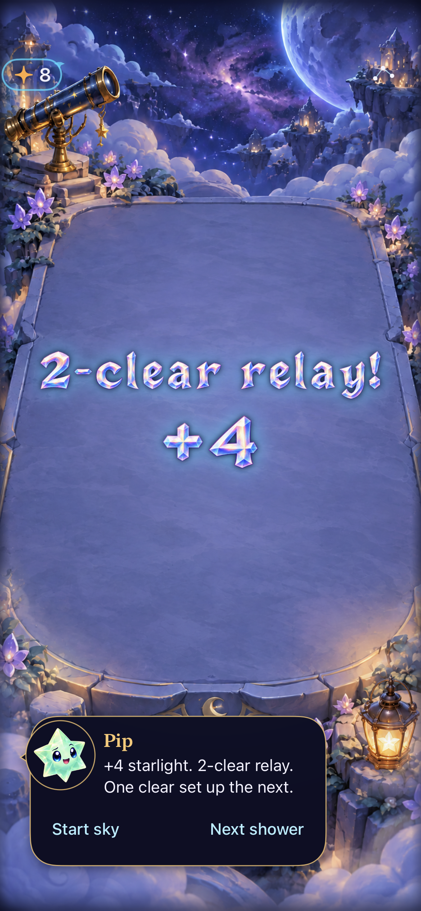
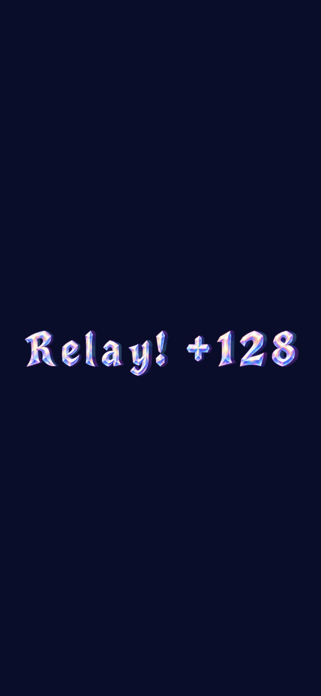
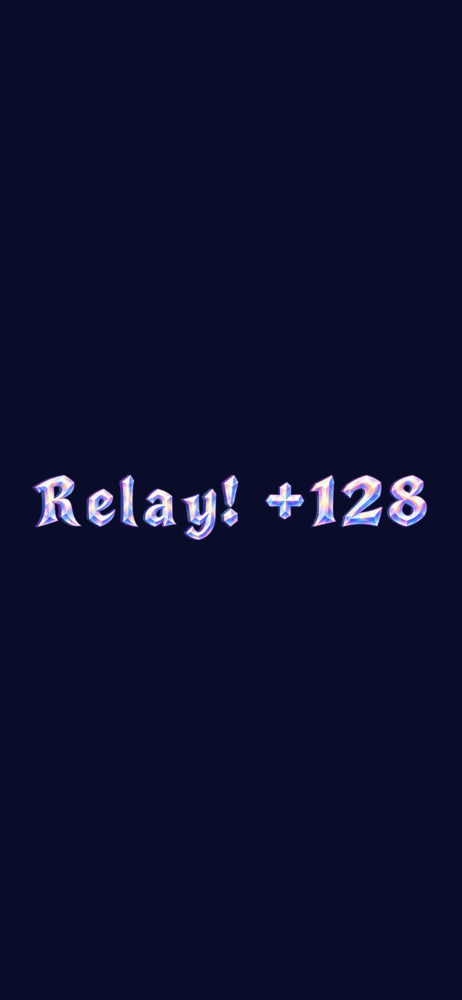
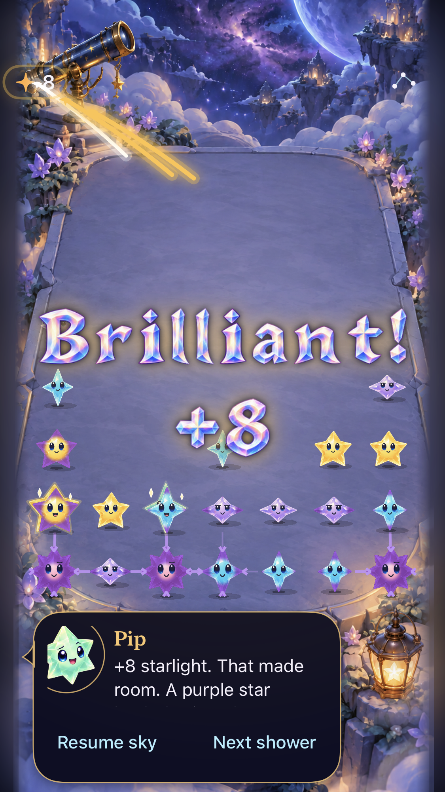
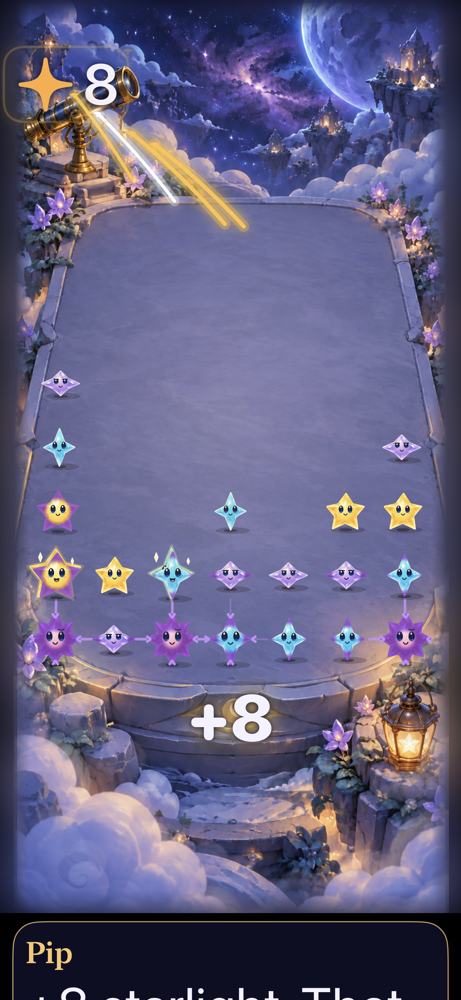

# Crystal-depth lettering in normal Starfall

**Result:** Verified in Debug/Release Simulator · **Owner:** current implementer · **Date:** October 18, 2026

The user approved using the [complete alphabet pack](../../../Artwork/CrystalComet/README.md). Score popups and celebration titles now compose the exact catalogue text from opalescent glyphs. Each letter turns briefly and settles to its front view using the existing receipt age. Quiet modes stay front-facing; accessibility sizes and unsupported text use the existing native fallback. No score, save, input, shower or receipt-lifecycle rule changed.

The normal app contains all 106 characters in fifteen horizontal views, derived from the approved full pack. The compact profile replaces the six former static title/digit assets. It uses 20,974,327 PNG bytes and 54,263,808 bytes of atlas RGBA pixels, below the explicit 64 MiB raster ceiling. This is an image-storage budget, not a measured process/GPU memory peak. The original 45-view pack remains the authoring master.

**Current-main follow-up:** [Shipping integration and current captures](INTEGRATION.md) records reconciliation and final checks. The original working-tree evidence below retains its source; physical/RC limits remain separate.

## Native appearance

**Native hosted game capture:** iPhone 17e simulator, iOS 27.0, normal motion, default text, working-tree snapshot `90d8d993cf63`. The relay title includes its exact committed count; the native header and accessible dialogue retain the authoritative score.

 

**Native rendering samples, not smoothness certification.** The renderer test compares pixels at three presentation ages and verifies distinct normal frames, identical quiet frames and a shared final front view. Separate full-game tests run the normal receipt timeline and capture its changing scene. These stills alone do not prove physical motion comfort.

## Outcomes against acceptance

| Check | Result | Scope |
| --- | --- | --- |
| Core | Passed: 165 tests | `swift test`; unchanged rules and save implementation |
| Focused native hosted | Passed: 20 tests, zero failures/skips | Complete alphabet/view membership, exact awards/catalogue text, stable layout, cached missing/malformed resources, finite turn/settle, rendered frame differences, receipt cancellation/replacement and full-game award visibility |
| Compact/large/maximum text | Passed automated host checks; selected captures inspected | 375×667 and 430×932 host bounds, default and accessibility5 text; source-bound host coverage, not compact hardware certification |
| Native interaction | Passed: seven tests, zero failures/skips | Seven selected native flows: automatic rain/rapid taps, recipe/relay, trace/cancel, settings/background, normal/largest touch, First Light win/full-sky/replay and real system Reduce Motion |
| Debug simulator build/run | Passed | Xcode 27.1, arm64, iOS 27.0; actual launch and screenshot inspected |
| Release simulator build | Passed | The compiled Release asset catalog contains all fifteen atlas names and metrics; retired static materials are absent |
| Resource integrity | Passed | Every native output hash and retired original asset hash matches; existing asset catalog supplies target membership |
| Hygiene/whitespace | Passed after final documentation | `python3 scripts/ci-hygiene.py`, `git diff --check`; local documentation links and source fingerprints also checked |
| Actual VoiceOver | Deferred to RC; not run on this development build | Native labels, accessibility-size fallback and quiet presentation preserved |
| Physical delivery/performance | Not run | No phone installation or measured physical memory/frame-time claim |

## Source and reproduction

Base `0d28c5089c4a34e8f210c35a0157988b47aaffc5` plus [source.json](source.json), snapshot `90d8d993cf63`, runtime fingerprint `dev.f6b2c29f8f`. This is dirty-working-tree evidence. Changed runtime inputs are `CrystalCelebrationArtwork.swift`, `StarlightCelebration.swift`, `StarfallTheme.swift`, the fifteen atlas image sets and one metrics dataset, with six former material sets retired outside the app. The associated hosted test file, native packaging script and hashes are included in the snapshot. The larger offline pack and documentation are not app runtime inputs.

The [native contract](../../../Artwork/CrystalComet/NATIVE.md) defines acceptance. `build/native.cjs` checks the sealed pack manifest, derives the native assets, and records [profile provenance](../../../Artwork/CrystalComet/native-profile.json). The family prewarms decoded atlas sources and cropped glyph references once, including failure; animation ticks only select existing images and apply stable layout. No new framework, network feature, pilot route, app target or save field was added. Retired original material bytes and their former paths remain in [the archive mapping](../../../Artwork/Celebrations/retired-v1/retirement.json).

XcodeBuildMCP used `Starfall.xcodeproj`, scheme `Starfall`, dedicated simulator `07A4D3FE-01D2-4A12-AB14-8D30399A71A3`, `ARCHS=arm64 ONLY_ACTIVE_ARCH=YES`, and `artifacts/crystal-depth-native/XcodeDerivedData`. Hosted selection: `StarfallAppTests/CrystalCelebrationArtworkTests` and `StarfallAppTests/StarlightCelebrationTests`. Raw results and attachments are under ignored `artifacts/crystal-depth-native/`; only selected inspected images are retained here.

Initial builds requested an x86_64 app slice while SwiftPM supplied only the active arm64 Core module. Selecting the actual simulator architecture resolved that build invocation mismatch without project-setting changes. The sandboxed core command could not write compiler caches; the authorized standard-cache run passed. Xcode emitted one generated `program_source` unused-variable warning in the hosted run, with no application-source diagnostics. The first native exporter exceeded an initial 48 MiB estimate; the documented ceiling is 64 MiB, with the final measured pixel roster at 51.75 MiB.

## Remaining visual limits

 

**Inspected normal-motion hosted samples.** The existing central placement still overlaps survivors during the entrance and partly overlaps one survivor in the later Brilliant +8 sample; an independent lower match remains visible and Store-admissible. This was already recorded for the previous lettering. The larger-text fallback remains below the board. Keep the [engineering follow-up](../../ENGINEERING.md#crystal-comet-physical-and-dense-board-review--october-18-2026): repeated automatic play and physical recognition, memory and frame-time review before RC. No physical enjoyment, full-board readability or measured smoothness claim follows from this change.
