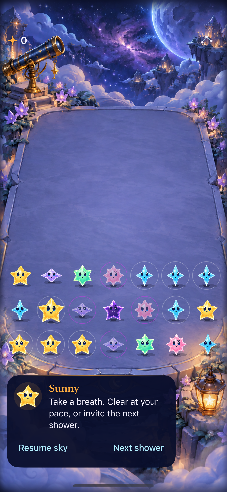
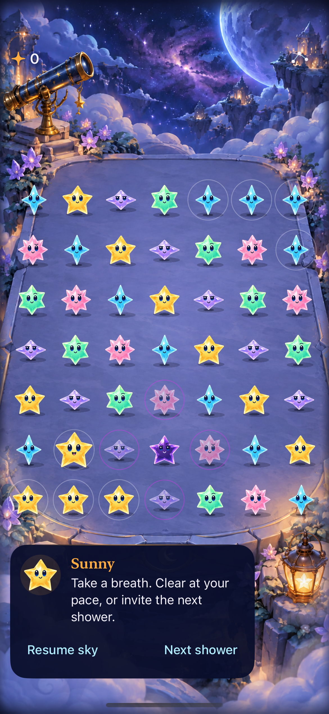
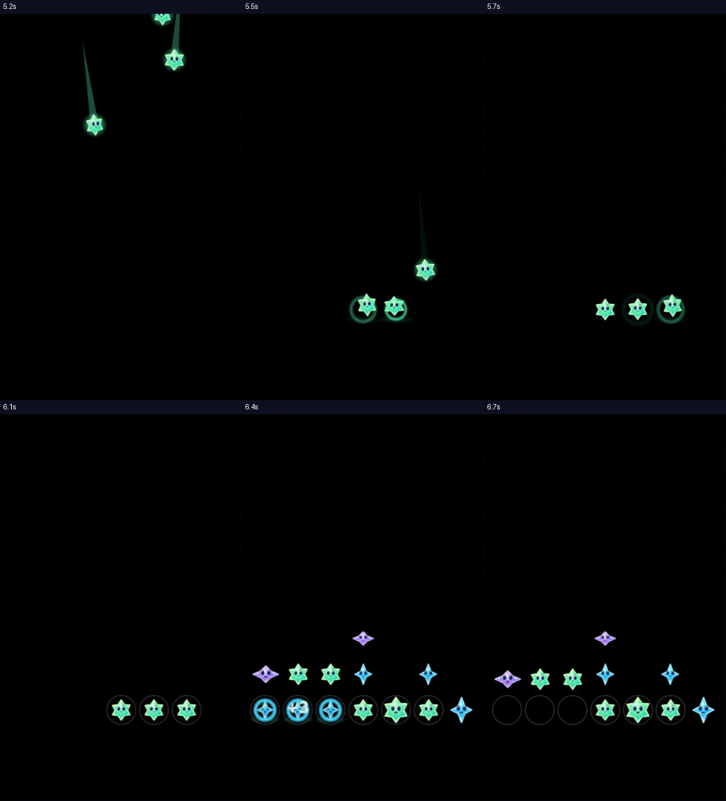

# Crystal Glow in the real game

**Result:** Partially verified · **Date:** October 17, 2026

The approved Crystal Glow direction is integrated into the shared cast factory for board stars, falling stars, HUD and previews. Six packaged crystal bodies receive larger blue eyes, four expressions and shallow left/right turns. Dark contact cores and softer floor shadows follow actual body height and grown size. Rules, saves, RNG and shared Observatory hit geometry are unchanged.

**Limits:** The existing largest-text edge-tap and actual VoiceOver-focus checks fail on both this candidate and clean main. They remain release follow-ups; this is scoped cast integration, not whole-app accessibility approval. Physical-device performance and human play acceptance are not established.

## Native result

| Sparse | Dense |
| --- | --- |
|  |  |

**Native captures — not concepts.** Source `6cc9efd`, iPhone 17e / iOS 27.0, dedicated simulator `D65C5E40-734F-42BF-8F91-97E980ED19C2`. Actual-size sparse/dense captures were inspected, including Nova's low silhouette, Dusk contrast, grown size and unobscured faces. Rendered controls and native corner taps were checked separately.

**Native renderer export:** same source/device. Small samples are 24/36/44 points; twelve-frame individual sheets are retained in the local xcresult. They do not prove motion.

**Native video samples, same source/device:** inspected 100ms-spaced frames from 5.2–6.7 seconds of the recorded hosted test, then retained six representative frames. Falling stars, landing/rebound and clearing are visible without the previous texture-size jump. Black is the test SKView background; this is not a product-screen mockup or evidence of the whole environment's motion. Automated sampling independently checks sprite bounds throughout flight and expression changes.

## Verification and source

The final app/test source is clean commit `6cc9efd`; [source hashes](source.json) cover app assets, app/test sources, configuration, core and project membership. Later evidence/documentation edits do not affect these binaries. The clean-main comparison is `6fdb8d050c5eefb50b5f347a4e7a33f580501853`, exported with `git archive`. Xcode 27.1 (27A9275), Swift 6.4; ARM64 simulator, shared scheme Starfall.

All native commands use `-project Starfall.xcodeproj -scheme Starfall -destination 'platform=iOS Simulator,arch=arm64,id=D65C5E40-734F-42BF-8F91-97E980ED19C2' ARCHS=arm64 ONLY_ACTIVE_ARCH=YES CODE_SIGN_IDENTITY=- CODE_SIGNING_ALLOWED=YES DEVELOPMENT_TEAM= CODE_SIGN_STYLE=Manual`. Test commands also use `-parallel-testing-enabled NO`. No device signing or new SDK/dependency is involved.

| Check | Source, command/scope | Result |
| --- | --- | --- |
| Core | `swift test`, integrated core unchanged | 61 passed, zero failures |
| Final hosted | `6cc9efd`, Debug `test`; StarCastTests, FallingSkyStoreTests, ObservatoryGeometryTests; derived data `/tmp/starfall-crystal-final`, result `/tmp/starfall-crystal-acceptance.xcresult` | 35 passed, zero failures/skips, including full-motion landing/contact sampling, 72 material slots, identical expression alpha, geometry/pivot, resource packaging, bounded reuse, body/growth shadow offsets and interruption/save checks |
| Final native interaction | Same result; sparse/dense projected corner taps, settings/background preservation, HUD/help/balance/menu flow | Three passed, zero failures/skips |
| Normal-mode precondition | `6cc9efd`, separate ObservatoryReviewSetupTests invocation, `/tmp/starfall-crystal-normal-setup.xcresult` | Passed; actual VoiceOver service disabled and actual system Reduce Motion off on this disposable QA simulator. Quiet-mode tests retain their own separate runs. |
| Final automatic native play | `6cc9efd`, automatic rain/pause/growth/clear/replay/settings native method, `/tmp/starfall-crystal-motion.xcresult` | Passed; recorded to ignored `artifacts/crystal-glow/normal-play.mp4`. This flow also exercises Calm effects; its recording alone is not full-animation evidence. |
| Full-motion renderer | Same source; `StarCastTests/testAnimatedLandingsNeverExpandToTheTextureCanvas`, `/tmp/starfall-crystal-renderer-motion.xcresult` | Passed without skips. Recorded the actual hosted SKView to `artifacts/crystal-glow/renderer-motion.mp4`; this is the renderer test window, not a product-screen recording. |
| Release | `6cc9efd`, `-configuration Release build`, derived data `/tmp/starfall-crystal-release-final` | Passed; Debug compilation also passes through the final test build |
| Broad interaction matrix | Earlier clean candidate `5b4ab49`, `/tmp/starfall-crystal-final.xcresult` | All eleven FallingSkyInteractionTests passed (automatic/manual rain, rapid input, growth, clear, win/loss, restart, persistence, background/resume, feedback, settings, actual system Reduce Motion). Eight of ten Observatory methods passed; failures below. |
| Hygiene / packaging | `python3 scripts/ci-hygiene.py`, `git diff --check`; repeat `package_star_cast.py` using bundled Python/Pillow | Passed; repeating packaging leaves body bytes and receipt unchanged |

Raw logs/results are local `/tmp/starfall-crystal-*.log` and `.xcresult` paths; selected captures and source hashes are durable here. The first generic-architecture build failed resolving the ARM64 core module for an x86_64 app; explicit ARM64 builds passed. An earlier shared-simulator UI run was discarded when another Observatory build replaced the app. Only the dedicated simulator results above count as integration evidence.

## Baseline failures and matrix separation

The broad run failed `testLargestTextKeepsPropsAndPausedControlsReachable` at line 201: tapping the front-left cell did not produce the expected score. `testVoiceOverSpeechActivationPropsClearAndMenuFocus` failed at line 244: actual speech focused “Starfall terrace, seven columns…” instead of Sunny. Both failures reproduced in the clean-main export on the same simulator. The latter was already documented in the [Observatory adoption evidence](../observatory-adoption-2026-10-17/README.md). No hit/accessibility geometry changed in this cast work.

After that screen-reader run, the feedback test observed stop counts 3/4 instead of 1/2; clean main reproduced those counts. Existing `announce` stops audio while VoiceOver is running. Two normal-motion cast methods also skipped in that system state. The explicit disposable-simulator normal-mode setup now declares screen-reader and motion preconditions; the final 35 hosted methods then pass without skips or assertion changes. This does not fix actual VoiceOver navigation or establish a green full accessibility suite. The clean-main comparison logged all three method failures, then its runner stalled after tests; it was interrupted and left no readable xcresult, so the baseline comparison rests on source-bound text logs rather than a completed result bundle.

## Durable boundaries and remaining work

Independent generated pose cells can drift in alpha and pivot. The production boundary therefore uses one centered crystal body per family and source-atop face composition, keeping the existing bounded 72-material cache and geometry-preserving expression setter. Ground offsets come from one cached alpha-height measurement per family rather than the square texture canvas. Resting placement, growth, gravity movement, clear removal and rebuild paths were examined; native captures and all-family/growth assertions verify the demonstrated Nova gap correction, not all conceivable shadow behavior.

No board-depth scaling, rear-view animation, model rig or new permanent pilot route was introduced. The approved side/rear and stretch/squash paintings remain construction references; runtime uses the existing shallow turns and scene-owned motion. Trigger for true 3D: a gameplay requirement for profiles/rear views, followed by explicit mesh/atlas and native acceptance work. Next UI/accessibility work must resolve the baseline edge-tap and VoiceOver focus issues, then rerun those exact native cases; device profiling and family recognition in human play remain release checks.
