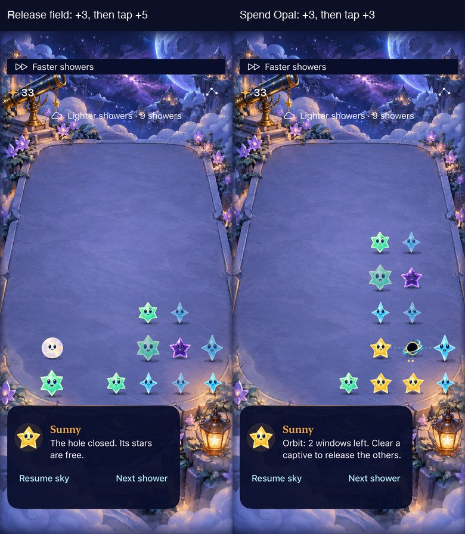
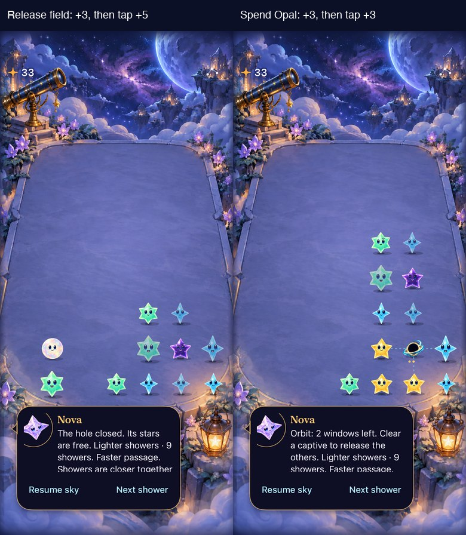
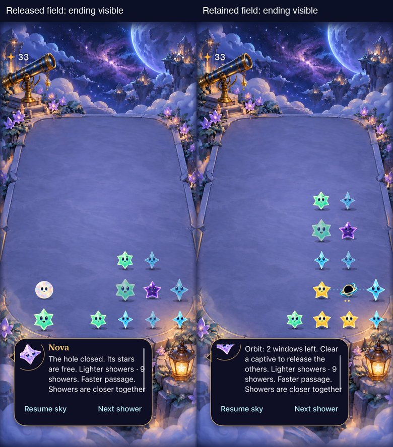
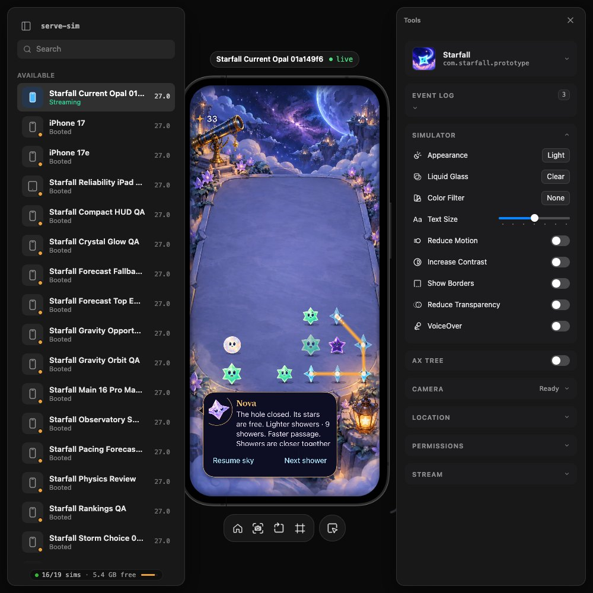

# Current-rule Opal choice through native input

**Result: Partially verified — native tap and curved-input paths pass; human recognition remains open · Owner: current implementer.** The current study's first equal-reward example is seed 180 / shower 12, with an occupied gravity field. Both first clears earn three light; the preserving branch offers six next, versus three after spending Opal. Verify the example in regular Starfall before using it as a comprehension comparison. No human result is claimed.

## Acceptance before implementation

- Reconstruct the full current-generation state using only its seven recorded legal clears over twelve seeded showers. Compare every encoded field to the study example, including RNG, incoming, orbit and cadence; do not inject a board/save.
- Use a named Debug-only reset fixture in the existing app. Preserve the older generation planning fixture as a historical rule regression; no separate app, player selector or production rule/save change.
- Core/hosted trace reproduces three-plus-six versus three-plus-three; native taps separately reproduce three-plus-five versus three-plus-three, unchanged clear preview/turn count, correct Opal consumption and valid save round-trip. Inspect initial and both follow-up screenshots with ordinary effects.
- A hosted deadline case explicitly records one intervening scheduled shower and exact Core parity; it does not stand for player speed. Keep normal presentation and test cancellation/restore siblings as relevant.
- Run Core, focused hosted/native tests, Debug/Release builds, hygiene and diff checks. Record source and missing animation, actual VoiceOver, physical and human preference evidence separately. Retain fixture only as reproducible native regression/comprehension tooling; adopt no new mechanic/tuning.

## Mechanism clarified during inspection

The preserving first clear is an Amber group that includes occupied orbit slots. It closes the field and settles Aqua into a five-star diagonal constellation worth six light. An ordinary Aqua tap collects only five. The remaining Opal belongs to a separate Mint group and is **not consumed by either follow-up**. This example therefore demonstrates the reward for field release and follow-up selection, with Opal preservation as a coincident property; it does not isolate a causal Opal benefit. Both the original study method and its retained snapshot remain unchanged.

The public XCTest coordinate API exposes one drag destination, not a waypoint sequence ([Apple reference](https://developer.apple.com/documentation/xcuiautomation/xcuicoordinate)). Do not represent the native two-tap test or hosted trace commit as a completed OS-level curved gesture. Curved-input acceptance remains open; existing straight native tracing is a sibling check.

## Verified outcomes and native appearance

**Runtime evidence:** Normal Starfall Debug app, current-generation reset fixture, iPhone 17e / iOS 27.0 (24A434). Both images follow the first three-light tap at score 33. Left: the hole is closed, Aqua has settled and Opal remains on the left. Right: Opal is gone and occupied field slots persist. The next ordinary tap collects five versus three. The image preserves each entire capture proportionally at 390 pixels wide; titles are QA captions, not in-game UI. The [initial native screen](initial.png) shows both initial three-light options. Inspected all three originals: visible targets remain above the footer, Opal is distinct and the paused guide explains field closure/persistence. These stills do not verify continuous motion or uncoached comprehension.

| Check | Result and evidence |
| --- | --- |
| Exact seeded reconstruction | Every encoded fixture field equals the discovery seed-180 snapshot, including RNG, orbit, preview, counters, generation and cadence; [hash/provenance](source.json). Seven committed actions over twelve showers, no state injection |
| Core | swift test: 110 passed, zero failures; /tmp/starfall-current-opal-core.log. New regression covers all three branches, retained Opal, field closure, stable clear preview/turn and valid JSON round-trip |
| Hosted / native | 10 passed, zero failures/skips; test_sim_2026-10-18T01-41-41-752Z_pid85535_35eb92bc.xcresult. Includes both native tap orders (38 versus 36 final light), existing straight Opal trace, native background/three-window expiry, six GravityStoreTests and the new one-due-shower/curved-trace Store check (39 final light, exact Core parity) |
| Build | Debug compiled through the tests; Release build passed, no warnings/errors; build_sim_2026-10-18T01-41-03-977Z_pid85535_8a8bc169.log. Existing Core file/project membership retained, fixture wholly inside DEBUG |
| Interruption / rapid input / saves | The hosted gravity batch checks restart/background/motion cancellation, rapid repeated clear rejection, saves before presentation and old-key preservation; native background/expiry also passed. Win/loss/settings flows were not rerun for this reset-only fixture; normal app routing is unchanged |
| Accessibility / motion | Native identity/value/button checks passed. Ordinary effects were retained; no new animation-frame or actual VoiceOver session, system Reduce Motion round or physical-device test claimed. RC acceptance remains separate |
| Hygiene | python3 scripts/ci-hygiene.py and git diff --check passed |

Tested product/test source is local **b6c4978**, based on main **7eeca12**, with documentation changes only during the native run. [Source hashes](source.json) identify all inputs; the source was committed while that same-byte run was active. Xcode 27.1 (27A9275), Swift 6.4, arm64 unsigned, Starfall scheme. Dedicated simulator D12E5EEC-D655-41F8-BF81-A81B27784253, DerivedData /tmp/starfall-current-opal-build. No normal-generation rule, schema, app resource, player route or phone save changed.

## Failed attempts and correction

The first run on simulator 536BCC00-751C-47BA-BC2F-C1702941CFC8 passed seven hosted checks but failed three UI checks (test_sim_2026-10-18T01-38-46-101Z_pid85535_3b4670e4.xcresult). Another live xcodebuild process was targeting that same simulator; a failure capture showed system Settings foreground while the app's score remained unchanged. These disrupted UI results were not accepted. A dedicated simulator initially could not boot because the machine reached its process limit (test_sim_2026-10-18T01-40-38-382Z_pid85535_7eae21ca.xcresult). Shutting down the idle historical Mechanics Lab, without erasing its data, freed capacity. The unchanged ten-check batch then passed on the dedicated simulator. No assertion, retry policy or motion preference was weakened.

One Release invocation supplied configuration both through defaults and extra arguments and was rejected before compilation. The profile configuration was then set once and the build above passed; it was restored to Debug afterward. Raw captures/manifests stay in the cited xcresult and /tmp/starfall-current-opal-native-attachments.

## Decision

Retain the bounded Debug history and regression. It makes the current combined field/clear-order choice reproducible, with native two-tap rewards and a separately verified stronger Core/Store trace outcome. Do not claim the curved OS gesture or pressure performance complete. Use ordinary fresh-sky observation first, then this prepared paused example only to distinguish seeing the opportunity from executing the path. Keep rules unchanged.

## Reconciliation with character dialogue

Main advanced to d45ed29 with character dialogue after the first native acceptance. Integration commit 8c02415 preserves that work and the current planning fixture. The only merge conflict joined independent appended Store-test extensions; both sets of assertions were preserved. The prior images/results above remain bound to b6c4978 until the integrated checks and captures below are recorded. Core and fixture bytes are unchanged by the dialogue reconciliation.

### Integrated result

**Runtime evidence:** integrated source **8c02415**, same dedicated iPhone 17e / iOS 27.0 simulator. Complete captures reduced proportionally to 390 pixels wide per side with QA title strips. Board outcomes and reachable native targets agree with the earlier comparison. Nova now speaks the committed field result and phase/timing together. The long body scrolls inside its bounded surface; these initial-position stills show only part of that text and do not establish full read-through. Actions stay outside the scrolling body. Curved OS input, physical feel and human comprehension remain unverified.

Final integrated focused run: **12 passed, zero failures/skips**, including the same ten checks plus main's dialogue save/deadline/restart and shared pressure/help-message regressions; test_sim_2026-10-18T01-45-41-253Z_pid85535_b5d89e56.xcresult. Release build passed without warnings/errors: build_sim_2026-10-18T01-47-32-308Z_pid85535_45e7fe0c.log. Core/fixture bytes are unchanged from the 110-test acceptance above. [Integrated source hashes](source-integrated.json) bind these results to main d45ed29 plus this bounded fixture/test work. No new app resource or membership change belongs to this workstream. The oversized Store-test file review is recorded in ENGINEERING.md; no unrelated test extraction was mixed into integration.

## Read-through follow-up: acceptance before testing

On source main 60bb9d6, check each current fixture follow-up's full scrolling introduction after the first native clear. A native upward swipe must expose the ending before the pinned actions; their frames and the committed board value must remain unchanged, all front stars must remain above the guide, and the next clear must still execute for the expected five/three reward. Capture and inspect both endings. This closes this fixture's read-through gap only; it is not actual VoiceOver or uncoached recognition acceptance. No product UI change is proposed unless the reproduction fails.

### Read-through result

**Verified for this normal-size simulator fixture:** two native tests passed, zero failures/skips, including both field follow-ups and the existing long-correction sibling. Native swipes reveal the complete ending “Showers are closer together,” with fixed reachable actions, unchanged board value and the correct subsequent native clear. Inspected both full captures; the retained-field introduction scrolls its portrait/name partly out of view while the ending remains clear above actions. No product UI fix was required.

**Runtime evidence:** main 60bb9d6, only UITests/ConstellationTraceNativeTests.swift changed; exact test hash, command selection, simulator/configuration and result in [readthrough.json](readthrough.json). Complete screenshots proportionally reduced to 390 pixels each with QA titles; the application content is unchanged. Result test_sim_2026-10-18T01-51-00-909Z_pid85535_ccb5e268.xcresult. Core/Release source is unchanged from the previous verified integration; Debug test compilation passed. Hygiene/diff passed. This closes the previously unverified full-read-through question for these two normal-text follow-ups. It does not establish maximum-text, actual VoiceOver, physical feel, curved OS tracing or human strategy recognition.

Core follow-up: swift test passed 110 tests, zero failures; /tmp/starfall-opal-guide-core.log. New retained capture naming follows SCREENSHOTS.md; snapshot 38edb5dd is the changed UI-test file hash prefix. No product surface changed, so the selected appearance index is unchanged. Earlier comparison frames remain unique source-bound evidence of the initial scroll position.

## Curved native input: nine-light branch verified

**Verified on the source-bound simulator; human recognition/comfort remain open.** The simulator-browser workflow supplied a real native HID path beyond XCTest's single-destination drag. On the prepared paused `opalStormPlanning` board, a browser tap at `(0,4)` earned three light and closed the field. A held pointer then followed `(0,4) → (0,5) → (0,6) → (1,6) → (2,5)` and released. Native accessibility reported **39 starlight**, up from 30 before the sequence, with one Opal retained and no hole. The follow-up therefore collected six light through curved OS input, not a direct Store/Core call.

**Runtime evidence:** serve-sim 0.1.48 mirrors the regular native app on the dedicated iPhone 17e / iOS 27.0 simulator. Orange trace follows the five Aqua stars at score 33. Browser tools show system Reduce Motion and VoiceOver off; Calm effects remained off. This is a scripted known solution on a paused fixture, not human learning or automatic-pressure performance. Full browser viewport retained; JPEG conversion only. [Native result](dev-49dcd0e__orbit-trace-nine-light__iphone-17e__default-text.jpg) shows score 39 and the six-light committed outcome. [Input/result/source record](curved-native.json) identifies the installed binary, source parity, tool version and raw script hash.

### Procedure and tool failures

Launched existing app with `--starfalls-reset --constellation-fixture=opalStormPlanning`. Playwright used installed Chrome, waited for the live simulator frame, enabled helper controls and stable canvas bounds, then mapped observed native accessibility button centers into the browser canvas. The first tap waited for native score 33 and ready five-light follow-up. A pointer down, four segmented pointer moves (12 samples each) and pointer up executed the trace. The final check waited for score 39 and enabled input, then counted the retained Orb and absent hole. No source/rule, quiet preference or game-state injection was used. Raw script remains at ignored `artifacts/opal-curved-native/gesture.cjs`.

The first browser readiness probe lacked bundled Chromium; using installed Chrome resolved it. Early clicks were logged by the browser but produced no native change, even at verified in-button coordinates. The tool's installed README documents Xcode 27 Device Hub disconnecting legacy input. Ran `serve-sim repair-input -d D12E5EEC-D655-41F8-BF81-A81B27784253`, restarting SpringBoard only on our dedicated simulator, then restarted the scoped server and relaunched the app. A browser Next shower click then delivered three native stars, and the curved sequence above passed. This supports the documented input-service explanation; it does not eliminate every browser input failure. An initial AX probe also saw an empty snapshot; its bounded readiness condition was corrected to await the score element before inspecting it. No game assertion was weakened. A derivative helper invoked system Python without Pillow before any file write; the bundled runtime completed the exports.

All App/Core/project inputs still match the prior integrated acceptance; no code changed for this result. Core/build/lifecycle results above retain their scope. The new evidence closes the earlier curved OS-input gap for this path on this simulator. Physical touch, live-storm execution and human preference remain unverified.

### Playable handoff

After verification, reset **only the dedicated simulator** to a fresh regular survival sky, seed 180, paused at zero light with Start sky. The local browser mirror at `http://localhost:3200` was opened/queued in Codex and left running for the user. This is a temporary native development preview, not another app or a published website. No physical-phone round was changed. User feedback is pending; a working stream, scripted gesture and prepared reward do not establish enjoyment. Do not reset or run automated interactions on this simulator while the user is trying the preview.
