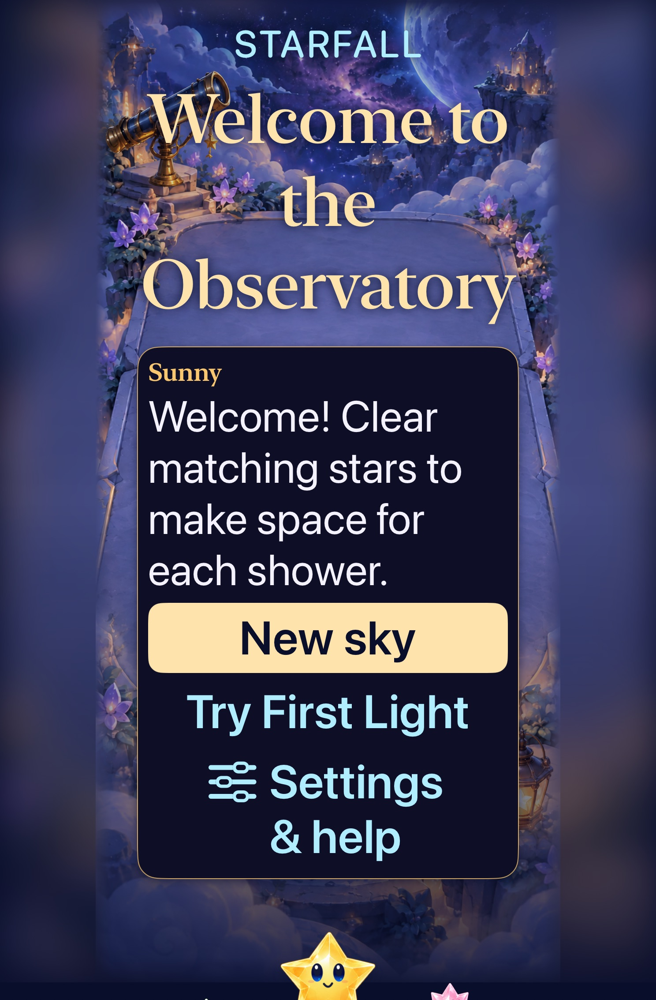
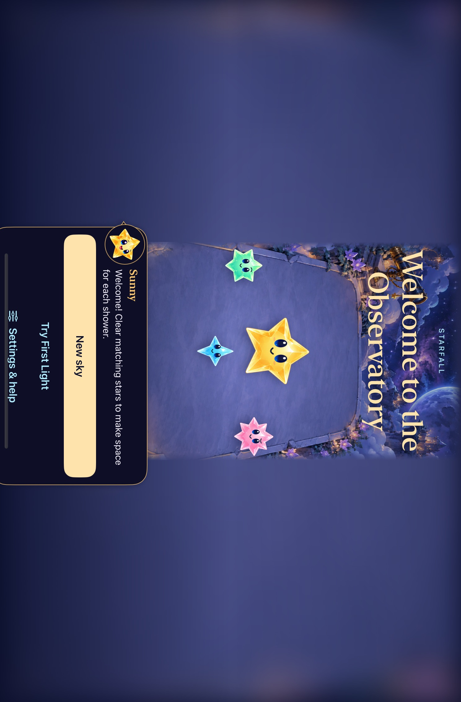
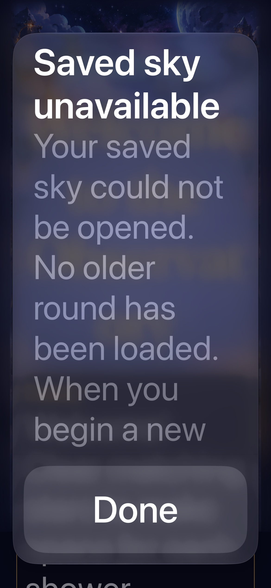
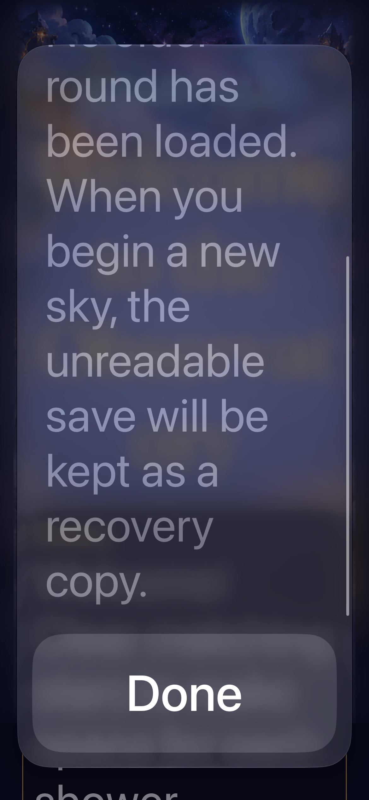
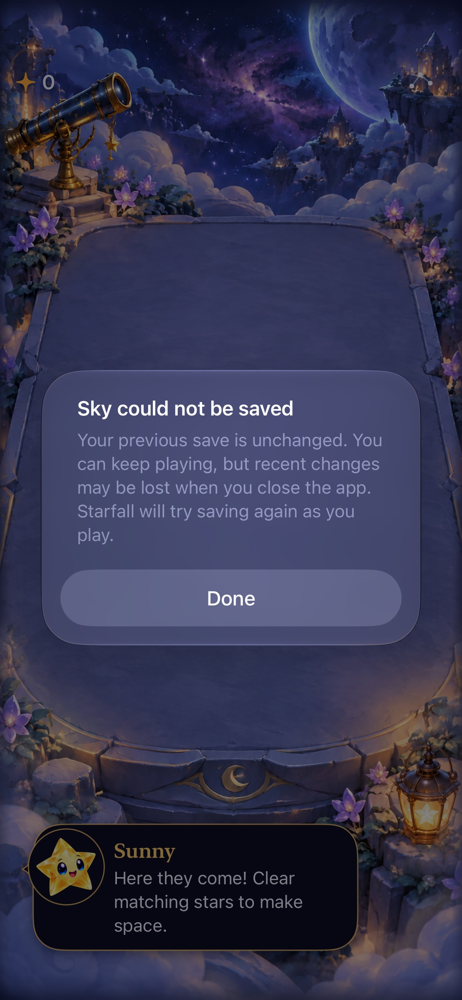

# Six follow-up debt fixes

**Result:** Verified for the six scoped fixes; RC/device limits below · **Owner:** current implementer · **Date:** 2026-10-18

Ship exact contact clocks, tablet Welcome activation, semantic archive checks, RC failure evidence, rule-aware help and visible save recovery independently. [Acceptance and scope](../../TECH_DEBT_FOLLOWUP.md). This record separates code fixes from native, visual, actual VoiceOver and physical-device evidence.

**Next action:** canonical phone delivery when connected; provision minimum-iOS and complete actual VoiceOver before RC.

## Verification context

Initial main: `5ba0d36`. Xcode 27.1 (27A9275); Debug / iOS 27.0, Starfall Forecast Fallback QA `1E9DCEF5-BF64-4052-AF8D-A6A205F711EE` unless a task states otherwise. App tests use isolated defaults, injected clock/presenter/feedback and the shared Starfall scheme. Native commands use sequential tests and ad-hoc simulator signing (`CODE_SIGN_IDENTITY=- CODE_SIGNING_ALLOWED=YES DEVELOPMENT_TEAM= CODE_SIGN_STYLE=Manual`). Raw logs/results: ignored `artifacts/debt-followup/` and the XcodeBuildMCP workspace. Actual VoiceOver: deferred to RC; no physical installation claimed.

## 1. Exact contact clock

Source: main `5ba0d36` plus `App/FallingSkyStore.swift` and `AppTests/TraceInputPolishTests.swift`. No schema/rule/RNG/artwork or geometry changes.

Root cause: contact holds reused interruption grace (`max(0.5, remainder)`), manufacturing time on release. The isolated reproduction held/released at the same clock instant every 100 ms: a 0.25 s opening deadline remained unfired at 1.05 s. Contact freezes now preserve the exact nonnegative remainder; pause/background keep their existing grace. An interruption arriving during an already-frozen contact applies its own grace before invalidation. The first new sibling test caught that nested case; it was corrected at the shared clock owner before the final run.

Examined touch-down/release, ticket replacement, invalidation, pause, suspension, balance/manual-shower resets, due delivery and stale callbacks. Existing near-deadline hold assertion intentionally changes from manufactured 0.5 s to the original 0.1 s; its 100-second held interval, stale callback and duplicate/stale ticket assertions remain. New cases cover zero-duration contacts through opening, regular fresh survival, retained Dusk and First Light, plus pause/background during contact. Actual held time still pauses rain; this is not a no-hold redesign.

| Check | Result |
| --- | --- |
| `swift test` | 162 passed. |
| Hosted TraceInputPolish, FallingSkyStore, ResponsiveInput | 73 passed, zero failures/skips. |
| Native stationary hold → trace/tap and Settings/background gesture recovery | 2 passed, zero failures/skips. |
| Debug simulator compilation, hygiene and diff | Passed. |

Native run used the standard context above, full normal input/motion assertions and no blanket retries. Gameplay quality, physical contact comfort and actual VoiceOver are separate; actual VoiceOver deferred to RC. No visual change requires replacement captures.

## 3. Semantic save validation

Source: main `cf6f846` plus `Sources/StarfallCore/FallingSky.swift`, `Tests/StarfallCoreTests/FallingSkyTests.swift` and `AppTests/SkySaveArchiveTests.swift`. Validation now requires distinct incoming identities and a blocked column whose highest occupied row reaches the landing limit. It uses the same height function as shower admission, including retained gravity boards. Schema, generation, RNG, score and outcome precedence are unchanged.

The reproductions decoded successfully but admitted forecast IDs `[0, 0, 2]` and a loss against an empty column. Regressions cover fresh survival, retained legacy and First Light, every blocked column, generated saves and terminal states, current-envelope rejection with no legacy fallback, read-only store construction and backup before replacement. Reviewed current/v7–v3 admission through their shared core validator. No claim that every possible malformed field is rejected follows from these two invariants.

`swift test`: 164 passed. Hosted archive + store: 51 passed, then all 11 archive tests passed after the added semantic admission regression; zero failures/skips. Debug simulator build passed as part of hosted tests on the phone context above. The retained replay driver with `precondition(game.isValidSave)` accepted all 1,337 archives and produced byte-identical output against the pre-refactor corpus (`swiftc -D DEBUG Sources/StarfallCore/*.swift <driver>`; raw comparison in `/tmp/starfall-semantic-replay`). Hygiene and diff checks passed. No UI/geometry/artwork change; native visual and actual VoiceOver checks are inapplicable to this batch.

## 4. RC failure handling

Source: main `8d3e81e` plus `scripts/rc-platforms.py` and its execution tests. The reproduced xcodebuild timeout was replaced by a shutdown timeout, while TemporaryDirectory removed the partial bundle and the plan still said planned. The runner now records a primary error separately from bounded secondary diagnostics, attempts a partial summary, preserves one failed bundle per role (64 MB maximum each), trims logs by reading only their tail, and marks the plan failed before temporary cleanup. Oversized bundles retain at most 100 path names plus size/count; they are explicitly marked over-limit rather than claiming full raw retention. A later role run replaces its own prior evidence; successful bundles remain disposable.

Examined boot, bootstatus, nonzero/timeout tests, summary parsing/counts, retention, shutdown and top-level temporary-directory ownership. Cleanup failure after otherwise successful checks is still a failure. Already-booted simulators are never shut down. Tests execute these paths with mocked subprocess boundaries and real temporary files; they do not claim native platform acceptance.

`python3 scripts/test_rc_platforms.py`: 11 passed. `test_native_test_plan.py`, hygiene and diff checks passed. Actual RC preflight still blocks because no iOS 17 runtime is installed; there is no fallback or download. No app source or deployment-service change; simulator app rebuild is inapplicable to this tooling-only batch.

## 5. Rule-aware Help

Source: main `20af64d` plus the six source/test paths in snapshot `361f431fc46a` (`sha256(git diff -- <paths>)`, in App menu/view/ceremony/preferences and hosted/native flow tests). `SkyHelpContext` snapshots current Core rules or the pending entry choice. Welcome/retained replay retains its actual Dusk/challenge rules; New sky uses the Core fresh-survival factory. Help has no implicit Dusk/critical-mass defaults. First Light omits opening cascades, Opal/storm and arrangement sections; its objective still names the unavailable mechanics. Entry exposes the same Settings & help action without committing a round.

Examined Welcome, initial/fresh/replay/challenge Entry and in-game Help call sites. Hosted selection tests cover current fresh, retained Dusk and First Light against each pending choice and prove reading leaves flow unchanged. `swift test`: 164 passed. Hosted SkyFlowState: 17 passed; native largest-text pressure and complete Help read-through: 2 passed; native pending First Light Help/cancel and shared Welcome preferences/paused retained summary: 2 passed in the final run. The latter exposed a stale case-sensitive `Paused` assertion from earlier copy; it now checks the complete shipped phrase `Automatic showers paused`, retaining the pause-state requirement. Debug and Release simulator compilation passed; hygiene/diff passed. Existing files keep target membership.

| Entry after Help | First Light Help |
| --- | --- |
|  |  |

Inspected native captures, iPhone 17e / iOS 27.0, default text, normal app route with isolated reset defaults. Text and all Entry actions fit; Done remains available in Help. Full largest-text read-through is independently tested above. Tablet Welcome hit-result diagnosis remains open; these phone samples do not close it. Actual VoiceOver and physical-device acceptance remain RC work. Raw captures/result bundles stay in `/tmp/starfall-help-attachments` and XcodeBuildMCP.

## 2. Tablet Welcome hit semantics

Source: main `882945a` plus removal of the outer ceremony `accessibilityHidden` modifier in FallingSkyView and inactive-heading hiding in SkyFlowCeremony. Captured runtime inputs `57e2106fabf3` hash the concatenation of `path + newline + content` for those two files, before the explanatory two-line comment was added. The subsequent landscape assertions and phone checks add no runtime behavior. Temporary diagnostic views/tests were removed.

The original largest-text Welcome test failed on visible, enabled Settings at `(168, 850, 408, 133.5)` in a portrait `744 × 1133` window. Native activation still opened Settings. Hiding/removing covered playfield containers, changing labels/decorative hit regions and changing dialogue AX grouping did not fix it; those trials were reverted. A temporary isolated ceremony reported native hits correctly at default and XXXL text. Adding the parent's modifier chain reproduced false hits for every action; removing only `accessibilityHidden(false)` restored them. This establishes the observed failure boundary on iPad mini / iOS 27.0; it does not diagnose Apple's implementation.

The ceremony already owns action enablement/AX hiding and receives active/modal values. It now also hides its inactive heading, and the parent no longer adds the redundant AX container. Settings retains native modal ownership; handoff still rejects input. No clock, save, rules, geometry, art, motion timing or routing change was kept. Examined Welcome, Entry, modal settings, handoff, results and the covered gameplay surface.

Original three tablet RC selections: 3 passed, zero failures/skips. The original largest-text assertion is unchanged; landscape now additionally requires native `isHittable` for Settings and Begin, and passes. `swift test`: 164 passed. Debug compilation/hygiene/diff passed. Phone siblings: 17 hosted flow checks plus four native normal-motion/background/another-sky, First Light win/replay/full/restore, system Reduce Motion entry/replay and Welcome preferences/paused-summary checks passed (21 total, zero failures/skips). Actual VoiceOver remains RC work.

| Maximum text, portrait | Default text, landscape |
| --- | --- |
|  |  |

Inspected native captures from the original three-test passing run, iPad mini A17 Pro / iOS 27.0, normal animations. Maximum-text actions fit without shrinking text. Landscape Settings is close to the Home indicator in the initial capture; the passed hit/navigation checks establish activation, not physical comfort. Revisit that lower-edge spacing in the next landscape visual pass/RC. Still frames do not prove animation quality. Raw bundles and failed trials remain in XcodeBuildMCP and temporary storage.

## 6. Visible save recovery and failure notices

Source: main `cf6526b` plus the eight runtime/test paths in snapshot `7213540d3ad9` (`sha256(git diff -- <paths>)`: local catalogue, store/view/copy/ceremony/archive and archive/native flow tests). No schema/RNG/rule migration. `SkyPersistenceNotice` gives the session a native acknowledgement for rejected saves or an encoding/validation failure. Copy names the retained previous save, potential loss of recent changes and future retry behavior. Rejected initialization remains read-only; acknowledgement writes nothing; the next committed replacement still backs up the rejected value. A present invalid current save never falls back. The single recovery slot is not a backup-restoration interface.

The view suspends gameplay and blocks handoff admission while a notice is pending; dismissal reconciles the existing handoff/clock contract. Repeated failures after acknowledgement do not create an alert loop; a successful write rearms a later failure notice. The store receives one narrow archive-write capability to exercise failures without corrupting Core state. Production still uses SkySaveArchive. Reset-only native failure/rejection fixtures use the ordinary Debug app, isolated review defaults and explicit reset arguments; Release excludes their routing. No IO or migration happens merely from constructing a normal view/store.

Examined missing/current/retained/rejected admission, successful replacement/backup, failed writes, acknowledgement, repeated failure/success/new failure, startup and handoff, modal/background interruption, stale clock/animation callbacks and restored play. UserDefaults has no synchronous physical-disk durability acknowledgement; this catches reported encode/validation errors, not every possible storage failure.

| Check | Result |
| --- | --- |
| Core | 164 passed. |
| Full hosted app suite, including catalogue/packaging, persistence, flow, native renderer/input windows | 265 passed, zero failures/skips. |
| Phone native hold/trace/tap + Settings/background gesture recovery | 2 passed, zero failures/skips. |
| Rejected-save background/replacement/relaunch and failed-save acknowledgement/handoff/retry/relaunch | 2 passed; rejection repeated after adding the message read-through check, passed. |
| Final original tablet selections with root alert attached | 3 passed, zero failures/skips; includes strengthened landscape native hit assertions. |
| Debug/Release simulator compilation, hygiene/diff, RC/native-plan Python tests | Passed (11 RC + 3 native-plan tests). |

The final phone sweep used the standard context above; tablet used iPad mini A17 Pro `147FF35E-5EAE-4676-B941-B82BE8119054` / iOS 27.0. Current test/source inputs are the snapshot above; the full hosted/Release runs preceded only the added native reading assertions. All app source and catalogue inputs match. Raw results remain in XcodeBuildMCP and `/tmp/starfall-recovery-attachments` / `/tmp/starfall-recovery-reading`.

| Rejected save, maximum text: beginning | Same message scrolled to its end | Failed save, default text |
| --- | --- | --- |
|  |  |  |

Inspected native iPhone 17e / iOS 27.0 captures. Maximum text requires native message scrolling; the bounded reading-area drags reach the final recovery-copy sentence, with Done remaining hittable. This is not evidence of actual VoiceOver speech/focus. The normal-text failure capture predates only native read-through assertions, with identical runtime inputs. Physical-device installation remains waiting for the configured iPhone; minimum-iOS and actual VoiceOver remain separate RC gates.

## Final RC evidence boundary check

A post-integration sibling review found that a boot failure before xcodebuild opened its log could leave a previous log beside the new execution manifest. The runner now clears the selected role's log with its old summary/result before boot. A real-file/mocked-process regression combines boot and shutdown timeouts and confirms the boot error stays primary, result is unavailable, and neither old log nor summary is attached. `test_rc_platforms.py`: 12 passed; native-plan tests (3), hygiene and diff passed. This follow-up changes RC tooling only; the six app/runtime acceptance results above remain source-bound and unchanged.
