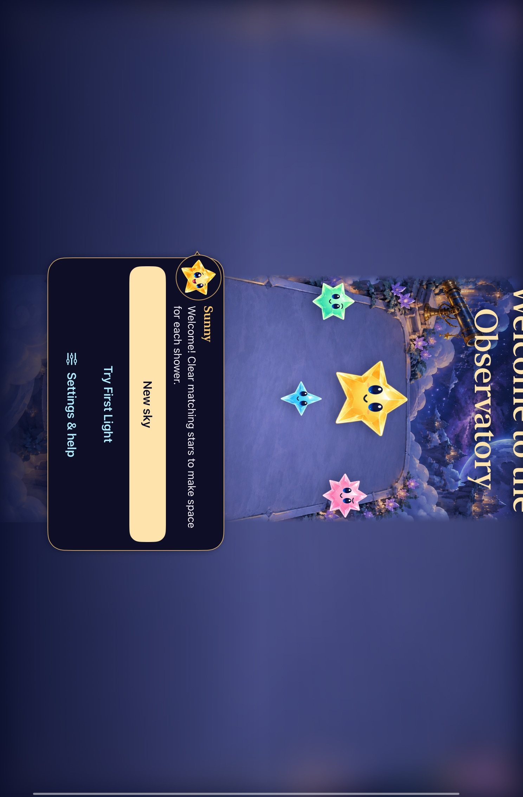
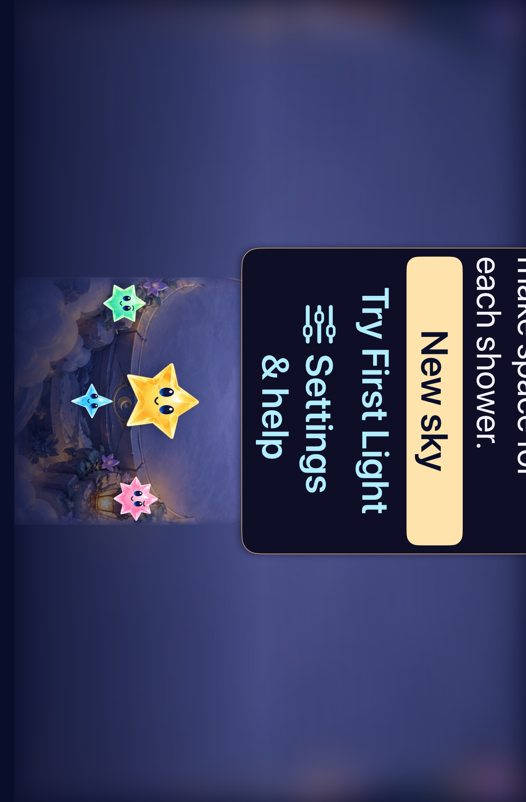
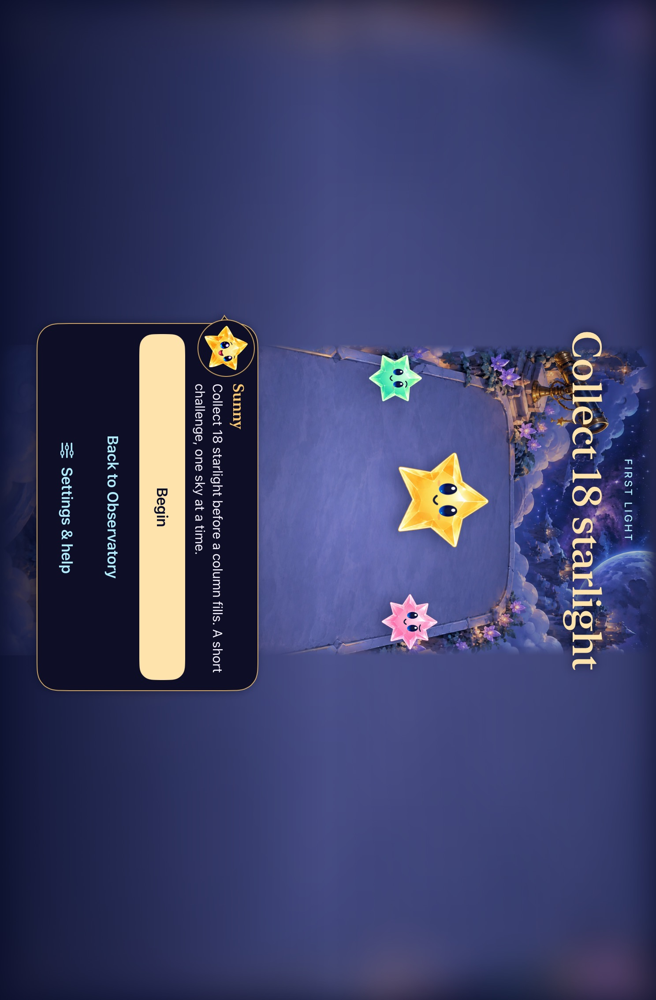
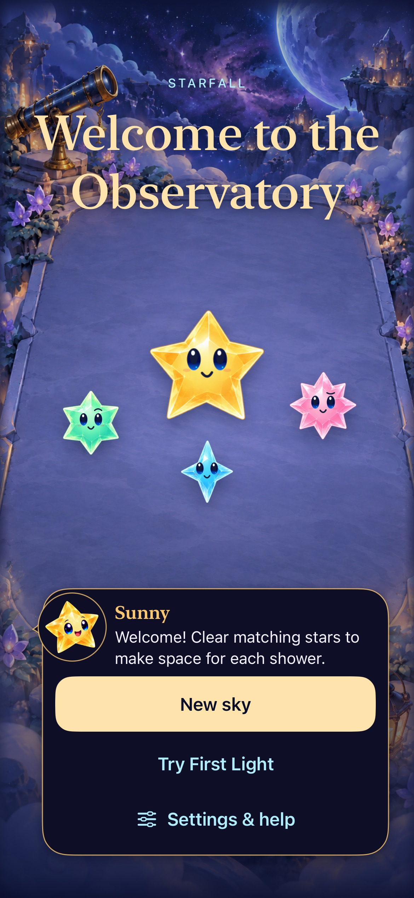
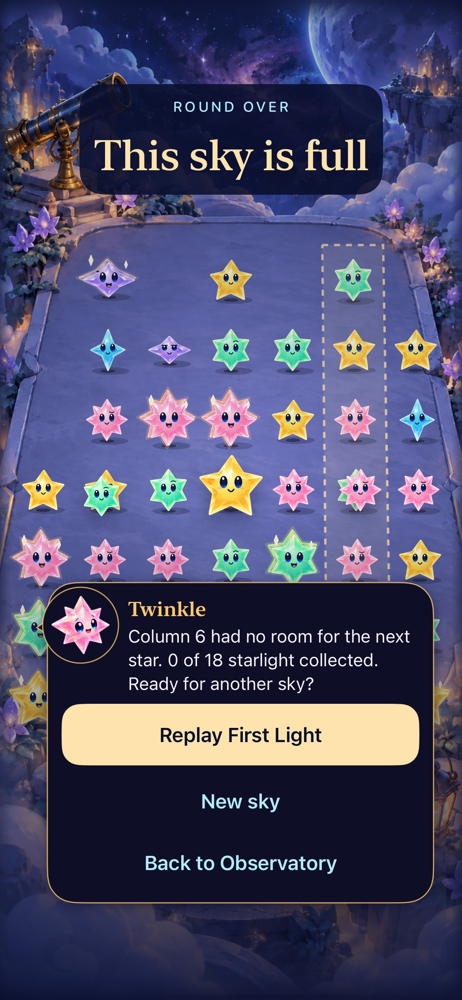
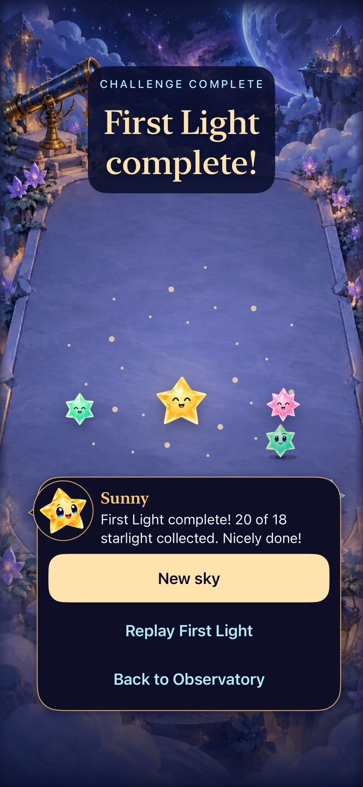

# Third debt pass: restore and native acceptance reliability

**Result:** Verified for the four scoped fixes; integration and RC limits below · **Owner:** current implementer · **Date:** 2026-10-18

[Ranked scope and acceptance](../../TECH_DEBT_THIRD_PASS.md). Main `b5ec445` is the starting source; the checkout was clean and origin was already up to date. This report records separate core, build, native, visual and physical-device results as batches finish.

**Next action:** clean-main verification and canonical delivery; complete minimum-iOS/actual VoiceOver before RC.

## Baseline reproduction

A local standalone Swift driver compiled with `swiftc -D DEBUG Sources/StarfallCore/*.swift <main.swift>` generated gravity generation 2 / seed 0 using ordinary showers until overflow. The archive validates, has lost outcome and blocked column 5. That column contains a magnet. Calling `removingGravity()` removes the magnet, compacts its survivors and fails the `result.isValidSave` precondition at FallingSky.swift:218 because the blocked column is no longer full. Raw driver/archive/crash output is in `/tmp/starfall-next-audit` and `/tmp/starfall-gravity-terminal.json`; no player data was changed.

The previous replay corpus samples intermediate rounds and replay starts, so its passing 1,337 archives did not establish terminal migration coverage. A passing ordinary invalid-overflow regression also did not establish that migration preserves terminal outcomes. The correction must cover both contracts.

## 1. Terminal gravity retirement

Verified on main `b5ec445` plus `Sources/StarfallCore/FallingSky.swift`, `Tests/StarfallCoreTests/GravityRetirementTests.swift` and `AppTests/SkySaveArchiveTests.swift`. Overflow is a committed result: explicit gravity retirement can remove supports and compact the losing column after that result. Requiring the post-retirement column to remain full confused committed history with the current presentation board. The validator now recognizes the existing bounded retired-mass accounting only in non-critical-mass standard-generation retired skies. Ordinary fresh, retained unretired and First Light archives still require a full blocked column. All existing conservation and gravity invariants still apply.

No new field, schema, RNG, score, seed, cadence or survivor identity was introduced. Existing retired archives have no pre-retirement column snapshot, so exact historical occupancy cannot be reconstructed from them; the compatible retirement accounting is the available provenance. This validator is not proof that an arbitrary archive's history actually occurred.

The original generated seed-0 archive now reports `before valid=true, outcome=lost` and `after valid=true, outcome=lost`, without a trap. Added 128 terminal histories across both gravity generations verify retirement, compaction, outcomes, stable survivors, round-trip, inert terminal actions and replay. Hosted cases cover current/v5 envelope read-only restore, activation, canonical re-encode, relaunch and replay. Reviewed raw admission, retirement postcondition, feeding-Dusk adoption and app archive precedence.

| Check | Result |
| --- | --- |
| `swift test` on final source | 165 passed, zero failures. Includes existing ordinary impossible-overflow/duplicate-forecast negatives. |
| Hosted store/archive + native First Light win/replay/full/restore | 55 hosted + 1 native passed, zero failures/skips. |
| Final hosted archive, gravity-retirement and Dusk-production suites | 24 passed, zero failures/skips. |
| Existing retained/replay corpus, each save validated | 1,337 accepted and byte-identical to the original baseline. |
| Debug simulator build, hygiene, diff | Passed. |

Xcode 27.1 / iOS 27.0, shared Starfall scheme, Debug, iPhone 17e `Starfall Forecast Fallback QA` (`1E9DCEF5-BF64-4052-AF8D-A6A205F711EE`), sequential native tests with ad-hoc simulator signing (`CODE_SIGN_IDENTITY=- CODE_SIGNING_ALLOWED=YES DEVELOPMENT_TEAM= CODE_SIGN_STYLE=Manual`). Raw results: XcodeBuildMCP; Core/restore/replay logs in `/tmp/starfall-third-core-final.log` and `/tmp/starfall-next-audit`. The native ending flow preceded only the final exclusion of critical-mass skies from the retirement exception; final Core/hosted tests include that guard. UI/geometry/artwork unchanged; no screenshot refresh or actual VoiceOver session is implied. Actual VoiceOver/minimum-iOS/device acceptance remain separate RC gates.

## 2. Primary CI simulator lifecycle

Source: task-1 main `e5f3b2b` plus `scripts/ci-simulator.sh`, new `simulator-command.py` / `simulator-lifecycle.sh` and their tests, and the existing workflow trigger/verification-step entries. Task-3 app/UITest changes are in progress in the same worktree and excluded from this tooling commit; these execution tests do not load app source or require a simulator.

The primary runner previously selected a simulator, booted it only when needed, then unconditionally shut it down on EXIT. Its direct `simctl bootstatus` had no stage timeout. Inventory and screenshots were also unbounded even though status-bar/install/launch used an inline timeout wrapper. The helper now owns cold-boot attempts explicitly and applies bounded subprocess execution to every primary simctl command. Partial boot still receives bounded owned cleanup; a prebooted device receives no boot or shutdown command. The existing readiness barrier still precedes installation and captures. No new CI job, retry, runtime download or budget was added.

Every stage records start, elapsed time, limit and exit/error while preserving stdout for PID parsing. Real missing-command, signal, failure and timeout paths preserve status. Receipt-write failure cannot turn command failure into success; a successful command without a writable receipt fails. Cleanup reads only log tails, preserves a primary failure and makes otherwise successful work fail when cleanup fails.

`python3 scripts/test_simulator_lifecycle.py`: 8 passed. Tests execute a real bounded sleeping child, stdout/PID contract, nonzero/missing/signal commands, unwritable receipts and the actual primary CI cleanup/trap prefix with fake simctl plus real files. Prebooted success, failed boot, failed install with failed shutdown, and cleanup-only failure are checked. `test_native_test_plan.py` (3), `test_rc_platforms.py` (12), Bash syntax, hygiene and diff checks passed. Native CI is not claimed from these isolated execution tests; the full job remains under its existing runner budget. This tooling-only batch has no rule/save/UI/actual-VoiceOver acceptance claim.

## 3. Scrollable ceremony control clearance

Source: main `034b6bb` plus `App/SkyFlowCeremony.swift` and `UITests/FallingSkyInteractionTests.swift`, snapshot `a767d897841e` (`sha256(git diff -- <these two paths>)`). Task-4 script/workflow edits were present but excluded from app build inputs and this UI commit.

The original iPad landscape frame was Settings `(378.5, 701, 392, 44)` in a `1133 × 744` app: its center was hittable while the control extended to y=745. The new complete-control assertion failed on that source. Ceremony content used the whole geometry height as its minimum, with no reserved bottom reading area. It now reserves the theme's section spacing in both scroll safe-area padding and minimum content height. Long content can scroll fully above the system area; labels and target sizes are not reduced. Gameplay mapping, native board cells and rules are unchanged. The same owner presents Welcome, Entry and results.

The existing tablet landscape method now visits portrait/landscape at default/XXXL text. It conditionally scrolls each Welcome and Entry action into the usable viewport, checks its complete frame above the full-window iPad's 21-point Home area and at least 44-point height, then activates Settings/dismissal and Begin. There are no extra test methods, tablet exclusions or retries. The original largest-text Welcome/Entry/back test also passes. The first layout trial still failed the initial-frame assertion: content may legitimately need scrolling; the regression now exercises the accepted bounded scroll-to-control contract and still requires complete clearance. Original hit, navigation and state assertions remain.

| Check | Result |
| --- | --- |
| Core | 165 passed. |
| Tablet native | Two methods passed, including all four orientation/text variants and original maximum-text flow; zero failures/skips. |
| Hosted flow + phone native | 17 hosted + 6 native passed, zero failures/skips: stationary hold/trace/tap, rescue scoring, automatic forecast/settings/background, Welcome/Entry/background/another sky, First Light win/replay/full/restore, system Reduce Motion entry/replay. |
| Additional phone opening/rapid-input regression | Passed. |
| Debug and Release simulator compilation, hygiene/diff | Passed. |

Xcode 27.1 / iOS 27.0, Debug, phone QA from task 1 and tablet `Starfall Observatory Tablet QA` / iPad mini A17 Pro (`147FF35E-5EAE-4676-B941-B82BE8119054`), sequential/ad-hoc signing. The combined phone tool response timed out at 300 s; the underlying Xcode run completed at 305.667 s with `TEST EXECUTE SUCCEEDED`. Direct `xcresulttool get test-results summary` confirmed exactly 23 passes, zero failures/skips; this is not an inferred pass or a retried batch. Future tool calls should split similarly long selections. Release compiled afterward. Raw result path: `/tmp/starfall-third-phone-result-path`; captures in `/tmp/starfall-third-tablet-captures` and `/tmp/starfall-third-phone-captures`. Native test time limits were not increased beyond the existing 240 s method allowance; normal motion assertions remain intact.

| Landscape default, scrolled to Settings | Landscape maximum text, scrolled to Settings | Entry default |
| --- | --- | --- |
|  |  |  |

The heading may scroll offscreen while reaching lower controls; these frames do not claim every element fits simultaneously. Inspected captures establish readable labels and complete control bounds in these sampled full-window configurations. Stage Manager, physical comfort and actual VoiceOver remain RC work.

| Phone Welcome | Phone full sky | Phone First Light win |
| --- | --- | --- |
|  |  |  |

Inspected native iPhone 17e/default-text captures on identical app source. Still images do not prove animation quality; the normal-motion ending/replay and input flows above provide their separate behavioral checks. Actual VoiceOver and physical-device acceptance remain open.

## 4. Default-game CI capture acceptance

Source: task-3 main `1469916` plus `scripts/export_native_evidence.py`, its tests, primary CI script and existing workflow verification/trigger entries. The previous inline selector required 33 classic frames and no default Falling Sky frames. It now keeps those classic requirements and adds exactly six: `flow-welcome`, `flow-entry`, `island-timer-active`, `critical-mass-rescue`, `flow-win` and `flow-full`. Names match exactly or Xcode's underscore suffix, so a similar prefix cannot substitute a different capture. A native success still requires source-counted exact passes, zero failures/skips and every required capture.

The exporter owns one bounded set of 39 files and manifests. It rejects duplicates, non-flat paths, symlinks, unknown/oversized PNGs and oversized manifests, with bounded reads. It resets only owned evidence at primary CI startup and before export so an early build failure or failed UI run cannot reuse old complete captures. Primary stage receipts are also reset per run. Failed native tests retain available selected captures even without a parseable summary; metadata explicitly remains incomplete/partial, and the primary runner keeps its original native failure status. Export/validation failures cannot certify a complete UI run. No new test methods, simulator runs, jobs, downloads, blanket retries or CI budget increase were added.

`python3 scripts/test_export_native_evidence.py`: 9 passed. Real-file cases cover full success, classic-only rejection, each missing shipping capture, duplicate/similar names, bad counts/skips/summary, unavailable partial data, unsafe files/limits and CLI startup reset preserving unrelated evidence. Lifecycle (8), RC (12), native-plan (3), updater tests, Bash syntax, hygiene and diff passed. The workflow invokes both new test suites in its existing verification step.

Integration also passed selection of all six real shipping-game PNGs exported by xcresulttool from the task-3 native result: 18,719,112 bytes total, each under 5 MB. [Selected names, byte counts and SHA-256 values](shipping-capture-selection.json) bind that sample to task-3 runtime snapshot `a767d897841e`. This checks actual Xcode attachment shape/labels/files, not merely synthetic fixtures. The complete 39-image primary CI job was not rerun locally; the selected sample does not certify the other 33 captures, and unit/fault-injection checks do not establish visual or actual VoiceOver quality. Fixed CI artifact names are disposable outputs with run/source provenance; retained documentation screenshots use the separate source-bound names above. Raw selected PNGs remain in `/tmp/starfall-third-shipping-evidence`.
