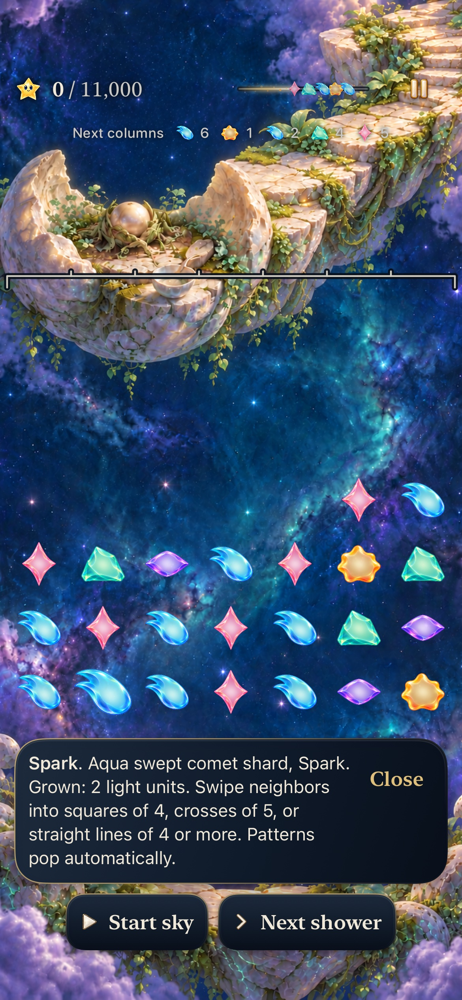
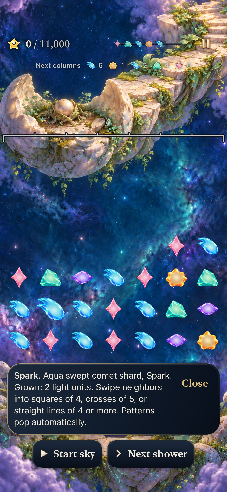
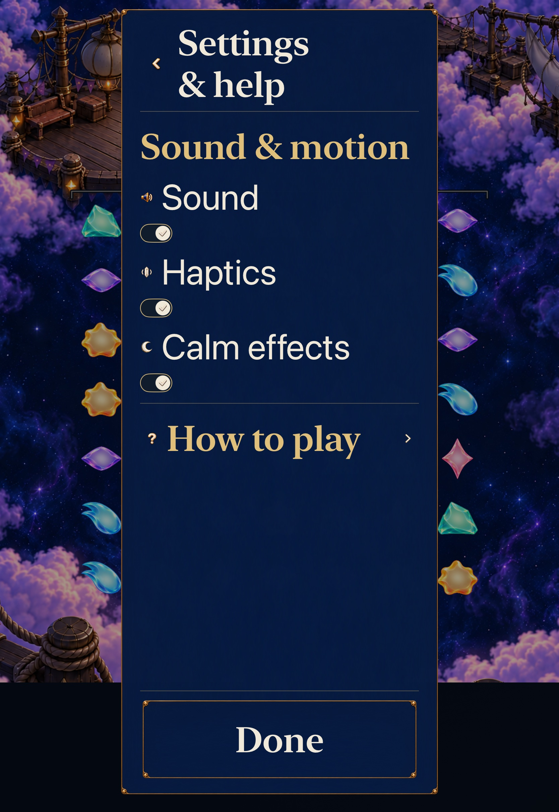
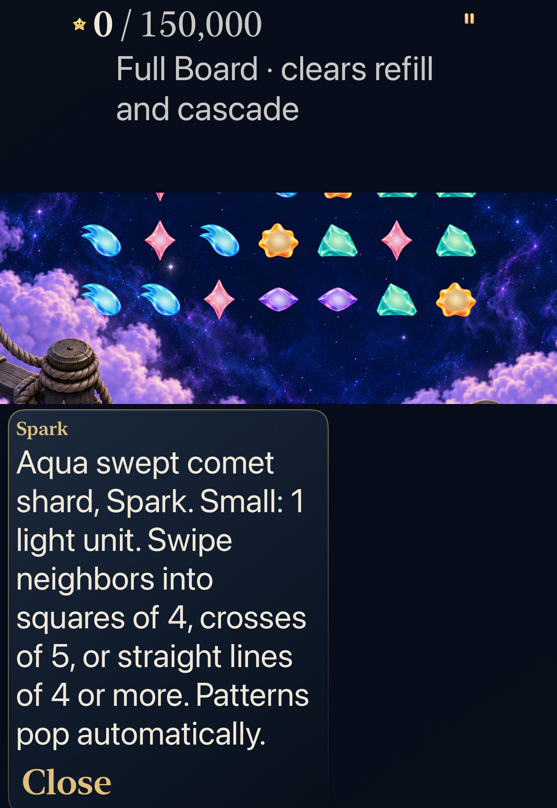

# Inspect the actual Story ingredient

**Status:** Adopted development slice · **Source:** runtime `8c6eefb`, final native `7db83ac` · **Build:** computed `dev.087b7f0bc4`, actual local bundle `dev.local` · **Date:** October 24, 2026

[Decision goal1 #361](https://github.com/lbeezr/starfall/issues/361) makes an automatic-Story tap describe the actual touched ingredient: family/material, Small or Grown, and its one/two light units. The same message retains the saved definition’s square/cross/line instruction. This develops Seed’s grown-ingredient choice without predicting the complete award, suggesting a route or changing what counts as a pattern cell. Its usefulness remains a player-observation hypothesis.

Previously every automatic-mode tap repeated the generic pattern lesson. `SkyDialogueLibrary.ingredientInspection(at:game:)` now reads the committed gem and existing material description; typed catalogue copy owns the wording. Manual, ended, empty and out-of-range contexts have no ingredient line. The Store keeps its existing contact/readiness gate and shared guide/context/announcement owner, with generic advice when no actual ingredient exists. Inspection changes no Core, RNG, score, save, forecast, clock, input generation, progression or archive19. Open Sky taps/traces keep their original branch; both Story supply modes and exact retained rules stay supported.

## Executed acceptance

| Scope | Source-bound result |
| --- | --- |
| Core | 352 passed, zero failures/skips; 21.893 seconds; inputs unchanged |
| Affected hosted | 118 passed, zero failures/skips at `b6b503d`: new ingredient6, technique34, dialogue29, catalogue bounds2 and Store47 |
| Normal phone | Seed4 grown versus small Aqua, exact zero-score/zero-shower board and world, genuine preserve exchange1→8, current ingredient after movement, background/cold Continue; 113.585-second corrected method |
| Largest Calm tablet | Actual Settings OFF→ON with original preference restored, AX3XL FullBoard6 small ingredient, full guide reading, exact49-cell state/world, following production27→34 clear earns42,000; 157.389-second method |
| Manual siblings | Existing normal first-shower tap19.130s and historical gravity five-of-six trace9.539s pass; no manual-rule change |
| Build/resources | arm64 Debug build-for-testing, generic simulator Release, explicit hosted/native membership, plist,548-key catalogue, three planner tests, hygiene/diff pass |

Five native method executions retain four passes and one earlier failed case across four distinct methods, zero skips. The two manual passes were not repeated after the test-only reader correction. All App/Core/configuration bytes remain identical to the runtime checkpoint. The final 654 recorded inputs remain identical after the accepted native checkpoint; subsequent delta is documentation/evidence only. Raw commands, logs, prepared products, source manifests, results and recordings are disposable under `/private/tmp/starfall-decision-01-20261024/`. [Verification](verification.json) records source-specific counts and limits.

Hosted checks compare exact game, forecast, archive/world/mastery bytes, input generation, pause/presentation/feedback and the live deadline before/after inspection; actual Seed movement changes the inspected ID/cell rather than retaining stale facts. Retained revision3 seven-star and current four-star lines, retained Lantern5 and current FullBoard6/7 stay distinct. Manual tap and exact five-of-six trace still commit their existing clears. These are behavior checks, not evidence of human comprehension.

## Inspected exports

Seven original-resolution JPEG exports were independently inspected; hashes/source are in [captures](captures.json). Phone paragraphs and controls fit. Tablet’s complete paragraph and Close label are visible in its scrolled reading layout; the passive panel border extends below the image. Actual control-frame containment, activation and subsequent clear are established separately by the passing native method, not by that still alone.

## Failure, correction and limits

The first new phone method failed its test-reader assertion: message bottom733pt was compared with inline Close top635pt. Its original screenshot shows the entire paragraph visible. The inherited helper assumed actions below the body, while ordinary constrained dialogue puts Close beside it. The focused test now reads against the actual dialogue viewport with the existing four-scroll bound, retains exact complete-label/start/end/full-fit assertions and checks Close containment/enabled/hittable separately. App code did not change; the complete corrected journey passed. No assertion was weakened, blanket retry added, quieter workaround forced or clock fix invented.

Before executing hosted checks, source review found the all-script renderer’s sample dictionary lacked the three new tokens. A test-only commit supplies star/size/light samples while preserving every catalogue assertion. No compiler or hosted assertion failure occurred. Runtime script capacity is121/128: reuse existing owners and templates before adding scripts in later goals; the existing strict capacity guard remains.

The normal movie was inspected at26 requested positions from60–85 seconds with actual timestamps/repeated frames retained: inspection/Close, Map return, the real swap, moved-ingredient explanation and background. This does not establish a complete short-body trajectory, sustained performance or physical smoothness. The native Seed route uses ordinary isolated existing-install admission, not proof of earning earlier repairs. Its paused zero-shower contrast establishes safe inspection while hosted live-clock checks preserve the actual deadline. The retained gravity trace does not prove modern supply behavior. No physical phone was probed/installed; both owned simulators were confirmed Shutdown and no unrelated resource was stopped.

No temporary product route remains. The Store stays1162 lines: this change only reuses its narrow existing guide/contact owner; the separately recorded Entry/round-transition extraction boundary remains, rather than mixing a structural rewrite with this presentation slice. Human learning/recognition, physical devices, minimum iOS17, actual VoiceOver and sustained performance remain separate. Revisit usefulness at the next #206 session or before extending ingredient inspection into forecast/score prediction; do not turn that observation into a gate on the next independent implementation.
