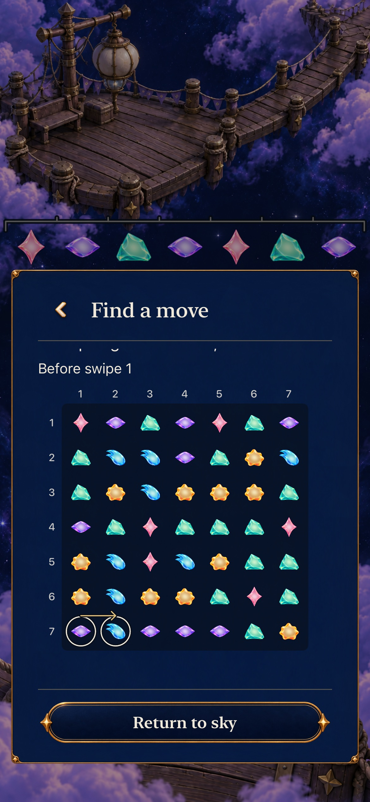
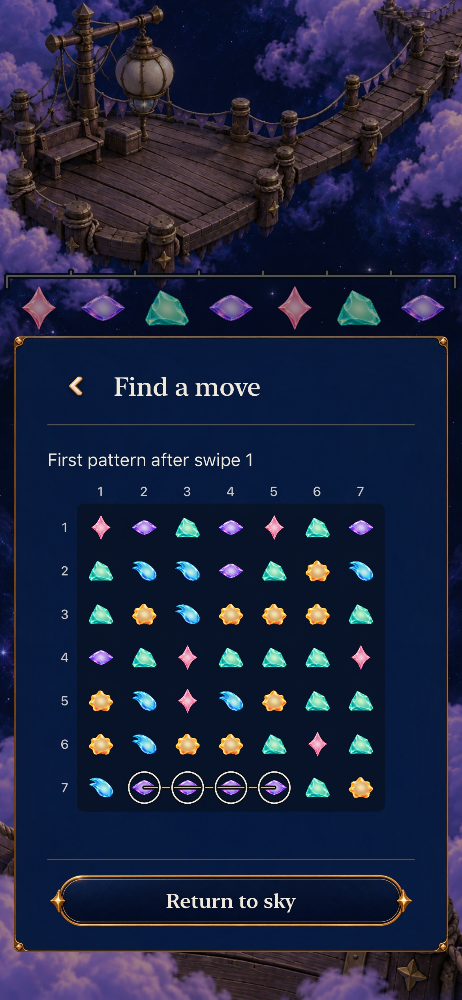
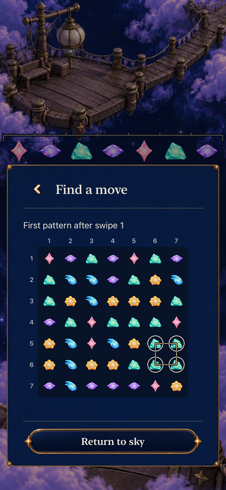
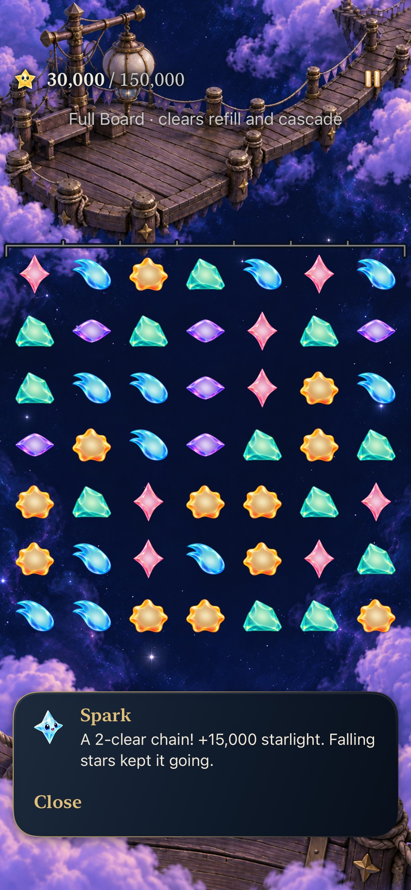
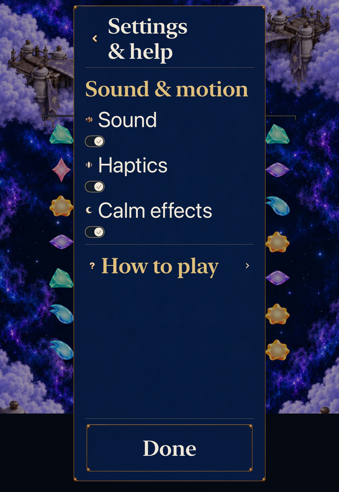
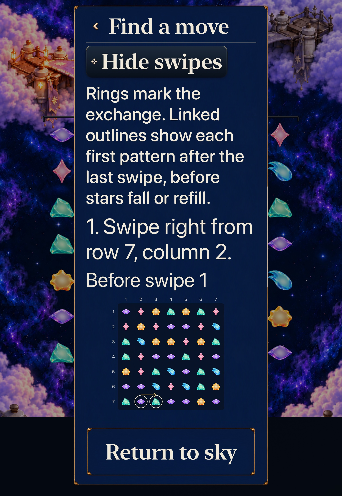
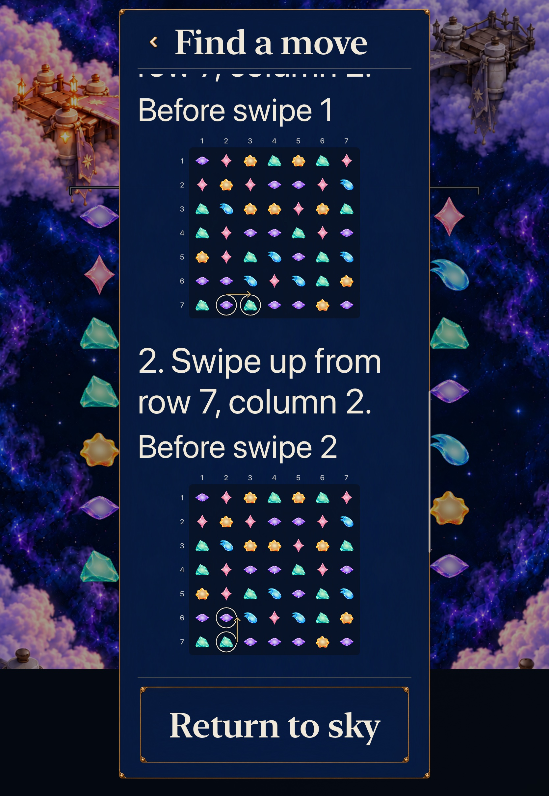
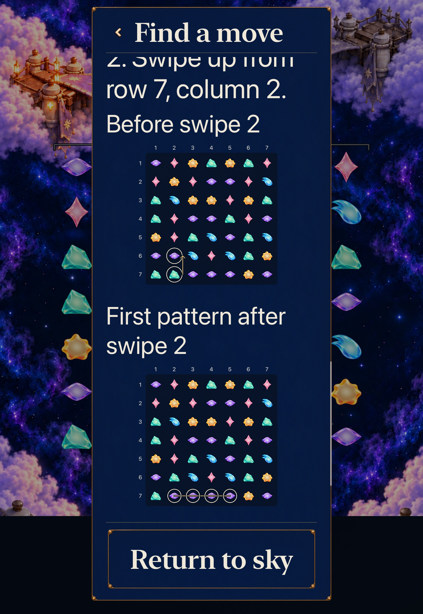

# Recognize a Full Board choice on the board

**Result:** Adopted development slice · **Source:** runtime `ce191ea`, native `88a20b6` · **Build:** computed `dev.4f553d4b34`, actual local bundle `dev.local` · **Date:** October 24, 2026

[Decision goal2 #362](https://github.com/lbeezr/starfall/issues/362) adds optional passive diagrams to the existing **Find a move** advice. A before frame marks the actual exchange; the last frame shows every first pattern on the resulting arrangement, before clearing, falls or refill. The original coordinate instructions remain. The hypothesis is that relating the words to actual materials makes the choice easier to recognize; automated success is not human learning evidence.

`SkyFullBoardChoiceDiagram` copies the immutable snapshot and applies only the already listed exchanges through shared settling. It never calls the resolver, runs another search, reads hidden supply or predicts points. Exact final recipe cells and IDs are validated against that arranged board. A direct choice has two frames; a genuine setup has three. All separate simultaneous/overlapping recipe paths use the existing presentation order, rather than a joined cleared-union outline. No Core, rule, RNG, score, clock, save, archive19, progression or asset change shipped.

The renderer uses the existing cached SkyPiece materials and one static Canvas per frame, with at most49 piece draws and14 axis labels. Before frames have two open endpoint rings and one directional arrow; final frames retain at most131 separate paths of at most8 entries and49 unique ingredient rings. The diagram fits a112–300-point square with no playable targets, state, timers or animation. Its axis numbers belong to the fixed miniature; captions and equivalent native swipe prose keep full Dynamic Type. Normal and quiet show the same figure.

## Executed acceptance

| Scope | Source-bound result |
| --- | --- |
| Core | 352 passed, zero failures/skips,21.819s; package inputs unchanged |
| Affected hosted | 57 passed, zero failures/skips: diagram7, existing choices6, Ribbon presentation7, dialogue29, catalogue bounds2 and ingredient inspection6 |
| Normal phone | Current Lantern6 earns15,000; reads Line/Square before/final diagrams, hides/reopens, pans through the passive board, cancels/returns/backgrounds/Continues with exact round and world, then plays0→1 to30,000;203.165s |
| AX3XL Calm tablet | Current Ribbon7, actual Settings OFF→ON and original OFF restored; existing seven-exchange prefix reaches80,000. Three setup frames preserve exact round/world through reading/hide/Back/background/Continue; real1→2 stays80,000, then1→8 earns85,000;232.577s |
| Build/resources | arm64 Debug build-for-testing and generic simulator Release pass; explicit four-source membership, plist,552 typed copy keys, three planner tests, hygiene/diff pass |

Both maintained native methods actually executed and passed with zero failures/skips. There were no compiler, hosted or native assertion failures in this slice. Before native execution, source review added one explicit72-point pan through each passive diagram: gutter scrolling alone would not prove the drawing permits page panning. This is a test-only checkpoint after the hosted/runtime checkpoint; all App/Core/hosted/configuration bytes remain identical. The accepted658 recorded inputs remain unchanged after native execution; later changes are documentation/evidence only. [Verification](verification.json) records exact sources, commands, counts and limits. Raw output, prepared products, source manifests and movies remain disposable under `/private/tmp/starfall-decision-02-20261024/`.

Hosted oracles are actual production turns: source/intermediate diagrams equal the prior board, and the final diagram equals the first resolution phase’s **before** board, never the post-refill result. Current Lantern6/Ribbon7 and retained Lantern5 direct/setup cases, three overlapping cross/line recipes, stale/invalid/completed contexts, encoded-state equality and the unchanged next refill are covered. No temporary review route or new fixture was added.

## Inspected native exports

Nine original-resolution JPEG exports were independently inspected. Each full diagram contains49 actual materials and both1–7 axes. Phone rings show row7 columns1→2, followed by the actual four-Violet line at columns2–5; the alternate square marks Mint at rows5–6/columns6–7. The tablet’s second before frame reflects the first real exchange: Mint moves to row7/column2, before exchanging upward with Violet; its final figure is one four-Violet **line**, not a square. Captions, Back/Return and diagram ink remain separate. Fragments of earlier prose at the top are ordinary clipped scroll content beneath the pinned header, not missing current captions. Native viewport/pan assertions establish reading and interaction separately from these stills.

## Observation and limits

The normal recording was inspected at47 requested positions:100–260s every5s and250–276s every2s, retaining actual timestamps and repeats. It shows reveal, page panning, distinct source/final figures, hide/reopen, returning play and the next committed clear. Samples are not a complete short helper trajectory, physical smoothness or sustained-performance measurement. Both recordings finalized to verified files; both owned simulators were confirmed Shutdown. A sandbox process-inventory denial was resolved with normal authorized access, identifying and stopping only the exact owned recorder. No unrelated process/device was stopped, and no physical phone was probed or installed.

Ribbon’s existing-install access fixture admits the real current round; it does not establish earning the earlier campaign. This selected development slice does not rerun the whole win/loss matrix, minimum iOS17 or actual VoiceOver. Human comprehension/comfort remain with #206. Catalogue scripts stay121/128; four typed copy keys add no dialogue script or expanded bound. Revisit diagram usefulness at the next ordinary player observation, or before changing advice scope, mapping or recipe presentation. Continue the next ordered leaf independently; the observation is not an approval gate.
