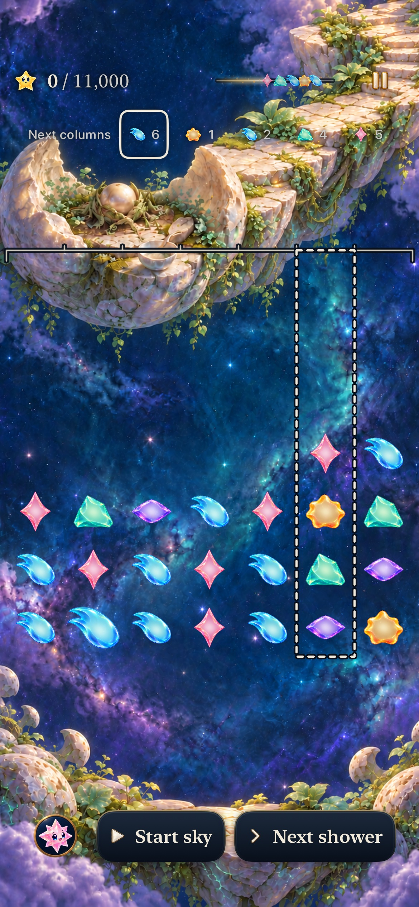
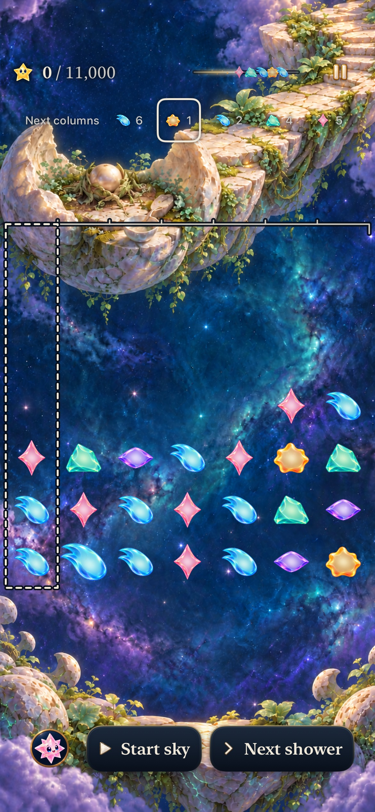
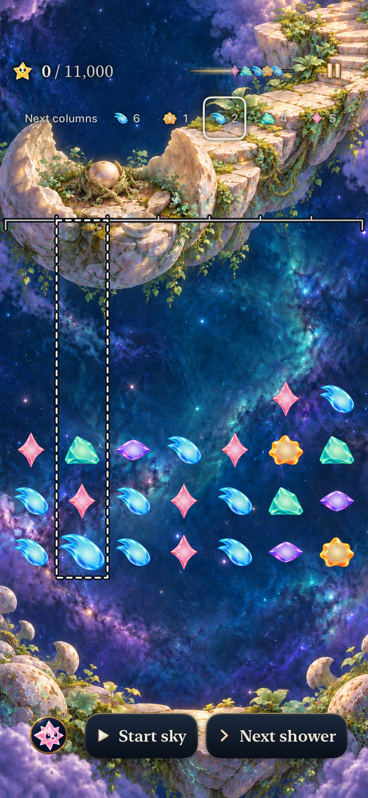
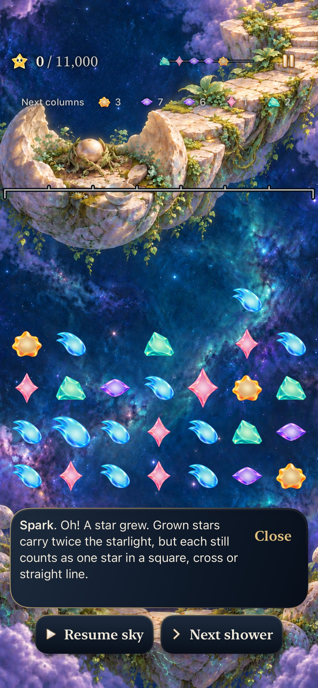
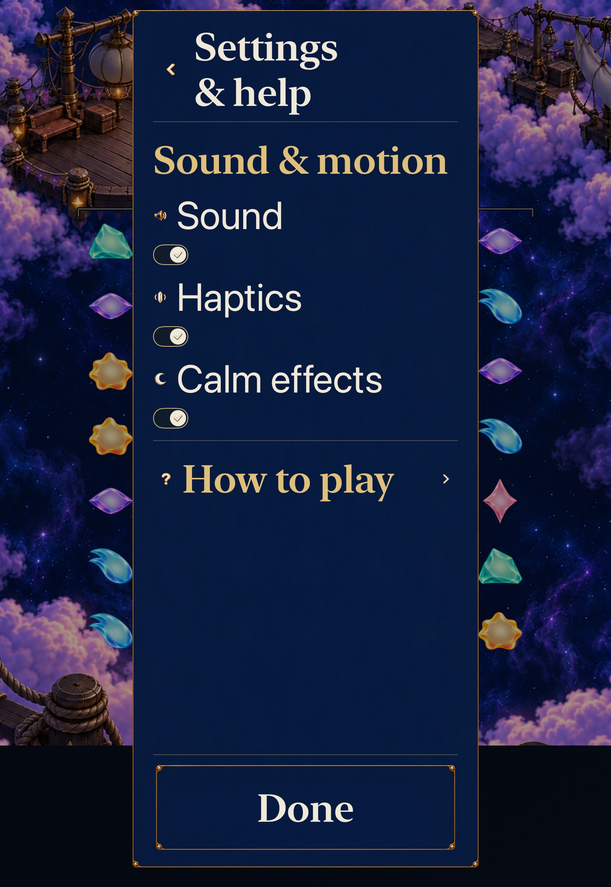
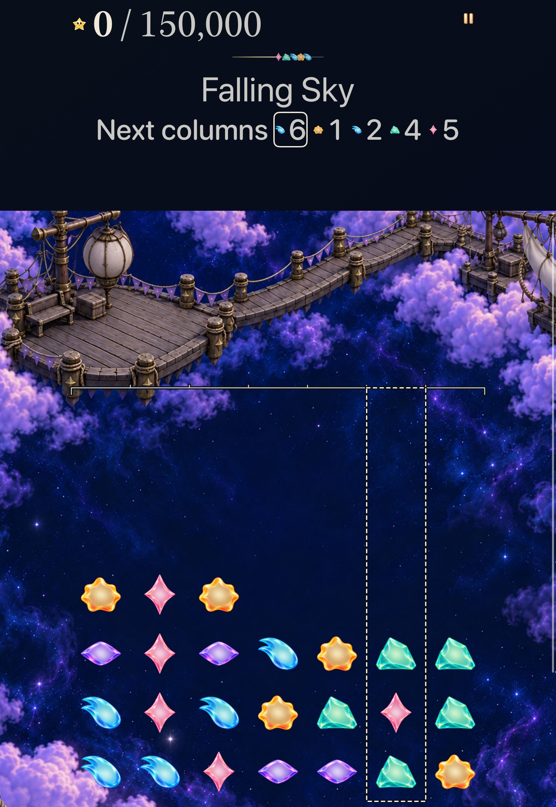
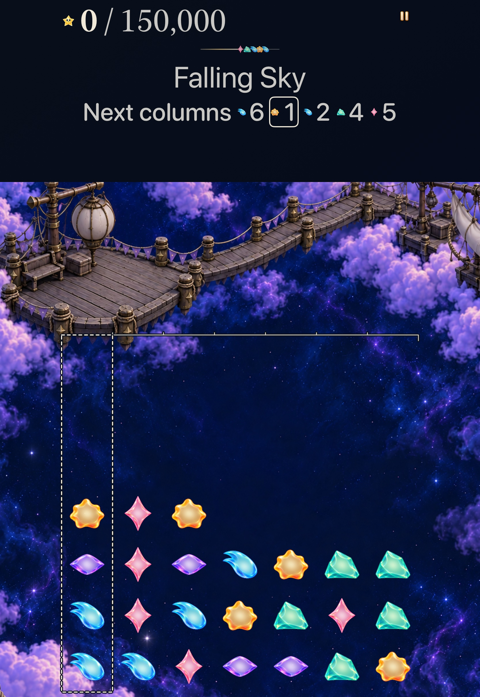
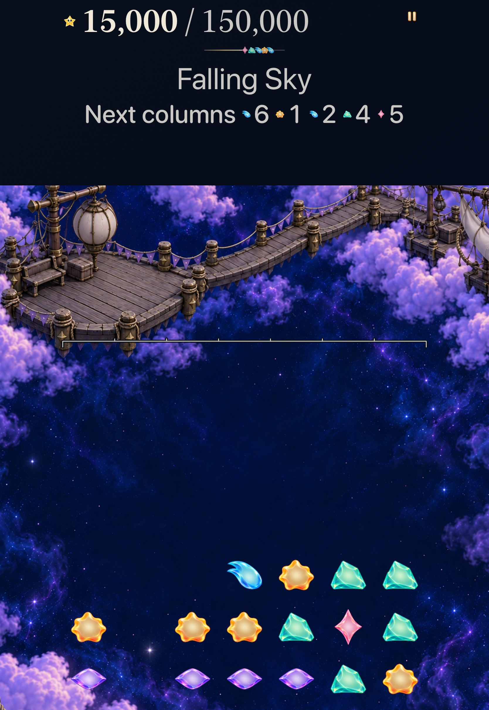
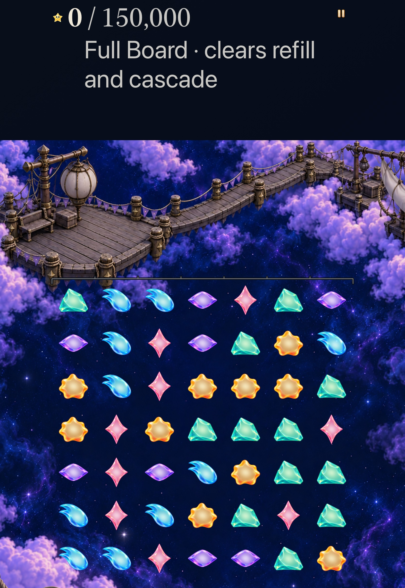

# Locate an announced star in its actual column

**Result:** Adopted development slice · **Source:** App `181ab85`, hosted/phone `d34e7d2`, tablet `85bacf3` · **Build:** computed `dev.e60556d923`, actual local bundle `dev.local` · **Date:** October 24, 2026

[Decision goal3 #363](https://github.com/lbeezr/starfall/issues/363) makes the existing ordered forecast chips optional column locators. Selecting a star outlines its real receiving column; selecting it again hides the cue. The hypothesis is that spatial correspondence makes the announced destination easier to understand. Native success does not establish human recognition.

`SkyForecastInspection.Source` is a transient value containing the actual game, input generation, entire displayed forecast and Next/Arriving state. Rendering rejects any mismatch. Chip callbacks also capture their rendered source and must still match before creating selection; an old callback cannot adopt the same star ID after an exchange. View-owned contact, replacement, menu/background and generation cancellation withdraw the cue. No Store, Core, rule, RNG, score, clock, save, archive19, progression or asset change shipped. Both Story modes and historical Continue/exact Replay retain their owners.

Native buttons retain ordered material/family/one-based-column speech, aggregate forecast values, selected semantics and44-point minimum targets. The locator reuses `LandingGeometry.columnPolygon`: one static unfilled path with dark5-point and pearl2-point dashed strokes, beneath native cells and the gesture surface. It owns no input, hold, timer or animation. The bounded source admits at most49 unique valid entries; current native scenarios have five. Full Board has no shower source or controls. No growth, safety, pattern or move promise is made.

## Executed acceptance

| Scope | Source-bound result |
| --- | --- |
| Core | 352 passed, zero failures/skips,21.039s; unchanged package inputs |
| Affected hosted | Final131 passed, zero failures/skips: new inspection7, destinations6, recovery4, Store51, trace input32, dialogue29 and catalogue bounds2 |
| Normal phone | Current Seed4; columns6/1/2, toggle, exact state, real passive-cue1→8 setup, explicit first shower, refreshed IDs, Home/background/Continue/cold restore and unchanged world;145.241s |
| AX3XL Calm tablet | Actual original ON→OFF→ON; LanternSky4 columns6/1/2, real8→9 chain15k, unchanged world, explicit LanternFullBoard6 with no forecast and27→34 to42k, original ON retained;195.871s |
| Build/resources | arm64 Debug build-for-testing, generic Release, four exact new source memberships,554 typed copy keys, three planner tests, hygiene/diff pass |

Both maintained native methods actually completed with zero failures/skips. Across four product native executions, two passes and two earlier failures remain separate. The accepted tablet checkpoint changes only two navigation lines in its own test after the accepted phone/hosted source; App/Core/hosted bytes and the phone selector/shared helpers are unchanged. Its dirty paths contain only the untracked evidence folder. All662 recorded compiled/runtime/test/configuration inputs remain identical after final acceptance; later changes are documentation/evidence only. [Verification](verification.json) records exact sources and result hashes. Raw products, logs, movies and manifests remain disposable under `/private/tmp/starfall-decision-03-20261024/`.

Hosted checks prove same-forecast exchange invalidation, suspension/same-opening Replay, changed material/order/destination/generation and Next→Arriving rejection. A controlled actual Store shower preserves the exact deadline/save/world/mastery bytes and seeded continuation. During flight, `store.forecast` retains the arriving IDs while `game.incoming` already names the following shower; completion can replace the displayed forecast without changing input generation. Selection follows that displayed identity. The repeated `[40,12,99]` stars at columns `[7,1,7]` are the existing hostile display fixture, not a natural historical-save claim. Actual terminal and retained/current Full Board source exclusion are covered.

## Inspected native exports

Nine original-resolution JPEGs were independently inspected. Phone selection moves between columns6,1 and2; the real exchange starts through the highlighted second column. The replaced forecast has no selected chip or stale bracket. Largest-text tablet selection, actual Settings Calm, real15k chain and Full Board absence retain their own reading/interaction evidence. All native target labels,44-point bounds, bounded header height and complete reading-surface containment are asserted through XCTest; strict hosted rasters verify unfilled selected-column ink and absent unsupported cues.

## Failures, corrections and limits

The first hosted run passed130/131: its new fitting-size probe returned390⅓ points for a390-point proposal. A correction using in-process UIKit accessibility traversal also passed130/131 but could not discover SwiftUI’s out-of-process native buttons. The reproduction was split at the correct boundary: real XCTest journeys retain complete labels,44-point targets, bounded height and containment; hosted tests retain exact native-cell union equality and all unfilled/interior/neighbor/absence raster assertions. No width epsilon or raster threshold was widened. A final geometry-only test edit overlapped the first build checkpoint; its dirty hash is retained in the raw manifest. Final acceptance uses clean checkpoints.

The first phone attempt found the correct selected column, then compared the full painted accessibility bounds with a logical column rectangle. A centered5-point stroke extends2½ points beyond each edge. The corrected oracle compares its centerline with the actual seven-cell union at the same1-point precision; the entire journey then passed. The first tablet attempt passed selection, geometry and15k play, then invoked a picker helper from gameplay after returning from Map. The recording shows attempted page pans while the required menu was absent. Explicit Sky menu→Map navigation corrects that test setup; the whole corrected case passed. No product hit-mapping, clock cause, quiet override, blanket retry or reward workaround was introduced.

The first tablet’s actual activity receipt shows a tap to OFF followed by a tap to ON, proving its original Calm value was ON. The failed case left that original value intact; no preference cleanup mutation was needed. Older OFF receipts retain their own scope. A supported direct-interaction alternative launched the owned app and read Home, but two taps produced no visible navigation; it supplies no acceptance, and the owned app was stopped. No cause is assigned. A boot request found the tablet already Booted; the earlier phone shutdown request found it already Shutdown, with owner unisolated. Final owned-device state was independently confirmed Shutdown; no unrelated process/device was stopped.

The accepted phone recording decoded successfully: ten requested samples65–155s retain actual timestamps and show selected columns, withdrawal, real setup, replacement forecast and return routes. The coordinator requested tablet shutdown after SIGINT but before confirming recorder finalization. The direct recorder did not finish; only its verified owned process was terminated. The ordering may have contributed, but the cause is unisolated. Future capture must confirm recorder exit and file readability before shutdown. Its partial file then failed AVFoundation decode(-11821/-12911). This capture failure is preserved separately; no complete accepted tablet movie or capture-only rerun is claimed. Complete tablet interaction and the original-resolution stills remain valid. Accepted normal/quiet native journeys and static exports are separate from a precisely timed native Arriving-chip tap, human comprehension, physical smoothness, sustained performance, minimum iOS17 and actual VoiceOver. Existing videos preserve actual timestamps/repeats; they are not a complete short helper trajectory. Seed admission uses existing-install access, not an earned earlier campaign. No physical phone was probed or installed. Release retains Xcode’s metadata-extraction warning because no AppIntents dependency exists; no suppression or new dependency was added. Revisit the spatial cue at the next #206 observation or before extending forecast simulation; the external observation does not block the next ordered goal.
