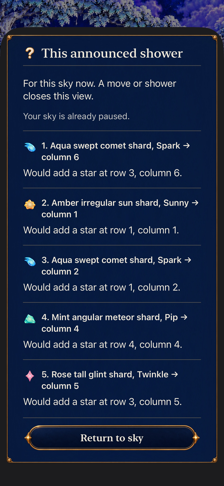
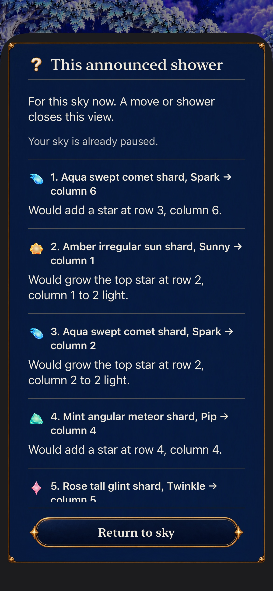
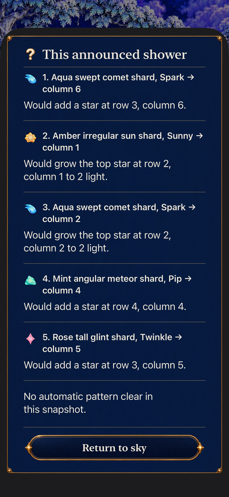
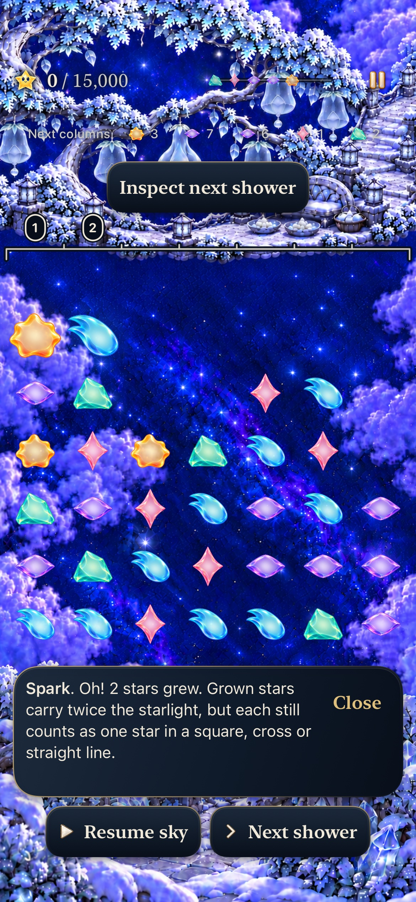
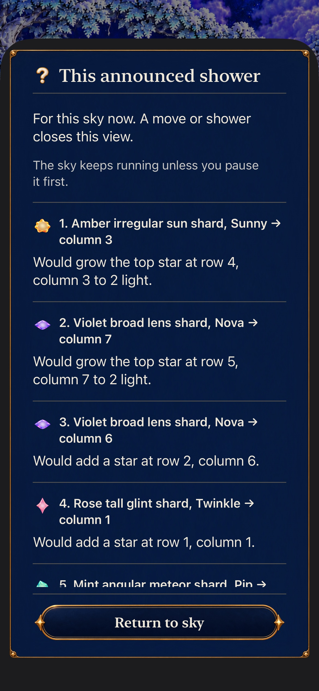
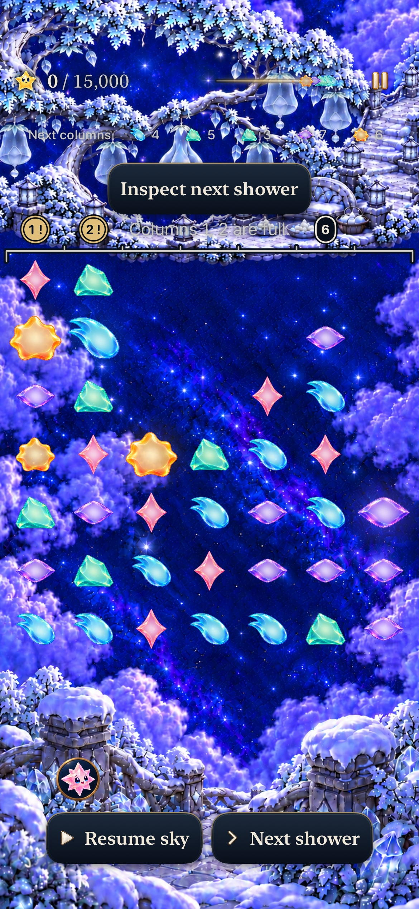
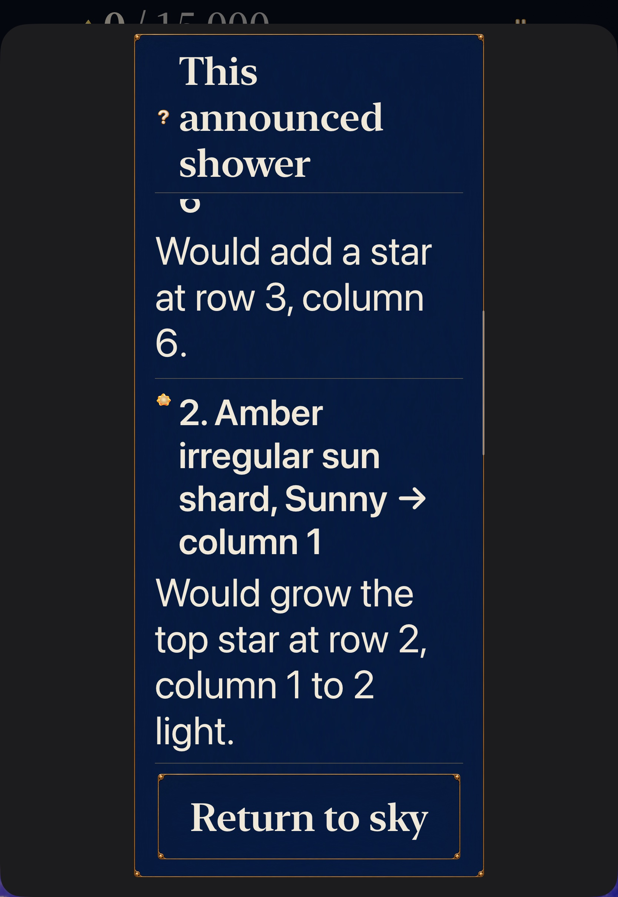
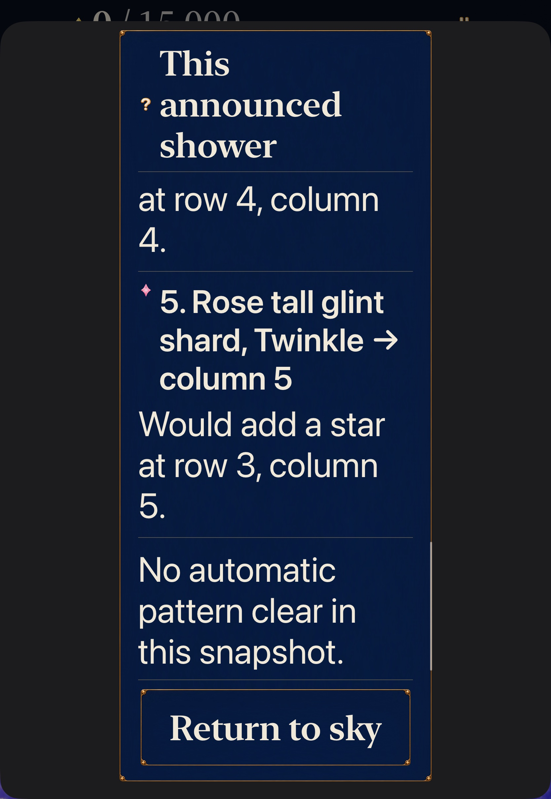
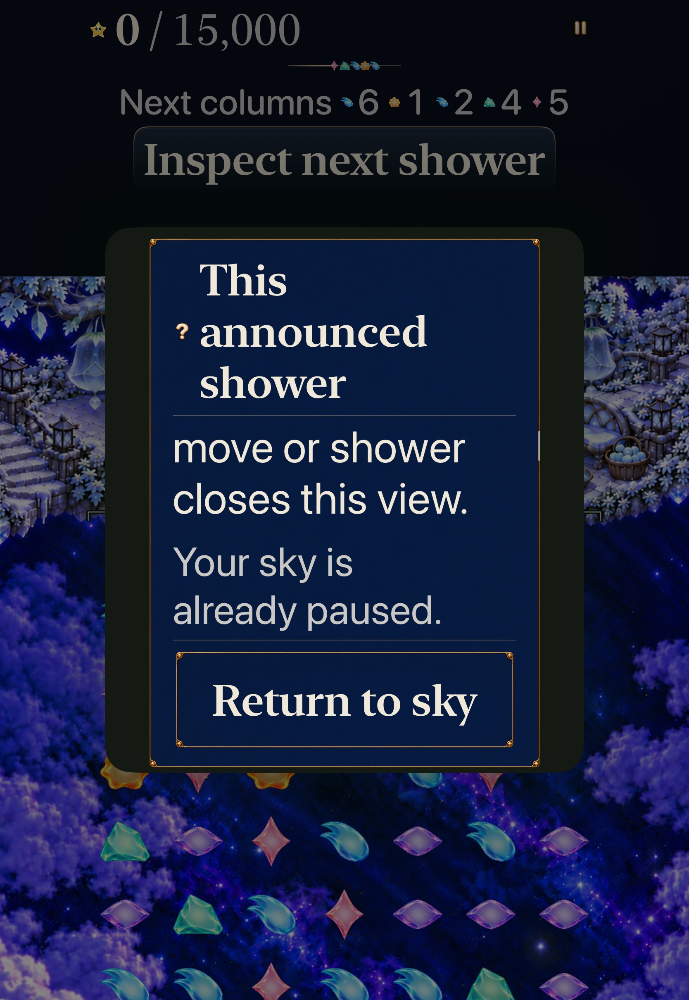

# Inspect the announced shower against this sky

**Status:** Verified development slice · **Source:** initial `fb2eeee`, page-sized `946ff2bad36ff13352103a46d28a99109462a795` · **Build:** computed `dev.85e9d430e8`, actual local `dev.local` · **Date:** October24,2026

[Decision goal4 #364](https://github.com/lbeezr/starfall/issues/364) adds an optional **Inspect next shower** action to accumulating skies. The hypothesis is that ordered, factual growth versus new occupancy helps a player understand the same announced shower before and after a real arrangement. Human recognition and enjoyment are unmeasured.

One `SkyShowerInspection` captures the exact game, input generation and entire displayed Next forecast through the existing goal3 source. It rejects Arriving, invalid saves and Full Board, then calls authoritative Core `letStarsFall()` once on a value copy. Each actual arrival remains separate and ordered: land, grow, first blocked star, then unreached suffix. Every actual recipe phase is retained; a grown arrival can subsequently be spent. Historical pre-arrival changes are disclosed. No generated following forecast, copied RNG or mutable game is exposed by the model.

A large native reading sheet reuses `SkyMenuSurface`, shared materials and wrapping text. It is View-owned and separate from `menu/settings`, so it introduces no Store hold, suspension, pause, save or deadline call. Its captured opening callback must still match; rendering independently omits mismatched content before dismissal. A live shower continues normally and closes stale reading. Full Board has no action. Goal3 column inspection remains available, including its distinct Arriving locator; that does not authorize a prediction from the already committed board. No Core, Store, rule, RNG, score, cadence, archive19, asset or progression change is part of this slice.

## Executed checks

| Scope | Source and result |
| --- | --- |
| Core |352 tests,0failures/skips;21.690s. Core/package/tests unchanged through this slice. |
| Affected hosted |Final corrected source142 tests in one selected run,0failures/skips. Initial source also passed138 plus separately selected4 forecast-recovery siblings; a selector class-name typo omitted those4 from the first invocation. |
| Debug |Canonical arm64 generic simulator build-for-testing passed. XcodeBuildMCP twice rejected the scheme despite its immediately verified defaults, before compilation; CLI fallback supplies actual build evidence. |
| Native |Two final-source whole methods pass,0failures/skips: normal phone181.783s, AX3XL actual-Calm tablet280.438s. Four product executions retain3passes/1earlier layout failure separately. |
| Release |Corrected generic simulator Release build passed. Existing AppIntents metadata-extraction skip warning retained without dependency/suppression. |
| Content and membership |568typed copy keys/121scripts within128; four new Swift source memberships, exactly one target each, pass. |
| Integration hygiene |Three planner tests, hygiene/diff and1,048local targets pass; nine accepted plus one rejected unique original-resolution exports are inspected and hash-verified. |

All666 runtime/test/configuration inputs are hashed in the disposable source checkpoint. No Markdown input is included. Source-bound counts and media never certify later runtime changes. The actual bundle is `com.starfall.prototype`, iOS17 minimum, `dev.local`; the computed development fingerprint is distinct. Build SDK is iPhoneSimulator27.1; runs use owned iPhone17e and iPadPro11(M5), both iOS27.0 build24A434. Host is macOS27.0.1/26A434, Xcode27.1/27A9275. The individual result retains exact IDs/configuration.

## Mechanical contrasts

Current Frostfruit8 opens with30stars and five announced placements. A real35→36 cap exchange changes that same preview to grow existing Amber29/Aqua28, followed by the other placements; no points have been collected. The prepared second shower fits, while the reward-first route accepts entries5–7, blocks8 and never attempts9. The real2→9 recovery permits the identical preview. Repeated-column land→grow-the-same-body→land and full-column grow→block fixtures are explicitly mechanical positions, not naturally reached histories. Growth followed by a recipe uses the existing valid constructed revision2 fixture; retained Dusk/critical fixtures cover pre-arrival changes. None establishes human comfort or current-native historical supply.

Real Store checks retain exact stored archive/world/mastery bytes and deadlines, presenter/feedback/generation, then compare the actual committed shower and following seeded continuation with an untouched control. During flight `pending.forecast` is already committed while `game.incoming` names following supply; inspection refuses that state. A presentation-only refresh can change the displayed preview without another input-generation increment.

## Measured tablet correction

The first tablet case failed at69.485seconds: one complete arrival row measured428points, while the actual scroll reader between fixed title and Return measured254.5points. The inspected capture shows narrow form sizing wrapping the title across three lines. This is a product layout failure, not a test-oracle adjustment. The correction selects informational `.page` sheet sizing on iOS18+, preserving the iOS17 fallback and every full-row/containment/scroll-bound assertion. The installed SDK declares this API's availability; [Apple's presentation-sizing documentation](https://developer.apple.com/documentation/swiftui/view/presentationsizing(_:)) describes page sizing for informational content. The corrected reader measures752.5points in its actual native viewport, preserving whole-row reading and fixed Return. Minimum-iOS17 actual execution remains unperformed.

The failed test spawned an owned600-second `simctl diagnose` after its completed assertion failure, delaying bundle finalization. Only verified diagnostic child74268 of xcodebuild72529 was terminated. A valid finalized0pass/1fail/0skip result preserves the primary failure and screenshots. No unrelated device/process was touched; no assertion weakening, pause/clock workaround or blanket retry was used. The subsequent whole case uses changed product source.

## Native evidence and limits

Corrected AX3XL actual-Calm tablet case completely executes opening/prepared reading, background/exact return, Full Board absence and following42k input. Its original Calm value is read and restored through actual Settings; no launch argument overrides that preference. Final-source normal phone also passed181.783seconds: complete opening/prepared reading, exact paused round/world, actual two grown caps and other placements, then Running status and an ordinary second shower that dismisses stale inspection without Next. It pauses again after two showers at0points with the replacement board; no clock-admission latency claim is inferred. Both use an existing isolated seeded prior Silver repair solely to admit Frostfruit, then explicit Visit/Begin selects current revision8. No earlier campaign repair is claimed. Native text/position/grown-family checks and independent exact Core IDs/value checks are separate.

Full actual VoiceOver remains deferred. No physical phone probe/install, minimum-iOS17 run, human observation, sustained-performance result or complete short body trajectory is claimed. The feature adds static reading, not a new motion system. Raw outputs remain in `/private/tmp/starfall-decision-04-20261024/`.

## Inspected native views

The nine accepted exports below retain original1170×2532 phone or1668×2420 tablet resolution. Each paragraph/arrival was independently read within the actual clipped scroll viewport by native assertions; the whole long inspector is not claimed to fit one frame. The selected large-text Amber row and later Rose/summary view show full reading between the fixed title and Return; neighboring content may cross the normal scroll edge.

| Normal phone, final source | |
| --- | --- |
|  |  |
|  |  |
|  |  |

| AX3XL actual Calm tablet, final source | |
| --- | --- |
|  |  |
|  | The subsequent real27→34 exchange earns42,000 in the passing native method; this zero-point still does not depict that clear. |

*Rejected initial source `fb2eeee`: the status-reading scroll position shows the short form-sized reader; the following complete428point arrival row could not fit its254.5point viewport. The warning crossing the scroll edge is a scroll position, not missing copy. The corrected page reader is752.5points high and passes the unchanged full-row checks. No full body-motion or physical-smoothness conclusion follows from these stills.*

[Verification and failure record](verification.json) and [capture hashes/status](captures.json) retain source boundaries. Raw logs include `core.log`, `build-page.log`, `hosted-page.xcresult`, `phone-page.xcresult`, `tablet-page.xcresult` and `release-page.log`; the original `phone.xcresult` and failed `tablet.xcresult` retain their own source. CLI uses shared schemeStarfall, arm64 Debug build-for-testing and selected test-without-building with parallel testing disabled; generic Release has a separate DerivedData folder. No new checks or paid CI dispatch were added.

Both owned simulators are confirmed Shutdown after acceptance. All workers returned with no additional discoveries; shared resources and write reservations release at the individual merge/completion boundary. Six ordered product leaves#365–370 follow, with no refill or external-observation gate.
