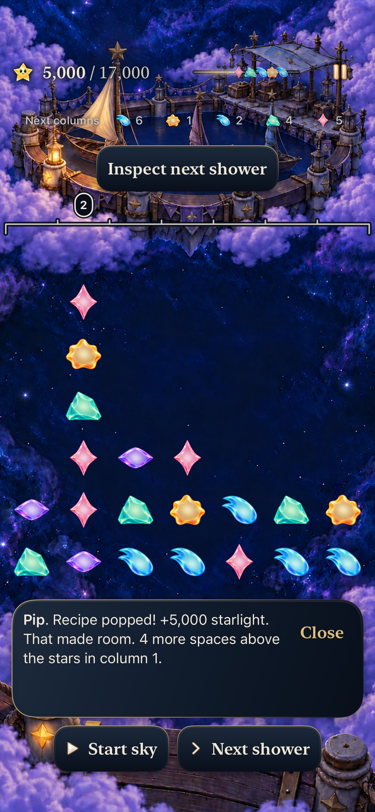
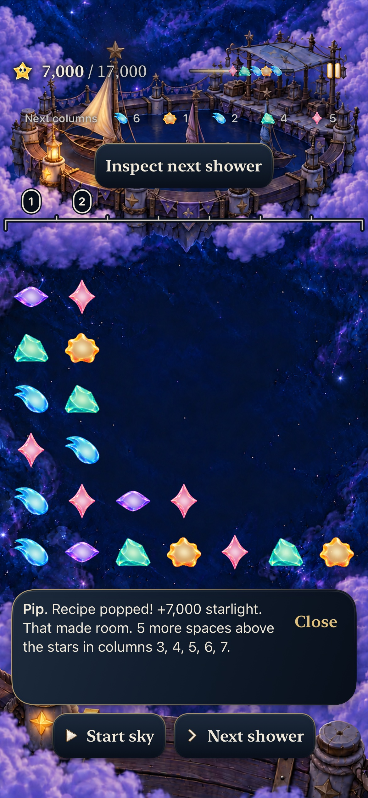
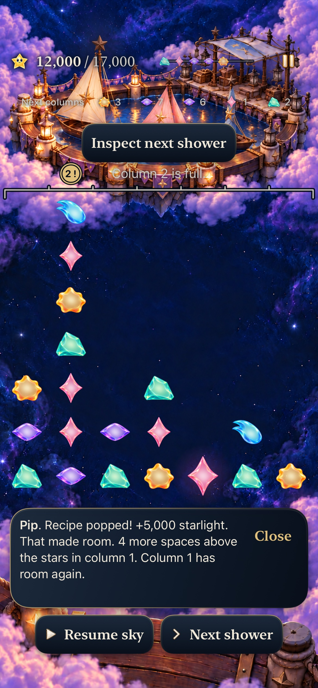
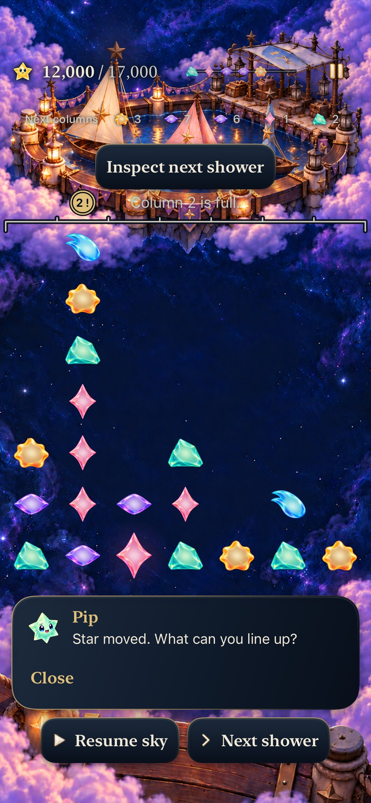
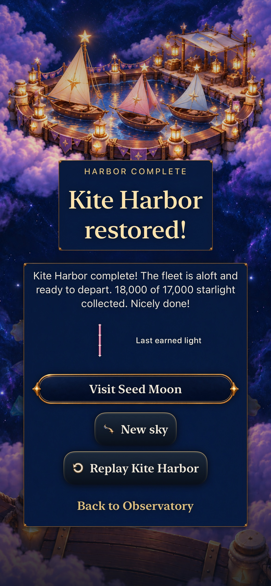
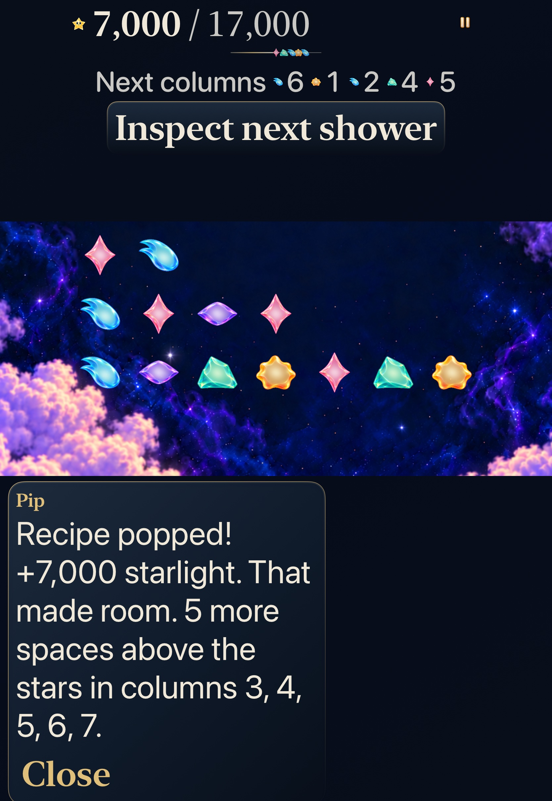
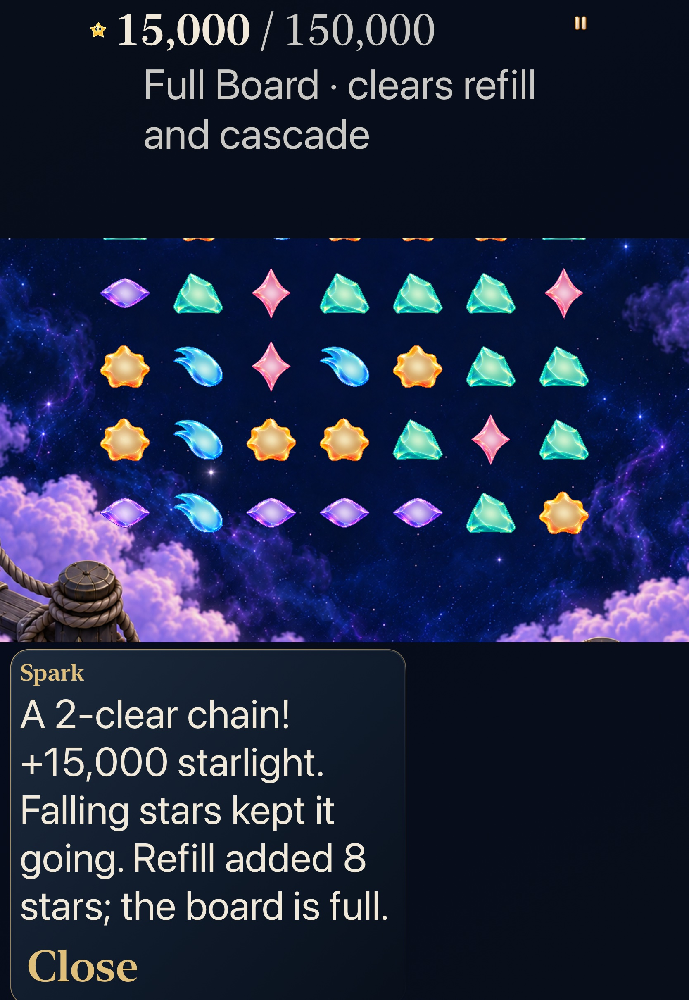
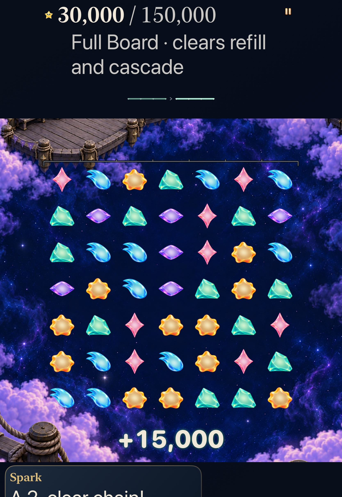

# See the room a committed clear opened

**Verified development slice for [Decision goal 5 #365](https://github.com/lbeezr/starfall/issues/365).** Current Kite choices now report their actual column headroom beside earned points through the existing guide. Full Board reports its actual replacement stars. There is no extra banner, clock hold, Core/rule/score change or new save state. Human understanding remains unmeasured.

Runtime source **56f2973 / dev.c2dcf294b6**, actual local bundle **dev.local**. Accepted hosted source **84a3121** corrects only two test files; accepted native source **dae8ec1** then corrects only one native score-label expectation. The complete 708-input acceptance manifest remains unchanged after that native checkpoint. It extends the original 670-input native manifest with 38 Core test files, all verified byte-for-byte against the unchanged Core-run base `60de19a6`; both original and completed manifests are retained. The three dirty paths at native compilation were noncompiled App/AppTests/UITests READMEs. Raw source manifests, logs and results remain under `/private/tmp/starfall-decision-05-20261024/`.

| Check | Actual result |
| --- | --- |
| Core | 352 passed, 0 failed/skipped; 68 Core/package/test inputs unchanged |
| Affected hosted | 114 passed, 0 failed/skipped at `84a3121` |
| Complete final-source native | Two distinct methods, 2 passed, 0 failed/skipped; phone 183.076 s; tablet 181.860 s actual method durations |
| Build/configuration | arm64 Debug build-for-testing and generic Release passed; four sources each in exactly one intended target |
| Supporting checks | 572 typed copy keys, 121 scripts within 128; 3 planner tests; hygiene/whitespace and local links pass |
| Visual scope | Eight original-resolution exports inspected; per-image status in captures.json |

Hosted selection: SkyHeadroomFeedbackTests (10), SkyHeadroomGuideTests (7), SkyDialogueTests (29), SkyDialogueCatalogBoundsTests (2), FallingSkyStoreTests (51), SkyForecastRecoveryTests (4) and SkyShowerInspectionTests (11). These are selected checks, not a full current Apple matrix. Generic Release retains Xcode's existing AppIntents metadata-skip warning; no framework or suppression was added. Host macOS 27.0.1 (`26A434`), Xcode 27.1 (`27A9275`); build SDK iPhoneSimulator 27.1, actual iPhone 17e/iPad Pro11 M5 simulators iOS 27.0 (`24A434`). Minimum deployment 17.0 is a build setting, not an actual iOS 17 run.

## Actual consequences, without a survival promise

`SkyHeadroomFeedback` reads committed before/after boards using the shared occupied-top height. Internal holes do not count as free space above a column. A genuine clear can report room even when it earns zero light. Positive gains are attributed only to their named columns; a labeled mechanical shower fixture gains one space in column 3 while other columns gain stars, so it cannot claim a positive overall net. Saved-context validation still checks Core invariants. Room and refill facts use committed boards and receipts rather than forecast or animation coordinates; no future-supply search or RNG mutation occurs.

| Same Kite revision 4 opening/announced supply | Actual award and room |
| --- | --- |
| High 15→14 |5,000 points; four additional spaces above column 1 |
| Low 4→11 |7,000 points; one space each in columns 3–7, five across those named columns |
| Low, first shower, then high 15→14 |5,000 more points; four spaces in previously full column 1; column 2 remains full |
| Lantern Full Board revision 6 8→9 |15,000 points across two phases; eight actual replacement arrivals; committed board remains 49 stars |

Full Board uses actual `refillArrivals` from every committed phase, never temporary `settled` vacancies. Retained Lantern revision 5's same exchange supplies 18 replacements and earns 66,000; it stays distinct. Setup/growth without a clear emits no new room fact. Actual win/loss copy retains priority. Existing guide ID, speaker, priority, timing, full-column recovery suffix and Store publication/cancellation remain responsible. No new Store/Core, clock, archive 19, renderer, asset, rule or progression owner ships.

## Whole native journeys and their limits

Normal-motion phone uses explicit new Kite revision 4 through existing isolated legacy access, compares both opening choices under the same forecast at zero showers, fully reads the result, preserves exact state/world through background/cold Continue, then accepts the first shower and makes a real full-column recovery. Four following zero-award setups replace the room message. The frozen final exchange earns 18,000/17,000, exposes result/onward controls and preserves exact Replay. Legacy access means Seed was already accessible; only the actually earned Kite repair changes this fixture's world. No earlier campaign is claimed.

The tablet operates actual Settings Calm OFF→ON at AX3XL, reads the whole Kite guide in its actual viewport, preserves the retained round/world and explicitly returns through Map before selecting new Lantern Full Board revision 6. Its 8→9 clear reads the full eight-replacement message with 49 actual bodies; a following 0→1 clear reaches 30,000. Background/return and world remain exact; its original Calm value is read/restored rather than inferred from older receipts. Reading pans overlap and full ending/Close fit assertions remain. Native rounds are paused with explicit Next, so this is not an unpaused cadence or reaction-time observation. Hosted injected-clock tests separately preserve actual deadline, save bytes, mastery/world, next authoritative shower and RNG continuation.

## Failures retained and corrected

The original hosted selection executed 114 methods: 112 passed and 2 failed, with four assertion failures. An older manual-clear context oracle omitted the new literal three-space sentence before its existing Dusk warning. A new Help test assumed inspection admission during an automatic phase; the actual committed presentation ledger reserves all columns. The correction explicitly proves reservation, establishes real settlement, then admits newer ingredient Help and rejects duplicate old completions. All exact metadata, speech, revision, save/world/mastery and deadline assertions remain. This corrects test expectations without changing product behavior or proving in-flight inspection admission.

That completed failing hosted run spawned a 600-second diagnostic. Only verified diagnostic 22663, child of owned xcodebuild 22466, was terminated after assertions finished so the original failed bundle could finalize. The command/parent receipt is retained; no unrelated resource was stopped. Initial sandbox report-cache access failed and normal authorized xcresulttool access exported the same result.

The original phone case reached the real 18k win but failed its final score oracle at 154.250 seconds: the ceremony exposes the entire Sunny result sentence through the score identifier, unlike the in-play numeric instrument. The native-only correction requires that complete exact label. The corrected whole case executes the remaining controls/world/Replay boundaries and passes. Across all product native runs, 3 executions retain 2 passes/1 failed separately; no assertion was weakened, no quiet workaround or blanket retry applied. App/Core/hosted bytes are identical across this native correction.

No movie was recorded for this static-text change. Stills prove inspected fit/state, not a full short helper trajectory, physical smoothness, sustained performance or human recognition. Actual VoiceOver/#217 stays deferred; physical installation/play and minimum-iOS 17 execution remain separate. Hypothesis retained: truthful local room and refill facts may help players compare choices. Revisit recognition at the next #206 observation or before extending this combined guide.

## Inspected native views

| Normal phone | |
| --- | --- |
|  |  |
|  |  |

| AX3XL actual Calm tablet | |
| --- | --- |
|  |  |

The phone exports are 1170×2532; tablet exports 1668×2420. Tablet reading positions can crop upper board rows beneath the fixed header; the 49-body count comes from complete native assertions. The 30k board/award frame leaves later guide text below the scrolling edge, while the preceding dedicated guide frame shows its whole message and Close. No resampling, annotation or alternate renderer was used. Native whole-text/viewport assertions supplement the selected stills. [Verification](verification.json) records actual source/counts/commands and [captures](captures.json) binds every promoted image to its source and hash. All workers returned with no extra discoveries. Five ordered product leaves#366–370 remain; no refill or human approval gate is added.
