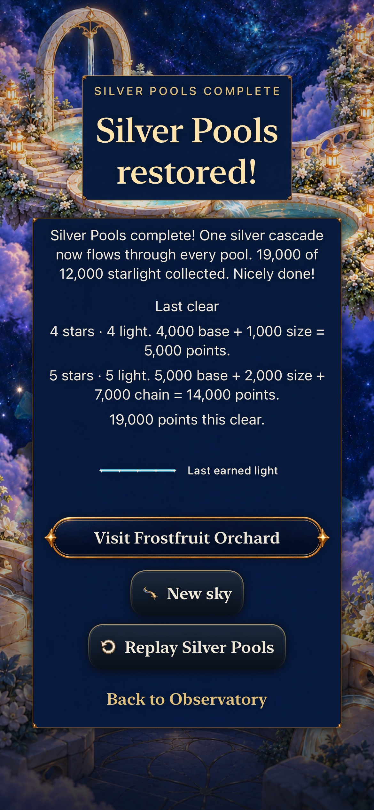
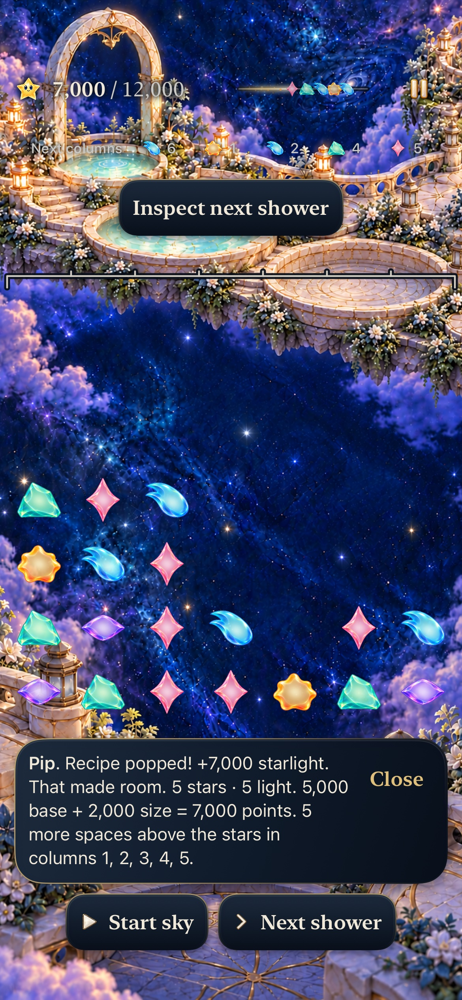
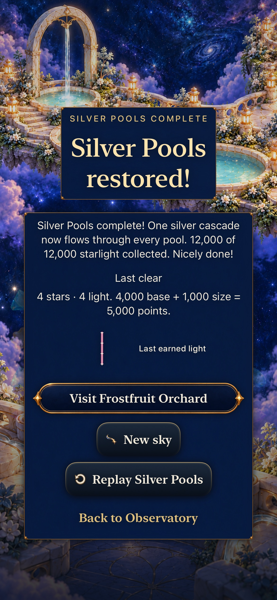
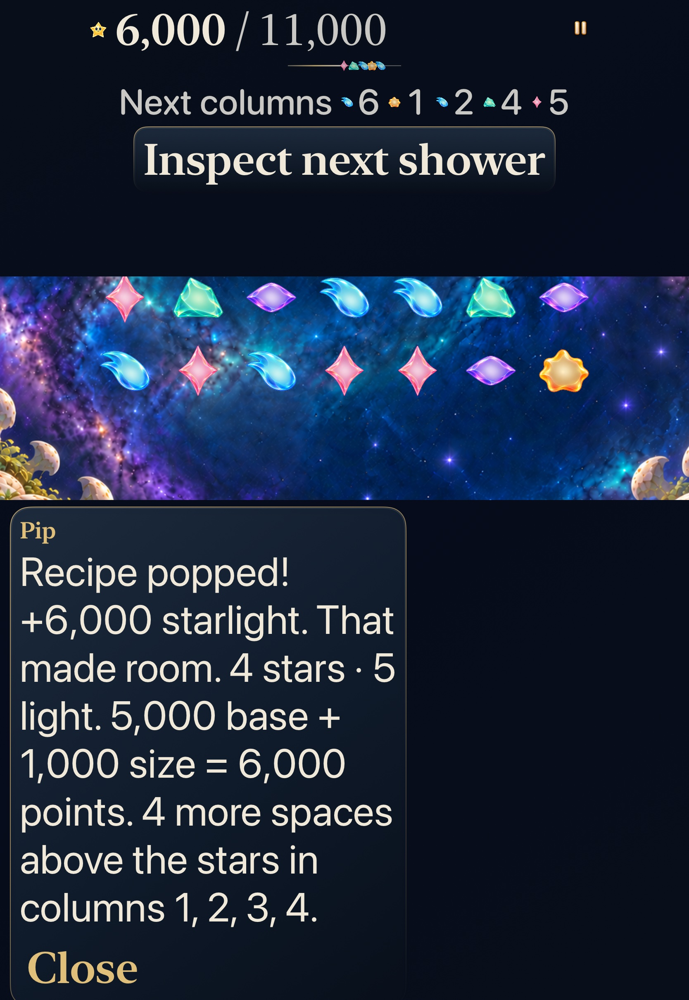
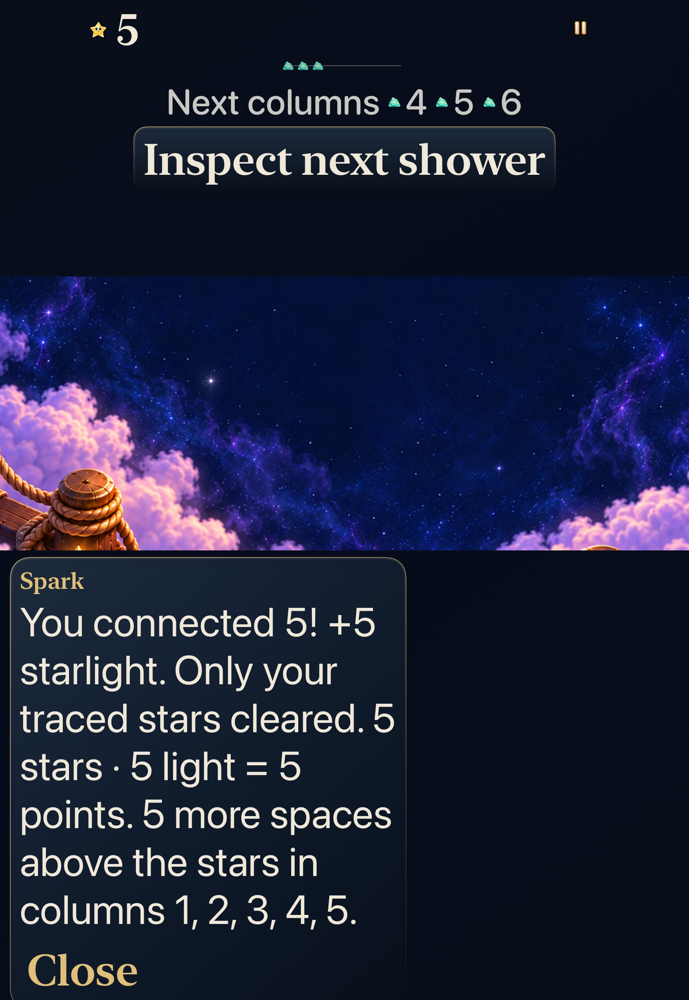
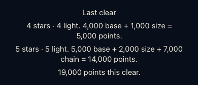

# Exact points from the committed clear

The current receipt and native guide now distinguish actual stars/light from base points, size and causal bonuses. A static **Last clear** block preserves every committed phase at an ending without delaying the result controls. [Decision6/#366](https://github.com/lbeezr/starfall/issues/366) builds on ingredient inspection, announced occupancy, headroom and the accepted identity receipts. Core accounting remains authoritative; no rule, score, RNG, clock, archive19 or asset changes ship.

**Recorded acceptance:** 352 Core, 157 affected hosted and two whole final-source native methods pass with zero failures/skips. Debug build-for-testing, generic Release, 581-key/121-script catalogue, seven exact source memberships, three planner checks and hygiene/diff pass. Seven original-resolution exports were independently inspected: five native screens and two explicitly hosted component renders. This selected scope is not a full current Apple matrix.

## Source and ownership

Runtime `409cf44783db8809864db586605badd40144aec9`, computed `dev.b3d8e2d36a`; hosted `6099df445d5f086dd2cd86c48c1056f1f2cb4317` changes only the controlled-presenter test. Native `8be7672e45821a74f45faa9aac802145c4b59a28` changes only its complete result-label oracle. Actual installed identifier is `com.starfall.prototype`, bundle build1, with `StarfallBuildID=dev.local`; the computed fingerprint is not the installed stamp. All716 recorded runtime/test/configuration inputs remain unchanged after that native checkpoint. Its explicit dirty paths are the three noncompiled App/AppTests/UITests READMEs. Subsequent changes are documentation/evidence only. All68 Core/package/test inputs independently equal main894e2d60 used for the352-test run. [Source hashes](source-inputs.json) and [verification/commands](verification.json) bind the evidence.

`SkyScoreExplanation` copies immutable Core awards and verifies aggregate/prefix equality. Overlapping recipes use the actual cleared union, not recipe lengths. Grown light is separate from physical star count. Nil-award Open Sky/history keeps its actual1:1 reward with no Story scaling. Twenty phases bound the value; this is no action history or new save. The live label caches its equation at publication and uses measured fit/fallback to preserve the primary award in narrow/large-text regions. AX text always has the full native guide. The existing1.4-second receipt lifetime, figures, packets, arrival, input and terminal timing remain unchanged.

The guide gives one complete aggregate equation before unchanged headroom/recovery text so multi-phase actions stay within the existing400-character contract. Every chronological phase is available in the static terminal block. `SkyLightReceiptSession` captures one latest genuine-clear numeric value synchronously before callbacks; no-award actions retain that value while replacing the live guide, and actual round replacement clears it. Cold restore omits unavailable detail. **Last clear** makes a retained explanation honest after a later losing shower; the separately named **Last earned light** figure keeps its existing positive-light meaning. No recap page, best-pattern system, schema or progression is added.

## Native decisions and inspected views

Normal-motion phone currentSilver4 genuinely earns5,000 then14,000 from one9→10 action, totaling19,000. Both phase rows, action total, actual initially lockedFrostfruit unlock, unchanged unrelated world, immediate actions and exact Replay pass. Separate2→9 earns7,000, then23→22 earns5,000 toward the12,000 round result; the latest-clear block contains no earlier chain bonus. Background return retains the in-session block; cold restore omits it and exact Replay returns the opening. The accepted method actually ran168.284s, separately from its189.145s result interval. Existing-install access enables Silver entry; earlier campaign repairs are not claimed.

| Actual19k chain | Independent7k clear | Later5k clear /12k round |
| --- | --- | --- |
|  |  |  |

AX3XL tablet operates actual Settings Calm OFF→ON and restores its read original preference. FreshSeed4 clears four stars carrying five light units for6,000:5,000base+1,000size. Complete guide reading, a genuine zero-award setup, exact state/world and background return pass. A separate existing historical horizontalFive Open Sky fixture then performs a real five-star trace for **5**, not5,000; no Story repair is earned. This fixture does not certify modern shower supply or continuity with Seed's round. The accepted whole method actually ran176.857s, versus197.809s result interval. These paused/explicit input routes are not an unpaused reaction-time study. Native reading positions can crop upper board rows beneath the header; they prove complete visible guide reading, not a whole-board still.

| Four stars / five light | Open Sky five points |
| --- | --- |
|  |  |

Hosted component renders separately show the compact live equation and static complete block. They are not native screen/motion evidence.

## Failures and limits retained

The original157-hosted selection had156passes/one failed root test. Its default recorder completes phases synchronously, so asserting no callbacks had occurred was an invalid harness assumption. The test-only held presenter now proves synchronous terminal capture before callbacks and rejection of retired late callbacks, preserving all exact save/world/deadline assertions; all157 then passed. The first phone execution genuinely reached19k but failed at57.657s because its oracle expected the in-play numeric score label. The ceremony exposes Sunny's full result sentence. The native-only correction requires that exact complete sentence, and the entire corrected journey passed. Across native iterations:3executions,2passes/1failed. No assertion weakening, blanket retry, forced quiet or speculative product clock change occurred.

Each failed run spawned a600-second diagnostic after assertions finished. Only exact verified descendants85101(parent83502) and89882(parent88373) were SIGTERM'd so their original failed bundles could finalize; no unrelated process/device was stopped. Generic Release retains the existing no-AppIntents-framework metadata extraction warning; no dependency or warning suppression was added.

Actual overlapping-recipe union, zero-light clears, retained scoring, current/retained Full Board phases, phase≥6 capped awards and RNG continuation are deterministic hosted/Core evidence, not new native overlap/Full Board walkthroughs. No movie ran for this static information change; stills and component renders do not establish live1.4-second reading latency, complete short helper trajectories, physical smoothness, sustained performance or human recognition. Actual VoiceOver/#217 stays deferred. Physical gameplay/installation, minimum-iOS17 execution and actual human learning remain separate. No player data or physical phone was touched. Devices were iOS27.0/24A434 on the recorded Xcode27.1/SDK27.1 host; both owned simulators were confirmed Shutdown afterward.

Hypothesis retained for development: accurate consequences may help compare choices. Revisit comprehension at the next#206 observation or before extending receipt/recap ownership. Next ordered product goal is#367 survivor ingredients;#367–370 remain usable, so no refill. Raw logs/results/attachments/diagnostic receipts remain disposable under `/private/tmp/starfall-decision-06-20261024`.
