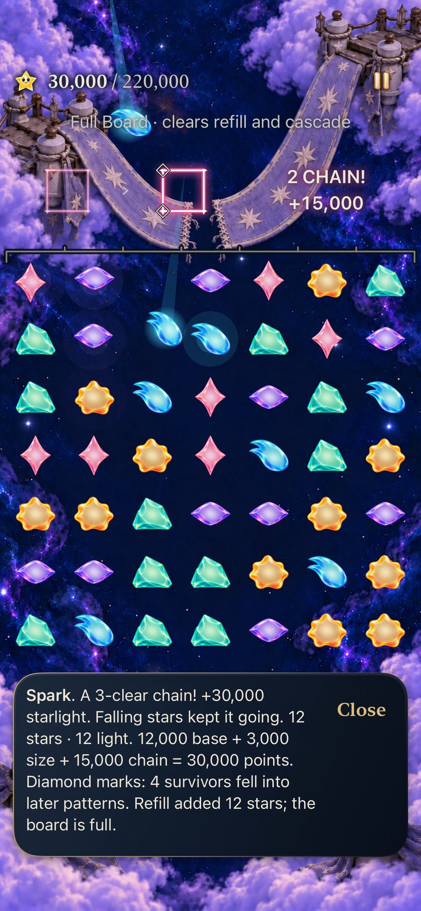
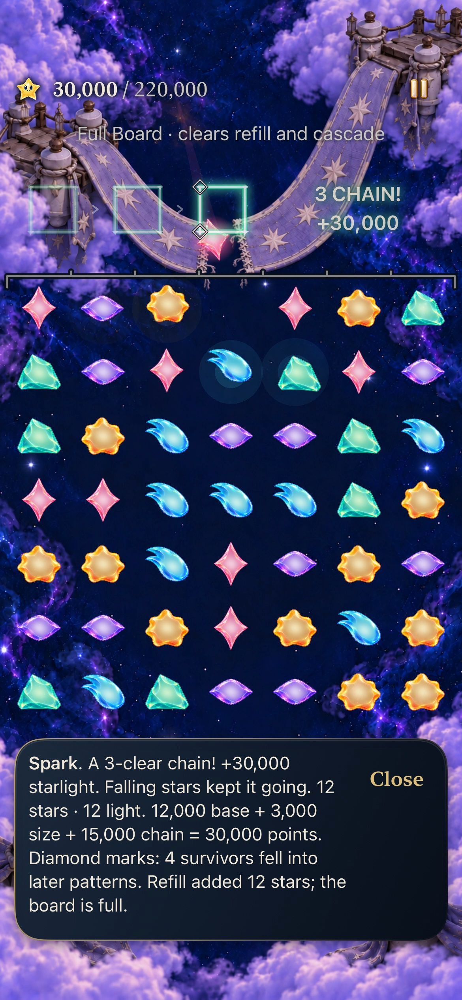
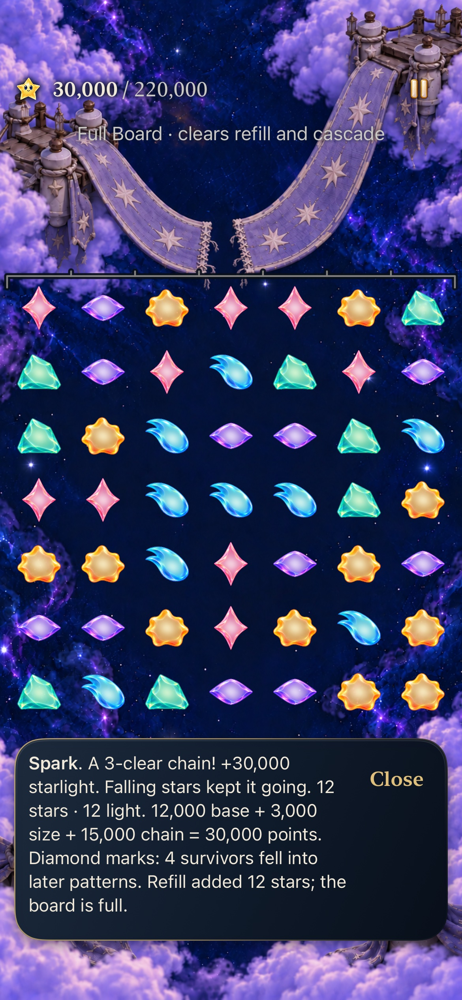
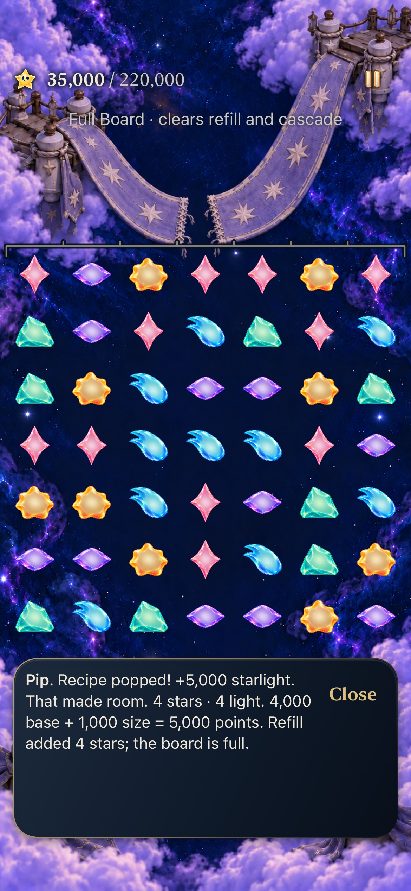
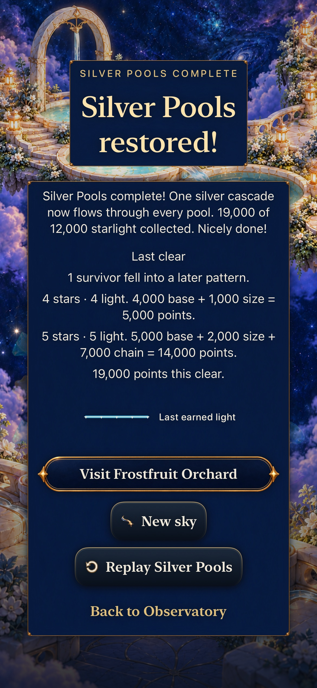
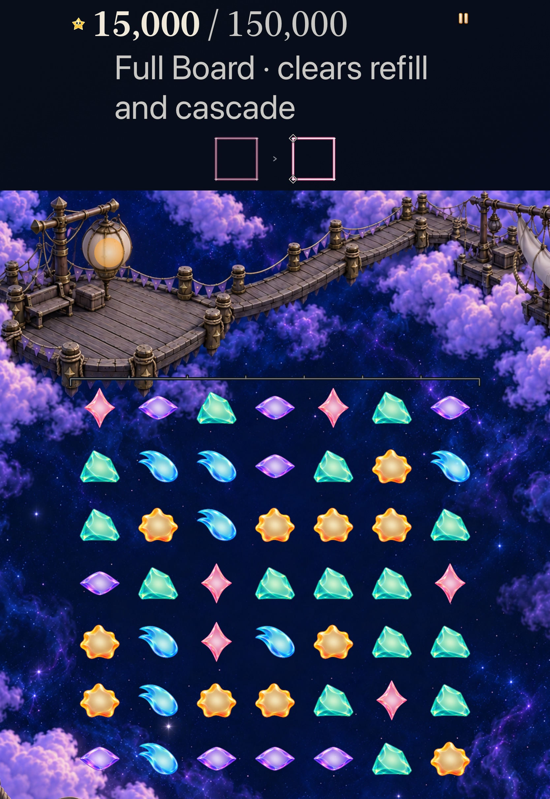
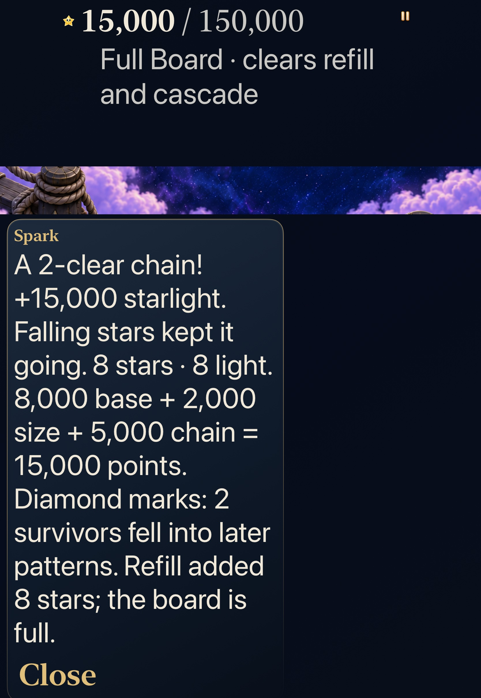
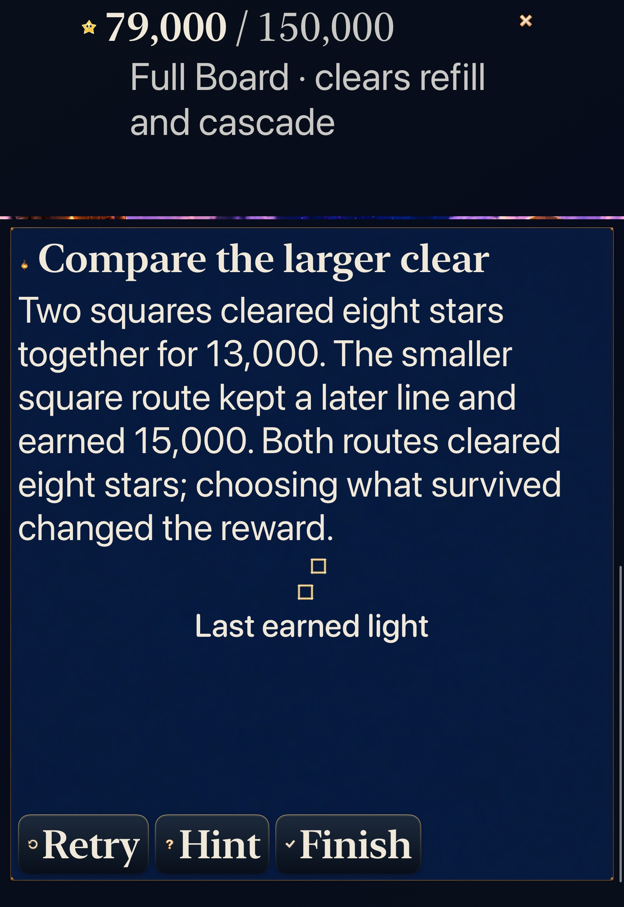

# The stars that actually carried the follow-up

**Result:** Verified development slice · **Owner:** continuing factory coordinator · **Date:** October 24, 2026

Only original-action stars that really moved into a later committed pattern receive an unfilled diamond on the current return. The existing guide gives the whole-clear count, while an immediate ending retains a fact-only **Last clear** reading. [Decision7/#367](https://github.com/lbeezr/starfall/issues/367) builds on exact recipe returns and committed score components without changing rules, clocks, saves or earned outcomes.

**Acceptance:** 352 Core, 167 affected hosted and two complete distinct native methods pass, zero failures/skips in accepted runs. Arm64 Debug build-for-testing, generic Release,584 typed keys/121 scripts within 128, six exact source memberships, three planner checks and hygiene/diff pass. Nine original-resolution exports were independently inspected. This selected scope is not a full current Apple matrix or human-learning result.

**Next:** #368 one bounded Last clear recap, followed by #369–370. Three usable product leaves remain after this slice; no refill or new human gate.

## Source and actual evidence

Product checkpoint `dbb0c3bb4258f26b6a1e93bdeb2a5b8e078b320c`, computed `dev.071f90f67e`; accepted test checkpoint `9f61b92af96db59950be3e32e17cc76e26f2e904` changes only two hosted-test oracles/measurements. All 722 recorded runtime/test/configuration inputs remain byte-identical after native acceptance; its three dirty paths were noncompiled folder READMEs. All 68 Core/package/test inputs independently match main `e9490486`, used for the352-test run. Installed simulator bundle is `com.starfall.prototype`, build 1, `StarfallBuildID=dev.local`; computed fingerprint and actual stamp are distinct. [Source hashes](source-inputs.json), [commands, results and recording receipts](verification.json), and [capture provenance](captures.json) retain the exact boundaries.

`SkySurvivorIngredients` checks the entire contiguous action prefix, unique IDs, exact gem/cell continuity through settled/refilled boards and all current recipe memberships. An original survives every earlier clear; a birth from any refill in this action cannot become an original later. A previous action's refill can legitimately be an ingredient of this action. Cleared, unmoved and same-phase stars are excluded. Valid empty transitions stay distinct from invalid prefixes. Bounds remain 20 phases/49 original bodies; every simultaneous/overlapping recipe stays intact.

`StarlightCelebration` copies this value at publication. The existing Canvas draws one open diamond per eligible current destination knot using the shared affine fit, clipping and 1.4-second lifetime. Prior figures have no marks or independent lifetime; manual walks retain their existing exact topology. Normal and Calm share destination geometry. No new animation, packet, body copy, future-chain suggestion or reward is added. `SkyLightReceiptSession` pairs the numeric survivor count with the existing latest genuine-clear score record. No-award actions retain that record; a newer genuine clear replaces it even with zero eligible survivors. Actual replacement clears it; cold restore omits it. Terminal art cancellation cannot delay the outcome or revive diamonds.

## Native results and inspected composition

Normal phone current Ribbon7: actual 8→9 commits three phases / 30k on 49 bodies. There are two movers in phase 2 and two different movers in phase 3, so the guide's4 describes the **whole action**. Only the active figure's own 2 are marked; prior figures remain inert. Independent 11→12 earns 5k / 35k round total and replaces the guide without the older causal fact. Background, cold Continue, exact world and Replay 0 pass. Existing-install access enables entry; earning the earlier campaign is not claimed.

| Actual phase2, two marks | Actual phase3, two marks | Whole-action guide |
| --- | --- | --- |
|  |  |  |

The same whole phone method genuinely wins current Silver4 through 9→10, 5k + 14k = 19k. Exactly one Aqua ingredient fell into the final line. Repair, initially locked Frostfruit becoming ready, unchanged unrelated world, immediate controls and exact Replay pass. Background retains the fact; cold result omits unavailable score/provenance/geometry. Actual method duration is211.520s, distinct from its226.134s result interval.

| Separate action | Immediate earned ending | Cold ending |
| --- | --- | --- |
|  |  |  |

AX3XL tablet operates actual Settings Calm OFF→ON and restores its read original value. Current Lantern6 actual 8→9 earns 15k with two movers, complete guide reading and exact retained state/world. Existing historical Compare practice contrasts a square→survivor-line route 81k with same-phase two disjoint squares 79k, then returns to the real 15k round through background/Continue and exact Replay 0. Practice uses its own chapter instructions, not the Story guide. Method 237.810s, result interval253.658s. Reading positions can crop the board; actual 49-body state has separate native assertions.

| Calm current return | Complete large-text guide | Same-phase comparison |
| --- | --- | --- |
|  |  |  |

## Failures, motion scope and limits

The first hosted run retained 166 passes/one failure: the existing full-column pressure oracle omitted the new genuine six-survivor sentence in a four-phase clear. Its exact expected paragraph now includes that sentence; identity, speaker, priority, lifetime, recovery, save and clock assertions remain. Two double-optional fixture presence assertions now use equivalent explicit boolean containment, removing new compiler coercion warnings. All 13 model/five rendering methods passed both runs; all 167 then passed. Only verified diagnostic 32867, parent 31637, was SIGTERM'd after assertions finished so that original failed bundle could finalize. No product workaround, weakened assertion, blanket retry, forced quiet or speculative clock fix ships. Both native methods passed their first execution.

Both direct recordings finalized with exit 0 and successful AVFoundation decode **before** simulator shutdown. The normal movie's 61 requests across 55–61s retain actual timestamps/repeated frames. Inspected original frames at 59.300s and 61.000s show successive current diamonds, separate prior figures, score and complete guide; sampled sheets show publication, flight and replacement. Hosted production-pass raster checks independently prove open centers, normal/quiet equality, HUD masks, expiry and dense overlap deduplication. Dense 42-original fixtures establish bounded geometry, not reachable campaign saves. Consecutive pure actions and existing held-callback Store tests establish deterministic source retirement; native independent input followed guide reading, so no sub1.4-second latency claim is made. No full 0.18-second body trajectory, physical smoothness, sustained performance, actual human recognition, minimum-iOS17 execution or actual VoiceOver claim. VoiceOver/#217 stays deferred. Generic Release retains Xcode's existing no-AppIntents-framework metadata warning; no dependency/suppression was added.

No Core/scoring/RNG/clock/archive19, asset family, campaign or progression changes. Both owned simulators ran iOS 27.0/24A434 and are confirmed Shutdown; no physical phone/player data was touched. Hypothesis: seeing actual carried ingredients may help recognize causal clears. Revisit at the next #206 observation or before extending this presentation; automated correctness does not establish comprehension. Raw source/products/results/recordings remain disposable under `/private/tmp/starfall-decision-07-20261024`.
