# Read the last clear without replaying its rewards

**Result:** Verified development slice · **Owner:** Starfall factory coordinator · **Date:** October24,2026

Decision8/10 [#368](https://github.com/lbeezr/starfall/issues/368) adds optional **Last clear** reading to the existing Sky menu and earned/lost result. One immutable in-session value holds actual pre-clear ingredients, every separate recipe path or exact manual walk, chronological score components, original moved survivors, actual replacements and resulting occupancy. A no-clear setup/loss may retain that correctly named earlier clear; a genuine zero-light clear replaces it. Real round replacement clears it; cold restore omits it. The distinct **Last earned light** figure keeps its existing positive-only meaning.

Core/rules/RNG/scoring/clocks/archive19/world progression and production assets are unchanged. No diagram has an input, reward, save, undo or replay capability. Existing result actions precede the optional opener; existing menu suspension and Begin-only replacement retain ownership.

## Acceptance and scope

| Boundary | Source-bound result |
| --- | --- |
| Core |352 passed,0failed; all68 Core/package/test inputs unchanged from the run |
| Affected hosted |162 passed,0failed/0skipped across nine selected classes, including24 new model/presentation/Store methods |
| Build/tooling |arm64 Debug build-for-testing and generic Release pass;596 typed copy keys/121 scripts within128; seven exact new source memberships; full81 Python tests pass |
| Native |Four complete current-source methods pass,0failures/0skips: normal phone379.186s/412.208s/97.880s and actual-Calm AX3XL tablet483.156s |

The selected scope is not a full current Apple matrix. Actual human usefulness/recognition, physical devices, minimum-iOS17, sustained performance and actual VoiceOver are unperformed. No phone delivery is implied.

## Ownership and source

Current product/test checkpoint `67edc9caa02a4c738b0596be418c5a8355ebff0a`, tree `e7ec289720aee186a81e19800558b2ed9d98fc2f`, computed fingerprint `dev.fa89a54d59`. Actual installed phone identifier `com.starfall.prototype`, version0.1.0/build1, minimum17.0, `StarfallBuildID=dev.local`; the computed fingerprint and installed stamp are distinct. Current Debug/Release,162 affected hosted and all four complete native methods pass, with zero skips. The manifest records729 runtime/test/configuration inputs; all68 Core/package/test bytes match the actual352-test run. Current checkpoint dirty paths are only noncompiled App/AppTests/UITests READMEs, ENGINEERING and this evidence folder. Final documentation/evidence changes leave all729 recorded inputs byte-identical; old counts never certify changed future runtime inputs.

`SkyLightReceiptSession` owns one `SkyLastClearSnapshot`; terminal numeric/count readers are read-throughs. Capture happens synchronously from the committed transaction before presenter callbacks. Bounds are20 phases,49 cells per phase,131 separate recipes with8 entries each or one196-entry manual walk. First recipe boards are post-exchange; a cleared union never becomes a fabricated walk. Actual final occupancy comes from the committed destination rather than a Full Board fullness assumption or a forged nonterminal headroom value.

The static passive reader reuses one menu surface, shared miniature coordinates/materials/grown sizing and14 axes. Text wraps outside Canvas. Historical drained cells use a static gray convention, explicitly not pixel equivalence to the living shader. Raw output remains disposable at `/private/tmp/starfall-decision-08-20261024/`.

## Native boundaries

The current tablet journey actually operates Settings Calm OFF→ON at AX3XL, reads and pans through the passive first42,000-point recap, preserves the round through menu Back, Entry cancellation, background and Map, then completes the existing ten-move156,000-point Lantern Full Board6 route. Its last action is58,000 across17,000/26,000/15,000 phases, with22 actual replacements,49 final stars and six original moved ingredients. Every phase/equation and all mastery reading are visited; the real first repair unlocks Ribbon, unrelated world entries stay exact, Map returns to the actual result, Replay matches the opening and the original Calm preference is restored.

The three current normal-phone methods pass:379.186s Open Sky,412.208s Silver and97.880s focused reproduction. They cover the original physical menu→new clear→result-opener reproduction; real current Silver4's5,000+14,000=19,000 chain versus later independent7,000 and5,000 actions; and an existing historical Open Sky exact-five trace worth5 points followed by actual no-clear overflow. Silver uses existing-install access, with initially locked Frostfruit becoming ready only after the real repair. This does not prove earning the earlier campaign. The historical fixture is not current shower-supply evidence. All retain complete reading, exact world/save/Replay and background/cold-omission checks. Earlier497f7a2 passes stay source-bound and separate.

Rounds use their existing paused/explicit-action controls. They do not establish unpaused comfort or reaction time. Genuine zero-light replacement, malformed receipts, overlapping paths, current/retained Full Board contexts, exact deadlines and next RNG have Core/hosted coverage; no new native zero-light route is invented. The full reader is deliberately optional, static and multipage, and no diagram delays rewards or gameplay/result controls.

## Reproduction and checks

Raw logs and result bundles use the names below under `/private/tmp/starfall-decision-08-20261024/`; disposable paths are not required to use the shipped feature.

| Command / selected boundary | Recorded output |
| --- | --- |
| `swift test --scratch-path /private/tmp/starfall-decision-08-20261024/CoreBuild --jobs 4` |`core.log`;352 passed with unchanged68 Core/package/test inputs |
| `xcodebuild -project Starfall.xcodeproj -scheme Starfall -configuration Debug -sdk iphonesimulator -destination 'generic/platform=iOS Simulator' -jobs 4 ARCHS=arm64 ONLY_ACTIVE_ARCH=YES build-for-testing` with reserved Debug derived data |`build-result-actions` passed |
| Same prepared Debug products; `test-without-building`, explicit phone destination, nine selected hosted classes |`hosted-result-actions`162/0/0; inventory in verification JSON |
| Same prepared products; explicit tablet destination and largest-Calm Full Board method |`tablet-result-actions`1/0/0,483.156s actual method |
| Same products; explicit phone destination and three exact LastClearRecapInteractionTests methods |`phone-result-actions`3/0/0; actual methods379.186s/412.208s/97.880s; full result interval908.538s |
| Generic simulator `-configuration Release build`, separate Release derived data, jobs2 |`release-result-actions` passed |
| `python3 -m unittest discover -s scripts -p 'test_*.py'` |81 mocked tests pass at the earlier unchanged script checkpoint; no device updater, RC hardware or delivery is invoked |
| `python3 scripts/test_native_test_plan.py`; `python3 scripts/ci-hygiene.py`; `git diff --check` |Three planner tests and hygiene/diff pass; final documentation hygiene/diff and local links checked separately |

Installed tooling is Xcode27.1/27A9275, simulator SDK27.1, macOS27.0.1/26A434. The owned phone64231AFE-4CDB-4B5A-B6D5-70CD7CEED324 and tablet255E141F-D4D6-45DA-89FF-51436BF1BBA7 use actual iOS27.0/24A434. CLI supplied these checks; the known unrelated MCP scheme-validation failure was not retried. Existing AppIntents metadata-skip warnings remain, without adding a dependency or suppression. Seven new source files each have exactly one intended target membership. All729 recorded compiled/resource/test/config inputs stay byte-identical during acceptance; documentation edits are explicitly outside that manifest.

## Failures retained separately

- The first Debug compile could not diagnose the optional closure inside the large SwiftUI expression. A separately typed action property compiled, with no behavior or assertion removed.
- First162-method hosted run:161pass/1fail. A new historical darkness fixture omitted feeding-Dusk adoption. The test now uses the same adoption as Store admission; all exact drained/material assertions remain. The same162-method selection then passed.
- First81-test Python run:77pass/4fail. The RC test fixture duplicated an obsolete13-method tablet list and mocked13passes before a29-method selection. It now reuses authoritative TABLET_ONLY while preserving exact source/selector/exclusion, count/skip, timeout and owned-cleanup checks. All81 then passed; RC hardware was not run.
- Original whole Silver native execution failed after341.191s at the fourth recap opener. A later331.079s execution reproduced it. The visible enabled result Button was uniquely present, but native hittability was false; four sibling actions were hittable. One diagnostic centre contact opened the correct reader, then deliberately failed the case regardless. It supplies diagnosis, not acceptance. The initial impression of clipping/focus did not establish a cause.
- A separate88.831s Silver failure exposed a reader measurement error: a fitting300-point diagram was handled as a half-page paragraph, scrolling its top behind the header. The exported screenshot confirms the crop. The test now aligns fitting items as a whole, retaining complete containment and the same eight-pan bound. No product layout or clock change was made for that failure.
- Normalizing the Button wrapper, separating the action label from the passive heading, distinct menu/result identifiers and a bounded five-second native-helper wait each failed the original opener sequence. Those failures remain separate (87.558,86.541 deliberate diagnostic,87.184,84.096 and113.019s). The shared helper wait was reverted to its original bytes; it was not a fix. The existing enabled/hittable/viewport and physical-tap assertions remain.
- The result fit owner built three interactive result copies in expanded/compact/scroll candidates. Current source instead keeps one ScrollView and one intrinsic heading/actions subtree. Measured reading height controls only passive vista/portrait space; small results still bottom-align, large reading scrolls without shrinking text. The original focused sequence passed110.010s at497f7a2; the whole Silver432.240s and historical Open Sky377.943s cases also passed that earlier source. The underlying UIKit implementation cause is not isolated. These three earlier passes do not certify later navigation changes.
- Source review corrected the new historical-loss oracle to the actual complete **Twinkle / Ready for another sky?** paragraph and actual blocked column. It also moved the exact opener-label check after bounded control admission. Neither changes product dialogue or removes an assertion.

- The first tablet case genuinely earned156,000 but failed285.027s at final Review admission. An existing automatic-movie frame at requested=actual280.000s shows scrolling through AX3XL equations while the opener remained below optional detail/actions. Moving Review after the outcome summary fixed that admission at1d59b8d, but the next whole tablet failed423.016s after recap/mastery reading and Map→Back: Replay was still below the long detail. Its requested420s/actual419.998333s frame shows Visit Ribbon/New sky and a clipped Replay. Pans did scroll; neither frame establishes a hidden secondary-layout cause.
- Current67edc9c puts all terminal navigation after the committed outcome summary, then optional Review, before mastery/phase/figure detail. Entry keeps its existing reading/action order. All data, action order, native eight-pan/full-text/full-viewport/hittable checks and clock/input ownership remain. The unchanged WHOLE tablet case now passes483.156s, including all three recap phases, mastery, Map return, actual Replay, world and original preference restoration. Its result interval and method duration are separate. The earlier two failures remain recorded; no blanket retry or wait increase ships.

Only exact verified completed-failure diagnostics were stopped after their assertions finished, to finalize those same result bundles. Relevant records include92412(parent91747),2145(parent95378),16728(parent10705),26339(parent24313),31212(parent29202),39224(parent37045),48266(parent45838). Later completed-failure diagnostic75718(parent70757) and93823(parent86463) were likewise isolated. No unrelated process/device was stopped and no new device was created. No direct recording workflow or packages were used; two existing automatic XCTest failure movies supplied one diagnostic frame each. Sandbox AVFoundation decoding failed for the second file, while the same file decoded with normal authorized access; this is separate from the UI failure. A phone app-container read after one finalized case found Shutdown with an unisolated actor; an actual current running-case read confirms the bundle stamp above.

**Adoption:** all four corrected native methods, affected hosted checks, builds and inspected exports pass on the recorded source. Across all iterations,17 native executions retain7 passes and10 earlier failures separately. No failed or older-source run is counted toward the four-method acceptance. The enhancement hypothesis is that optional deliberate review connects arrangement, survivors, points and room without replaying rewards. Observe usefulness in existing #206; this is not a human gate for independent delivery.

## Inspected current-source views

These are source-bound static/component or native reading captures. The complete reader spans multiple viewports; a cropped adjacent paragraph is not a one-frame fit claim. All images retain original pixel dimensions after JPEG export.

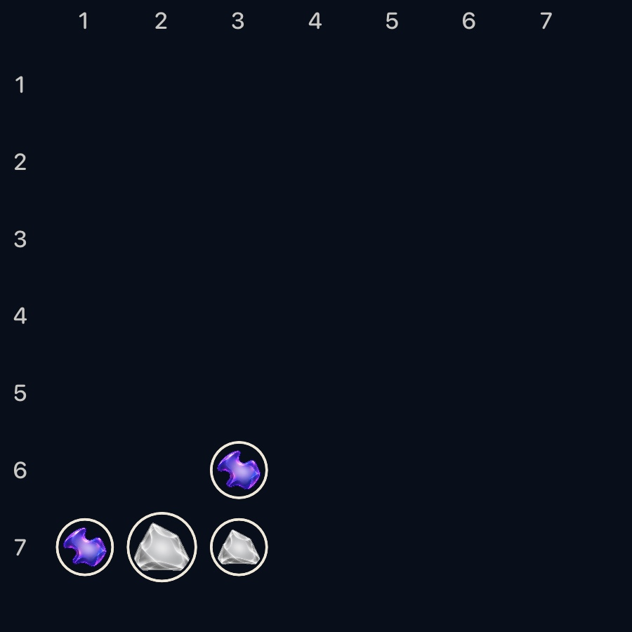

Hosted900×900 production component: the actual historical drained set is gray. This is a static convention, not living-shader pixel equivalence or a native walkthrough.

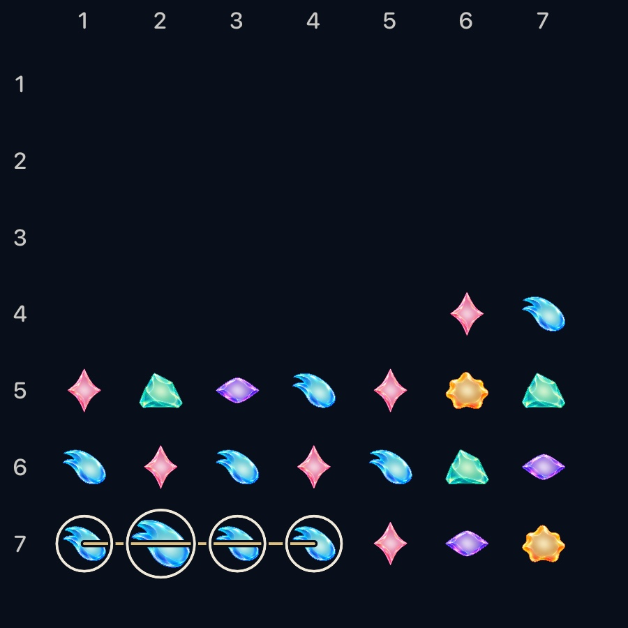

Hosted900×900 production component: actual grown ingredient, shared material and miniature geometry; no native Seed journey is claimed by this render.

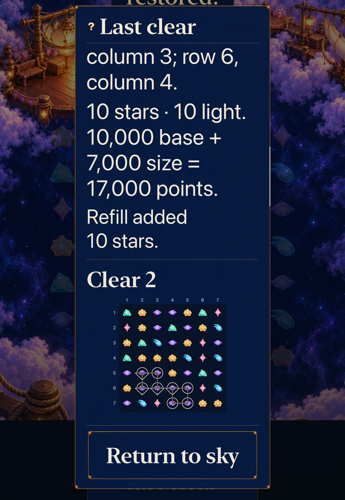

Native AX3XL actual-Calm tablet1668×2420: complete second-phase miniature with49 actual ingredients, separate recipe paths and current moved-original diamonds. The preceding phase's ending remains visible above it.

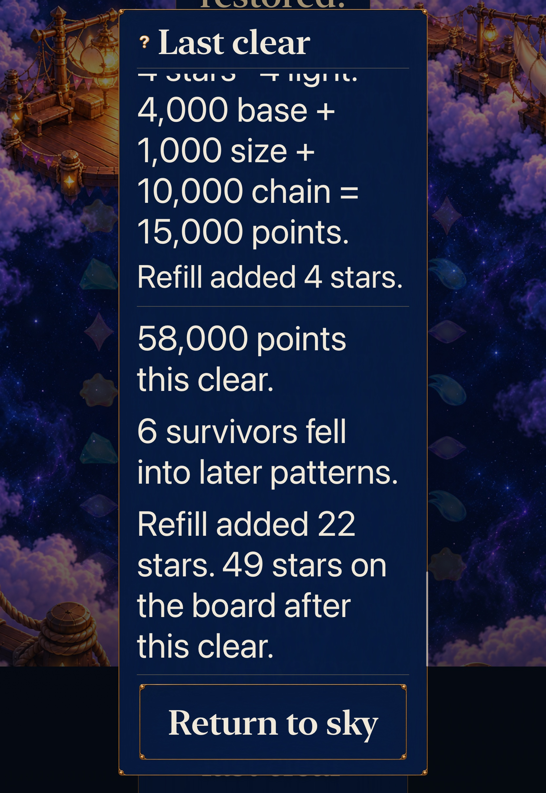

Native same journey:58,000 from the last action, six original survivors across later patterns,22 replacements and49 final occupied cells. Whole target paragraphs and fixed Return fit; the prior phase's first line is naturally outside the reader.

Native same journey after the real156,000-point repair: the complete outcome paragraph, onward/New/Replay are visible before optional accounting. Heading/Home continue outside this particular viewport; separate native assertions reveal and physically operate the required actions.

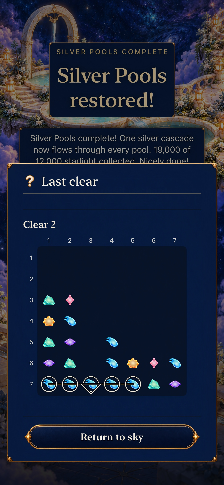

Normal phone1170×2532: complete second-phase board and exact row7/columns1–5 Aqua line, with the one original moved ingredient at column3. The first phase is a separate earlier record; this is not a joined union outline.

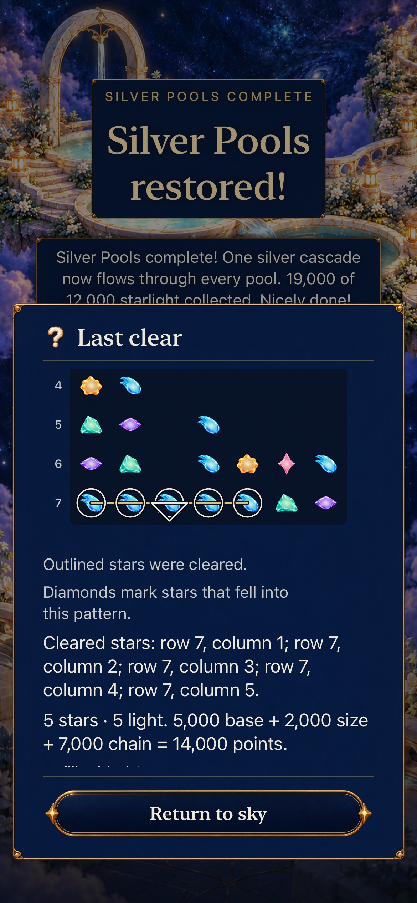

Same19,000-point action:5,000 base+2,000 size+7,000 chain=14,000 in phase2. The complete target paragraph and pinned Return are visible; upper diagram rows have naturally scrolled outside this viewport.

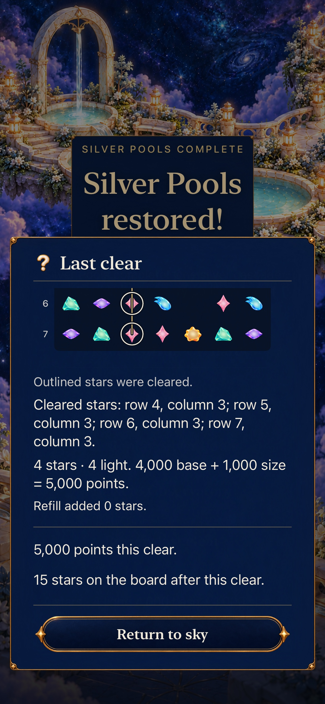

Later independent5,000-point clear, zero replacements and15 occupied stars. It does not inherit the old19,000-point chain or the preceding7,000-point action. Only the lower outline is in this reading position; the full coordinate/score/room paragraphs are visible.

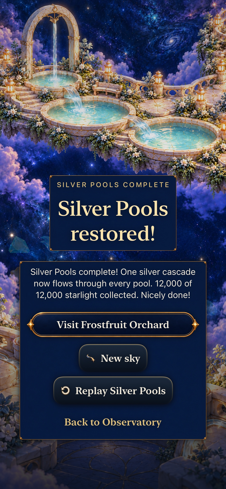

Cold12,000-point Silver ending: outcome, onward/New/Replay/Home fit and Review is absent. No geometry/history is reconstructed from the archive.

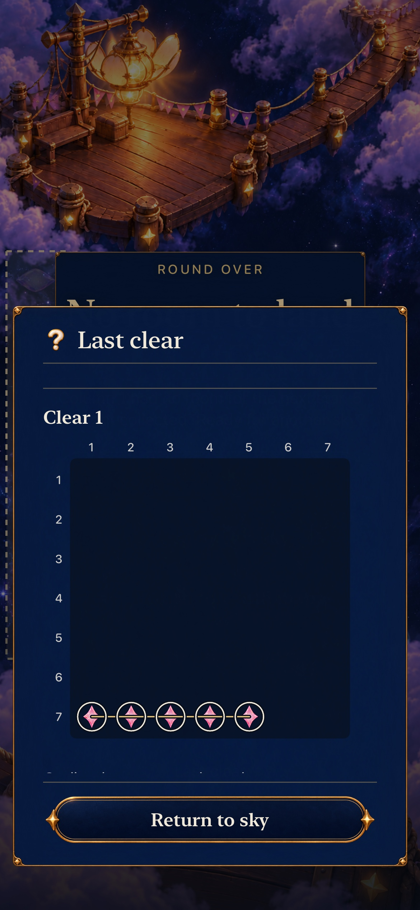

Historical Open Sky fixture after real no-clear overflow: the complete five-Rose row7/columns1–5 walk remains Last clear, with fixed Return. Its real reward was5 points, not5,000, asserted in the complete native reading. The damaged place/loss backdrop is not a repair or current shower-supply claim.

### Rejected layouts retained as failure evidence

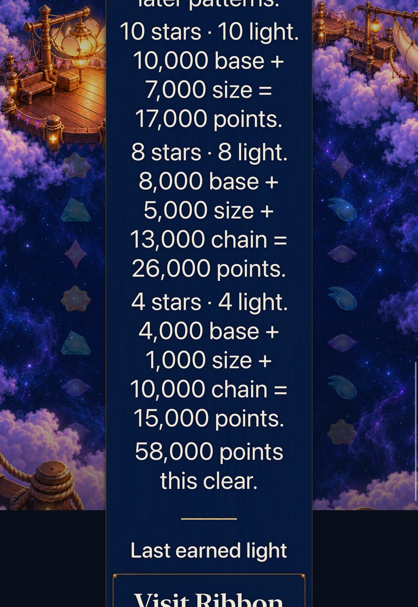

Historical497f7a2/dev.19f04a8334, requested=actual280.000s: rejected after the285.027s failure. It does not certify current navigation.

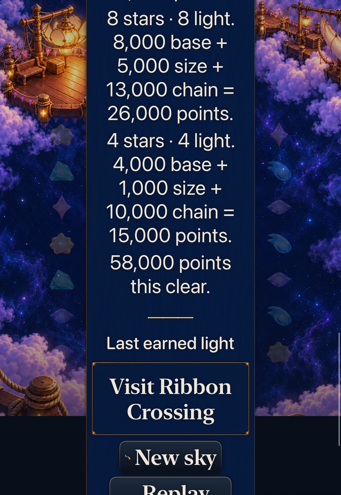

Historical1d59b8d/dev.86ea500374, requested420/actual419.998333s: Replay remains partly below the viewport after scrolling through optional details. Current67edc9c moves the existing terminal decisions before them.
