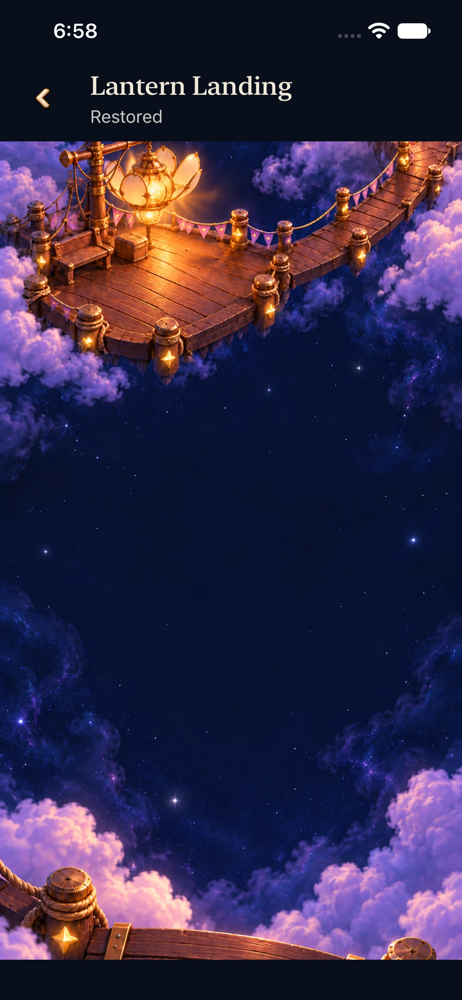
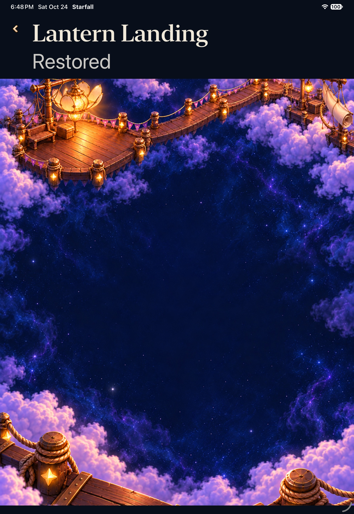
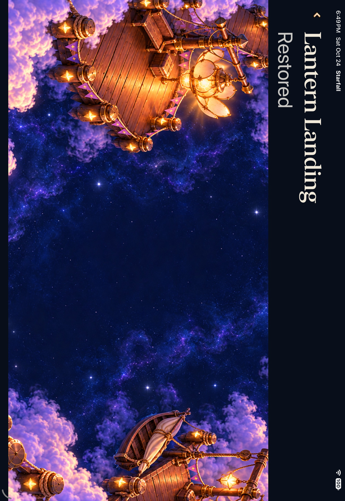
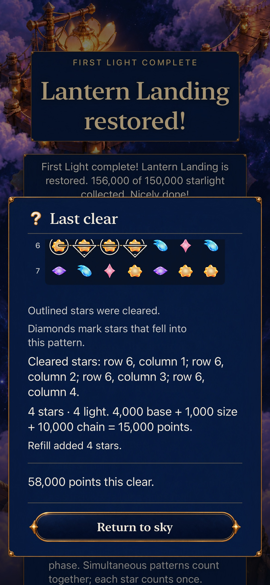
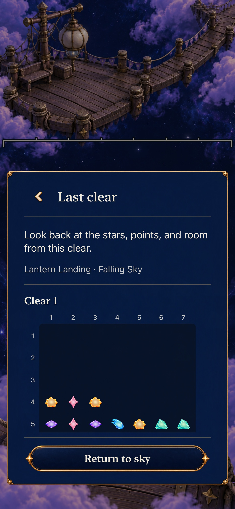
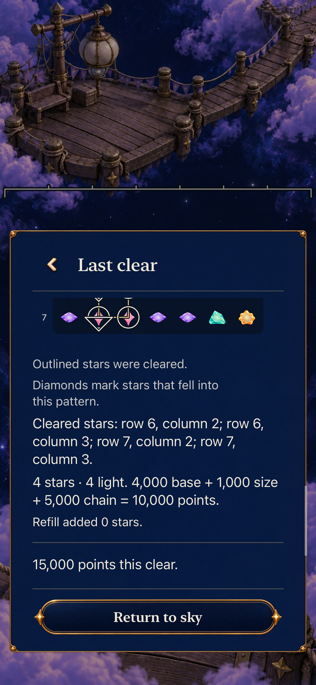
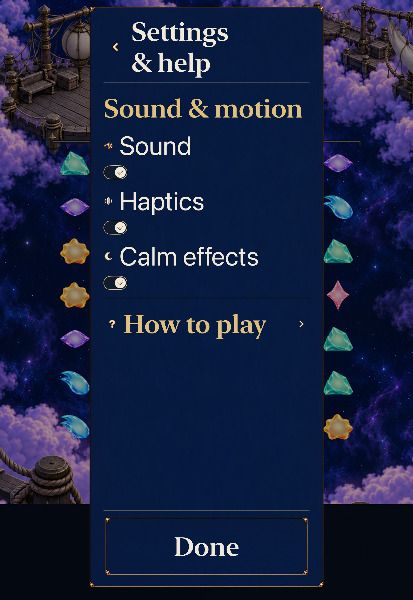

# Visit the earned Lantern without replacing a sky

**Result:** Verified development slice; ready for resolving default-main PR · **Owner:** Factory coordinator · **Date:** October24,2026

[Decision9, #369](https://github.com/lbeezr/starfall/issues/369) adds **View restored place** for a selected, genuinely completed Lantern in Map and Places. The existing 100% painting fills a passive cover below native Back/title/Restored text. Viewing preserves the retained round and result; Revisit stages Entry and only Begin replaces it. Current-source acceptance has 352 unchanged Core tests, 180 affected hosted tests, two complete native journeys, Debug/Release and the existing structural checks. Independent non-author review passes all six phone and four tablet viewer states. Seven exact original-resolution documentation exports are inspected. No physical installation or primary-checkout change occurred.

## Integration and source progression

Main6dcda31a (#398) adds separately accepted FIFO input ownership after the documentation-only22ab merge. The isolated branch67e3ac02722228523c451e39dc1394f6c87a36c8 /dev.118b8a25c3 preserves both that full published delta and this slice's readiness publication; only ENGINEERING's two new introductions conflict, both retained. No primary checkout or other coordinator resource changes. Temporary log hooks and retained native method are removed. The exact735-input checkpoint identifies only two noncompiled draft-report dirty paths. Documentation-only mainac7de9cb (#399) is subsequently integrated normally asa40e763b; all735 recorded inputs remain identical.

Debugbuild-for-testing and all180intended affected hosted methods pass0failures/skips on this combined source. The initial plan counted184because four sibling tutorial methods share the input-test file; source-scoped names independently match all36selected input methods to their passed identifiers. No test is dropped or rerun. The canonical planner's three tests, hygiene and diff checks pass. Both maintained methods and current Release subsequently pass as recorded below. Counts from older source remain separate.

Before removing the probe,653ae3b5/dev.7c5deb007a passes the SAME whole retained Ribbon diagnostic in121.730s with exact30k/0showers/pause/CalmON/world, background/landscape/MapBack input, portrait and coldContinue. It makes no reset/re-earning/Begin/Replay or preference change. This validates the narrow readiness boundary but is not either maintained complete journey. The tablet's measured494.04s prefix plus49.16s post-MapBack/cold tail alone exceeds its old480s allowance before the required recap/preference/second-view tails; its complete budget is now720s, with every individual5/12s wait, eight-pan, target and state assertion unchanged. Phone keeps its480s configured allowance; its actual complete522.309s result is recorded separately below. No per-condition wait or assertion is removed.

The first combined-source whole tablet fails417.943s before viewer admission: Pause succeeds, but the exact expected Start sky label is actually Resume sky. The original AX text and an existing movie frame(requested410s/actual409.996667s)show paused play after a real shower. Begin389.89s→generic Settings398.76s consumes8.87s before suspension. The native-only4c987a8 correction reuses the existing forecast sibling’s direct pinned48-point menu protocol, retaining full viewport/hit/enabled gates and exact0showers/Startsky assertions. Only the native file changes; App/Core/hosted/configuration remain byte-identical to the180-pass source. This is not a cadence or product fix. Exact completed diagnostic37684(parent26667)is stopped only after assertions;144attachments/movie/failure remain. Actual originalCalm=true is recorded; the successful restoration tail was not reached, and ON is left unchanged.

The run also emits“Modifying state during view update”; the same warning is already recorded by published#398’s source-bound verification. No exclusive cause or warning-free claim is made and no suppression is added. The native-only correction subsequently passes current Debug/Release and both complete maintained journeys below.

## Ownership and player outcome

`SkyRestoredPlaceSnapshot` admits only actual completed membership plus the current Lantern selection. Ready access, legacy access, mastery alone and a foreign selection are insufficient. Its normalized1/1 selects the complete painting; it is neither earned score nor a fabricated winning game. The value stores no round or mutation capability.

`WorldMapView` offers the independent action after both existing Continue/Start again and Revisit branches. At activation the root revalidates active scene, world-map route, no modal and current admission. The associated snapshot uses the existing full cover. Back changes only modal state; Map origin, Places choice, suspension, persisted selection, saved sky and mastery retain their owners.

`SkyRestoredPlaceView` keeps one wrapping native header outside the painting, avoids the menu's540-point cap and frames the passive art semantics to the actual remaining viewport. Existing `RestorationEnvironment`, registered composition/layout and ambient lifecycle remain unchanged, with no award, board or input capability. Normal and quiet name the same completed place. The proposed readiness-publication correction stays at its existing Store/View observation boundary; FlowState, Core, rules, scoring, RNG, clock calculations, archive19, assets and progression remain unchanged.

## Source and checks

Current candidate `4c987a8d96c591841853adef7ed0869d698301e3`, tree `dbc89065d8ad7056496c6800ea7f95b2ae39b9f5`, runtime `dev.118b8a25c3`, integrates published main6dcda31a. Its735-input manifest excludes Markdown; only the owned native helper differs from the180-pass hosted checkpoint67e3ac0. All App/Core/hosted/configuration bytes match. At native compilation the two dirty paths were this draft report and verification JSON. Later Markdown adoption notes and seven selected image exports are noncompiled evidence changes. Temporary native methods and lifecycle logs are absent. Earlier counts/media certify only their recorded sources.

Product identifier `com.starfall.prototype`, version0.1.0/build1, packaged `StarfallBuildID=dev.local`, declared minimum17.0. The computed fingerprint is distinct from the packaged stamp. Xcode27.1/27A9275, iPhoneSimulatorSDK27.1, macOS27.0.1/26A434. Factory iPhone17e `64231AFE-4CDB-4B5A-B6D5-70CD7CEED324` and iPadPro11M5 `255E141F-D4D6-45DA-89FF-51436BF1BBA7` use iOS27.0/24A434. At most one owned simulator is booted. Primary divergent checkout and physical devices remain untouched.

| Check | Recorded result |
| --- | --- |
| `swift test` |352passed/0failed/0skipped; Core/package/test bytes unchanged |
| arm64 Debug `build-for-testing` |Current4c987a8 passes |
| Thirteen explicit affected hosted classes |180passed/0failed/0skipped at67e3ac0; identical current App/Core/hosted/configuration bytes. Includes15new methods:13viewer and2readiness-observation checks |
| Whole normal-phone journey |1passed/0failed/0skipped at4c987a8; actual method522.309s, result interval584.253s |
| Whole AX3XL actual-Calm tablet journey |1passed/0failed/0skipped at4c987a8; actual method428.378s, result interval534.373s; actual original CalmON restoredON |
| Generic Release |Currentdev.118b8a25c3 passes; existing no-AppIntents-framework warning retained |
| Six new single-target memberships |Pass |
| Planner/hygiene/diff |Three planner tests, current tracked-file hygiene and diff checks pass; the module-form planner invocation failed import before real tests, while its canonical direct command passed |
| Copy |599typed keys;121scripts within existing128 bound; typed-copy/catalogue equality passed |

Canonical command configuration is `xcodebuild -project Starfall.xcodeproj -scheme Starfall -configuration Debug -sdk iphonesimulator -destination 'generic/platform=iOS Simulator' -jobs 4 ARCHS=arm64 ONLY_ACTIVE_ARCH=YES build-for-testing`, with reserved Debug derived data. Hosted and UI tests reuse those products with `test-without-building`, `-parallel-testing-enabled NO`, exact owned simulator destinations and explicit selectors. Command arrays, source manifests, raw logs, xcresults and exports are under `/private/tmp/starfall-decision-09-20261024/`; source/count details belong in the accompanying verification JSON. This selected slice is not a full Apple matrix.

## Inspected native appearances

Independent non-author review inspected all14phone and10tablet original PNGs before receiving the integrator’s verdict. All six phone viewer states (Map, Places, opposite retained mode, two background returns and cold Continue) and four tablet viewer states (portrait, landscape, background and cold Continue) pass the official component/registered-art comparison. Full native titles/status and the subordinate utility Back remain readable; no clipping, overlap, distortion or concrete viewer defect was found. The integrator separately inspected the seven exact JPEG exports below. Supporting recaps show visible facts; full state equality belongs to native/hosted assertions, not screenshots.

All images depict4c987a8/dev.118b8a25c3, packageddev.local. Phone is ordinary system motion; tablet is actual Settings AX3XL Calm. Export preserves full native coded dimensions1170×2532phone/1668×2420tablet, with no resize, crop or annotation. Landscape retains TIFF orientation8 and displays upright2420×1668; coded dimensions alone must not be interpreted as portrait. Hashes and original mappings are in [verification](verification.json). Reading screenshots intentionally show different scroll positions, including clipped earlier rows at the reader edge. No motion, physical/human/VoiceOver/performance acceptance is inferred, and this viewer verdict does not adopt the separate rejected HUD#382 appearance.

| Normal phone, completed Lantern from the actual Map route | Actual AX3XL Calm tablet, portrait |
| --- | --- |
|  |  |

The same registered completed place remains distinct from the actual retained round. Full Board’s58kfinal clear and Falling Sky’s15kclear are preserved through viewing:

| Retained Full Board clear | Retained Falling Sky mode | Same Falling Sky clear after viewing |
| --- | --- | --- |
|  |  |  |

## Historical failures, correction and counterevidence

These entries describe their named earlier checkpoints. Their missing acceptance is superseded only by the complete current-source results above; each failure remains part of the record.

1. Initial142hosted:141pass/1fail/0skip. The existing cross-location Begin oracle omitted shipped Lantern4/goal-set1 enrollment for six source-to-Lantern transitions, yielding18failed equalities. Independent field comparison found every other field equal. Test-only `5c36da8` reuses existing `enrolledMasteryOpening` solely for the generated attempt UUID, retaining all whole-state/archive/stale-callback comparisons and additionally requiring successful Begin. Subsequent same selections passed. Only completed-failure diagnostic63310(parent62567)was stopped to finalize that bundle.
2. First whole phone, `5c36da8`:197.004s failed after genuine156k repair and real Map→View. The root page identifier inherited into title/status children. `bcdd9f3` matches shipped WorldMapView's semantic containment boundary. Child IDs then pass. Diagnostic70476(parent66739)had already exited before targeted termination; no termination is claimed.
3. Second whole phone, `bcdd9f3`:192.259s failed strict art containment. Existing exported snapshots did not expose rectangles; a safe-area or numeric cause was not assumed. Only completed-failure diagnostic76361(parent72651)was stopped.
4. One temporary retained-state XCTest, `086e9df`:36.045s failed and measured app390×844, page390×880, art(0,100,390,780). It launched the existing isolated actual156k result without reset, legacy admission, gameplay or a fake completion. The780-point extent matches the887×1774 source at390width. The visible crop and semantic image extent were distinct. One frame from that existing movie, requested33s/actual32.9966667s, was inspected; it is not animation acceptance. Only completed-failure diagnostic94903(parent94121)was stopped.
5. Product `12dda34` frames the unchanged renderer and semantic wrapper to the actual remaining slot, clips there and applies `.contentShape(.accessibility, Rectangle())`. The installed Apple SDK declares that shape kind available from iOS17. No shared renderer/painting/crop, safe-area subtraction or tolerance changes. The next focused33.041s case proves app/page both390×844 and art(0,119.33333333333333,390,690.6666666666666). It then exposes a separate raw Back height `43.99999999999999` versus44.0; no product padding workaround ships.
6. Native measurement now subtracts global edges in the actual uniform raster coordinate scale, then converts to points, without rounding or epsilon. The next48.827s focused case passes all44-point, containment, enabled/hittable and exact world/ending checks: Back(12,61.333333333333336,84.66666666666667,43.99999999999999), scale3, measured height44.0. The original-resolution capture was independently inspected. The temporary method is removed before final acceptance; orientation-invariant scale extraction uses the longer raster and point edges. An exclusive framework implementation cause remains unproved.
7. The next whole phone atfe615cd fails215.689s after both original and post-background viewer geometry/44-point/hittability checks pass. Its single Back tap logs Springboard activation and a computed point{-1,-1}; Map does not return. The old helper did not observe actual background/foreground state. This does not establish a product hit-mapping or clock cause. Test-only lifecycle admission now follows existing sibling protocols: require actual background after Home, actual foreground plus Back readiness after activation, and foreground immediately before one normal Back tap, all within the existing five-second bounds. No fixed sleep, coordinate fallback, tap retry or weaker assertion is added.
8. A changed retained-state lifecycle reproduction at0d1d595 fails7.219s before reaching the viewer: Home lookup reports `kAXErrorAPIDisabled`. Same-device logs show a remaining remote automation session, a newly admitted XCTest client and contradictory automation-enabled/API-disabled responses; no exclusive cause is established. Only completed-failure diagnostic28091(parent27715)was stopped to finalize the bundle. No unchanged retry/new device/unrelated process change follows. The temporary method is removed atb83749a; the reserved phone is handed off Shutdown before the reserved tablet's distinct first complete journey. The unresolved phone acceptance remains required.
9. The first whole tablet atb83749a genuinely earns Lantern156k, operates actual AX3XL Calm, enters newly unlocked Ribbon and earns30k. Its complete Ribbon recap, completed-Lantern portrait view, actual background/foreground admission, landscape rotation,44-point Back and Map-return/world equality checks all pass. Recorded states are beforeHome4, immediately afterHome4, admitted background3, afterActivate4 and immediately beforeBack4; the Back match count is1. This demonstrates why an immediate post-Home observation alone is insufficient. It does not prove the prior phone failure's exclusive cause.
10. After the tablet taps Map Back, the settled-round query stops progressing at494.04s while requesting the board/score AX hierarchy. No completed assertion establishes a product cause. After more than three minutes without progress and beyond the method's480-second allowance, only verified owned xcodebuild31465 receives SIGINT. Exact canceled-run diagnostic40267(parent31465)is then stopped to finalize the result. Summary reports0pass/1fail/0skip with“Testing was canceled”;763.773s is its result interval, not a completed method duration. A one-second app sample and bounded simulator log read also return late; the sample has no usable call graph. No main-thread or clock cause is inferred. No native rerun or speculative product patch follows. The original Calm attachment recordstrue; the case setsON, but its final preference-restoration tail does not execute. No guessed preference cleanup is performed.

Across those first eight native executions, one focused geometry/navigation reproduction passes, six earlier assertion/API attempts fail and one whole tablet is canceled. At that checkpoint there was no complete maintained native pass. Original tablet captures were inspected for whole native Back/title/status, the existing registered complete painting and upright portrait/landscape orientation. These partial visual observations do not substitute for the unfinished state/return/cold-Continue tail. The canceled result exports no movie; no animation claim is made.

## Fresh main, visual correction and narrowed return

Published main80f7f329 adds the separate HUD stack's runtime and stricter independent visual contract. The isolated merge preserves every upstream HUD byte; only the README introductions conflict, resolved by retaining both the HUD rejection erratum and this unmerged proposal. No primary checkout or other worktree changes. The reopened HUD goal#382 retains its own coordinator and dedicated devices; this slice does not take over its redesign.

The original component author independently rejects the old AX3XL landscape viewer's forced vertical header:530/1668pixels despite1210-point width. That is independent of the integrator's judgment, not an independent-author acceptance. The correction reuses official viewport utility navigation from Map/reader owners: one full48-point Back icon with literal spoken label and one naturally wrapping native title/status column. Fonts, target minimums, painting registration and single interactive subtree remain. The source-bound142-hosted selection includes width-sensitive reflow; current180selection retains it. A separate non-author reviewer inspects both new original tablet views before seeing the implementer's verdict and passes those two appearances only: official roles, complete text and recognized registered art, with no concrete defect. At that checkpoint changed-header default-phone and full preservation were unaccepted; the complete current-source journeys below supply later interaction evidence. Motion remains separate.

Five further focused attempts preserve their own sources. The first two stop before entering the saved round: e0b7743 at6.705s expects“Continue”instead of shipped Home“Continue sky”; native-onlydc5a921 at6.225s expects literal“Falling Sky”in a Home summary that actually names paused automatic showers. Re-reading SkyWelcomeSnapshot yields the complete exact summary“Ribbon Crossing · 30,000 of220,000 starlight · Automatic showers paused”; the diagnostic separately requires actual in-play Falling Sky,0showers, Start sky and original CalmON. These are corrected exact test oracles, not product changes or removed facts. Only completed-failure diagnostic72270(parent72040)is stopped;73915already exited.

Native-only0d995f8 then reproduces a real return failure in73.848s without a hang. The retained round, original preference, viewer, background and rotation pass, and its immediate Map-Back capture still visibly shows Ribbon30k. Native-only73db856 adds factual clause measurements before the same guard; its80.768s failure records correct score/0showers/no settling, but cell0 at y937.5 and Next at y1126 are outside the834-point landscape viewport and both disabled/unhittable. Exact completed-failure diagnostics76804(parent75675)and82364(parent80867)are stopped to finalize their respective bundles.

Native-only2ad3770 uses the unchanged non-playing-edge reveal protocol, retaining all original state and12-second readiness assertions. Its116.430s failure disconfirms visibility alone: cell(365,565,68.5714,68.5714)and Next(597.5,753.5,349.5,79.5)are now fully within1210×834 and hittable, yet both remain disabled. No product/clock cause is inferred solely from this. The run's parent had already exited; no diagnostic termination is claimed. At that13-execution checkpoint there is one earlier focused pass,11failures and one canceled whole tablet, with zero complete maintained native passes.

Temporary candidate283750d adds launch-argument-gated DEBUG-only read-only lifecycle logs in the existing root suspension and scene readiness owners. It observes route, modal/phase/handoff, readiness, suspension, exact scene/view dimensions and attachment. It changes no Store, clock, rule or save operation. This diagnostic and the temporary native method must be removed before final acceptance/publication; their source cannot inherit prior App verification. The causal run fails the unchanged guard in97.539s (0pass/1fail/0skip). Its exact logs show active/playing/no modal or other root gate/readytrue/suspendedfalse before reattachment. During that same return, size callbacks with nil view synchronously reportfalse; didMove then reports matching1210×900 attached bounds andtrue. No later root recomputation appears before failure. This supports loss of a coalesced false→true Boolean observation. Only exact completed-run diagnostic4495(parent1757)is stopped to finalize the same failed bundle. Across14native executions, one earlier focused pass,12failures and one canceled whole remain; there is no complete maintained pass.

A narrow candidate now publishes a monotonic revision at the existing Store readiness transition and observes that revision in the existing View lifecycle owner. The full current suspension policy remains unchanged, and a false readiness still synchronously freezes the Store before any SwiftUI update. Readinesstrue alone still cannot start a clock. Temporary OSLog hooks and launch argument are removed; the retained reproduction remains temporary until its changed-source run and final maintained journeys finish. At653ae3b5/dev.7c5deb007a, Debugbuild-for-testing and all144affected hosted methods pass0failures/skips. Both new real SwiftUI methods pass: the original Boolean observer misses the coalesced transition, the revision observer recovers, and modal/background countergates plus frozen remainder/archive/stale-clock assertions remain. The isolated host emits a UIKit appearance-transition warning; SKView no-drawable/IOSurface diagnostics are retained, with no suppression. These tests intentionally isolate observation semantics and do not claim private Map/SpriteView callbacks. The actual retained-state native reproduction subsequently passes121.730s at653ae3b5; that method is removed before current4c987a8. Complete maintained acceptance was unresolved at that checkpoint; both later current-source methods pass below.

A direct debugger `snapshot_ui` timed out after an app launch; it was not retried. A preceding app-absent response occurred while both owned simulators were Shutdown, so it does not establish uninstall; shutdown ownership is unisolated. Argument transport for that debugger launch was not verified, so its foreground defaults domain was not assumed. Explicit XCTest launch arguments subsequently recovered the bounded retained-state investigation. No physical device, new simulator, unrelated process, player reset, package installation or capture-only matrix was used. Automatic XCTest movies and the existing AVFoundation decoder supplied historical failure evidence; no direct recording workflow ran.

## Complete current-source native acceptance

Both maintained methods pass at4c987a8/dev.118b8a25c3 with zero failures/skips. Normal phone genuinely earns current Lantern Full Board6 at156k, retains its58k final-clear recap through Map/Places/view/background/Revisit-Entry-Back, then explicitly Begins current Lantern Sky4 and earns15k at zero showers. That opposite-mode board, score, pause, world and complete recap remain exact through viewing, background and cold Continue. The illustrated Map and Places each exercise the actual independent action. This is normal system motion with its original system preference restored.

The AX3XL tablet actually operates Settings CalmOFF→ON and restores its recorded originalON. It genuinely earns the same Lantern repair, unlocks Ribbon and earns30k in current Ribbon Sky4. Its full recap, round, world and explicit input remain exact through completed-Lantern portrait/background/landscape, Map Back, portrait return, preference restoration, cold Continue and a second view. Largest text intentionally uses Places. No fake completed game or legacy progression claim is used.

The preceding67e3ac0 tablet attempt failed417.943s before the viewer: its generic Settings reveal spent8.87s after Begin, so the first real shower had already arrived. Pause worked, exposing **Resume sky** rather than required **Start sky**. The native-only4c987a8 correction reuses the existing forecast test's direct48-point pinned-menu admission, retaining exact zero-showers, full-target, enabled/hittable and Start-sky assertions. No product cadence or clock changed. The failed source/result/movie remains separate; one existing automatic movie frame at requested410s/actual409.996667s was inspected without rerunning capture.

Across18native executions, two focused reproductions and two complete maintained methods pass;13earlier assertion/API failures and one canceled whole method remain separate. The phone method is522.309s and tablet428.378s;584.253s/534.373s are their result intervals. Exact owned diagnostic collectors70435(parent58874)and55956(parent46301)were stopped only after all case/suite assertions passed; both xcodebuilds then exited0 and independently finalized1/0/0. A premature phone summary read encountered the still-staging bundle; the finalized summary supplies acceptance. Both owned simulators are confirmed Shutdown after finalization, with no unrelated resource changes.

Current native inherits the state-during-view-update warning already recorded by published#398. The isolated SwiftUI observation harness also emits appearance-transition/no-drawable diagnostics. No exclusive cause or clean-warning run is claimed; no suppression or speculative workaround was added. Release retains its existing AppIntents metadata-skip warning.

## Limits and next boundary

Hosted tests exercise actual viewer lifecycle, painting equality, target layout, passive hit testing, exact raw-save/deadline and Entry/Begin boundaries. They do not drive private root callbacks; the complete native journeys own Map/View/Back and real retained-mode transitions. Human usefulness, physical smoothness, sustained performance, minimum-iOS17 execution and actual VoiceOver remain separate. No complete short-body trajectory is claimed. Family extension#370 follows this individual verified merge; its usable work prevents a refill.
