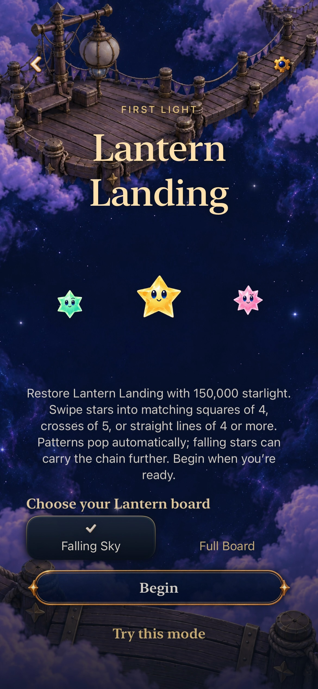
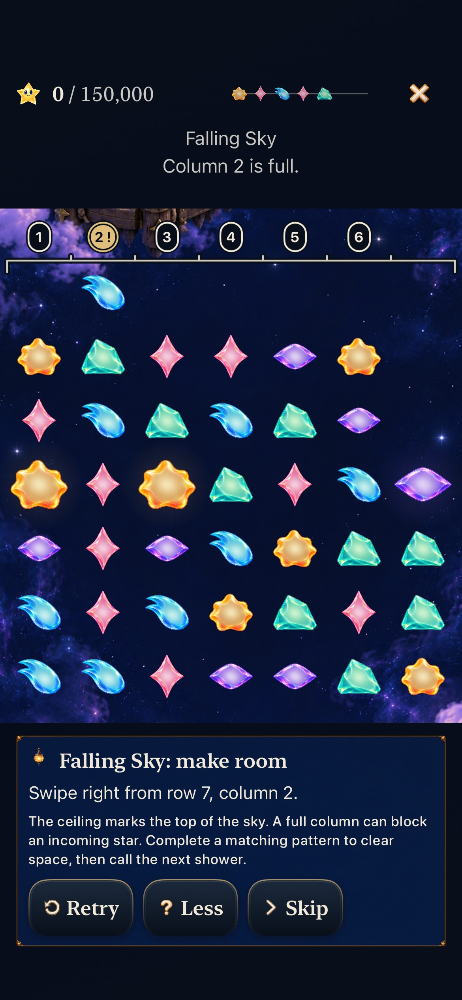

# Optional first decisions for both Lantern modes

**Verified for development — October 23, 2026.** Goal [1/10 #304](https://github.com/lbeezr/starfall/issues/304) in [depth queue #303](https://github.com/lbeezr/starfall/issues/303) adds optional “Try this mode” Entry/Help practice. Both normal Lantern modes remain available. Practice never begins or replaces the retained round and never earns repairs.

The previous tutorial supplied a current Story square but no Full Board refill lesson; its old room chapter used a historical manual clear. The two new discoveries compose production Core constructors and actions. Falling Sky begins after four ordinary Lantern showers, clears four spaces in the threatened column and sends the same next shower through safely. Calling that shower first overflows. Full Board’s real opening exchange produces three clear/fall/refill phases, awards 66,000 and returns to 49 occupied stars. These are lesson outcomes, not new gameplay rules.

Worked coordinates remain behind Hint. Retry reconstructs the exact disposable opening; exiting a direct lesson returns to the selected Entry or retained board. Generic Tutorial navigation and historical chapters remain. Entry callbacks validate their selection generation, and the existing tutorial store rejects archive/world writes and stale presentation/clock callbacks. No rule, RNG, save or archive version changed.

## Source and evidence

Activation source is main `6f8fc7a0879e3feb2c56d0107e51b1e3c9f9656b`. All build-affecting differences are enumerated in the final verification manifest. Core, hosted, native interaction, stills and normal-motion observations are recorded separately below once complete. Human learning/comfort, actual VoiceOver, minimum-iOS runtime and physical-device performance remain unmeasured. No phone installation is requested or performed.

## Verified behavior and limits

| Check | Result |
| --- | --- |
| Full Core after Seed integration | 272 passed, 0 failures/skips |
| Affected hosted, including archive/flow/current Seed | 159 passed, 0 failures/skips |
| Final practice/ceiling hosted checks | 11 passed, 0 failures/skips |
| Initial phone | Three journeys passed: both Entry discoveries with saved Full Board; largest-text Entry/Help with paused Falling Sky; existing Story square sibling |
| Current normal phone | Both discoveries and exact saved Full Board return passed with the unchanged ceiling-bound assertion |
| Largest-text quiet tablet | Help, both discoveries, Retry/background and exact paused Falling Sky return passed |
| Builds | Debug test build and Release passed; explicit new test membership and hygiene/diff passed |

The [verification manifest](verification.json) lists exact build-affecting hashes, source, environment, commands, raw-log names and original failures. Full Core was 264 before the independent Seed merge; the final combined count is 272. Native tablet covers the larger prior Falling Sky completion text; final wording is shorter, and the default-only crop refinement leaves that largest-text reading route and Full Board hint unchanged.

A still review found the old tutorial crop cutting the ceiling/warning band. The new ordinary-input assertion reproduced the band at y100 overlapping a header ending y126.33. The correction shares the ceiling’s 44-point top clearance with the crop and gives pressure text space from the reading shelf. That same assertion now passes. Full Board capture also waits until all columns admit input; finite decorative award trails can still appear in its still. No animation duration or rule changes were used to obtain a pass.

The initial new hosted test read the manual-clear field for an automatic recipe (127 tests/1 failure); it now asserts the same four stars in committed resolution phases. The initial mixed-architecture build could not import an arm64 module from x86; installed-runtime arm64 builds pass. The first recording hit its owner bound; the separate 150-second recording finalized normally. Sandbox media extraction failed, then native-access extraction succeeded. These attempts remain in the manifest instead of being relabeled as passes.

## Inspected native samples

Current normal-phone frames from `4b50ce3` plus manifest-listed inputs, `dev.37309be455`. Entry is recording second10. The ceiling frame follows the actual crop correction; it retains full-size native stars and a readable Hint/Retry row. [Capture index](captures.json) also retains the real Full Board reaction/49-star completion and the full AX3XL tablet hint. Stills establish sampled composition and reading only.

A bounded normal-motion recording is retained only in temporary storage. Samples at10/30/55/80 seconds show real Entry, committed round/menu, disposable Full Board discovery and interruption states; native actions and Core phase assertions separately prove the actual refill. Continuous smoothness and human recognition remain unmeasured.

## Adoption and next action

Keep the optional discoveries in the ordinary app and retain both playable Lantern modes. Their source-bound software acceptance does not establish player learning, balance, taste, physical listening/performance, minimum-iOS rendering or actual VoiceOver. No phone installation was requested or performed. Revisit the lesson after depth goal4 or the next actual player observation; goal2 starts only after this goal’s separate verified main merge.

Raw logs, result bundles and recording remain disposable under `/private/tmp/starfall-depth-01-20261023`. GitHub issue/PR closure is the completion record; this report owns evidence rather than a second queue.

Final publication integration preserves main `495d4062` (the independent Seed-only environment/15-painting refinement) at local `e292d55`, runtime `dev.bda38dfdb6`. Lantern/tutorial inputs remain byte-identical to the final native samples. Full Core272 and Debug/Release pass again; the focused11-case hosted suite passes on this merged source with zero failures/skips. This supplements the source-bound native record without relabeling its captures.
