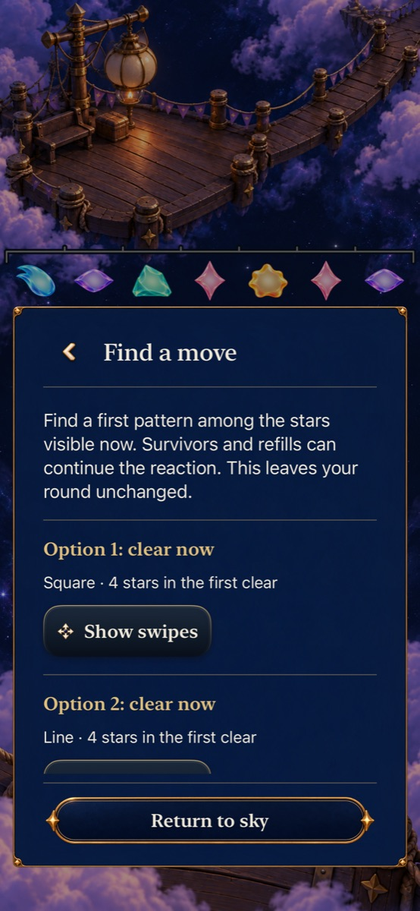
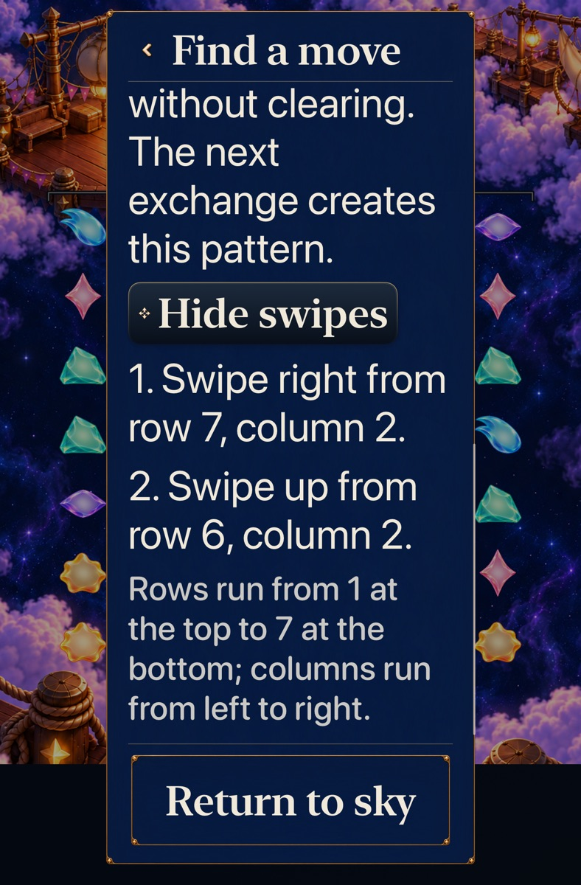

# Optional visible choices after the opening

Goal [2/10 #305](https://github.com/lbeezr/starfall/issues/305), in [queue #303](https://github.com/lbeezr/starfall/issues/303), adds **Find a move** to the unfinished Full Board menu. Both Lantern modes remain available. The hypothesis is that comparing useful first patterns and short preparations helps the player continue after the opening spectacle; software witnesses establish the choices, not human enjoyment or learning.

The existing revision-5 board already supports different decisions. After its 66,000-point opening, the offered square earns another 15,000 and leaves four immediate scoring exchanges; the offered line earns 5,000 and leaves six. Both branches have complete, independently witnessed wins. At 106,000 on the square route, no direct clear exists; a free arrangement followed by a square reaches 111,000. The aid now exposes those situations in the ordinary app.

Core searches only copied visible stars, exchanging, settling and discovering the first pattern. It offers up to two distinct immediate clears, preferring different shapes, or one two-exchange setup. It never examines hidden supply, predicts future awards, mutates a round or ranks optimal moves. The maximum 7,140 scans run in a detached task; view cancellation reaches Core and discards abandoned results. No-short-plan wording preserves the ability to keep arranging. Worked swipes remain behind **Show swipes**.

## Verification and source

[The manifest](verification.json) records the source, every build-affecting working input, exact native stage commands, environment, counts and original failures. Activation is main `0d77ee41801cce750600a0415c2f5eac1edccd46`; the installed Simulator bundle label is `dev.local`. No rule, supply, RNG, save/archive revision or progression behavior changes.

Full Core 280, affected hosted 91 and both native journeys pass with zero failures/skips. Debug/Release, membership, hygiene/diff and 950 local link targets pass. The normal phone journey was repeated after integrating main `7e712f31`’s independent flight-handoff change; Core and hosted checks also pass on that combined source. Normal phone play retains full effects; the tablet uses largest Dynamic Type with Calm effects. Native actions cover real exchanges, optional instructions, return/Continue, background and unchanged board identities. These checks do not establish continuous animation quality, actual VoiceOver, minimum-iOS 17 rendering or physical-device performance. No phone installation was requested or performed.

The initial hosted 82-case batch had one stale wording assertion after “pattern below” became “this pattern”; the assertion now checks the corrected sentence. Initial native phone/tablet failures exposed SwiftUI container identifiers replacing descendant identifiers. The actual accessibility hierarchy showed Back/Return and individual patterns with inherited page/section IDs. Removing those two container identifiers preserves the explicit child owners. The original failure logs remain separate from corrected runs. The next phone run passed the aid and Continue but its additional immediate Entry-existence assertion missed offscreen mode controls. The final test uses the existing bounded reveal helper and actually taps both choices; it passes. The initial synthetic Core fixture omitted encoded grown; preserving the original gem fields corrected that fixture before the full 280-case passing runs.

## Adoption

Retain the optional aid and both modes. Revisit it with the round-arc change in goal 4 or the next actual player observation. It is an explanation of existing choices, not a difficulty or refill adjustment. Goal 3 starts only after this batch’s individual verified main merge. Raw logs and result bundles remain disposable under `/private/tmp/starfall-depth-02-20261023`.

## Inspected native samples

These source-bound Simulator stills show optional guidance and readable scrolling, not animation or human comprehension. [The capture index](captures.json) also retains the revealed phone instructions. They predate the independent flight-handoff integration; the advice/menu presentation files are identical.
