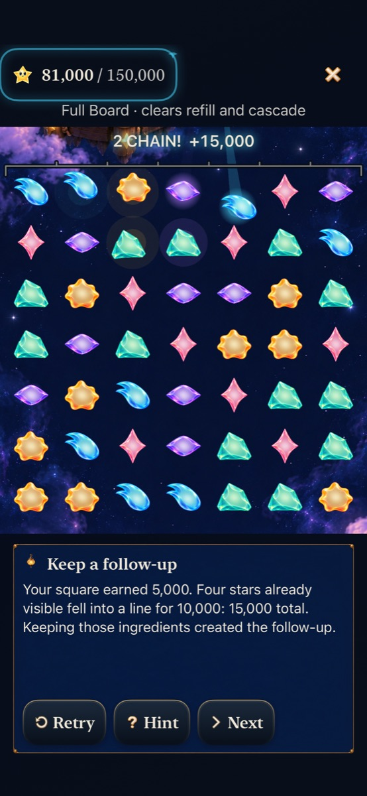
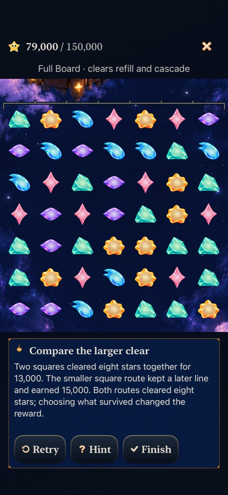

# Choosing what survives creates a follow-up

Goal [3/10 #306](https://github.com/lbeezr/starfall/issues/306), in [depth queue #303](https://github.com/lbeezr/starfall/issues/303), adds optional **Compare clears** practice to Full Board’s Find a move page. Both live Lantern modes remain available. The hypothesis is that playing and comparing two consequences helps the player recognize a deliberate survivor cascade; human transfer and enjoyment remain unmeasured.

Both disposable chapters start from exactly the same actual 66,000-point board, constructed through production exchanges. One four-star square earns 5,000 and preserves four existing stars that settle into a line for 10,000: 15,000 total. The alternative clears eight stars in two simultaneous squares for 13,000. Both choices clear eight physical stars and draw the same eight replacements from the same random stream. Exact survivor identities prove the first continuation comes from visible ingredients, rather than refill luck. Both branches also have complete ordinary winning continuations.

The player performs the exchange. Hint reveals coordinates only on request; Retry reconstructs the same board. Next moves to the contrasting arrangement; Finish returns to the exact retained round. The general Tutorial keeps its existing catalogue sequence. The short comparison passes its ending chapter through the existing view/player/guide ownership, rather than truncating global chapter navigation. Practice never writes the round/world archives, earns a repair or starts a shower clock. No scoring, supply, rule, RNG or save version changes.

## Source and verification

Activation is main `ffdf28ee59eb08cf38754ae96beb6ceca58e8c62`. [The manifest](verification.json) records build-affecting inputs, source, commands, environment, counts and any failed attempts. Final combined Core 295 and affected hosted 149 pass with zero failures/skips, as do Debug/Release and both native journeys. Native phone uses full effects and system motion; tablet uses AX3XL Calm. Interaction and inspected stills are separate from continuous animation quality. Minimum-iOS 17 runtime, actual VoiceOver, physical performance and human learning remain unmeasured; no phone installation was requested or performed.

The Core worker’s first test compilation needed two missing `try` annotations; corrected without changing assertions. Review caught a draft global Finish boundary that would have stopped the general Tutorial before Match. The route now owns that limit; hosted expectations distinguish ordinary and bounded navigation, and the native phone journey also enters the general Tutorial and proceeds into Match.

## Adoption and next action

Retain the paired discovery and both live modes. Revalidate its authored histories, survivor identities, awards and equal replacement stream when goal 4 changes new Full Board visits, or retain the demonstrated shipped definition explicitly. Software checks cannot establish human preference. Goal 4 activates only after this goal’s individual verified main merge. Raw logs and result bundles remain disposable under `/private/tmp/starfall-depth-03-20261023`.

## Inspected native samples

[The capture index](captures.json) also retains largest-text calm tablet reading through the complete comparison and fixed Finish. The normal-motion phone still can include finite collection decorations after input resumes. Stills do not establish continuous animation quality or human recognition; no new animation implementation is introduced.

Final combined verification includes independent Silver #315/main `a5e35267` at local `43913bf9`. Its Silver-only definition/presentation/copy additions retain the demonstrated Lantern lesson branches and nine lesson entries. Core 295 and hosted 149 pass again with Debug/Release; the earlier native captures keep their original source and do not imply a second visual review of Silver.
