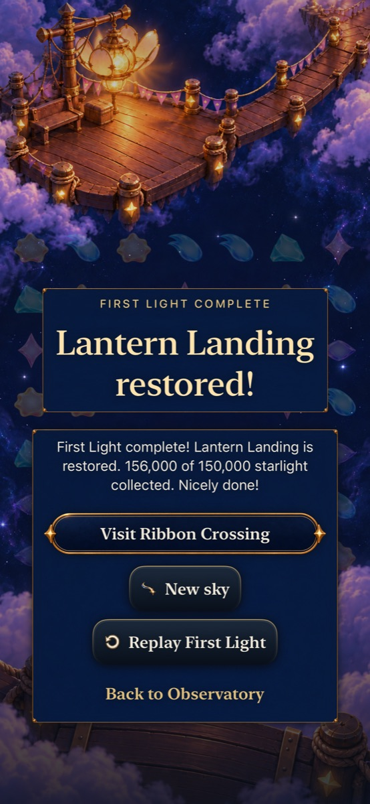
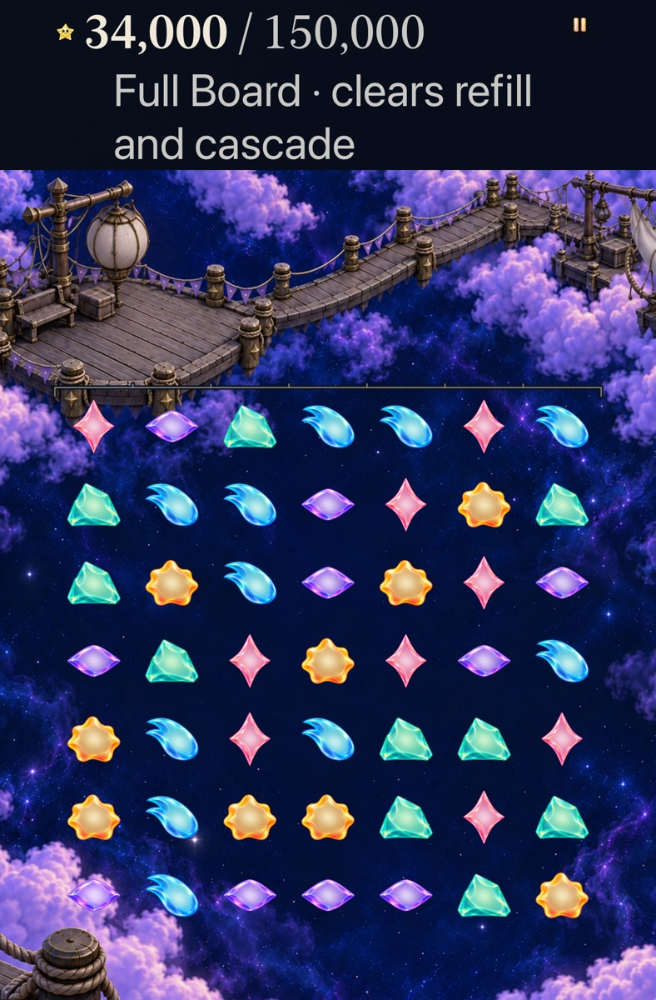

# More of the Full Board round belongs to later choices

**Status:** Verified development slice, with human and physical acceptance open. Goal [4/10 #307](https://github.com/lbeezr/starfall/issues/307) in [depth queue #303](https://github.com/lbeezr/starfall/issues/303) keeps both Lantern modes available and revises only the Full Board opening for explicit new visits.

Revision 6 changes star 29 from Violet to Aqua and star 37 from Mint to Rose. These break two large automatic survivor lines after the basic opening square. That exchange now earns 5,000 + 10,000: **15,000**, compared with retained revision 5’s 66,000. The board still starts with 49 ordinary stars and seed 42, refills through the existing causal phases, and finishes at the unchanged 150,000-point target. Pattern legality, scoring, refill/stabilization, unlimited untimed setup and immediate earned wins are preserved. Falling Sky remains revision 4.

The hypothesis is that distributing more of the reward across later player decisions produces a more satisfying beginning, middle and finish. The witnesses below establish committed consequences and complete routes; player comprehension, difficulty and enjoyment remain unmeasured.

## Actual alternatives and complete rounds

Core’s `FullBoardRoundArcTests` exercises these production-rule choices, round-tripping saves and exact refill receipts along both full routes:

| Situation | First choice | Alternative and consequence |
| --- | --- | --- |
| Opening | Basic square exchange 8→9 earns 15,000 across two phases. | Line 1→2 earns 27,000; exchange 27→34 earns 42,000 and begins a complete ten-exchange route. |
| Middle at 76,000 | Line 4→5 earns 5,000 and leaves three immediate scoring exchanges. | Cross/line 33→40 earns 9,000 and leaves a board requiring setup; a two-exchange plan exists. |
| Awkward middle at 94,000 | Exchange 4→11 prepares the board without points. | Exchange 5→6 then earns 5,000, reaching 99,000. No timer, move penalty or board rewrite is introduced. |
| Final choice at 98,000 | Square 3→10 earns 5,000 and leaves nine scoring exchanges at 103,000. | Cross-and-lines exchange 9→16 begins phases worth 17,000 / 26,000 / 15,000, earning an immediate win at 156,000. |

Indices above are zero-based, bottom-up board indices (`row * 7 + column`), not the player-facing top-down coordinates. [The manifest](verification.json) records every exchange and cumulative score for the ten-exchange 156,000-point route and a contrasting 21-exchange line route finishing at 150,000. Setup exchanges count and remain legal. These examples do not establish a minimum or optimal round length. Other policies can reach narrower boards; no universal opportunity-density or enjoyment claim follows from the reference routes.

## Preserved versions, practice and fixture ownership

Saved revision-5 rounds retain their exact opening, refill stream, Continue and same-round Replay. Current and retained states keep validated light/identity/RNG accounting; tests cover all 84 neighboring opening exchanges and corrupted/foreign supply rejection. Archive v15 writes the new definition and admits v14 envelopes only through authored revision 5; validated earlier readers and original bytes remain. The world envelope stays v1, and retained current-format archives do not grant pre-world access.

The basic **Try this mode** refill lesson follows current revision 6. **Compare clears** explicitly reconstructs the demonstrated revision-5 history, preserving its authored 15,000-versus-13,000 comparison. Practice remains disposable and earns no repair.

A reset-only Debug fixture constructs the untouched production revision-5 opening using `--starfalls-reset --dialogue-review --full-board-v5-review`. It rejects missing/conflicting review choices and uses the existing isolated dialogue-review domain. Ordinary activation and actual exchanges own persistence; relaunch with `--dialogue-review` alone exercises real Continue. This proves native retained-version behavior after ordinary saving; exact old-v14 envelope admission is separately covered by hosted archive tests. The helper and store selector compile only under Debug; the integrated Release binary has no fixture launch marker.

## Source and completed verification

The Core/hosted/tablet input is base main `379f84106faf4a0271e7dd958941cab988f59e72` plus [preintegration snapshot `59bd8bc4c2af`](source-preintegration.json), recording all 25 changed compiled paths and hashes. Production owners include `StoryChallenge`, `FallingSky`, `SkyTutorial`, archive/world restore boundaries, flow snapshots and the Debug fixture/store selector, plus affected tests and explicit project membership. [Integrated source `cb55318`](source-integrated.json) includes main `68374968` with identical compiled code; only the Lantern tablet portrait/landscape 50% paintings changed. Integrated Debug/Release builds passed separately. Earlier tests keep their original source association and do not constitute another visual review of those paintings. The simulator bundle reports `dev.local`; that label alone does not identify the source.

| Completed check | Result | Raw evidence |
| --- | --- | --- |
| Core package | 305 passed, zero failures/skips. | `core.log` |
| Debug simulator build-for-testing | Passed. | `build-debug.log` |
| Release simulator build | Passed. | `build-release.log` |
| Entire hosted app suite | 499 passed, zero failures/skips. | `hosted-all.log`, `hosted-all.xcresult` |
| Selected native tablet journeys | Three passed, zero failures/skips. | `tablet.log`, `tablet.xcresult` |

The tablet selection covers AX3XL Calm current-v6 exchange/rotation/restore, retained-v5 setup advice with background return, and v5 Continue/Replay followed by an explicit new v6 visit. Core/hosted checks cover current and retained complete routes, committed save boundaries, archive rejection, practice isolation and fixture guards. The JSON manifest records exact logged native commands and bounded stage receipts. The manifest includes the Core invocation, native commands and source boundaries.

Raw artifacts remain disposable under `/private/tmp/starfall-depth-04-20261023`. Environment: macOS 27.0.1 arm64, Xcode 27.1, iPhoneSimulator 27.1 SDK, iOS 27.0 (`24A434`) runtime; hosted checks use iPhone 17e and native tablet checks use iPad mini A17 Pro. Deployment target 17.0 compilation is separate from running on an iOS 17 device/runtime.

## Integrated native checks and inspected samples

At clean code source `cb55318`, the normal-motion phone journey plays all ten exchanges to 156,000, restores exact board identities and replays the same opening/refill. Three further phone journeys exercise optional alternatives, current basic practice isolation, cancellation and actual Begin into Falling Sky. The integrated AX3XL Calm tablet exchange/rotation/restore journey passes again. Total: eight selected native executions, seven distinct cases; the full 219-case UI suite was not run. No failed checks or assertion weakening occurred in this goal. The shared experiment-index merge retained both independent entries.

[Eight retained inspected samples](captures.json) show the earned result, the current 34,000 tablet restore, retained-v5 Replay, optional guidance, current refill practice, actual Falling Sky and two sampled final-cascade frames. Additional raw captures were inspected before selection. The landscape screenshot export is partial; portrait samples and passing rotation/49-cell assertions do not certify landscape visual fit. The 197.697-second normal-motion recording was sampled at 86, 89, 160, 164, 170 and 190 seconds. They show refill, final cross/line effects, falling survivors and the result; the last sample is Settings teardown. These samples do not establish continuous smoothness or physical performance. Raw video stays disposable.

Source `cb55318` integrates main `68374968`: two tablet 50% painting updates plus docs/skills, with every changed compiled code/test/project hash identical to the earlier 305 Core/499 hosted source. Debug/Release and the tablet journey were repeated against the integrated resources. Evidence/index edits after this clean code commit do not alter compiled inputs. Project membership, Release fixture absence, hygiene and whitespace checks pass; see the manifest for exact commands.

Retain the bounded development change, keep both modes available, and revisit actual player preference at the next ordinary session or before goal 6 expands Full Board to Ribbon. Goals 5–10 remain queued after the requested initial tranche. Minimum-iOS runtime acceptance, actual VoiceOver, physical performance and human learning/enjoyment remain separate. No physical phone installation is claimed. Historical evidence keeps its original source and outcomes.
