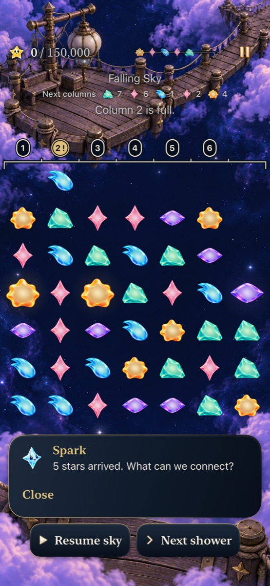
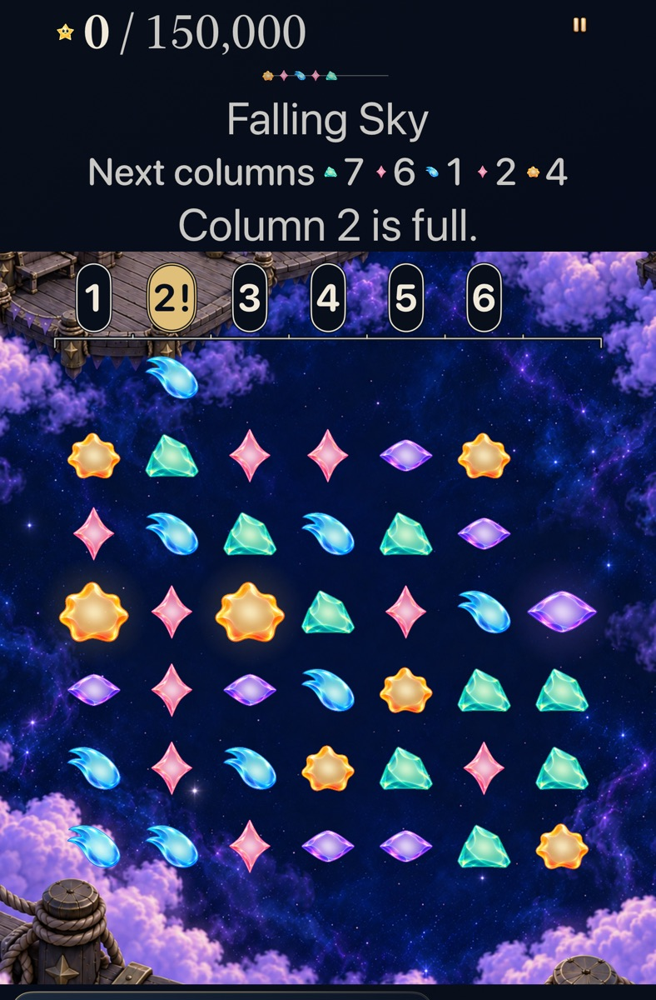

# The announced shower names its actual columns

**Status: Verified for development.** [Goal 5 #308](https://github.com/lbeezr/starfall/issues/308) in [queue #303](https://github.com/lbeezr/starfall/issues/303) connects each forecast star with its one-based destination column. The existing ceiling already named crowded columns; its family-only forecast omitted the connection. Both modes, saved-round Replay and disposable practice remain available.

The passive native row and the existing trail share ordered descriptions from `store.forecast`. Pending arrivals retain their announced stream until presentation finishes. Next columns and Arriving columns distinguish state; repeated columns and historical identities remain intact. No Core rule, supply, clock, target, scoring or save-schema change. A destination is factual information, not a promise of loss: matching-top growth can still fit in a full column.

## Ordinary consequences

| Situation | Actual consequence |
| --- | --- |
| Lantern 4 after four showers | Column 2 is full. The next ordered destinations are 7,6,1,2,4; the Rose names column 2. |
| Exchange flat indices 1→2 | Four Rose stars earn 5,000 and open four spaces. The exact same fifth preview fits. |
| Decline that recovery | The actual fourth arrival blocks in column 2; the result names that column and offers Replay. A plausible non-scoring 7→8 exchange also leaves the block. |
| Ribbon 4 sibling | Columns 1,2,4 are full, but only full column 2 receives the next preview. The existing 50,000-point recovery opens all three. |

Indices are bottom-up `row*7+column`; native labels remain player-facing. Hosted tests also prove matching-top growth while full, unchanged saved/RNG continuation, pending forecast identity and actual restore. These consequences support the feature hypothesis; human recognition and enjoyment remain unmeasured.

## Verification and corrected failures

[The manifest](verification.json) records commands, source, environment and exact counts. Core 305 and the full hosted 511 suite pass with zero failures/skips at their named source. After integrating main325 at clean code `9027076`, Debug/Release and 37focused hosted tests pass; the current inventory is 512hosted/219UI, not a full 512/219 run. Nine candidate native executions covering five distinct cases across iPhone 17e, iPhone SE3 and AX3XL Calm iPad mini pass; a separate cleanbaseline case passes. Final integrated native runs include normal-motion clear/restore/next-shower recovery and both optional practices preserving the retained Full Board round. Loss, mode-switch cancellation, compact and largest-text checks retain their own sources.

The first Core invocation was refused by SwiftPM’s nested sandbox before testing; the same authorized command passed. Initial hosted and phone candidates crashed because 513 bundled copy entries exceeded the 512-entry decoder budget. Runtime and editor admission now allow at most 1,024 entries, retaining 1,600-character and strict-template limits. New tests accept capacity and reject overflow/malformed templates; the shipped inventory is checked too. No assertion was weakened.

Screenshot inspection rejected an otherwise-passing largest-text export that cut through ceiling badges. The passive ceiling’s reported bounds now include their scaled height and outer stroke. The strengthened native visibility check reveals complete badges below the pinned header; board geometry and stars remain unchanged. Initial failures/rejected exports remain in the disposable raw record.

## Inspected appearance and adoption

[Six selected captures](captures.json) preserve clean before `47e633e3`, integrated phone `9027076`, corrected compact/tablet `d01ac54` and actualblocked-arrival source `10321bc82370`. [First](source-first-slice.json), [final](source-snapshot.json) and [integration](source-integration.json) manifests separate these inputs. Main 325 changes packet ink/shadow around the score, without changing forecast/header/ceiling or Core. The quiet tablet has no packet Canvas. Later evidence/index edits do not change compiled inputs. Simulator bundle label is `dev.local`, not a source identity.

Retain this bounded improvement and revisit whether players use the announced columns at the next ordinary play session. Actual VoiceOver, minimum-iOS17 runtime, physical comfort/contrast/performance and human enjoyment remain open. Normal-motion interaction is separate from continuous animation quality. No phone installation or scheduler. Raw logs and result bundles remain under `/private/tmp/starfall-depth-05-20261023`. Continue to goal 6 only after this goal’s separate verified main merge and completed issue/Project status.
