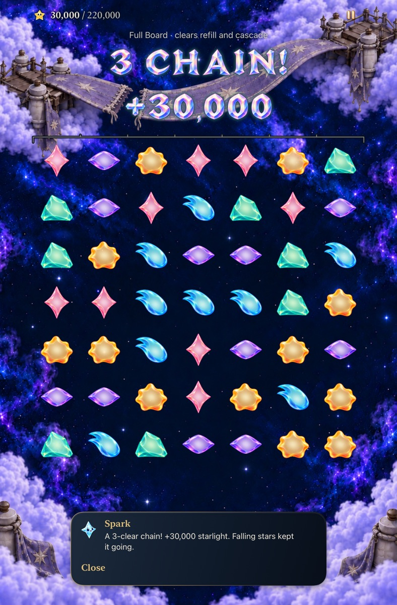
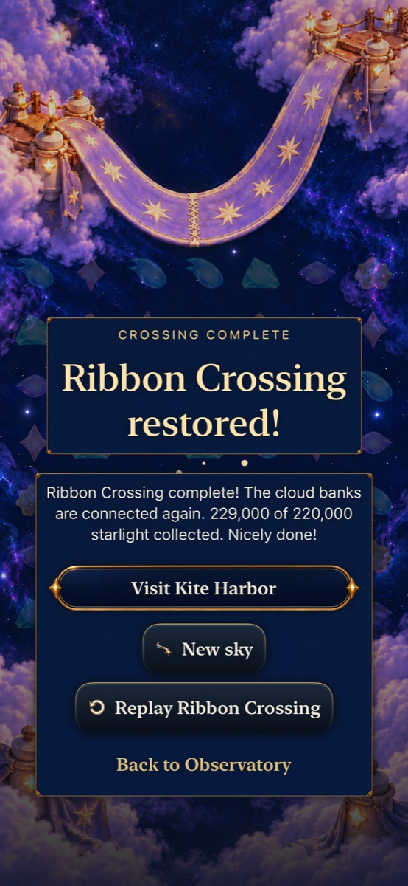

# Ribbon’s Full Board comparison

Goal 6 of [queue #303](https://github.com/lbeezr/starfall/issues/303) gives Ribbon its own untimed 49-star opening and 220,000-point objective. Lantern and Ribbon each retain Falling Sky and Full Board. New Ribbon Full Board visits select revision 7; retained Lantern 5/6 and Ribbon Sky 4 Continue/Replay remain exact. Entry switches preserve location and saves until Begin. Archive v16 retains v15 through revision 6, v14 through 5 and earlier bounded readers. World schema stays 1; actual wins repair places.

Square 8→9 earns 30,000 through three phases made entirely from stars visible before the exchange. Immediate line 1→2 earns 5,000 and leaves seven ready scoring exchanges instead of five. Complete routes earn 229,000 in 18 exchanges or 223,000 in 34. The primary route reaches 80,000 without an immediate clear; a real setup permits 85,000. One geometry, 3,496 successors/0.162 seconds; search stopped at two wins below the 60,000/120-second cap. No withheld awards, minimum moves, changed RNG or new scoring/refill algorithm.

Ribbon keeps **Find a move** against its own immutable board. Lantern-specific optional lessons remain in Lantern. Hosted tests cover stale Entry IDs, cancellation, exact archives/continuation, location-specific copy and earned progression. Core retains historical definitions and corruption boundaries.

Source 9ab386f, default-text Calm iPad mini: 49 settled cells, a 30,000-point three-phase receipt and the 220,000-point goal.

Source 57d4e3c, normal-motion iPhone 17e: 18 physical exchanges earned 229,000 and the ordinary Ribbon result. Stills do not establish continuous animation quality.

[Verification](verification.json) identifies sources, dirty inputs, commands, environment and results. [Nine inspected captures](captures.json) retain original attachment identities. Core: 315 passed. Both complete native routes passed without failures/skips on 57d4e3c: normal phone cancellation/background/Continue/win/Replay/new Falling Sky, and largest-text Calm tablet rotation/line-first win/Replay. PR #329’s practice-award band and #328’s forecast image correction were integrated at 7342b7d, retaining both index entries. Source 9ab386f adds a passing native Ribbon advice-preservation check and integrated Debug/Release builds. That integration changes no live-round rule, save or route. Final hosted acceptance is recorded in verification.json; the broad runs and selected passing corrections have separate counts.

Three rejected attempts remain in raw evidence. A valid swipe after the five-phase 179,000 transaction arrived roughly 2.7 seconds before presentation finished; its 0.65-second buffer expired. Enabled cells admit buffered input, so committed score did not establish settling. Board accessibility now appends the existing **Stars settling** status while busy; both Full Board helpers wait for it to clear with unchanged gestures. The first largest-text run completed 34 exchanges, then rejected a test expectation confusing active numeric text with complete terminal speech. Both result assertions now require that exact speech. The initial concurrent 525-test hosted run had five failed assertions in two unchanged scene-host methods; both passed isolated on the same binary with unchanged assertions. The final integrated hosted run is serial. Existing SpriteKit surface-availability tracking remains the follow-up owner.

Fixed routes establish consequences and reachability. Human recognition, difficulty, preference, continuous animation quality, actual VoiceOver, physical-device and minimum-iOS-17 acceptance remain separate. Scrollable ceremony captures show their identified reading positions. No phone installation or scheduler. Revisit both Full Board offerings at the next player session or before goal 9 adds mastery.

The serial integrated run executed526 tests:524 passed, two failed, none skipped. The two original scene-host timing cases passed in this full run. One remaining failure reproduced the existing first-frame IOSurface capture boundary in Crystal glyph pixels. The other exposed a newly merged practice-test fixture: its Store used isolated defaults while its hosted view read standard Calm preferences, so a normal-motion assertion correctly rejected aggregated15k-only feedback. The fixture now sets Calm off in its own suite and injects that suite through defaultAppStorage, matching StarfallApp. No production behavior or assertion changed. The affected hosted selection below verifies the corrected practice fixture, glyph capture, Ribbon/archive/world contracts and integration. This is not a claim that either broad run was all green.

Final affected hosted selection: **73 passed, zero failures/skips** on8d087dc. The isolated glyph and corrected normal-motion practice cases pass with all assertions intact. Debug/Release, membership, hygiene and diff checks pass; source/runtime differences are explicit in verification.json.
