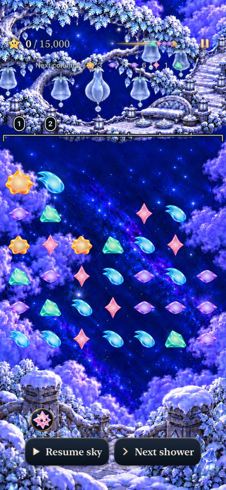
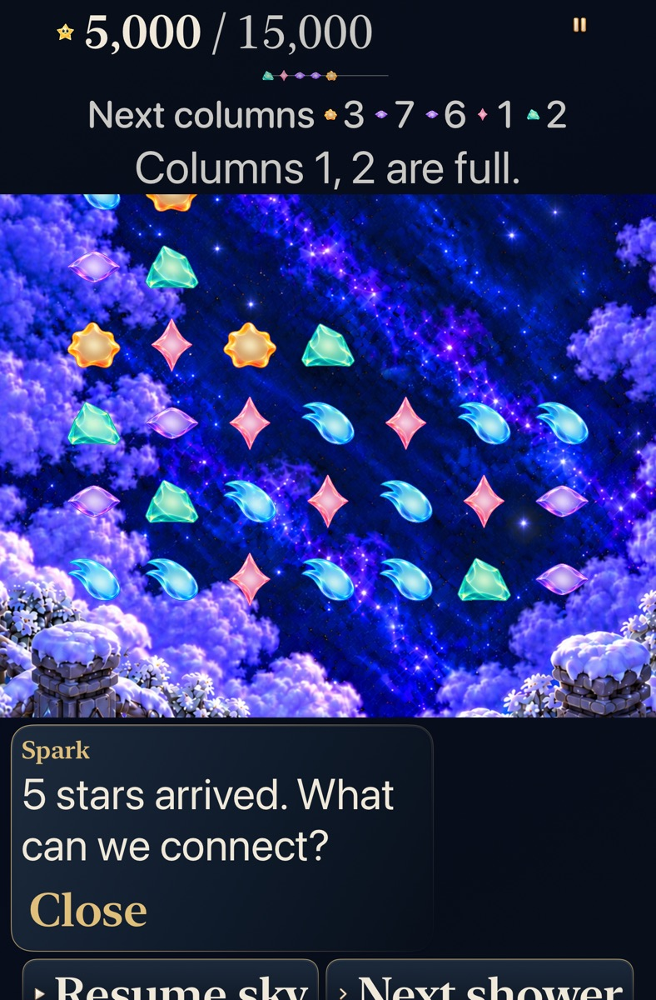

# Frostfruit turns top growth into room in threatened columns

**Status:** Verified development slice; adopted for explicit new visits. Human recognition, balance and preference remain unmeasured. Goal [7/10 #310](https://github.com/lbeezr/starfall/issues/310) in [depth queue #303](https://github.com/lbeezr/starfall/issues/303).

Explicit new Frostfruit visits select revision 8: 30 ordinary nongrown stars, a 15,000-point objective, seed 42 and the existing gentle five-family supply. The opening offers a zero-point arrangement that prepares exposed tops for growth, or a Violet square worth 5,000 immediately. Both can complete the round through ordinary rules. Lantern and Ribbon retain both modes and their exact saved definitions.

The hypothesis is that seeing the same announced shower fit one arrangement and block another makes compression a useful recovery decision. The fixed witnesses prove consequences and legitimate alternatives; they do not establish recognition, difficulty or enjoyment. No new recipe, power, timer, exact-action gate or automatic rescue is introduced.

## The same preview makes the tradeoff concrete

[Core's `FrostfruitEncounterTests`](../../../Tests/StarfallCoreTests/FrostfruitEncounterTests.swift) reconstructs every action from its Codable prestate, comparing receipts, identities, conserved light, committed forecasts and Replay.

| Choice or contrast | Actual consequence |
| --- | --- |
| Prepare caps: exchange 35→36, then shower | The first shower grows original Amber 29 and Aqua 28 in columns 1 and 2. Both columns remain six stars high; no points are earned. |
| Take points: exchange 20→19, then shower | The Violet square earns 5,000. All five first-shower arrivals need cells, leaving columns 1 and 2 full. |
| Accept the same second preview | Prepared room receives all five stars and remains playable. Untreated immediate-clear play commits the first three arrivals, then really loses when the fourth, Rose, cannot enter column 1. The remaining arrival is not committed. |
| Recover after taking points | Aqua-line exchange 2→9 earns 7,000 and lowers both full columns to six. The unchanged second preview then fits all five arrivals; Rose exchange 3→10 finishes at 17,000. |

Columns above are player-facing, one-based numbers. Move indices below use Core's zero-based, bottom-up `row * 7 + column`; `[]` means an ordinary shower. The second preview is Amber→3, Violet→7, Violet→6, Rose→1, Mint→2. Neither route rewrites it.

| Complete fixed route | Cumulative points after each action |
| --- | --- |
| **Safe:** `35→36, [], [], 20→19, 2→9, 3→10` | `0, 0, 0, 6,000, 13,000, 18,000` — actual win after two showers. |
| **Immediate:** `20→19, [], 2→9, 3→10` | `5,000, 5,000, 12,000, 17,000` — actual win after one shower. |
| **Ignored opening:** `[], 20→19, 2→9, 3→10` | `0, 5,000, 12,000, 17,000` — same final committed state as Immediate. |

The shown clears occur in separate actions. Preparing caps protects particular columns; it does not make every part of the board emptier or make the immediate choice wrong. Only matching exposed ordinary tops grow; buried matches stay unchanged and grown stars retain value two. Earned wins finish immediately, and both won and lost rounds reject later actions until Replay or a new visit.

## Versions and earned progression remain exact

Historical Frostfruit 0 keeps manual clearing, its original 18-light objective, supply and same-round Replay. Explicit New visit alone selects Frostfruit 8. Other locations cannot claim revision 8, and unshipped Frostfruit revisions 1–7 remain unsupported.

Archive v17 writes the new definition. The retained v16 reader requires schema 16 and revision ≤7; v15≤6, v14≤5 and earlier bounds remain. A present invalid higher archive blocks fallback, and rejected bytes or wrong-type values are preserved. Advancing the archive key grants no pre-world access. World envelope v1 still records actual committed wins; an unfinished Frostfruit earns no repair, while a valid win unlocks Sunwheel and can repair an interrupted world write. [Eight hosted compatibility cases](../../../AppTests/FrostfruitEncounterCompatibilityTests.swift) cover these boundaries, grown-cap continuation and retained Replay; all eight pass in the selected hosted run below.

The earlier optional 24-star Lantern carrier established growth/value consequences but left ample room and did not establish a pressure decision. It remains historical authoring research, not the adopted Frostfruit board or proof of Frostfruit terminal/save behavior. This runtime uses the separate 30-star definition and fixed actual-Frostfruit routes above; no further search was needed for their verification.

## Source, verification and remaining acceptance

Current runtime source is `0f1cdf9`. Raw output is disposable under `/private/tmp/starfall-depth-07-20261023`; [verification.json](verification.json) records exact commands, environment, selected counts and build-affecting differences. Runtime sources are unchanged in the final clean documentation/evidence commit.

The complete Core suite passes **325 tests with zero failures** in `core-final.log`. Its first full run recorded six stale expectations about which locations remained historical or which revisions were unsupported; those tests now retain the correct historical constructors and explicit revision bounds. The first focused Core pass also exposed a bad assumption that changing an unused RNG state must invalidate this authored supply. That assertion was corrected without weakening or changing production validation. Initial failures remain part of the record rather than being presented as passing runs.

Debug build-for-testing and Release build pass. The affected hosted selection passes **127/127**, and the largest-text Calm tablet case passes **1/1** with zero skips. The first phone case completed its growth, actual automatic shower, exact restore, two-shower18k win, Replay and earned Sunwheel title checks, then failed because it checked Begin about0.03s into the deliberate0.36s action reveal. Test-only correction `5adeec8` uses bounded visibility/hittability conditions and additionally starts the earned Sunwheel round; The next run reached Entry/Begin but used a paused-only helper while the new sky ran. Correction `0f0b406` restores the ordinary pause setup; the whole normal phone case now passes **1/1 with zero skips**, including actual earned Sunwheel Begin and0-of18 play. Both failed runs remain recorded. Runtime/Core/App code remains `0f1cdf9`. [Verification](verification.json) retains exact commands, environment, source differences and initial failures.

Six [inspected exports](captures.json) preserve that runtime source and original attachment hashes. The first phone run supplies valid represented gameplay states despite its later test-only failure; the tablet run passes as a whole. Existing Frostfruit paintings remain unchanged. Largest-text stills show a scrolling reading position, with upper board or ceremony content outside that viewport; native reveal checks independently prove reachable controls. Stills do not certify continuous animation, actual VoiceOver, physical installation, minimum-iOS runtime or human-play acceptance.

| Prepared room, normal phone | Immediate reward, AX3XL Calm tablet |
| --- | --- |
|  |  |

Normal phone `0f1cdf9` / `dev.local` shows actual two-grown-cap compression. Tablet from the same runtime shows the contrasting full-column warning after taking points. The recovery and both earned results are retained in the manifest.

**Adoption:** Keep this exact versioned encounter; the Core,127 hosted cases, both selected native cases, Debug/Release, membership and hygiene checks pass. Goal8 can now build on these shared owners. Revisit whether the cap swap and announced columns are understandable, and whether the extra preparation feels useful, at the next ordinary play session. Keep the immediate-clear and missed-opening recoveries valid; fixed routes are reproducible witnesses rather than required solutions.
