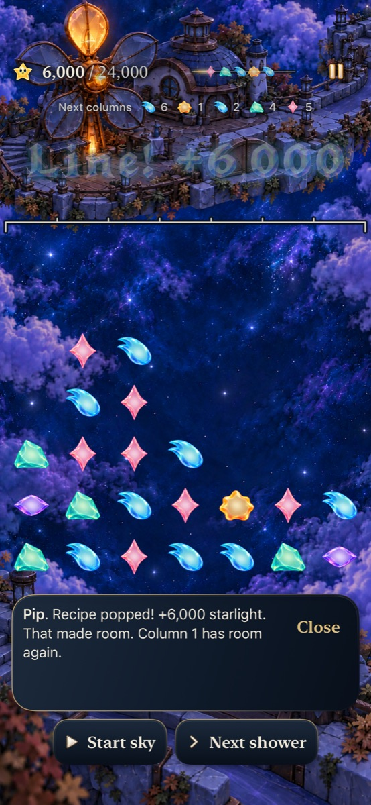
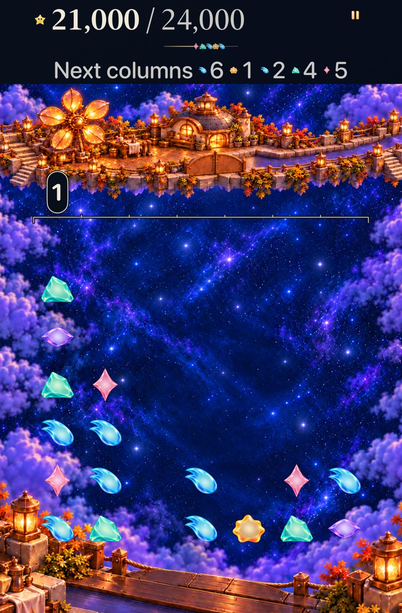

# Sunwheel combines room, a grown ingredient and visible survivor sequences

**Status:** Verified development slice; adopted for explicit new visits. Human recognition, balance and comfort remain unmeasured. Goal [8/10 #311](https://github.com/lbeezr/starfall/issues/311) in [depth queue #303](https://github.com/lbeezr/starfall/issues/303).

Explicit new Sunwheel visits select revision 9: 26 stars storing 27 light, grown Aqua 0, a 24,000-point objective, seed 42 and the existing gentle five-family supply. Column 1 starts full. The same grown ingredient can clear four spaces there or contribute to a larger sequence after visible Rose supports disappear. Existing recipes, growth, scoring, showers and immediate earned completion supply every consequence.

The hypothesis is that combining these familiar decisions produces a readable capstone to the seven ready locations. Fixed routes establish real choices and recoveries; difficulty, understanding and enjoyment remain unmeasured. Lantern and Ribbon retain Falling Sky and Full Board, and saved rounds keep their own definitions.

## A shared ingredient changes the immediate consequence

[Core's `SunwheelEncounterTests`](../../../Tests/StarfallCoreTests/SunwheelEncounterTests.swift) repeats actions from Codable prestates, comparing committed receipts, identities, conserved light, forecasts and Replay.

| Opening choice | Committed consequence |
| --- | --- |
| **Room:** exchange 15→14 | A four-star Aqua line spends IDs 0, 7, 15 and 18, including grown 0: five light, 6,000 points. Column 1 falls from seven stars to three. |
| **Sequence:** exchange 9→10 | Rose IDs 2, 10, 16 and 20 clear for 5,000. Their visible survivors settle into an Aqua line containing IDs 0, 1, 3, 4 and 23; its six light and depth-two award earn another 16,000. Total 21,000; column 1 remains six high. |

Every star in both opening sequence phases was visible before the exchange. The follow-up board is the first phase's settled board; no refill supplies its ingredients. Grown 0 joins the second phase and earns the existing value/scoring treatment.

Both choices preserve the same announced supply. After one shower, column 1 is four high on the room route and full on the sequence route. The same second preview—Amber→3, Violet→7, Violet→6, Rose→1, Mint→2—fits all five arrivals on the room route. Untreated sequence play commits the first three, then actually loses when Rose cannot enter column 1. It retains 21,000 and the blocked preview. The planned sequence can finish before that second shower.

Columns above are player-facing one-based numbers. Move indices below use Core's zero-based, bottom-up `row * 7 + column`; `[]` means an ordinary shower.

| Complete fixed route | Cumulative points after each action |
| --- | --- |
| **Room:** `15→14, [], [], 17→18, 9→10` | `6,000, 6,000, 6,000, 6,000, 25,000` — win after two showers. The final support/follow-up phases earn 9,000 + 10,000. |
| **Sequence:** `9→10, [], 0→7` | `21,000, 21,000, 26,000` — win after one shower and a separate 5,000-point square. |
| **Direct spending:** `2→9, [], 0→7, 3→10` | `8,000, 8,000, 13,000, 24,000` — exact-target win after one shower. |

Direct spending uses the grown Aqua line before its Rose support. It remains a supported alternative: a later square and an 11,000-point cross/line clear complete the round. Declining the larger opening sequence does not require a restart or a hidden rescue. These paths are witnesses, with no required move order or minimum duration. Won and blocked rounds lock further actions until Replay or a new visit.

## Save history and completion remain explicit

Historical Sunwheel 0 retains manual clearing, its 18-light objective, supply and same-round Replay. Explicit New visit selects Sunwheel 9. Other locations cannot claim revision 9. Current Frostfruit 8, Lantern Full Board 5/6, Ribbon Full Board 7 and ordinary first-pair revision 4 remain unchanged.

Archive v18 writes the new definition. Retained v17 requires schema 17 and revision ≤8; v16≤7, v15≤6, v14≤5 and earlier bounds remain. Invalid higher-key presence blocks fallback; rejected values and original historical bytes remain. Invalid encoding cannot replace the archive or recovery slot. World envelope v1 records actual committed completion and repairs an interrupted world write; unfinished rounds earn no completion, and Bell Choir remains unbuilt. [Eight hosted compatibility cases](../../../AppTests/SunwheelEncounterCompatibilityTests.swift) cover these boundaries, exact continuation and Replay; all eight pass in the selected hosted run.

## Source, bounded authoring and verification

Runtime checkpoint: `516e16ca75f4fae607ab7cffc834a5b932baedc4`. The complete Core suite passes **336 tests with zero failures**; Debug build-for-testing and Release build pass. The affected hosted selection passes **171/171**; both selected native cases pass **2/2**, all with zero skips. Phone normal motion earns Silver/Frostfruit access, completes the room plan after a real automatic shower and exact restore, then replays the same opening. AX3XL Calm tablet completes the sequence, replays and recovers the direct-line alternative. [Verification](verification.json) records commands, environment, source and limitations. Subsequent changes are documentation/evidence only; final clean publication identity is recorded in the PR.

One frozen geometry produced the three complete routes in 1,322 production action evaluations and 0.0506 seconds. The authoring receipt remains disposable at `/private/tmp/starfall-sunwheel9-author.txt`. This bounded result establishes reachable consequences, not an optimal route, universal opportunity density or human balance.

Eight [inspected exports](captures.json) retain runtime516e16c / bundle dev.local, original attachment hashes and variants. Existing Sunwheel paintings remain unchanged. Normal captures can include the existing award fade after input readiness; largest-text captures show scrolling reading positions, with controls or upper content outside some viewports. Native reveal checks independently establish reachable controls. Stills do not certify continuous animation, actual VoiceOver, physical installation or minimum-iOS runtime behavior.

| Room-first, normal phone | Sequence-first, AX3XL Calm tablet |
| --- | --- |
|  |  |

These are different device/text variants illustrating committed choices, not a matched artwork comparison. The manifest also retains the same-second-shower fit, full-column warning and all three earned outcomes.

The first focused Core run recorded six assertions in one helper that incorrectly applied ordinary-sky nudge accounting to retained Full Board. Capability-specific accounting corrected the helper; production rules stayed unchanged. The initial log is retained separately. A compile-only type-inference repair in the disposable diagnostic preceded its sole bounded authoring execution.

Active-clock comfort remains a specific human check: the first unmatched arrival can overflow the untouched full column after six seconds. The demonstrated direct-line mistake is recoverable; inactivity is not promised. Native paths pause for inspection and separately prove an automatic shower after the room choice.

**Adoption:** Keep the exact versioned encounter after Core, affected hosted, complete native, Debug/Release, membership, hygiene and whitespace acceptance. Goals9–10 remain queued after this separate merge. Revisit whether the visible survivor sequence and room tradeoff are understandable at the next ordinary play session and the queued gameplay revisit; retain all three legitimate completions while assessing whether the capstone feels coherent.
