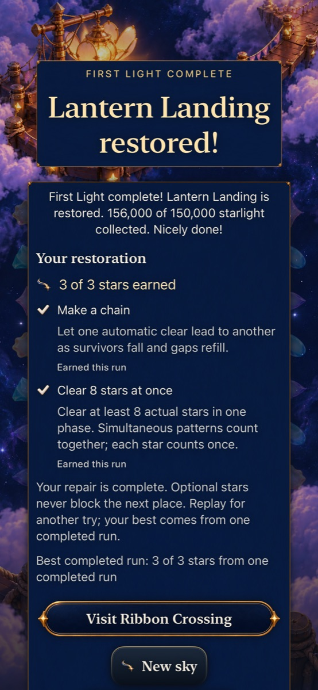
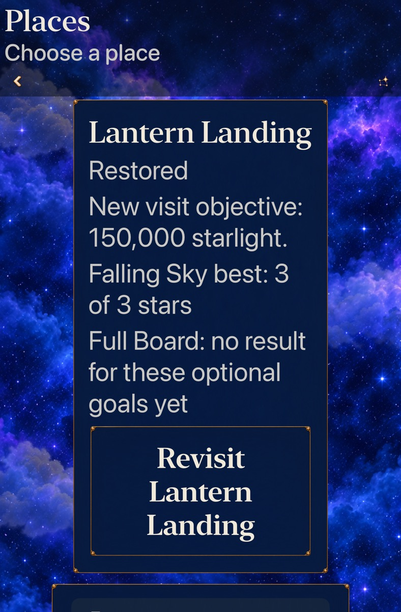

# Lantern optional mastery

Goal9 [#312](https://github.com/lbeezr/starfall/issues/312) adds two optional accomplishments to explicit new Lantern visits. Falling Sky4 rewards grown collection and a survivor chain; Full Board6 rewards a cascade and eight actual stars in one phase. The repair remains a complete success and unlocks the same journey regardless of rating. Both modes remain available.

## Contract and scope

[The implemented contract](../../design/STORY_MASTERY_CONTRACT.md) owns exact goal semantics. Core derives progress from existing committed scoring receipts; the opening, supply, scoring, objectives and RNG are unchanged. Goal-set1 is explicit per eligible attempt. Continue keeps its UUID; committed Replay resets progress with a new UUID. All unenrolled historical rounds and their Replay remain completion-only.

Round saves advance to v19. Every older reader rejects enrollment, including otherwise eligible content. A separate bounded archive keeps one whole strongest completed run per exact mode identity, with ties retaining the first. It never unions accomplishments across runs. A durable winning round recovers an interrupted best write. Failed optional projection cannot withhold the repair; replacement retries before discarding that receipt. Invalid optional data is preserved for recovery. Practice/reset tooling cannot submit records.

Entry, menu and result share native text rows. The result distinguishes this run from its best. Map and Places keep the two modes separate; historical repairs do not receive invented current-contract stars. No new gameplay HUD overlay, resource or alternate target is introduced.

## Source and verification

Runtime/test checkpoint: `fc42397603cc1ff5bd547da5a991545596cb54d8`, initially based on main `c6c726f5`. Integrated source `a49ad72a8c07306ec06ca1e54558600f6ff5c390` preserves main `56fb4acd` and its macOS12 test-host declaration, with identical iOS Swift/resources/project/test sources. Full Core and Debug/Release checks repeat after that manifest change; subsequent changes are documentation/evidence. Full command/environment/count and source details belong in [verification.json](verification.json). Raw logs/results remain disposable under `/private/tmp/starfall-depth-09-20261023`.

All 348 Core tests and 181 selected hosted tests pass, with zero failures/skips. The initial 179-case hosted run also passed; the integrated selection adds two catalogue boundary cases. Both Debug and Release simulator builds pass with explicit membership for the new App, hosted and native files; Core source is included by the existing local package. Hygiene and whitespace checks pass. Native complete-round checks and visual inspection are recorded in the final verification receipt.

Both native cases pass on first execution with zero skips: default-text normal-motion iPhone Full Board and AX3XL Calm iPad Falling Sky. Each earns its real three-star repair, checks independent mode bests, relaunches the saved result and replays with empty current goals. Phone Replay also relaunches and preserves the exact opening. Eight originals and exact selected JPEG exports were inspected; [the capture manifest](captures.json) records hashes, variants and reading-position limits.

| Earned Full Board repair | Independent mode bests at AX3XL |
| --- | --- |
|  |  |

These are scrolled reading positions. Entry, result and menu content remains scrollable at large text sizes; the captures do not claim every action is visible in the same frame. Artwork and gameplay geometry are unchanged.

The Core equivalence tests replay235 actual production commitments across joint/recovery Sky routes and three Full Board routes, comparing qualification against real phases and preserving rules/RNG after every action. Full Board HIGH earns3stars at156,000, with the eight-star accomplishment first earned in the final winning transaction. LINE earns2stars at150,000. The existing Sky routes earn3stars at151,000/150,000, including a real declined-opening-chain recovery.

Rank1 and separate-goal aggregate fixtures establish accounting and validation only. They do not demonstrate naturally reachable authored histories. Missed-first-grown recovery, natural rank1 and distinct Sky single-goal wins remain unproved. Solver speed, completion scripts and stills do not establish human comprehension, difficulty, preference or motivation.

## Retain and revisit

Retain this bounded Lantern comparison for development. At the next player observation, assess whether the goals explain useful planning and make Replay worthwhile; also investigate missed-first-grown recovery before extending beyond Lantern. Revise the versioned goal contract if those observations reject it. Actual VoiceOver, minimum-iOS17 runtime, physical installation/play and continuous animation quality are not established by this batch.
