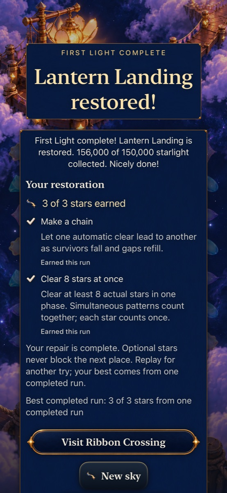
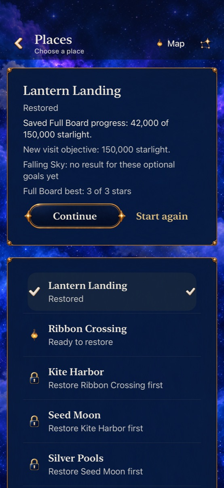
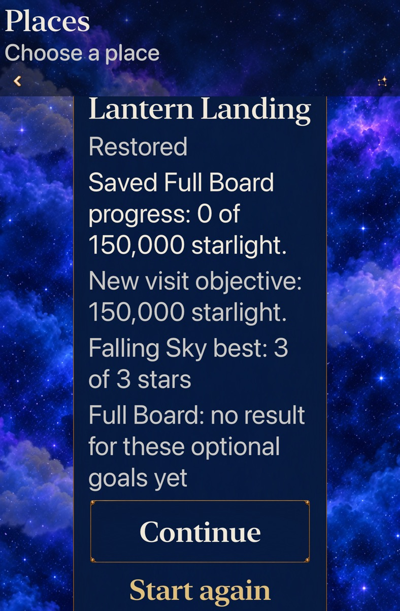

# Return to the round you were inspecting

Goal 10 [#313](https://github.com/lbeezr/starfall/issues/313) fixes the strongest remaining repeat-visit mismatch after [goal 9](../depth-goal-09-optional-mastery-2026-10-23/README.md): Back from a Replay or New preview now returns directly to the original round or earned result. Explicit Home still opens the Observatory. A preview opened from Map still returns to that Map.

## Cause and correction

`SkyFlowState.stage` previously remembered Home for every origin except Map. Existing tests reproduced that behavior, including cancellation over a completed round. The committed game remained safe, but the player lost their immediate context and needed Continue to find it again.

Entry now remembers the actual presentation origin. Back emits the existing continuation effect for play/result origins, with no new admission handoff, clock restart or replacement game. The existing caller preserves pause and the frozen shower remainder. Stale Entry callbacks remain rejected; explicit Home and Map's independent return origin retain their behavior. Failed Begin can still roll back to its exact Entry without discarding a winning mastery receipt.

Map and Places also identify the saved mode beside its exact progress: “Saved Full Board progress” or “Saved Falling Sky progress.” This distinguishes equal 150,000-point objectives using the retained round's capability. Current and historical definitions remain exact; inspecting the label cannot upgrade or write a save.

The examined boundary includes direct Replay/New, mode previews, Home, Map/Places, preferences/practice, active pause/deadline, won/lost results, and failed-save replacement. Rules, RNG, supply, score, round schema v19 and world/best schemas remain unchanged. Both Lantern and Ribbon retain their existing modes.

## Source and acceptance

Runtime/test checkpoint: `083005c57a7ef522e6eb73cf4dcbb4b8658bf66f`, based on goal 9 main `57598b10608c3b9b3525540ec92e686970f33206`. The native reading correction at `0bf3fe0f98c65299ea9a79cb31f13e276c40cf30` changes only `UITests/StoryMasteryInteractionTests.swift`; App/Core/resources/project sources remain identical. Subsequent changes are documentation/evidence. Raw logs/results remain under `/private/tmp/starfall-depth-10-20261023`; [verification.json](verification.json) records command forms, selected counts, environment, failures and scope.

The selected hosted matrix contains 207 cases, including seven origin/clock/save regressions and seven saved-mode/history cases. Native acceptance extends both complete goal 9 routes through earned-result Back, paused real-chain preview cancellation, Map-origin mode cancellation, exact Continue, explicit opposite-mode Begin and Home/Continue. Four existing navigation cases retain Ribbon and Open Sky loss/active-round coverage. Two Map/Places cases check current and historical mode wording. Final acceptance passes all 348 Core tests, 207 selected hosted cases and eight selected native cases, with zero final failures/skips. Debug build-for-testing, Release, explicit membership, hygiene and whitespace pass. The initial tablet failure below remains part of the record.

The first largest-text tablet attempt failed after the real Sky win and mode switch: the test helper required both long Full Board goal blocks to fit in one viewport. The menu is intentionally scrollable. The correction reveals each complete goal block before the same state/label assertions; it changes no production layout or goal assertions. The expanded journey measured 917 seconds including setup/teardown, so the corrected case has an explicit 1,100-second execution allowance inside a 1,200-second wrapper. The initial failed result remains recorded separately from the focused whole-case rerun.

## Inspected appearances

| Earned result after Back | Saved Full Board after Map preview Back |
| --- | --- |
|  |  |

**Native Debug `083005c` / `dev.local`, iPhone 17e, iOS 27.0 Simulator, default text, Calm off.** These selected scroll positions retain the result and distinguish saved progress; lower actions occupy other reading positions. [The manifest](captures.json) records original/export hashes and limits. Artwork is unchanged.

**Native Debug `0bf3fe0`, app-equivalent `083005c` / `dev.local`, iPad mini A17 Pro, iOS 27.0 Simulator, AX3XL, Calm on.** After explicit Begin and Home/Continue, the saved mode is Full Board at zero while the earlier Sky best stays three stars. This scrolled position shows the complete progress/best and Continue; the card title is partly above the viewport. Eight inspected exports retain their original source and reading-position limits.

## Carry the comparison forward

The ten depth outcomes remain separately integrated: optional mode discoveries; visible move choices; survivor-cascade comparison; Full Board round structure; announced forecast columns; distinct Ribbon Full Board; Frostfruit pressure/growth; Sunwheel synthesis; Lantern mastery; and this repeat-visit correction. Ordinary repairs keep unlocking the journey, and practice stays disposable. Each earlier report retains its own source and evidence limits.

| Goal | Individual main PR |
| --- | --- |
| 1 · Mode discoveries | [316](https://github.com/lbeezr/starfall/pull/316) |
| 2 · Visible choices | [318](https://github.com/lbeezr/starfall/pull/318) |
| 3 · Survivor comparison | [319](https://github.com/lbeezr/starfall/pull/319) |
| 4 · Full Board round arc | [323](https://github.com/lbeezr/starfall/pull/323) |
| 5 · Forecast columns | [326](https://github.com/lbeezr/starfall/pull/326) |
| 6 · Ribbon Full Board | [330](https://github.com/lbeezr/starfall/pull/330) |
| 7 · Frostfruit pressure | [331](https://github.com/lbeezr/starfall/pull/331) |
| 8 · Sunwheel capstone | [332](https://github.com/lbeezr/starfall/pull/332) |
| 9 · Lantern mastery | [348](https://github.com/lbeezr/starfall/pull/348) |
| 10 · Repeat-visit continuity | This batch; closing PR is linked from [313](https://github.com/lbeezr/starfall/issues/313). |

Keep both modes available for player comparison. Complete fixed routes demonstrate consequences and reachability, not human preference, difficulty or mastery motivation. The goal 9 limits on natural rank 1 and missed-first-grown recovery remain open. Actual VoiceOver, minimum-iOS 17 runtime, physical play/install and continuous animation certification are not established by these selected simulator checks.
