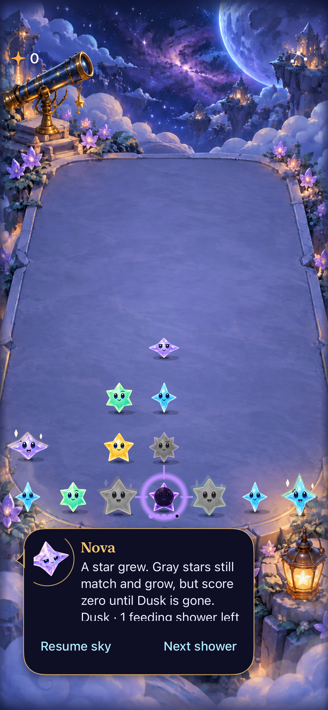
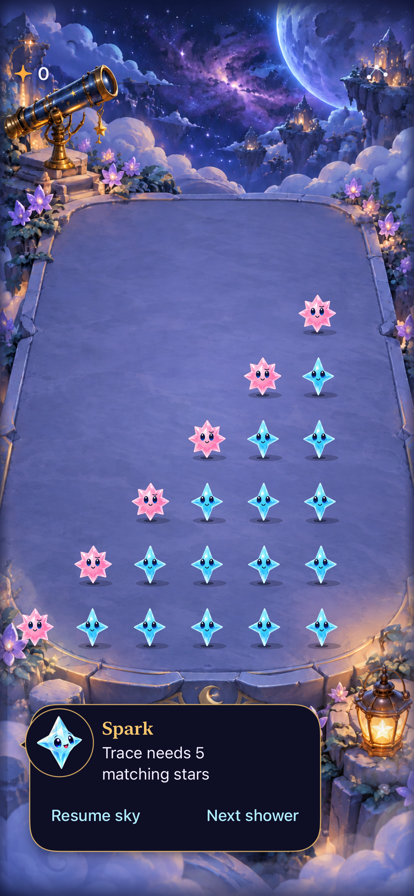
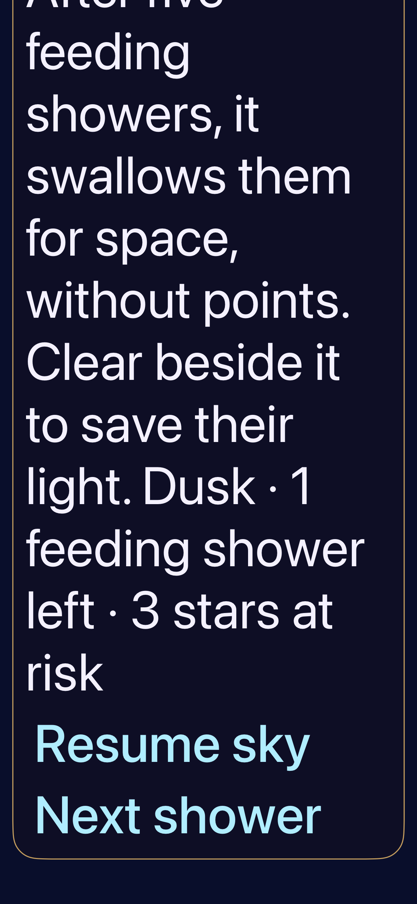

# One bottom dialogue and direct gestures

**Result:** Partially verified · **Owner:** current implementer · **Date:** October 18, 2026

Removed the reintroduced top Dusk/input banners and the entire Arrange mode: no header toggle, menu alternative, neighbor-tap exchange, recipe picker or tap-arrangement panel. Swaps use the existing 150 ms gesture; exact squares/crosses use traces. Ordinary match taps remain. Character dialogue owns guidance. Core rules, save schema, RNG, cadence, geometry and artwork are unchanged.

**Next action:** Reproduce the full-sky timeout on an idle host, retaining the board/archive and pending presentation state before teardown. Physical timing comfort and release-candidate VoiceOver acceptance remain separate. No phone update was performed.

## Outcomes against acceptance

| Criterion | Result / limit |
| --- | --- |
| No top text banners or Arrange UI | Source removes both banner renderers, mode state, its gesture override and control file/target membership. Native startup assertions check absent banners/toggle; menu assertions check no alternative. |
| One bottom message owner | Dusk context joins committed storm/cadence copy. Input corrections use Spark's existing bubble; the next contact/commit/lifecycle clears them. No input expiry timer is introduced. |
| Gesture-only board actions | All 11 selected native interaction cases pass at the isolated checkpoint: direct swaps/empty falls, selected-only traces, recipe taps/relays and settings/background readiness. Ordinary taps still clear matches; recipe traces retain exact ingredients. Mode-free VoiceOver Move left/right actions use the same snapshot/generation validation; actual VoiceOver is not run in routine development. |
| Interruption and saves | Native Dusk progression/collapse/restore and early/zero-reward clears pass. Settings/background direct input passes; all 44 final hosted checks, including stale contacts and exact square/cross traces, pass. Win/replay assertions passed in the final outcome case; the later full-sky step failed waiting for either Next shower or an outcome. Full-sky acceptance remains open. No persisted mode or new save field. |
| Large text / motion | Native Dusk warning and outcome at largest text with system Reduce Motion pass. Normal/largest-text drift-tap and incomplete-trace follow-up checks pass. Screenshots and hosted motion checks remain separate from a human feel assessment. |

## Source and verification

Base `e4c8f2b` plus local changes; initial isolated checkpoint [source hashes](source.json), final working-tree [source hashes](final-source.json). No published-commit or device-install acceptance is claimed. All changed source/resource/project paths are explicit in those manifests; documentation is outside the runtime boundary.

Xcode 27.1 (27A9275), Debug/Release arm64 Simulator; isolated **Starfall Gesture HUD QA 01a14f09**, iPhone 17e / iOS 27.0, UDID `556CD828-3962-4FC2-B1DD-10905A779C62`. Default text and normal motion except named largest-text/Reduce Motion cases; Calm effects off. Early runs on the shared 17e were stopped in favor of this isolated simulator when concurrent testing was discovered.

- `swift test`: 149 tests pass; Core is unchanged by the final presentation cleanup.
- Debug simulator build passes. Final source: 44/44 hosted tests and 2/2 swap/trace native smoke tests pass; the separate First Light win/replay/full-sky test fails at the full-sky step (`UITests/FallingSkyInteractionTests.swift:742`, five-second `outcome.exists || next.isEnabled` predicate). Win/replay assertions and the `flow-win` capture precede that failure. Initial checkpoint has 11/11 native passes and 42/44 hosted passes; two old exact-copy assertions fail because they omit the newly required Dusk context. Final expectations explicitly require that context. The native checkpoint replaces the obsolete assertion that expected *no bottom message* after settings; it now checks that stale input copy is gone while normal dialogue remains. A test-only incorrect Core argument label was corrected before the isolated run.
- Release: `xcodebuild -project Starfall.xcodeproj -scheme Starfall -configuration Release -destination 'generic/platform=iOS Simulator' -derivedDataPath /tmp/starfall-dialogue-release ARCHS=arm64 ONLY_ACTIVE_ARCH=YES CODE_SIGNING_ALLOWED=NO build` passes on final source, including direct accessibility actions and the final bundled input script.
- Native matrix discovery: `python3 scripts/native_test_plan.py --stage dev` passes (90 UI, 218 hosted methods discovered, not all executed).
- `python3 scripts/ci-hygiene.py` and `git diff --check` pass.
- Actual VoiceOver, physical-device installation, human timing/gesture comfort and a new inspected motion recording: not run. No geometry change; native direct cell gestures are covered by the selected cases. Multi-segment square/cross paths are exercised in hosted intent/Core checks; a new native curved square/cross trace is not claimed.

Raw logs/results remain disposable under `/tmp/starfall-dialogue-*`. The isolated checkpoint differs from final source only by direct mode-free accessibility actions, non-expiring input copy, project-reference cleanup and matching dialogue test expectations; final hosted and swap/trace smoke checks cover those changes; the additional full-sky case remains failed.

## Why this recurred

Earlier character-chat adoption removed top storm/cadence views, but later Dusk and responsive-input features introduced their own top message renderers. Recipe work also retained a global Arrange mode after direct swipe-and-hold was available. Removing only the visible toggle would leave the same mode contract reachable elsewhere. This correction removes that state and panel, and routes the examined Dusk/input/phase/cadence paths through the existing dialogue owner. Gesture admission, trace-to-swap transfer, release/cancel/reset, settings/background and stale generation paths are the related boundaries examined; this is not a claim that every gesture interruption or latency issue has been eliminated.

## Inspected native presentation

| Default Dusk warning | Input correction |
| --- | --- |
|  |  |

**Native implementation, checkpoint `9d48ca2602d9`, iPhone 17e / iOS 27.0 Simulator.** Default text, normal system motion and Calm effects off. These frames show removal of the top message/toggle and ownership by character chat; they do not measure gesture latency or establish motion quality. The default Dusk bubble shows the imminent feeding line, but its trailing risk count requires scrolling inside the existing bubble. Full copy fitting at ordinary text remains a layout follow-up; it is not certified by the successful native AX assertion.

**Same source and simulator, accessibility XXXL and system Reduce Motion on.** The below-board scroll view exposes the complete warning and both actions. The upper part of the bubble is intentionally outside this scrolled frame. This is layout evidence, not actual VoiceOver acceptance.

### Reproduce the native/hosted checks

Common command: `xcodebuild -project Starfall.xcodeproj -scheme Starfall -configuration Debug -destination 'platform=iOS Simulator,id=556CD828-3962-4FC2-B1DD-10905A779C62' -derivedDataPath /tmp/starfall-dialogue-derived -parallel-testing-enabled NO -collect-test-diagnostics never ARCHS=arm64 ONLY_ACTIVE_ARCH=YES CODE_SIGN_IDENTITY=- CODE_SIGNING_ALLOWED=YES DEVELOPMENT_TEAM= CODE_SIGN_STYLE=Manual test`.

The isolated checkpoint selects `StarfallUITests/SkyTechniqueInteractionTests`, `StarfallUITests/DuskInteractionTests`, and `StarfallUITests/ResponsiveInputUITests` using `-only-testing:`. Hosted selections are `StarfallAppTests/ResponsiveInputTests`, `DuskProductionTests`, `SkyTechniqueStoreTests`, `SkyDialogueTests` and `TraceInputPolishTests`, each with the same target prefix. The final-source run retains those hosted suites and selects native `SkyTechniqueInteractionTests/testSwipeAndHoldSwapsWithoutArrangeAndEmptyDestinationFalls`, `ResponsiveInputUITests/testIncompleteTraceExplainsCancellationAndNextTapStillWorks` and `SkyFlowInteractionTests/testFirstLightWinReplayAndFullSky`. Result bundles: `/tmp/starfall-dialogue-gesture-only.xcresult` and `/tmp/starfall-dialogue-final.xcresult` respectively. The earlier command named the outcome method under the wrong suite and ran zero outcome cases; final-source selection corrects that name.

### Final outcome-check limit

The final native run returns **TEST FAILED** because the full-sky predicate above timed out. The app process remained alive until the next case terminated it; no new Starfall crash report was found. At investigation time the host had seven booted simulators and 9,594 MB swap in use; the following app launch took roughly 52 seconds to reach automation setup. Host contention is a plausible contributor, **not an established root cause**. No assertion, timeout, animation setting or retry policy was changed. The failed run had no matching automatic failure-image attachment; its raw result/log remain at the paths above. A fresh full-sky pass is not claimed from the earlier win, core or build results.

Final checks: `python3 scripts/ci-hygiene.py`, `git diff --check`, native-method discovery and changed-document relative links pass. The final source manifest matches all changed app/test/project inputs. All ordinary/selected clears, recipe tracing and exchanges keep the existing rules/save contracts. No ad/IAP SDKs, network features, new app target or player-data migration were added.

## PR integration with current main — October 18, 2026

**Result:** Partially verified. Reconciled with main `7ddc837`, then `1ab1765`. Preserve the newer feedback/readiness/award boundaries and generic per-action admission; retire the newer Arrange-only recipe-revalidation state, controls and tests because the user requires direct gestures. Its historical reports remain unchanged. Published PR: [#91](https://github.com/lbeezr/starfall/pull/91).

The first published head `9179880` exactly matches local tested merge `72027d0`, tree `674566fe4a143e93579dd689b2b2088015e08497`. After the second reconciliation, app/test source is `3ca42ea`; subsequent differences are documentation only. [Integration input hashes](integration-source.json) identify the final runtime/test inputs. Same dedicated 17e / iOS 27.0 and Xcode 27.1 as above; normal motion, Calm effects off.

| Check | Source and result |
| --- | --- |
| Core | 149 pass; neither later main update changes Core |
| Expanded hosted | 226/227 pass initially; the sole failure is an exact speech list omitting required Dusk context. Five expected strings now include the exact feeding counts while retaining count/order assertions. The complete affected 41-test store suite passes afterward. |
| Expanded native | 7/9 pass initially; the Dusk post-resume readiness and gesture post-resume exchange cases fail. Diagnostic follow-up passes both with unchanged result assertions/timeouts. The gesture case now waits up to five seconds for foreground, enabled and hittable board input before one swipe; it does not retry the gesture. Dusk adds failure-only capture/tree diagnostics without changing its seven-second readiness predicate. No product-level elimination of all resume failures is claimed. |
| Final affected checks | `3ca42ea`: 29 hosted tests (DuskProductionTests, ResponsiveInputTests, SkyTechniqueStoreTests) and the native direct-swap/empty-space-fall case pass. |
| Build | Debug test build and final Release arm64 Simulator build pass. No source/resource membership gap; the removed control file and all target references are gone. |
| Hygiene | Hygiene, whitespace and relative-link checks pass. |

Commands use the common Xcode command above with `/tmp/starfall-hud-pr-current-main.xcresult` (all hosted, techniques, responsive input and the Dusk progression case), `/tmp/starfall-hud-pr-resume-diagnostics.xcresult` (41-test FallingSkyStoreTests suite and the two diagnosed native cases), and `/tmp/starfall-hud-pr-reconciled.xcresult` (final 29 hosted tests and direct swap). Logs are `/tmp/starfall-hud-pr-{core,native,resume,reconciled,release}.log`. No blanket retries, assertion relaxation, motion suppression or timeout increases were used.

The original full-sky failure above was not rerun or declared fixed by these narrower checks. Long Dusk copy still uses the bubble's existing scroll. Actual VoiceOver, phone installation, new full-motion recording and human gesture comfort remain unverified. Repository CI runs on pushes to main, not on PR branches; no premerge CI run is claimed.
