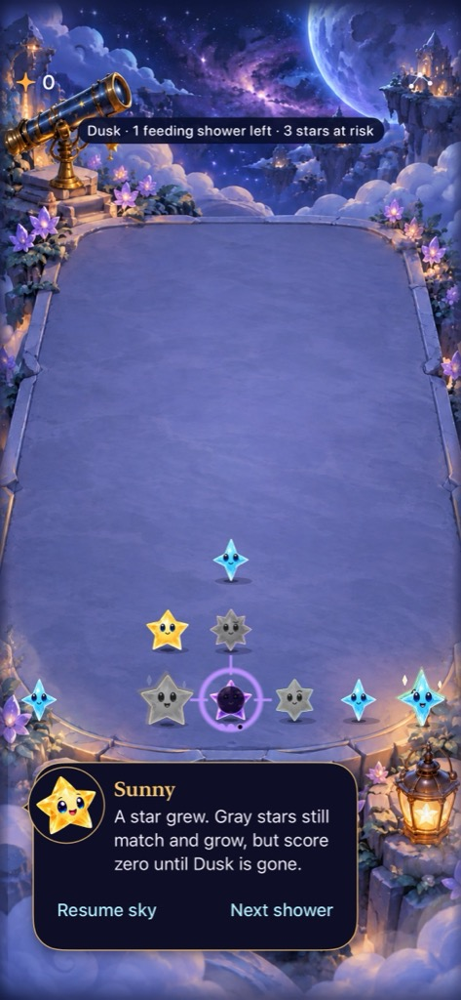
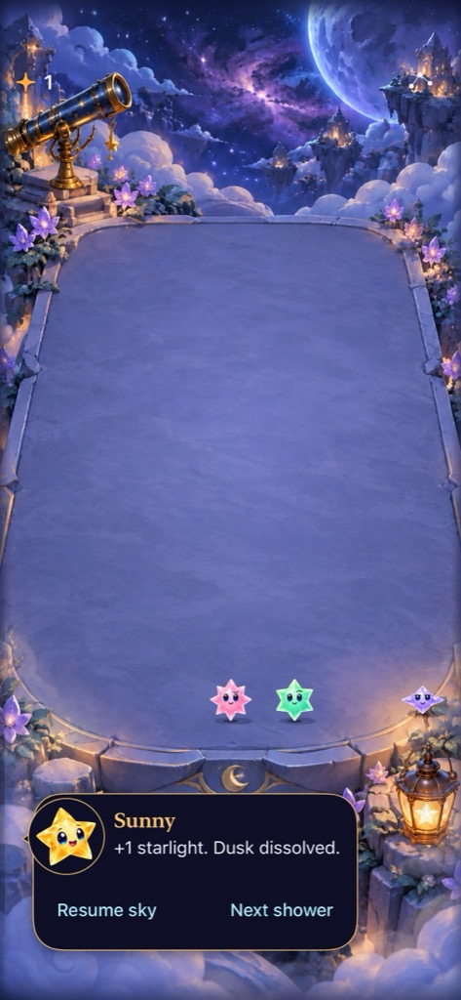
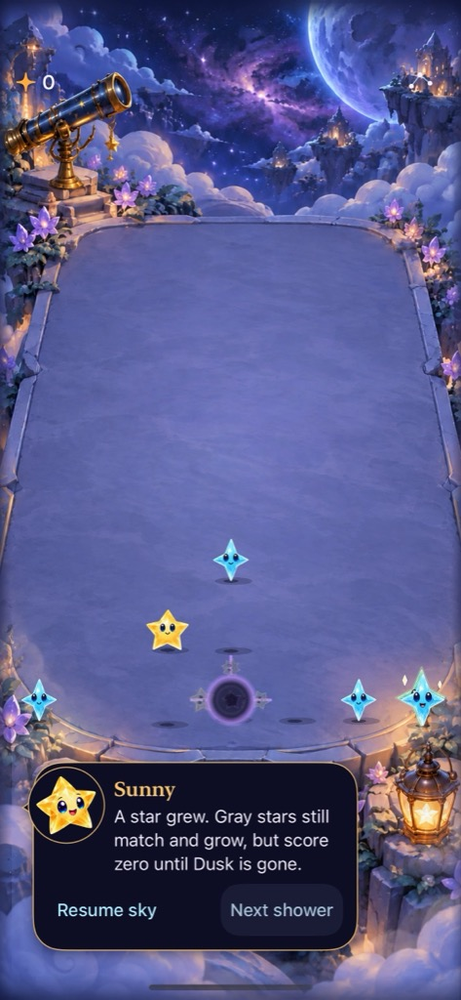
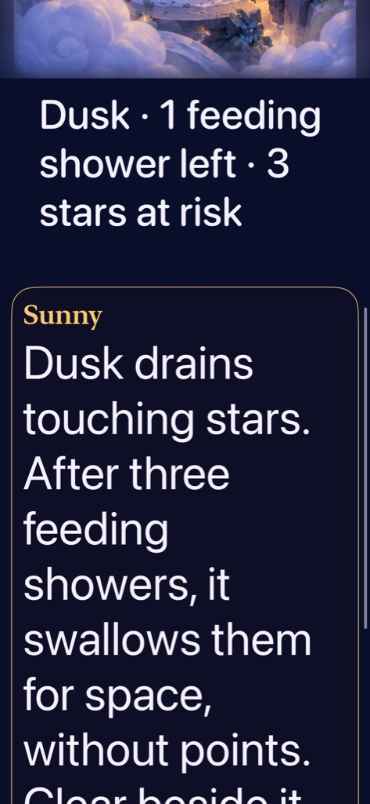

# Dusk becomes a problem players can use

**Decision:** Adopt the user-selected feeding/collapse pivot in the regular Starfall target. No separate mode or lab app. Three feeding showers lead to a bounded zero-point neighborhood clear; early matching beside Dusk saves survivors’ reward opportunities. Human recognition and enjoyment remain unmeasured; the next playtest should ask players to explain and deliberately use both choices.

[Production rule and acceptance criteria](../../design/DUSK_FEEDING.md) · [Runtime source hashes](source.json)

## Source and environment

Base `b80edd8` (production main), branch `codex/dusk-black-hole-production`, capture snapshot `72e5845b05d2`; pre-integration runtime snapshot `d176232d6d2a`, build identity `dev.32a7813177`. The capture snapshot includes every App/Sources input, Package.swift and project membership. A final Core-only save guard rejects overlapping retired/lost-light totals before subtraction (including extreme decoded counters); App/project render inputs and valid fixture outcomes remain unchanged. The final source hashes are recorded separately in the manifest. Tests/docs also changed; the source manifest records dirty paths. No unrelated working-tree changes were included. Xcode 27.1 (27A9275), iPhone 17e Simulator / iOS 27.0, UUID `6E9BC34B-C5C6-48ED-9593-D16AC994BCC8`. Debug tests use normal motion/Calm off except the explicit system Reduce Motion/largest-text scenario; the simulator’s original Reduce Motion preference is restored after validation.

## Verified contract

Core owns feed stages, simultaneous target snapshots, score/lost-light conservation and settlement before incoming stars. Dusk consumes only touching colored stars/Opals, disappears, and cannot chain into specials. Consuming an orbit captive closes/releases that orbit safely. No-neighbor showers pause progress. A neighboring valid ordinary/trace clear remains legal even at zero reward, dissolves adjacent Dusk and releases surviving stars only when their last source leaves.

The app explicitly migrates v3/v4/v5 rounds to v6 feeding without changing board, IDs, score, preview, RNG, generation or cadence. Existing Dusks start unfed; old bytes remain untouched and a malformed newer archive never revives older state. First Light is unchanged. Animation reads committed events; settings/background/restart invalidate stale callbacks. Ordinary input reserves affected columns, while collapse/orbit phases reserve the board.

## Initial branch checks

Commands use `-project Starfall.xcodeproj -scheme Starfall ARCHS=arm64 ONLY_ACTIVE_ARCH=YES CODE_SIGNING_ALLOWED=NO`. Debug tests use the simulator UUID above, `/tmp/starfall-dusk-production`, `-parallel-testing-enabled NO`. Release uses generic iOS Simulator and `/tmp/starfall-dusk-release`. Raw logs/results are in `/tmp/dusk-production-*` and DerivedData; retained captures below are selected native output.

- `swift test`: 125 tests passed, including historical replay and 80 seeds × 40 showers of mixed-special conservation.
- Final full normal-motion hosted app matrix: 191 tests passed, no skipped tests (`/tmp/dusk-production-normal-final.log`, result bundle `Test-Starfall-2026.10.18_00-27-34--0400.xcresult`). Includes normal SpriteKit collapse/infall/arrival sampling and replacement cancellation, live automatic shower/input timing, migration, saves and interruption boundaries.
- Debug and Release simulator builds passed; new scene/warning/hosted/native files have explicit Xcode target membership. The package discovers core files normally.
- Native production checks passed: early clear/color release, zero-reward rapid taps, all three feeds/collapse/restore, settings dismissal/background, balance persistence, normal opening clear, paused dialogue, and First Light win/replay/full-sky/ending restore. The two selected native batches each passed 7/8; both failures belonged to successive navigation corrections in the same largest-text test. That corrected scenario then passed in `/tmp/dusk-production-acceptance.log`, giving 15 distinct native scenarios passing across the recorded runs. The combined Reduce Motion run skipped 19 hosted motion tests; the separate normal-motion matrix owns full hosted acceptance.
- Repository hygiene, native-matrix source-count checks and whitespace checks passed. A clean-export verification record follows below.

Existing planning examples were also recomputed under feeding: the Opal two-clear orders end at 33/32, the current orbit orders at 35/36, and both magnetic examples at 30. Old reports retain their historical 34/33, 38/36 and 32/31 outcomes; those scores do not describe the new rule. Dusk can change the preferred choice.

Initial failures exposed obsolete legacy-marker and scoring expectations. Updated expectations explicitly reflect pre-dissolution zero rewards; matching/trace legality, clock boundaries, raw legacy bytes and committed-state comparisons remain asserted. An initial native sequence incorrectly expected an injected imminent-fixture forecast after natural subsequent showers; its corrected check compares the actual committed board across relaunch. The first largest-text reveal stopped at a partially hittable cue; it now scrolls until the entire cue is inside the viewport. A subsequent test scrolled toward the board instead of the lower action; it now reveals Next shower using its actual frame and then verifies the same zero-point collapse.

Xcode’s failure-diagnostic `simctl diagnose --timeout=600` stalled after completed test suites. Only those diagnostic child processes were terminated to finalize the recorded result bundles; test runners and assertions were not bypassed.

## Limits and next check

Actual VoiceOver and physical-device acceptance were not run for this development integration; they remain RC gates under repository policy. Captures do not establish animation: the normal-motion hosted sampler separately observed the well, moving/shrinking consumed star, incoming flight and final settlement. Three feeds and an orthogonal neighborhood are initial tuning, not proof of enjoyment. At the next human session, verify imminent-state comprehension, recognizable gray families and deliberate early-clear versus space-making choices. No backend, analytics, SDK, monetization or progression was added.

## Inspected native visuals

| Imminent collapse | Early clear releases color | Normal-motion collapse frame |
| --- | --- | --- |
|  |  |  |

**Runtime evidence, not concepts:** iPhone 17e Simulator, default text, Calm off and system Reduce Motion off. Stage and release captures are exported XCTest attachments from the 00:09:31 run (the early-clear case passed; the sequence later failed its unrelated forecast expectation). The collapse frame is 13.6 seconds into that sequence’s native screen recording; 14.2 seconds shows the following incoming flights. Runtime inputs match snapshot `72e5845b05d2`; still frames alone are not animation proof. Retained JPEGs are proportional 1024-pixel-high encodings of the native output; originals remain in temporary test exports. No generated art was added.

**Accessibility runtime capture:** largest supported Dynamic Type, system Reduce Motion on, after scrolling below the board. The complete warning fits without shrinking text; native scrolling then reveals Next shower and commits the same zero-point collapse. Captured in the successful 00:23:53 run. This is lightweight development acceptance, not actual VoiceOver certification.

## Reconciliation with newer production main

Production advanced to `257f30f` during verification: PR #71 retired gravity specials and PR #72 guarded canonical device delivery. This feature merges those accepted changes. Normal restore/replay first calls `removingGravity()`, then adopts feeding Dusk; new games use `standardSky`. Raw historical Core readers and explicit reset-only Debug gravity fixtures remain compatibility tests. The v6 Dusk envelope preserves the existing v5 reader and the strict legacy/Opal-only v4 contract. Phone delivery remains owned by `scripts/device-update.py`; no branch checkout is installed on a phone.

The initial captures and 125/191 test counts above retain their original source. Integrated Core verification passes 130 tests, including both 80-seed production and 80-seed historical-gravity Dusk conservation cohorts. Updated hosted/native results and clean-export checks are recorded after integration verification.

**Integrated clean export:** `103870c`, `/tmp/starfall-dusk-clean-103870c`, no working-tree inputs. Core: 130 passed (`/tmp/dusk-integrated-clean-core.log`). Generic iOS Simulator Debug and Release builds passed (`/tmp/dusk-integrated-clean-debug.log`, `/tmp/dusk-integrated-clean-release.log`), matching ARM64/signing options above. Integrated runtime snapshot `44668387e999`, build identity `dev.588c62c0f0`. The source manifest records the captured, pre-integration and integrated inputs separately. Canonical delivery tooling’s 21 local regression checks and native-matrix checks also passed; these are tool tests, not a physical-phone installation claim.

**Integrated native/hosted acceptance:** `/tmp/dusk-integrated-native.log`, result `Test-Starfall-2026.10.18_00-31-19--0400.xcresult`: all 193 hosted tests passed with normal motion and no skips, plus all four native scenarios (Dusk early-clear/zero-reward, three feeds/collapse/restore, old orbit retirement, old pending pair retirement). Combined command succeeded. This rechecks the two changed restore boundaries against accepted main; the earlier 15 native scenarios remain source-bound evidence for unchanged UI/interaction paths. Runtime inputs match the clean export exactly; only this acceptance report was appended afterward. System Reduce Motion was restored to its original enabled preference. No physical-device or actual VoiceOver acceptance is implied.
