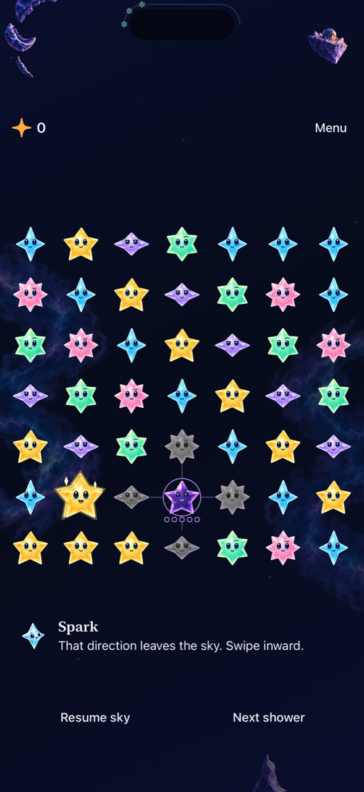

# Edge swipes explain the chosen direction

**Result:** Partially verified · **Owner:** current implementer · **Date:** 2026-10-18

Outward swipes now say “That direction leaves the sky. Swipe inward.” The directional recognizer preserves a blocked-swipe result through the production adapter, rather than converting it into generic tap cancellation. The contact is consumed once; the next contact remains available immediately. This is the final small consequence-feedback correction before shower pacing.

**Next action:** Proceed to shower pacing; incorporate physical-play feedback when available.

## Acceptance and root cause

The original hosted regression reproduced tap instructions after a recognized outward swipe. A single cancellation event had discarded the action's meaning. Only the validated out-of-bounds cardinal destination now returns the dedicated event; ordinary tap cancellation, held-trace exits and invalid coordinate samples retain their existing behavior.

The regression exercises four directions at compact, large-phone and tablet sizes; it requires one explanation, no swap/clear/delayed hold, and a successful next inward swap. Existing final-only/coarse samples, same-color swaps, tracing and interruption checks remain applicable. A new native check rejects all four edges without changing the dense board, then clears its four-star Amber corner group worth five starlight through a normal tap.

## Verification context

[source.json](source.json) records base main `ba8ea71` and all five dirty runtime/test hashes; runtime fingerprint **`dev.3be5031c35`**. Xcode 27.1 (27A9275), Swift 6.4; Debug and Release, iPhone 16 Pro Max QA / iOS 27.0 (24A434) Simulator. Tests use XcodeBuildMCP `test_sim` with arm64, no signing, serial tests and scoped identifiers; the report's verification JSON records exact cases. Core uses `swift test --disable-sandbox` and the temporary module cache. Disposable output stays in `artifacts/edge-feedback/`; the expected red reproduction is `artifacts/edge-feedback-reproduction.xcresult`.

No rules, scoring, RNG, save schema, gesture thresholds, geometry, normal animations, shower schedule, sound or haptics changed. The copy inventory check verifies the shipped key/resource pair. Actual VoiceOver remains RC work; physical feel and comprehension are not established by simulator checks. The immediately preceding integrated batch owns win/replay and Reduce Motion evidence; this batch exercises affected input and interruption paths separately.

## Results and inspected appearance

**169 Core tests, 52 affected hosted tests and five distinct native tests passed.** The initial combined run had 56 passes and one failure: the new native test incorrectly expected three starlight, while the dense fixture includes a touching grown Amber and correctly commits five. Its score expectation was corrected; the focused native rerun passed. This is combined/focused evidence, not one all-green combined run. The product code did not change after that run.

The hosted checks include the shipped copy inventory and all four-edge/recovery cases. Native checks cover every outward direction, successful next tap, normal/largest-text drift, incomplete trace recovery, same-color swap/held trace, and settings/background. Release simulator build, hygiene and diff checks passed. [verification.json](verification.json) records exact cases and the initial failure. Source snapshot `e516aad66176` is the final test revision; initial acceptance used `e59f41cde66e` with identical product inputs.

*Inspected native iPhone 16 Pro Max / iOS 27.0 Simulator, default text and normal motion, `dev.3be5031c35`. The historical dense fixture includes Dusk for compatibility; it is not fresh survival. JPEG reduced to 1280 pixels high. All four native gestures leave this board unchanged, and the subsequent tap awards five. The image establishes readable copy placement, not physical comfort.*

## Delivery

[PR #146](https://github.com/lbeezr/starfall/pull/146) merged at `1ddd5f267bd13d31e48ebc4b7a628aadb097c170`, with the same tree as accepted local `302f0af`. The canonical updater installed and verified **`dev.3be5031c35`** after Core/signature checks, preserving player data. Main CI was pending at installation. [delivery.json](delivery.json) is the sanitized receipt.
