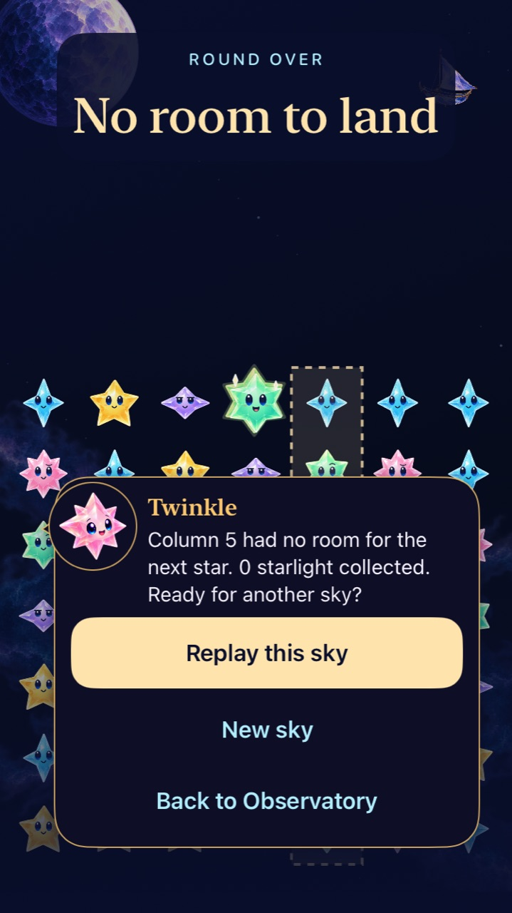
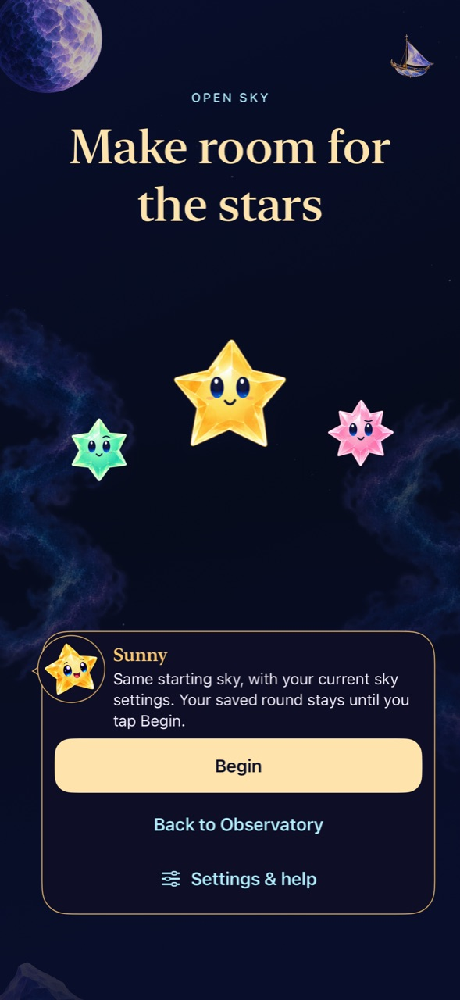
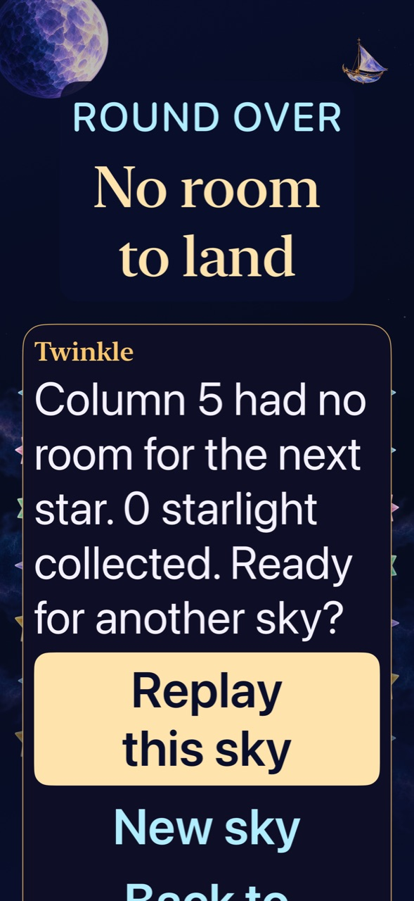

# Endings explain the blocked arrival and replay choice

**Result:** Partially verified · **Owner:** current implementer · **Date:** 2026-10-19

The loss headline now says “No room to land.” The existing exact column and committed score remain underneath. Replay has its own entry explanation: the same starting sky with current settings, or the fixed First Light opening. Both explain that the saved round stays until Begin.

**Delivery:** [PR #150](https://github.com/lbeezr/starfall/pull/150) merged to `0bcc852`; canonical updater verified **dev.07b4062290** on the original phone. [Receipt](delivery.json): Core and signature passed; main CI pending at installation. No player-data reset or automatic launch.

**Next action:** Observe physical comprehension on the delivered app. The separate [compact-device CI follow-up](../compact-native-acceptance-2026-10-19/README.md) is verified, merged and canonically delivered.

## Scope and acceptance

The previous headline said the whole sky was full even when other columns remained open. The result snapshot already retained the correct blocked column; this correction aligns the headline and Welcome summary with it. The fresh and replay choices also shared the same introductory text despite their different seed/reset behavior. A narrow pending-entry value now selects the replay explanation. No Core, clock, save, input, animation or seed contract changes.

Existing tests cover staged replacement cancellation, duplicate/stale Begin, same-seed/current-settings replay, First Light reset, fresh survival defaults and saved outcomes. New checks cover a blocked column with empty cells elsewhere and a winning clear saved before its presentation completes, both with settlement and background interruption. Native checks exercise real win/overflow/replay/restore, maximum text and system Reduce Motion. Actual VoiceOver and physical comprehension remain RC/player acceptance.

## Source and verification

[Source](source.json): clean runtime `d9a0b59`, **dev.07b4062290**. Xcode 27.1 / Swift 6.4, iPhone 16 Pro Max QA, iOS 27.0 Simulator. Only evidence/documentation paths differ during acceptance.

Core: `swift test --disable-sandbox` with the existing `/tmp/starfall-swipe-clang` module caches — **172 passed**. Native: XcodeBuildMCP `test_sim`, sequential `-sdk iphonesimulator CODE_SIGNING_ALLOWED=NO ARCHS=arm64 ONLY_ACTIVE_ARCH=YES STARFALL_BUILD_ID=dev.07b4062290`, scoped flow/dialogue/archive suites and four native flows. Raw results are under ignored `artifacts/ending-replay/`; [Verification](verification.json): **45 hosted + four native passed**, zero failures/skips. Both ending/replay native cases also pass on iPhone SE3, iOS 27.0 (`Starfall Landing Compact Acceptance`, `EA0F7A30-21E1-4995-93F5-C4A983F4A354`). Release Simulator build, hygiene and whitespace checks pass. No failing check occurred in this batch. The actual full First Light win/replay/overflow/restoration flow also satisfies the recorded recurrence check for the historical outcome timeout; its original cause remains unknown.

The preceding Help main CI failed at simulator inventory after all 172 Core tests passed; app compilation and native tests were never reached. [Separate source-bound record](../setup-discovery-2026-10-18/ci-inventory-timeout.json). This is distinct from the earlier compact-device UI failures, which remain a follow-up before closing this workstream.

## Inspected native appearance

*Runtime evidence: clean `d9a0b59`, dev.07b4062290, normal motion. The SE3 and full-size result/replay captures were inspected. Maximum text requires scrolling; native tests reach replay, Home and New sky and preserve the result after cancel/background. Captures show legibility and placement, not animation quality or physical comprehension. [Capture provenance](captures.json). The additional [First Light overflow frame](dev-d9a0b59__overflow__iphone16promax__default.jpg) retains the actual zero-of-18 score and column 6.*

The subsequent main-only CI run passed Core172, then timed out during simulator inventory before compiling the app. This is separate from the local native/build acceptance and installed receipt. [CI record](ci-inventory-timeout.json).
