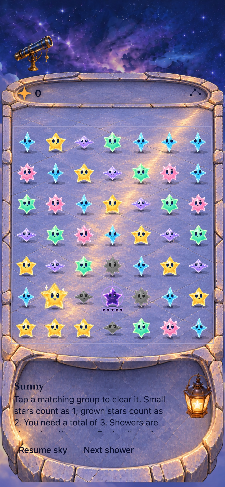
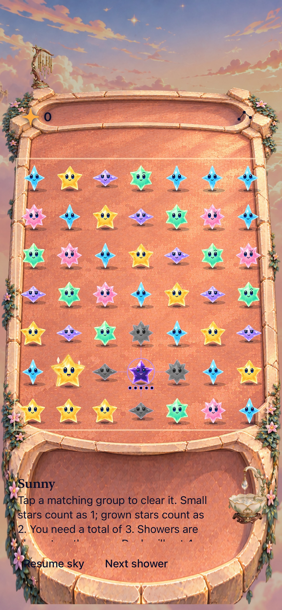
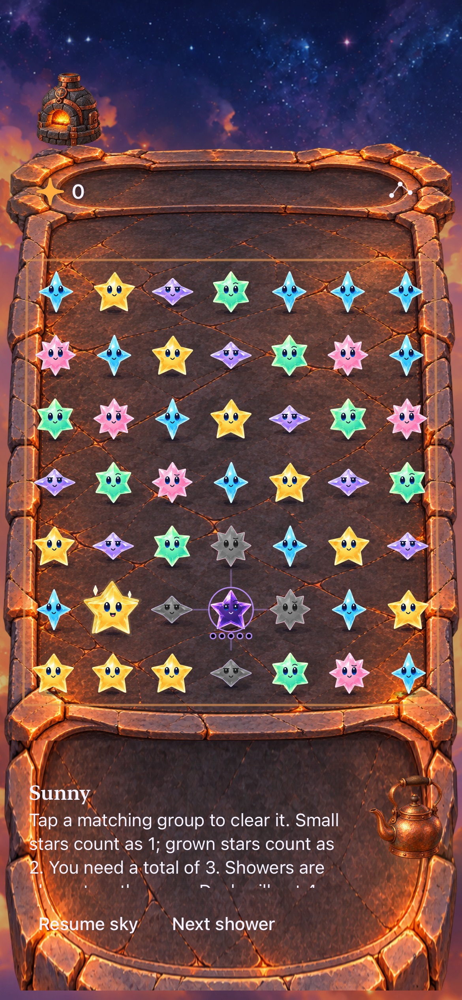
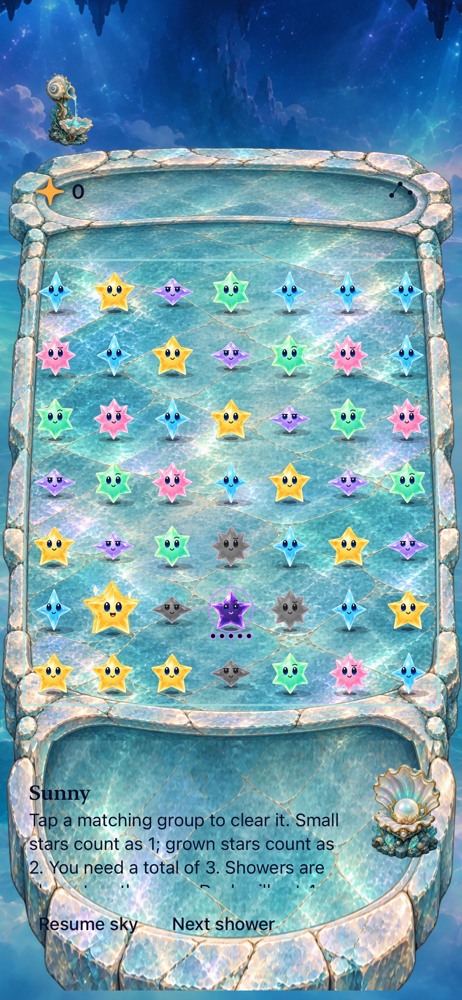
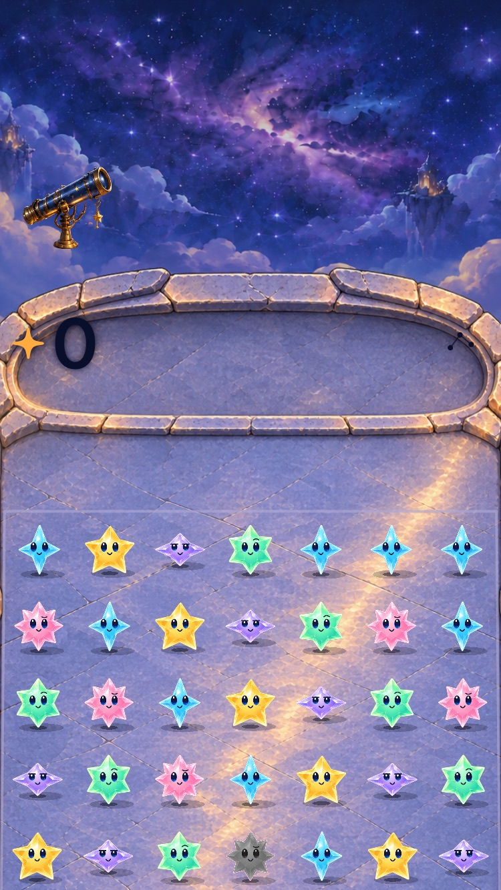
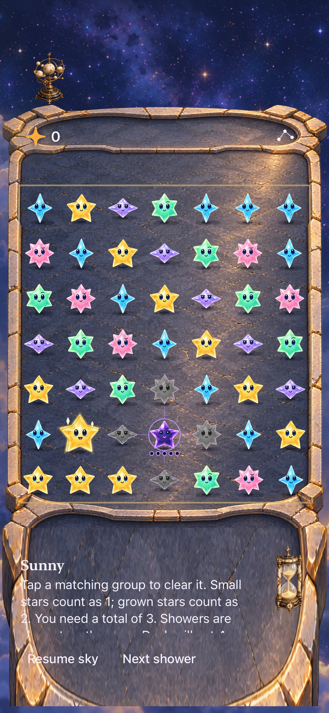
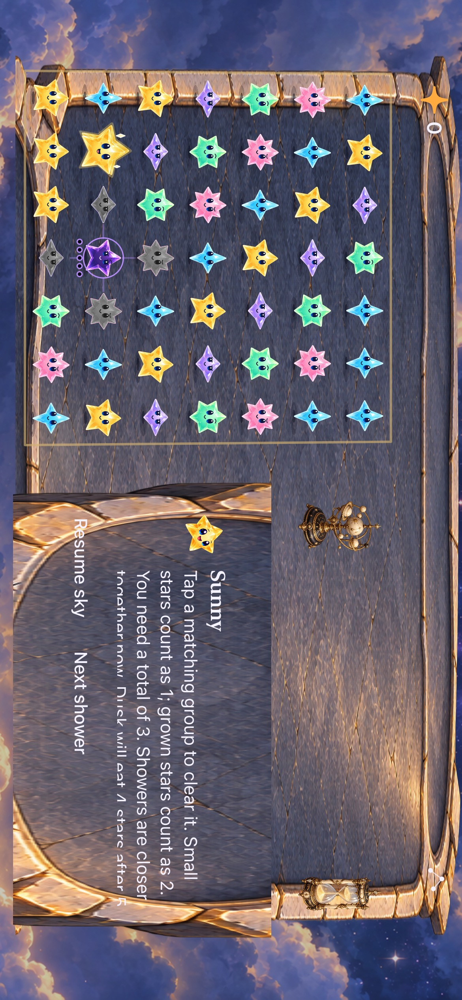

# Environmental controls seated in the platform

**Result:** Verified for sampled development acceptance · **Owner:** current implementer · **Date:** October 18, 2026

Five regular locations now have illustrated upper control grooves, open floors and lower communication hollows. Native score/menu/forecast and dialogue/actions occupy those spaces. Landscape uses a connected wing; independent wallpaper fills spare space. Short/narrow and accessibility layouts scroll with full-size controls. **Sky menu → Location** remembers the choice and preserves the round.

Origin/main was first merged at `33ae6fb`, then fetched and reconciled through `1ed6290` when it advanced during the work. Its forgiving swaps and one-gap traces are preserved. This pass seats active-play UI; welcome/result ceremonies retain main’s existing modal presentation. Human art approval, device performance/feel and full actual VoiceOver remain separate.

**Next action:** Human visual review and the existing device/RC acceptance cadence; no physical-device installation was performed.

## Outcomes against acceptance

| Criterion | Observed result / limit |
| --- | --- |
| Five physical settings | All architecture plates decode with alpha in the normal target; Debug/Release simulator builds pass. Each empty plate contains the physical hollows without baked text, icons or game pieces. |
| Shared arena and input | Exact 49-cell perimeter, inverse mapping, full targets and prop exclusion checked at phone/tablet sizes. Native corner clears pass on all five places and after rotation. A regression now requires the painted floor to contain every native cell. |
| Interactive layers and persistence | Ten props respond; repeated taps replace responses. Menu/background cancellation, remembered selection and unchanged board/score pass. |
| Responsive content | All five compact-landscape and quiet/largest-text paths pass. Small-phone visible-score/menu-dismissal check and tablet portrait/both landscape directions pass. Dialogue overflow remains scrollable; long messages are not fully visible in one still frame. |
| Current input and outcomes | Gap/repeated/off-center trace and quick directional swap checks pass after latest-main merge. First Light win/replay/full-sky/restore/new passes in 149.312 seconds on the preceding verified environment snapshot. |
| Rules and saves | Feature adds no Core/RNG/save-schema changes; Core is byte-identical to `1ed6290`. Existing restore/replay tests remain in the hosted suite. |
| Motion/accessibility/device | Normal-motion native inputs and rendered awards checked; actual system Reduce Motion play passes on SE3. Full actual VoiceOver and physical-device acceptance are not run. Smoothness and human enjoyment are not established by still frames. |

## Verification context

Xcode 27.1 (27A9275), iOS 27.0 Simulator, arm64, unsigned Debug/Release. iPhone 17e (`21025903…`), iPhone SE3 (`EA0F7A30…`), iPad Air 11-inch M3 (`4BA9208F…`). [Commands and result bundles](commands.json) record exact invocations; raw logs, xcresults and disposable exports remain under ignored `artifacts/environment-grooves-2026-10-18/`.

| Source / check | Result |
| --- | --- |
| Main `1ed6290` Core | `swift test`: **152 tests pass**. |
| Environment snapshot `88c790ab7a2f` | **236 hosted methods pass** serially, including rendered ordinary/recipe/trace/relay awards. Five-location portrait and compact-landscape matrices pass; tablet rotation and SE3 largest-text header/dismissal pass. |
| Latest-main snapshot `b48eef2925b0` | Gap/repeated trace, off-center trace, quick directional swap and largest-text header pass. Hosted run exposes the empty-viewport crash described below. |
| Final snapshot `a2a7b3a1f4d4` | **239 hosted methods pass**, including empty viewport and current trace acquisition. Archive portrait/landscape native checks and Release simulator build pass. |
| Hygiene | `python3 scripts/ci-hygiene.py`, `git diff --check`, project plist/membership and changed-document links checked. Rendered Markdown not checked. |

[Initial inputs](source.json), [first correction](revised-source.json), [verified environment inputs](final-source.json), [latest-main integration](main-integration-source.json), and [final viewport/crop inputs](viewport-source.json) retain SHA-256 hashes. Captures keep their actual development HEAD/snapshot labels. The latest merge changes input behavior, not these materials; Archive has separate corrected captures. The zero-viewport guard does not change positive-sized projections. No clean published-commit or physical-device certification is implied.

## Inspected native presentation

| Observatory | Cloudsea | Hearth | Grotto |
| --- | --- | --- | --- |
|  |  |  |  |

**Runtime, not concepts:** iPhone 17e / iOS 27.0, default text, normal motion, snapshot `88c790ab7a2f`. These show open floors and native content in the illustrated hollows. The same sample fixture is used across settings to compare geometry and materials.

**Runtime:** iPad Air 11-inch M3, same snapshot. The entire arena now lies on the floor; native corner taps pass in portrait and both landscape directions. The inlay separates the playable area from furniture and the communication wing.

**Runtime:** SE3, largest accessibility text, same snapshot. Header and far-corner checks pass; remaining board/message content is reached by scrolling.

| Archive portrait | Archive landscape |
| --- | --- |
|  |  |

**Runtime:** iPhone 17e, snapshot `a2a7b3a1f4d4` after latest-main integration. The white action labels now stay within the dark material; actual corner clears pass after both layouts.

[Inspected local +3 award](dev-86ae25e-wip-88c790ab7a2f__local-award__iphone-17e__normal-motion.jpg) remains visible beside the cleared group through the existing compact-award fallback. [First Light win](dev-86ae25e-wip-88c790ab7a2f__first-light-win__iphone-17e__default-text.jpg) and [full sky](dev-86ae25e-wip-88c790ab7a2f__first-light-full__iphone-17e__default-text.jpg) preserve main’s modal result UI. Their copy/actions were inspected; these frames do not accept a redesign of ceremonies.

## Failures, corrections and remaining risk

- **Floor coverage:** Initial wide artwork ended at the communication hollow’s top, leaving the front rows over wallpaper despite passing native taps. Both wide paths shared that defect. The body now covers the entire arena and its upper rail spans the same slab width. Hosted checks require every native cell inside the painted body; corrected phone/tablet captures and native taps pass. [Rejected tablet frame](dev-86ae25e-wip-3c988d0841d6__floor-gap-rejected__ipad-air11__landscape.jpg) is historical evidence.
- **Empty viewport:** Latest main’s zero-size trace test exposed a division by zero while constructing the projected floor range, before the inverse mapper could reject input. The shared geometry now treats nonpositive/nonfinite viewports as empty and avoids an invalid range. Zero, zero-width and zero-height regression cases cover renderer/native-cell frames and inverse lookup; the current ellipse-acquisition test exercises the original failure. Positive-size round trips remain checked.
- **Archive content registration:** White actions crossed the light front bevel. Its apron source end now keeps the actions on dark slate, with geometry and touch targets unchanged. [Rejected wide frame](dev-86ae25e-wip-88c790ab7a2f__archive-bevel-rejected__iphone-17e__landscape.jpg) retains the reproduction; corrected portrait/landscape frames and native clear checks verify the fix.
- **Test expectations:** One gravity assertion retained the removed word “captive”; it now requires the full current catalogue line. Award pixel checks sampled the retired fixed header strip despite visibly rendered local awards; the crop now samples their group-relative location with the same brightness threshold and committed-reward assertions. A small-phone test tapped Done during sheet motion; a bounded stable-frame expectation now precedes its single tap, preserving dismissal/board assertions.
- **Host interruptions:** One combined rotation runner was killed; one unchanged motion-overlap observation failed. Serial 236-method verification passes, including that motion method, and corrected rotation passes separately. Earlier attempts remain in the command record; these passes do not prove host/drawable variability eliminated. No blanket retry or relaxed motion/outcome assertion was introduced. An initial malformed view call failed compilation and was corrected before native acceptance. One initial outcome selector used the wrong class and executed nothing; the later correctly selected `SkyFlowInteractionTests` case supplies the recorded pass.

Revisit geometry, source-band calibration and native taps when adding a material/camera profile. Check physical motion comfort and prop placement in the next human review, and actual VoiceOver at RC. [Template contract](../../design/environments/BOARD_TEMPLATE.md), [production prompts](../../design/environments/production-set/architecture.json), and [engineering follow-ups](../../ENGINEERING.md) own the durable boundaries.
