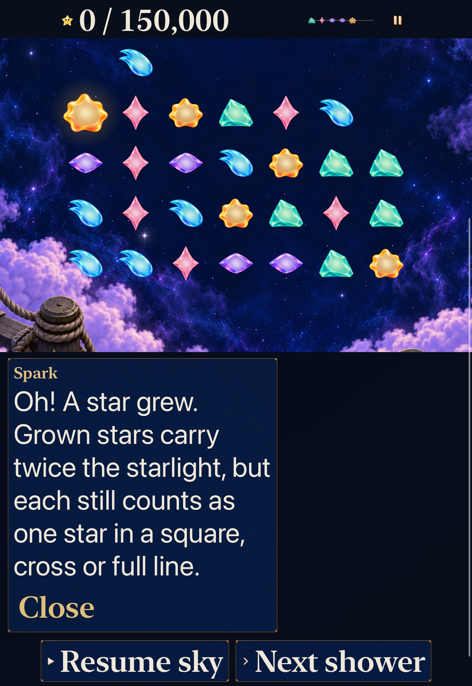

# Keep the first Story growth message consistent with its rules

**Result:** Verified for the selected development scope; baseline restore-guide failure remains open · **Owner:** Factory coordinator · **Date:** October 22, 2026

The first gameplay application of the [game-factory guidance](../../design/AI_GAME_FACTORY.md) selects a concrete early-round contradiction: current Story automatically clears patterns, while its shared growth reaction teaches a tap match. [Issue #223](https://github.com/lbeezr/starfall/issues/223) owns one focused guidance correction. Human comprehension and balance remain open in [#206](https://github.com/lbeezr/starfall/issues/206).

The factory updates merged first through [PR #222](https://github.com/lbeezr/starfall/pull/222), main `bf09f946eb46f06c10ef086e3cba312ddcff9214`, tree `a7a708d24468a5a5048ffb072762feea0390f775`. Its issue #221 automatically closed as completed. The published tree equals tested clean local commit `3b9c7be5a2c3128d0a196a272e23a3a619a81f61`. Existing Project-view uncertainty remains tracked in #220; issue closure does not establish board-row visibility.

## Player promise and acceptance

Understand that growth increases collected starlight while a grown star still occupies one place in an automatic pattern. The guide should help the next decision in the selected round, including retained historical rules.

| Criterion | Evidence required |
| --- | --- |
| Reproduce the current Story contradiction | New Lantern, no swaps, first shower; inspect the real growth result. |
| Correct the responsible owner | Select growth dialogue by the current manual-clear capability at the committed-result boundary. |
| Preserve mode semantics | Both current locations, retained revisions, Open Sky/later places and Dusk; recipe/chain feedback keeps precedence. |
| Preserve behavior | Same committed game, forecast, score, save/replay and shower clock/announcement policy; the new message remains open for player-paced reading. |
| Native delivery quality | Real input through the normal journey, default/large text, readable growth message and usable controls; required Core/hosted/build/Release checks. |

The Lantern witness was reproduced through ordinary native inputs: Amber at Core `Cell(3,0)` grows on shower one, without a clear or score, and the visible guide teaches a tap match. The new native regression fails its expected corrected wording. Three hosted regressions run actual production showers: two current-Story checks fail the old selection, while the retained/manual sibling passes. A contrasting case is a retained manual-clear round, where the existing two-light tap-match instruction remains correct.

## Review and selection

Three independent workers read current source under disjoint review scopes; the coordinator owns selection, native execution, shared documents and Git. This is bounded source/agent review, not human playtesting.

| Finding | Classification and decision |
| --- | --- |
| Growth dialogue teaches a tap match in arrangement-only Story | Concrete source contradiction; selected for correction because it can occur on the first Lantern shower. |
| Incoming columns are hidden by the compact forecast | Documented intentional information limit; no forecast redesign adopted. |
| Accessible Cancel trace can leave selection progress dialogue behind | Source-traced, actual activation unperformed; deferred to the next accessible-input pass/#217 investigation. |
| Upward swap can return to the same placement while saying it moved | Concrete feedback inconsistency with an existing committed-board regression; deferred to a separate move-feedback pass. |
| Open Sky Help appends fresh Lantern restoration guidance | Cross-mode content concern; deferred to the next Help pass. |

The [originating issue discovery comment](https://github.com/lbeezr/starfall/issues/223) preserves source, impact, next check and revisit triggers. No new practice, tuning, progression, artwork family or networking follows from this review. Entry/replay revision selection, manual/automatic action gating and existing shower/pause ownership were examined; no new deterministic rule/save defect was established.

## Source and native resources

Baseline: clean main `bf09f946eb46f06c10ef086e3cba312ddcff9214`. Final candidate snapshot `ff001f5ce36a`, computed input identity `dev.1299a00cca`, with exact dirty-input hashes in [source-inputs.json](source-inputs.json). Only `App/SkyDialogueLibrary.swift` and `App/DialogueScripts/observatory-dialogue.json` affect the built app; the two test files add regressions. No Core, project, signing, entitlement or dependency changes. The existing bundled catalogue and existing test files keep target membership unchanged; Debug hosted/native and Release builds exercise actual resource admission.

Dedicated iPhone 17e Simulator `5CD3215C-C14E-47CB-8732-B185017A91A1` and iPad Pro 11-inch (M5) Simulator `1832E070-D0EB-432C-8EE9-16580E3C4C98`, both iOS 27.0. Xcode 27.1 (`27A9275`), Swift 6.4, SDK 27.1, macOS 27.0.1 arm64. DerivedData/raw output lives under `/private/tmp/starfall-factory-gameplay-20261022/`; XcodeBuildMCP logs/results live under `~/Library/Developer/XcodeBuildMCP/workspaces/Starfall-c35297cacc07/`. Existing simulator sessions are outside this reservation. No physical installation or reset is performed by simulator verification.

The first XcodeBuildMCP build omitted explicit architecture build settings and tried incompatible app/Core architectures. Reading its invocation established the cause; `ARCHS=arm64 ONLY_ACTIVE_ARCH=YES CODE_SIGNING_ALLOWED=NO` corrected the invocation without project changes. The corrected baseline build/run passed. Runtime snapshot/tap calls sometimes returned an old snapshot or failed to settle; these tool outcomes are not app or test passes. Native XCTest remains the reproducible interaction check.

## Verification and adoption

The mode capability now selects `guide.patterns-growth` after committed growth in current Story. It explains twice the collected starlight and one star per pattern place. Retained manual-clear rounds keep their original guidance; the earlier Dusk/clear/chain branches retain precedence. The new routine Spark message omits `seconds`, using the existing Close/reopen/replacement behavior. Independent source review found no actionable issue, including after the lifetime adjustment.

| Check | Result and source |
| --- | --- |
| Core | 225 passed, zero failures/skips; unchanged Core inputs. |
| Final tablet hosted + native | 66 hosted and two native passed, zero failures/skips, 107.8 seconds; snapshot `ff001f5ce36a`. Dialogue, flow/save, normal Story entry and largest-text full read-through/controls. |
| Final phone native | Two passed, zero failures/skips, 77.7 seconds; same final snapshot. Default and AX3XL growth read-through, unchanged board/score after inspection and reachable controls. |
| Final Release | arm64 normal-app build passed, 11.9 seconds; final JSON bundled. |
| Hygiene/diff | Passed after explicit evidence/index staging; local links and source hashes also checked. |

The native tests take the normal Home → Story → visit → Begin route, pause before the first scheduled shower, then call Next shower. They require actual growth, no score, full correct wording and a grown-star tap that changes neither board nor score. Largest text uses the existing bounded reader/control helpers and keeps normal motion enabled. Hosted witnesses also exercise Ribbon's second production shower, historical revisions 1/2, plural growth, Open Sky, manual publication exactly once and quiet automatic growth. Catalogue tests render all 97 scripts. This is a selected subset, not the full development or RC matrix.

### Failed checks retained

- Baseline native: one expected wording failure after reproducing the ordinary first Lantern growth. Baseline hosted: two expected current-Story failures and one retained/manual sibling pass, zero skips.
- Initial six-second candidate: 66 hosted and the default native test pass; largest text initially assumes inspected-star controls remain onscreen and fails. The regression adopts existing bounded reveal/read helpers, preserving the board/score assertions.
- Tablet six-second candidate: default passes, largest read-through fails because the reaction expires while scrolling. This product failure caused the scoped player-paced lifetime change; the final tablet run passes both checks.
- Existing `FallingSkyInteractionTests/testPausedGuideReportsGrowthDarkOutcomesAndRestore` fails at line 681 because `experiment.message` is absent after relaunch/Continue. It fails identically on a clean `bf09f946` build-source export: one executed, one failed, zero skipped, 67.3 seconds. Earlier growth/Dusk/menu/background steps pass. [#226](https://github.com/lbeezr/starfall/issues/226) owns classification of product behavior versus stale expanded-guide expectation. No assertion was changed or suppressed, and this older sibling is not claimed green. The baseline export initially used an asset-catalog directory symlink rejected by actool; materializing the unchanged catalogue enabled the actual comparison above.

Raw result identifiers: baseline UI `16-39-55-870Z`, baseline hosted `16-42-08-634Z`, initial candidate `16-44-20-793Z`, expiring tablet candidate `16-49-23-851Z`, final tablet `test_sim_2026-10-22T16-56-56-698Z_pid6635_94346098.xcresult`, final phone `test_sim_2026-10-22T16-59-05-298Z_pid6635_183faf96.xcresult`; clean-main comparison `/private/tmp/starfall-factory-gameplay-20261022/baseline-restore-sibling-2.xcresult`. Earlier candidate artifacts are historical checks of the six-second script; they do not certify the final lifetime.

### Reproduction commands

Core: `swift test --scratch-path /private/tmp/starfall-factory-gameplay-20261022/CoreBuild`.

XcodeBuildMCP `test_sim` uses project `Starfall.xcodeproj`, scheme `Starfall`, Debug, the device/DerivedData above, and explicit `ARCHS=arm64 ONLY_ACTIVE_ARCH=YES CODE_SIGNING_ALLOWED=NO -parallel-testing-enabled NO`. Final tablet selectors:

```text
-only-testing:StarfallAppTests/SkyDialogueTests
-only-testing:StarfallAppTests/SkyFlowStateTests
-only-testing:StarfallAppTests/SkySaveArchiveTests
-only-testing:StarfallUITests/SkyFlowInteractionTests/testCurrentStoryGrowthGuidanceMatchesAutomaticPatterns
-only-testing:StarfallUITests/SkyFlowInteractionTests/testLargestTextCurrentStoryGrowthGuidanceKeepsControlsUsable
```

Phone uses the two UI selectors. The unchanged baseline sibling uses its exact selector above with `xcodebuild test`, a clean-main source export and separate `BaselineDerivedData`.

Release: `python3 scripts/simulator-command.py --receipt /private/tmp/starfall-factory-gameplay-20261022/release-final-receipt.jsonl release-build 600 xcodebuild -project Starfall.xcodeproj -scheme Starfall -configuration Release -destination 'generic/platform=iOS Simulator' -derivedDataPath /private/tmp/starfall-factory-gameplay-20261022/ReleaseDerivedData ARCHS=arm64 ONLY_ACTIVE_ARCH=YES CODE_SIGNING_ALLOWED=NO build`.

### Inspected native appearance



**Final-source native still, iPad Pro 11-inch (M5), iOS 27.0 Simulator, AX3XL, normal motion.** The complete explanation survives scrolling and fits above the paused actions. [Default tablet](dev-bf09f946-wip-ff001f5ce36a__story-growth__ipad-pro11-m5__default-text.jpg) shows its compact presentation and the grown star at unchanged zero score. The [default phone](dev-bf09f946-wip-ff001f5ce36a__story-growth__iphone-17e__default-text.jpg) shows the whole message; its [AX3XL read-through endpoint](dev-bf09f946-wip-ff001f5ce36a__story-growth-read-through__iphone-17e__ax3xl.jpg) shows the last words and both actions, with the beginning above the scroll viewport. JPEG exports preserve original dimensions; [capture metadata](captures.json) binds original and retained hashes. These images show sampled appearance, not observed animation, actual VoiceOver, physical reading comfort or player learning. Minimum-iOS and sustained-device acceptance remain open with their existing owners. No phone installation is claimed.

## Factory trial observations

The experience brief led from several candidates to one observed rule/feedback disagreement; it avoided treating a hidden forecast design choice or missing human balance data as a bug. Peak research concurrency was three workers; one worker owned the app/hosted correction, while the coordinator owned native tests/evidence/integration. Shared semantic contracts were settled before implementation. No delegated write-ownership conflict occurred. Integrating independently merged documentation from main `b989a18a` required two additive index-conflict resolutions, preserving both entries. Runtime/test inputs and computed build identity remain identical to the verified snapshot; no native rerun follows solely from those documentation changes. One meaningful product revision followed native reading evidence: six-second expiry became player-paced. The large-text test also adopted existing scroll helpers after its initial onscreen assumption failed.

One gameplay slice meets selected development acceptance; factory guidance merged first. Publication and closure are recorded on the issue/PR. Oldest returned-result wait, comparable baseline throughput and merge/closure delay remain unknown until integration is recorded. Project visibility remains a separate #220 limit. This single uncontrolled slice cannot establish improved enjoyment or faster throughput. Revisit clarity in #206's next uncoached player session and the factory method at its existing third-batch/recurring-failure trigger.
