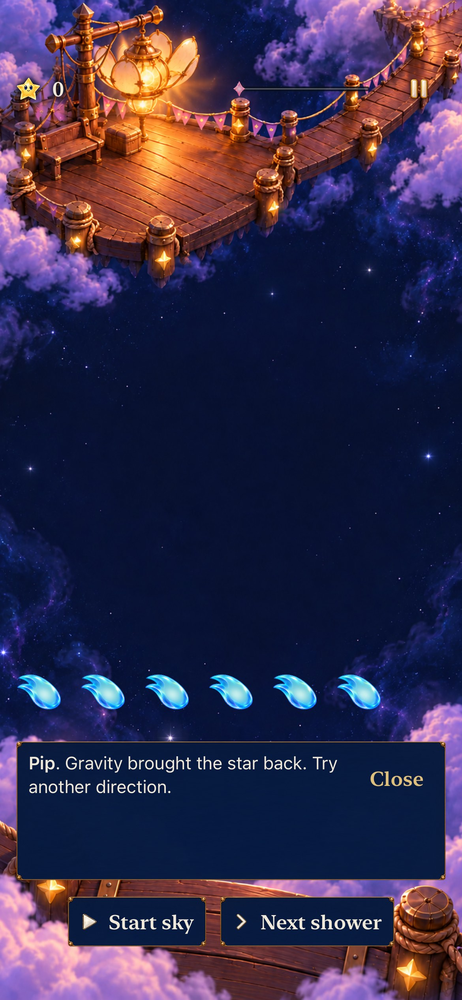

# Explain a swipe's settled result

**Result:** Selected development acceptance passed · **Owner:** Factory coordinator · **Date:** October 22, 2026

[#228](https://github.com/lbeezr/starfall/issues/228) gives the player a truthful next-step explanation when an upward swipe rises and falls back to the same arrangement. Previously the guide said “Star moved. What can you line up?” after that unchanged result. It now says “Gravity brought the star back. Try another direction.” A sideways exchange that changes the settled board keeps its movement message; scoring patterns retain their more consequential result.

## Playable slice and preservation

The experience brief is one action → committed result → explanation → next action. An existing disposable trace board supplies an upward empty-space exchange, then a sideways move and a successful five-star trace. Hosted contrasts use actual production Core outcomes across Open Sky and Lantern/Ribbon revisions 1–3. No human confusion, comprehension or enjoyment result is inferred from this source contradiction.

The existing Store compares committed boards to select one typed catalogue string. It still presents the complete exchange. Core, animation code, rules/RNG, score, forecasts, saves/replay, clocks and journey ownership are unchanged. Tests check the complete expected Core result, saved state, next-shower deadline, journey and single publication. No new production source, resource file, target or dependency was added. Debug and Release admit the existing catalogue; the key inventory check covers its new entry.

## Source, environment and selected checks

Base main `f07091c1`; working-tree snapshot `be34749f3481`. [Exact input hashes](source-inputs.json) identify the three production and two test inputs. The only app-affecting edits are the Store selection, typed key and bundled catalogue. Documentation added after checks does not affect the build.

Xcode 27.1 (`27A9275`), iOS 27.0 Simulator, arm64, normal motion. The factory reserved iPhone 17e `4103C352-DFC2-493E-A224-DE4CE3D50889` and iPad Pro 11-inch (M5) `027DFF2A-5E63-4A82-AACF-8360AD426F9B`, both initially Shutdown. Raw outputs and bounded stage receipts are under `/private/tmp/starfall-factory-next-20261022/`; unrelated simulator sessions are outside the reservation.

| Check | Selected result |
| --- | --- |
| Core | 225 passed, zero failures/skips; Core inputs unchanged. |
| Hosted | 49 passed across technique Store and dialogue tests, zero failures/skips. Includes unchanged/changed/scoring exchanges, actual full up/fall motion and quiet outcome, input cancellation and save/clock preservation. |
| Existing native siblings | Two passed: real immediate swaps/empty-space falls and settings/background/next input. |
| New phone native | Two passed, zero failures/skips; default and AX3XL, 66.057-second bounded command. |
| New tablet native | The same two passed, zero failures/skips; default and AX3XL, 79.398-second bounded command. |
| Release | Normal arm64 simulator target passed, 25.495 seconds. |
| Hygiene / diff | Passed at acceptance; all changed local documentation targets resolve. |

This is a selected development subset. Actual VoiceOver stays deferred, and physical feel, minimum-iOS and full RC acceptance remain with their existing owners. No physical installation is performed.

### Inspected appearance

**Native still: iPhone 17e Simulator, iOS 27.0, default text, normal motion, snapshot `be34749f3481`.** The complete message fits above the paused controls. The [AX3XL capture](dev-f07091c1-wip-be34749f3481__fall-back__iphone-17e__ax3xl.jpg) shows the complete explanation after scrolling; the native test then reveals the board and completes the different-direction move and five-star trace. Both were inspected directly. [Capture hashes](captures.json) bind the original PNGs and JPEG exports at unchanged dimensions. Stills establish sampled appearance, while the existing hosted scene assertion separately proves actual rise and fall-back motion; neither establishes physical comfort.

## Failure history and refinement

The baseline real gesture's retained hierarchy reads “Pip. Star moved. What can you line up?” after the fall-back. Its native assertion fails as expected. The initial hosted reproduction instead failed before feedback because its Open Sky setup had no usable star; the corrected setup commits a real opening shower and labels each mode. This setup failure is not a Core defect or a passing feedback reproduction.

The first candidate has 49 passing hosted and two passing sibling native tests, but both new native methods fail an incorrectly exact label: the production element includes the existing “Pip.” speaker prefix. Its retained hierarchies show the correct new text. The largest-text hierarchy also places the explanation below the initial viewport. The final native methods preserve exact speaker-and-message wording, use the existing bounded scroll owner to read it fully, then reveal the board for a different move and clear. No production rule, assertion, motion preference or timeout was weakened to obtain green results.

## Reproduction

`swift test --scratch-path /private/tmp/starfall-factory-next-20261022/CoreBuild` supplies Core acceptance. Native commands use `scripts/simulator-command.py`, scheme `Starfall`, Debug, explicit `ARCHS=arm64 ONLY_ACTIVE_ARCH=YES CODE_SIGNING_ALLOWED=NO -parallel-testing-enabled NO`, temporary DerivedData and source-bound xcresults. Selected classes are `StarfallAppTests/SkyTechniqueStoreTests` and `StarfallAppTests/SkyDialogueTests`; targeted UI methods are `SkyTechniqueInteractionTests/testUpwardFallBackExplainsGravityAndAllowsNextMove`, `testLargestTextUpwardFallBackKeepsFeedbackReadable`, `testImmediateSwipeSwapsWithoutArrangeAndEmptyDestinationFalls` and `testSettingsAndBackgroundLeaveGesturesReadyWithoutRetoggling`.

Release uses the same wrapper, `-configuration Release -destination 'generic/platform=iOS Simulator'` and a separate `ReleaseDerivedData` directory. Raw logs retain complete commands, return codes and selected counts; no full-matrix pass is claimed.

## Factory continuation

Two independent read-only reviews converged on this committed-result mismatch. One worker owned the four app/hosted files; the coordinator owned native tests, simulators, Git and shared documents. The review also supplied [#229](https://github.com/lbeezr/starfall/issues/229), a separate Tutorial-scope correction. Its patch preparation runs outside the checkout until the shared catalogue reservation is released. No worker write conflict or human sign-off was introduced. Test setup and speaker-prefix assumptions caused the recorded rework; comparable throughput improvement remains unmeasured.

Adopted for development after the selected checks passed; no alternate runtime route remains. Revisit player understanding during #206's next uncoached session. Issue closure follows the resolving default-main PR; the separate Project-view discrepancy remains #220.
