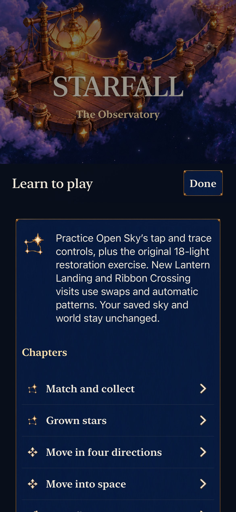

# Identify Tutorial's rule family before practice

**Result:** Selected development acceptance passed · **Owner:** Factory coordinator · **Date:** October 22, 2026

[#229](https://github.com/lbeezr/starfall/issues/229) makes the shared Tutorial index explain its scope before chapter selection: Open Sky's tap/trace controls and original 18-light restoration practice, distinct from new Lantern/Ribbon automatic-pattern visits. Home, map and game-menu entry previously bypassed the only rule-family warning inside How to Play. Player misunderstanding is a hypothesis; the source omission is observed.

## Experience and preservation

Player promise: know what practice teaches and why its controls differ from the current Story round. The smallest slice is Home → read Tutorial → practice → current Story → read the same Tutorial → return unchanged. One catalogue paragraph supplies every existing entry route. The existing intro receives a stable native identifier; no chapter, gameplay rule, route, artwork, clock or save owner changes. Conditional arrangement practice remains #210, dependent on #206's player evidence.

The default phone journey completes an ordinary tap lesson, earns the existing 15,000-point Lantern chain, completes the selected-five trace lesson, and opens the original 18-light restoration exercise through one actual shower. Practice creates no Home save. Returning retains the exact 49-cell Story identities/values, board summary, score, paused state and all twelve Places statuses/selection. Largest-text phone and tablet scenarios read the introduction from Home and Story, check the pinned Done action, and preserve the round/world without repeating all practice mechanics.

## Source and checks

Base main `7a825e4c957b650f70baa0518ee9afc55dee9a33`, after [#230](https://github.com/lbeezr/starfall/pull/230). Snapshot `514a81aa673a`; [exact input hashes](source-inputs.json) identify `App/SkyTutorialView.swift`, the existing dialogue catalogue and `UITests/WorldJourneyInteractionTests.swift`. Only the intro string and identifier affect the app. The catalogue, source and native test file already belong to their targets; no new membership or dependency was added. Later documentation/capture exports do not affect runtime inputs.

| Check | Result |
| --- | --- |
| Core | 225 passed, zero failures/skips; unchanged Core inputs. |
| Hosted | 43 passed, zero failures/skips: dialogue catalogue/selection and flow/save/journey boundaries. |
| Phone native | Two passed, zero failures/skips: default complete practice journey and AX3XL reading/preservation; bounded command 270.381 seconds. |
| Tablet native | One passed, zero failures/skips: AX3XL Home/Story reading and unchanged return; 67.852-second test, 92.273-second bounded command. |
| Debug / Release | Normal app Debug test build and arm64 Release passed; Release command 3.527 seconds. |
| Hygiene / diff / links | Passed at acceptance; changed local documentation targets resolve. |

Xcode 27.1 (`27A9275`), iOS 27.0 Simulators, arm64, normal motion. The factory reused its reserved iPhone 17e `4103C352-DFC2-493E-A224-DE4CE3D50889` and iPad Pro 11-inch (M5) `027DFF2A-5E63-4A82-AACF-8360AD426F9B`; other sessions were untouched. Raw commands, logs, source manifests, xcresults and bounded receipts are under `/private/tmp/starfall-factory-next-20261022/`. No failing run preceded this slice's passing native checks. A read-only review normalized the final Map/Places surface before comparing journey state; it does not reselect a place or hide a changed selection.

This is a selected subset, not a full development/RC matrix. Full physical restoration completion, human comprehension, minimum-iOS and actual VoiceOver acceptance are not claimed. VoiceOver remains deferred; no phone installation is performed.

## Inspected native appearance

**Default iPhone 17e Simulator, iOS 27.0, normal motion, snapshot `514a81aa673a`.** The complete explanation precedes the chapter choices, with Done visible. The [AX3XL beginning](dev-7a825e4c-wip-514a81aa673a__tutorial-intro-start__iphone-17e__ax3xl.jpg) and [read-through end](dev-7a825e4c-wip-514a81aa673a__tutorial-intro-end__iphone-17e__ax3xl.jpg) retain the scrollable introduction and pinned Done action. The native tests use the actual owning scroll viewport to reach the final line, rather than treating a complete accessibility label as visible reading. All three stills were inspected directly; the largest text requires substantial scrolling and does not establish physical reading comfort. [Capture hashes](captures.json) bind originals and JPEG exports at unchanged dimensions.

## Reproduction and continuation

`swift test --scratch-path /private/tmp/starfall-factory-next-20261022/CoreBuild` supplies Core results. Native tests run through `scripts/simulator-command.py` with scheme `Starfall`, Debug, explicit `ARCHS=arm64 ONLY_ACTIVE_ARCH=YES CODE_SIGNING_ALLOWED=NO -parallel-testing-enabled NO`, the reserved simulator and temporary DerivedData. Phone selectors are `StarfallAppTests/SkyDialogueTests`, `StarfallAppTests/SkyFlowStateTests` and the two `WorldJourneyInteractionTests/testTutorialScopeFromHomeAndStoryPreservesRound` / `testLargestTextTutorialScopeFromHomeAndStoryPreservesRound` methods. Tablet selects only the largest-text method. Release uses the same wrapper and `-configuration Release -destination 'generic/platform=iOS Simulator'` with separate ReleaseDerivedData.

The factory integrated #228 before applying this prepared patch, avoiding overlapping catalogue writes. One worker prepared it outside the checkout while the coordinator verified the preceding slice. #228 merged at 18:00:02 UTC and completed automatically at 18:00:04; its issue-side Project Done was observed without manual reconciliation. Canonical saved-view visibility remains #220. No routine human sign-off, new required workflow or background daemon was added.

The next bounded source review found no further independently justified gameplay correction across entry/cancel/map/resume, pause, restart/restore, input admission and journey ownership. The existing #226 failure was separately classified: restore deliberately starts its selected dialogue collapsed, but the native test never reopens the portrait. Its minimal normal-input test correction is prepared separately; no app defect is inferred. Deferred VoiceOver and physical/balance dependencies do not refill the ready queue.

## Factory trial review

Across the initial infrastructure batch, the growth-message application and this continuing gameplay batch, useful worker discoveries and default-main closing references are functioning. Current gameplay work used at most two workers plus one coordinator, with no concurrent native sessions or semantic write conflict. The shared catalogue was serial; independent preparation overlapped native work. The move-feedback slice required test-setup/speaker-prefix repairs, while this slice passed its selected checks on the first native run.

Overall ready timestamps, worker utilization and a comparable non-factory baseline are unavailable, so sustained throughput improvement remains unknown. Retain the lean coordinator/worker method, focus native selection on the affected behavior, and add no infrastructure from this sample. Creative briefs supported choosing concrete player feedback/scope contradictions; player learning and enjoyment remain unmeasured. Keep no comparison route. Revisit the wording at #206's next uncoached session, and simplify the method if integration or repeated test assumptions dominate another batch.
