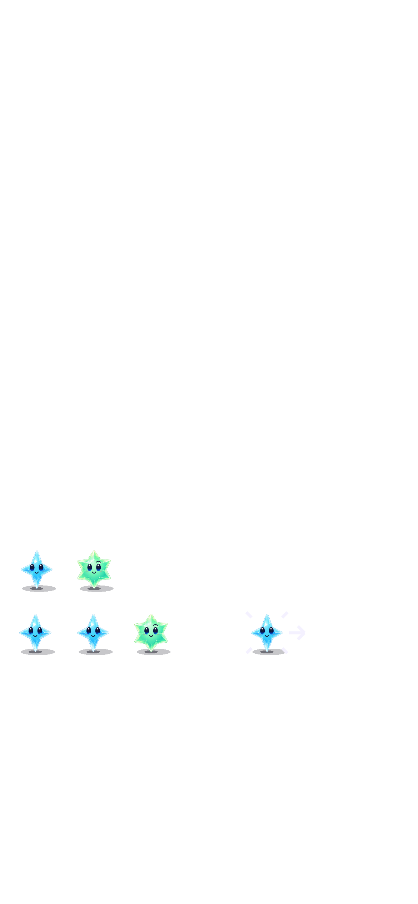

# Rapid follow-ups retain one intended move

**Result:** Partially verified · **Owner:** current implementer · **Date:** October 18, 2026

Valid taps and swaps on moving columns now register immediately and wait for presentation to release their stars. One intention lasts at most 650 ms, is tied to the committed board and star identities, and is replaced by a newer touch. [Acceptance contract](../../design/FOLLOW_UP_INPUT.md). This is the second gesture delivery; publication and physical comfort remain unverified.

**Next action:** publish after repository-specific approval, then deliver each batch separately through the canonical updater. Development checks pass; direction forgiveness, held-drawing feedback and physical acceptance remain later individual batches.

## Outcomes against acceptance

| Criterion | Observed result | Limit |
| --- | --- | --- |
| Follow-up admission | Exact-once swap and tap requests pass behind occupied columns; real production touch samples complete consecutive swap/fall moves in normal and quiet SpriteKit motion | Native driver gestures and physical thumb timing are separate checks |
| Identity and bounded capacity | Latest request replaces old; new contact, independent board commit and lifecycle changes cancel; stale callbacks cannot replay | Full-board snapshot validation intentionally cancels on any intervening committed board change |
| Clock and save | Pending state never saves; expiration resumes the exact shower remainder; already-due rain retains priority | Longer exceptional presentations can outlast the 650 ms bound and ask for a fresh gesture |
| Acknowledgment | Source outline and direction arrow stay bounded to two nodes; readable and spoken acknowledgment; expiry remains visible through older animation completion | Simulator cannot establish haptic or physical comfort |
| Interruptions | Background/Settings boundary, restart, First Light, motion change, resize/detachment and stale deadlines pass | Actual VoiceOver remains the RC gate |

## Verification context

**Source:** `0d13695` plus [explicit source/test hashes](source-snapshot.json), runtime `dev.677341325c`. The full hosted/native suite used [pre-cue snapshot `dev.b92f2e664e`](pre-cue-source-snapshot.json); the only later runtime difference moves the arrow shaft outside the star's face and shortens its tip. Focused final-source native/hosted/build checks cover that visual adjustment. No Core rule, RNG, save schema, dependency, target or build-setting changes. The preceding test-only fixture correction preserves current main's retirement of automatic aging.

**Environment:** Xcode 27.1 (`27A9275`), Swift 6.4, iPhone 16 Pro Max Simulator / iOS 27.0 (`24A434`), shared Starfall scheme, Debug unless stated. Normal system motion; the named quiet check exercises the app setting separately.

| Check | Result and raw artifact |
| --- | --- |
| Core | 169 pass; `artifacts/immediate-swipes/buffer-core.log` |
| Focused hosted | 20 gesture/store checks plus corrected crowded-board check pass, zero skips; `buffer-cue-and-crowded.xcresult` |
| All hosted | Final rerun: all 281 pass, zero failures/skips, plus native system Reduce Motion; `buffer-final.xcresult`. Earlier 280 pass / one stale current-main crowded fixture failure is investigated below |
| Native gestures | All 11 technique UI checks pass, including normal/rapid input, four directions, same-color hold/draw, maximum text, Settings and background; `buffer-native.xcresult`. System Reduce Motion passes in `buffer-final.xcresult` |
| Final cue / outcomes | 20 hosted gesture/store checks plus native First Light win, replay, full sky and restore pass, zero skips; `buffer-final-cue-flow.xcresult` |
| Release | Final source builds: `build_sim_2026-10-19T00-23-26-062Z_pid62736_3d734613.log` |
| Hygiene | `python3 scripts/ci-hygiene.py` and `git diff --check` pass |
| Physical device / actual VoiceOver | Not run; publishing approval pending; RC VoiceOver deliberately deferred during development |

Core command: `CLANG_MODULE_CACHE_PATH=/tmp/starfall-swipe-clang SWIFTPM_MODULECACHE_OVERRIDE=/tmp/starfall-swipe-clang swift test --disable-sandbox`. Native commands use `Starfall.xcodeproj`, scheme `Starfall`, simulator `5107CBBF-108B-4B94-9125-A873F948A38C`, `-sdk iphonesimulator CODE_SIGNING_ALLOWED=NO ARCHS=arm64 ONLY_ACTIVE_ARCH=YES -parallel-testing-enabled NO` and the report's named suite selections. XcodeBuildMCP retains exact build logs; raw xcresults stay in ignored `artifacts/immediate-swipes/`.

## Failures investigated

The original loss occurred at two boundaries: the physical surface rejected contact in a moving column, and the store rejected every overlapping action. The shared request boundary now captures one validated intention without committing early. Physical and accessibility actions use it; strict direct commit APIs still reject overlap. The presentation ledger releases actual changing columns, then the store validates and retires the intention before committing. Core remains the authority; no node position or animation callback computes a legal outcome.

The initially proposed 250 ms bound was shorter than existing 340 ms swap/fall and 560 ms clear presentations. The 650 ms bound covers these normal cases while preserving cancellation and expiration. The native real-motion regression includes the longer swap/fall case.

All-hosted verification exposed an unrelated current-main test: seed 28 at 29 showers assumed automatic aging. On untouched main `9aa4d7d`, the same assertions fail because the current rules overflow at shower 15. The corrected fixed history uses 12 showers, 33 occupied stars, an eight-point award and an independent clear. All four compact/large, default/maximum-text native-host variants pass, retaining every visual, layout and motion assertion. The correction is a separate test-only commit, `f8da265`. Baseline reproduction: `/tmp/starfall-buffer-baseline-9aa4d7d/baseline.xcresult`.

The first new save/clock test chose an empty seed cell; it now chooses and validates a reversible legal pair before exercising the same strict save/deadline assertions. Initial command errors (wrong test target name and Swift's async overload for an unkeyed SpriteKit test action) were corrected without changing production behavior.

## Visual and timing limits

The crowded maximum-text capture was inspected: the board and eight-point award remain visible; the bottom conversation continues below the viewport and needs scrolling. This retains the existing large-text layout limitation, not a new gesture regression.

The first UIKit snapshot of a pending cue retained SpriteKit's previous frame. It is not evidence that the cue was visible. The test now measures motion without screenshot overhead and captures the production cue separately through SpriteKit's native texture renderer. That inspected snapshot exposed an arrow crossing the star's face; final geometry starts outside the star and shortens its tip. The snapshot is an isolated native scene render, not an on-screen full-game capture or proof of latency.

The pre-cue native host observed first node displacement at 25.5 ms in full motion and 7.1 ms in quiet mode; the two committed swap/follow-up sequences finished in 501.7 ms and 392.8 ms. These are single callback-to-node samples on Simulator with a 5 ms polling interval, not hardware touch-to-photon measurements or a population latency percentile. The buffer remains attached to Core identity while the scene animates.

Final cue source produced 46.6 ms / 523.6 ms full-motion and 7.2 ms / 389.3 ms quiet samples in the same check. This variation reinforces the need for repeated physical-device measurement before a latency claim.

**Inspected native SpriteKit scene render — `dev.677341325c`, Debug, iPhone 16 Pro Max / iOS 27.0 Simulator.** The production cue is rendered separately after the timing sequence; the black background is the isolated host, not the game's Observatory. The arrow stays outside the face and the source has non-color corner marks. This establishes sampled cue appearance, not full-game contrast, actual VoiceOver or physical feel. Raw full/quiet sequence checks assert that the actual pending cue exists during buffering and is removed on commit.
