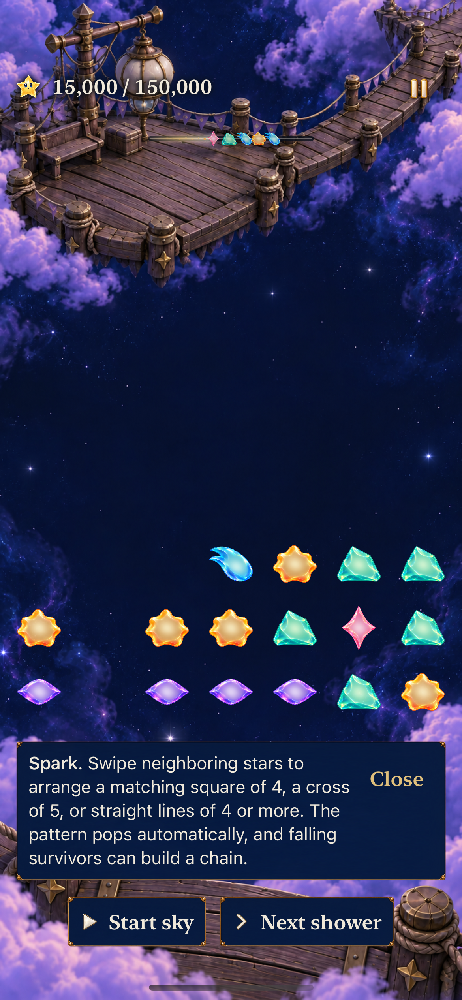
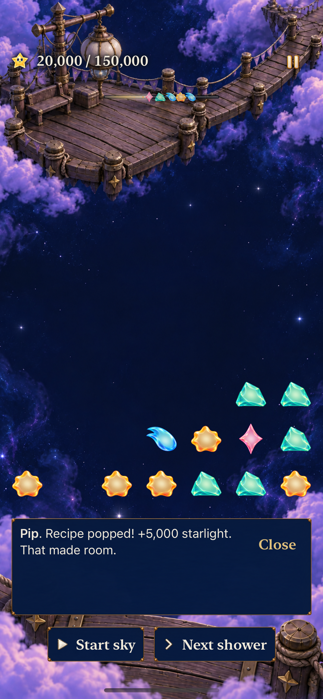
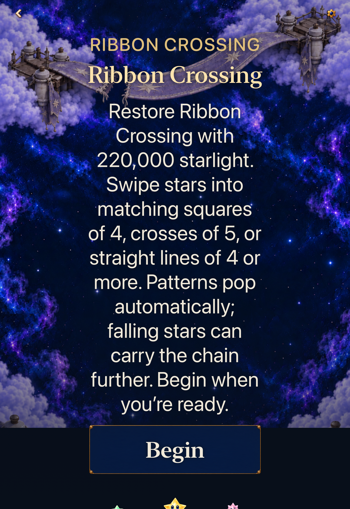

# Four-star straight lines in Lantern and Ribbon

**Status:** Development subset verified; canonical phone installation pending · **Owner:** Current implementer · **Date:** October 22, 2026

The player asks to try four-star lines on the original phone while keeping the other mechanics fixed. New Lantern Landing and Ribbon Crossing visits select authored revision 4. Continue and same-round Replay retain their saved revision, including revision 3's seven-star lines.

**Player promise:** A straight arrangement can earn a satisfying clear after fewer setup exchanges. This is a trial for physical play; software checks cannot establish enjoyment.

## Scope and acceptance

| Contract | Acceptance |
| --- | --- |
| New line rule | At least four contiguous occupied matching cells horizontally or vertically on the existing 7×7 board. Every offset/orientation works; three, gaps and diagonals fail. Grown stars still occupy one cell. Longer maximal runs clear once. |
| Other mechanics | Four-star squares, five-star crosses, union spending, light accounting, score constants, causal multipliers, growth, openings, five-family supply, forecasts, six-/four-second cadence and 150,000/220,000 goals stay unchanged. Open Sky and later locations keep their rules. |
| Saved rounds | New versioned definition and archive. Historical envelopes cannot smuggle revision 4; v12 rounds remain readable with seven-star lines. Continue/Replay preserve original rules and previews. World access is not broadened by moving the archive key. |
| Native slice | A real exchange from a fresh visit produces a four-star line clear, accepts the next input and survives interruption/relaunch. Guidance reflects the saved rule, including retained seven-star play. Current full-round witnesses still win. |
| Verification | Core deterministic/boundary/save tests, affected hosted/native checks, Debug/Release, membership, hygiene and diff checks. Normal-motion and largest-text checks remain distinct from quiet presentation. Actual VoiceOver deferred to RC. |
| Delivery | Verified change merged to current main; canonical updater signs and installs the normal app and verifies OS installation identity. No save reset or automatic launch. |

The [preceding investigation](../mechanics-fun-2026-10-22/README.md) records the player's setup-effort complaint and synthetic threshold comparisons. Four reduced setup/scoring ratios under a shallow policy; that supports this comparison, not a preference claim. Revisit after the next phone session: retain, revise or remove the four-line trial based on deliberate clears, square/cross alternatives, understandable chains and recovery.

## Integration and evidence

The [verification record](verification.json) binds the changed build/test files to runtime input fingerprint `dev.38fb093b7f`, based on main `8e5cb6b52d709b204cbbefdb3005586b18e40534`. A clean Git export produces the same fingerprint. Only evidence and Markdown change after the tested source is frozen. Xcode 27.1 / Swift 6.4, arm64 macOS 27.0.1; native simulators use iOS 27.0.

| Evidence | Result |
| --- | --- |
| Core | 236 passed, zero failures; includes old/new rules, every line offset/length, growth/gaps/overlap, 140 unchanged showers per location and restored complete-round witnesses. |
| Hosted app subset | 188 passed, zero failures/skips; archives, world access, guidance, stores, current wins and retained rules. |
| Native iPhone 17e subset | Three passed, zero failures/skips: current Lantern full win/restore/replay/survival, current Ribbon full win/replay/overflow, natural four-star line/next-input/settings/background/relaunch. |
| Native iPad Pro 11-inch (M5) subset | Two passed, zero failures/skips: the natural four-star line path and largest-text Ribbon entry/clear. |
| Builds/membership | Debug test products and Release compile; no new App/test/resource membership. New Core tests are SwiftPM-discovered. |
| Source/guard checks | Clean-export runtime parity, hygiene, diff and local file links pass; final evidence links will be rechecked. |
| Actual VoiceOver / physical feel | Deferred to RC / unmeasured; this is the player's development trial. |
| Phone installation | Pending canonical updater verification after merge. |

The first hosted run passed 187 and failed one catalogue authoring test because its sample values omitted the new `lines` placeholder. Its sample map and the Studio preview default are corrected; strict missing/unused assertions remain. The full affected 188-test subset then passes.

Both native connector calls hit a 300-second response limit while their original Xcode processes continued. Those original runs completed successfully; direct `xcresulttool` summaries verify exact 3/2 counts and zero failures/skips. No repeated run is substituted for the timed-out response. Raw logs/xcresults remain disposable under `/tmp/starfall-four-lines-2026-10-22`. For future long native groups, use the existing bounded local process runner and inspect its final result, rather than relying on this connector's response window.

Current Core witnesses win Lantern at 151,000 after 22 showers/75 exchanges and Ribbon at 220,000 after 32 showers/98 exchanges. They establish reachability, not human duration or difficulty. The fresh native example keeps the opening: exchange 8→9 earns the original 15,000 square chain; 0→1 clears four violets for 5,000; the next 5→12 exchange earns an unchanged square award, reaching 25,000. Continue retains the committed board/score and old-round rules.

## Inspected native appearance

| Before the straight-line swap | Four-star line cleared | Largest-text Ribbon Entry |
| --- | --- | --- |
|  |  |  |

Debug native stills: source `ea2d020e`, runtime-input fingerprint `dev.38fb093b7f`, simulator label `dev.local`; iPhone 17e and iPad Pro 11-inch (M5), iOS 27.0. [Exact originals and context](captures.json). Assertions separately verify actual swaps, the 5,000-point award and restore; stills do not establish motion quality or physical feel.
