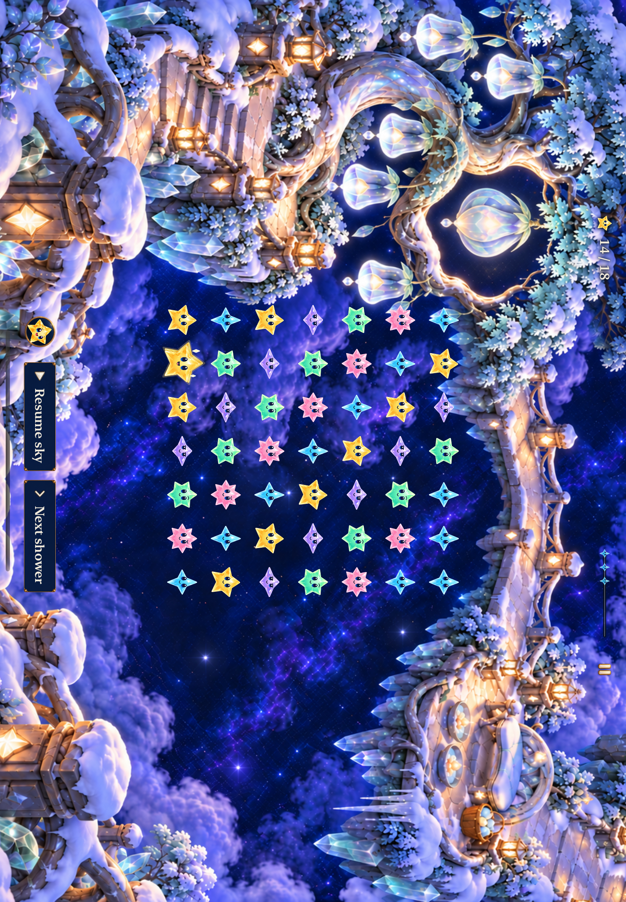

# Frostfruit Orchard production evidence

**Result:** Combined development checks passed; merged and installed on the original iPhone · **Date:** October 20, 2026

Merged in [PR #187](https://github.com/lbeezr/starfall/pull/187); the [canonical receipt](delivery.json) verifies `dev.bd94e46b80` installed from main `3f560e2` in the original iPhone app. Main CI was pending at installation. Installation is separate from physical-play and actual VoiceOver acceptance.

## Combined Observatory integration

Source `6aee65e` / `dev.bd94e46b80` combines the Frostfruit work with main `386b2f8` / PR #185. The fresh combined run passes 342 hosted, 6 phone, 3 tablet and 2 compact-phone checks, plus Core and Release. Exact commands, counts, failed or missing checks, environment and captures are recorded in [verification.json](verification.json) and the [capture index](captures.json). These checks establish bounded development acceptance; actual VoiceOver, measured contrast, full RC and physical gameplay remain unverified.

The six combined phone checks cover all five paintings, win/replay, dense overflow, largest-text/Reduce Motion, dense rapid input with backgrounding, and Silver preview/cancellation. The two other cross-location preview checks passed before integration at `bede49c`; they were not rerun here. Their unchanged state owner and the full combined hosted suite provide separate coverage, not an eight-test combined phone run. The combined 342 hosted checks passed with zero failures/skips in 158.019 seconds; 185 Core tests passed in 39.061 seconds.

The integrated result presentation uses Observatory's vertical `ViewThatFits`: the scenic composition first, a compact fallback without decorative cast or restored-scene clearance next, then scrolling when necessary. Local `starfallPanel` surfaces protect headings and text/actions. `resultContent` places actions before decorative cast, while the primary World Map action and adaptive secondary action row keep their incoming Observatory hierarchy.

The fresh normal-motion recording shows the native winning trace, yellow light transfer into the crown, the committed 18/18 score and the crown opening through the whole-image transition. Sampled final frames keep the result text legible and its actions reachable. This is animation evidence, not a frame-rate measurement.

All fifteen generated source paintings remain byte-identical to their selected originals. The 31 generation attempts and earlier native results retain their own source boundaries. Neither the prior branch's tests nor Observatory's separate installation certifies this combined build.

Fifty-one integrated native PNGs were inspected across phone, tablet and compact-phone runs. Seven unchanged exports are retained; 84 earlier reviews remain historical metadata.

**Next action:** Complete actual VoiceOver, measured contrast and physical-play acceptance at release-candidate review; verified installation does not establish those results.

## Pre-integration development evidence

**Historical scope:** The report below describes `bede49c` / `dev.98b984fb29` and `f7b5c71` / `dev.8b80450f52` before Observatory parity integration. Its counts, failures, captures and motion observations are preserved as originally recorded. Statements about unchanged App code, corrected inputs and final layout apply only to that earlier comparison.

**Result:** Adopted for development; publication and installation pending · **Date:** October 20, 2026

The sixth restoration adopts fifteen packaged paintings in the normal app and uses the existing Silver Pools-earned access rule. Production began at main `d0dfcc1`. Baseline `bede49c` / `dev.98b984fb29` passed 185 Core tests, 339 hosted tests, eight phone and three tablet checks, with all fifteen paintings inspected and a Release build with zero warnings/errors. The corrected native inputs are `f7b5c71` / `dev.8b80450f52`; 40 affected hosted checks passed with zero skips in 10.327 seconds. The full 339-test hosted suite was not rerun after the narrow correction. The [verification record](verification.json) owns corrected compact/phone/tablet results, configurations and inspected capture scope. Publication and canonical installation remain pending.

**Next action:** Publish the verified source and [production assets](../../design/frostfruit-orchard-06/production-assets.json), merge into main and deliver through the canonical updater. Record the verified receipt only after installation succeeds. The [production plan](../../design/frostfruit-orchard-06/PRODUCTION_PLAN.md) retains observable acceptance.

[Initial verification](initial-verification.json) records 185 passing Core tests, 61 tooling tests and the native master probes. Master probes temporarily used the restored painting for score 14; they do not prove a 75% state. The latest tablet method passed one test with zero failures or skips in its completed xcresult, despite the MCP wrapper reaching its 300-second transport timeout after build and execution. Earlier incomplete or rejected art is retained in the exact production provenance.

Dense native results exposed bright retained stars behind the title and paragraph. The board is correctly inactive; terminal text had lost its localized contrast surfaces. The shared ceremony restores compact local reading surfaces around terminal heading and text/actions. A compact test at `bede49c` then failed immediate Replay access; its 71-second capture showed the action below decoration. The correction makes terminal text/actions precede `decorativeCast` at every text size. Other App code and all artwork are unchanged. The local surfaces and corrected order are development-verified within the exact native scope recorded in [verification.json](verification.json); active-play scenery, retained star opacity, gameplay and saved state are unchanged.

A world-map helper also needed `revealSkyControls` before its map tap: the inspected hierarchy showed that chrome obscured the control. The helper now establishes visible controls while retaining real taps and assertions. An additional landscape Home action check passed once on `bede49c` with test-only changes; it is separate from the corrected-source runs and does not replace them.

Native checks use Xcode 27.1, Debug, arm64, iOS 27.0 Simulators and normal motion unless explicitly testing a quiet mode. This is a development subset, not the full release-candidate matrix. Actual VoiceOver, physical gameplay and measured contrast remain unverified. The layout kit separately verifies compiled geometry and current source hashes; its UI edge markers are schematic, not measured SwiftUI coverage.

Corrected inputs pass 185 Core tests, 40 affected hosted checks, two compact-phone checks, four regular-phone checks and the tablet rotation check, all with zero failures/skips. Release builds with zero warnings/errors. A separate recorded native winning clear also passes. The original failed checks remain explicit in [verification.json](verification.json), alongside their causes and passing corrections.

The [selected capture index](captures.json) records original PNG hashes, exact source and the scope of visual carry-forward. The normal-motion recording was inspected at the actual clear: the stars enter clearing expressions, the committed score reaches 18/18, +4 appears, the crown opens through the whole-image transition, and result controls and cast celebration settle. This is sampled animation evidence, not a performance measurement.
