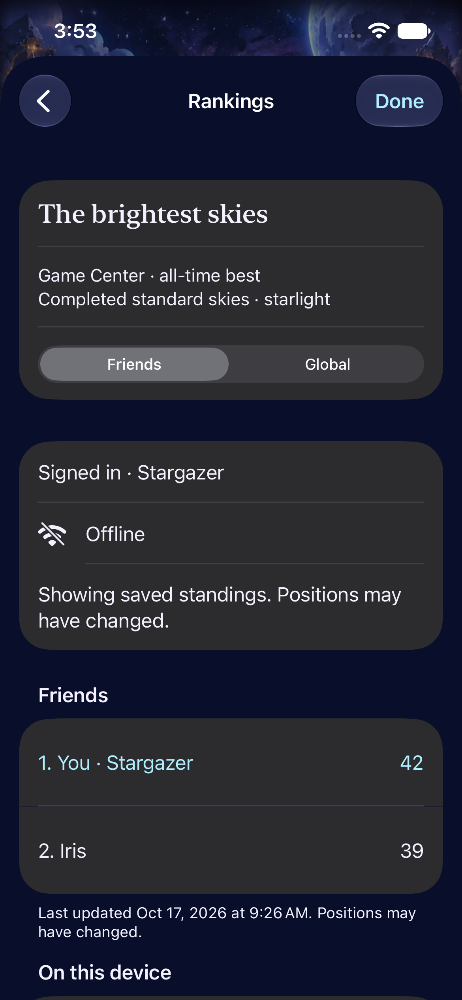
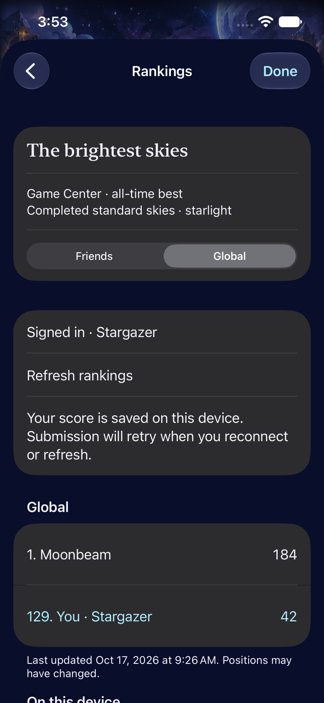
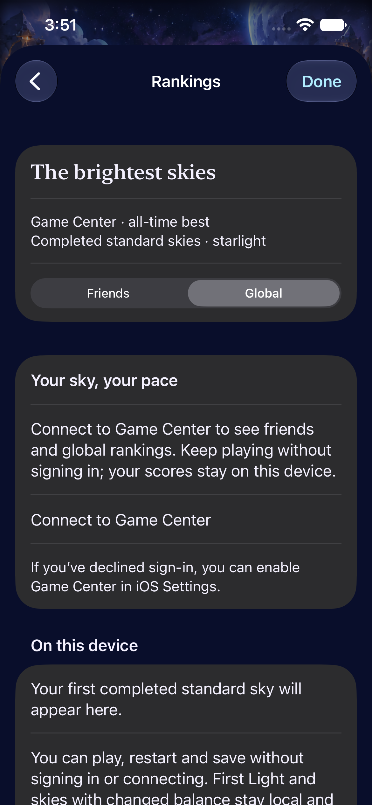

# Optional rankings preserve local play

**Result:** Partially verified · **Owner:** current implementer · **Date:** October 17, 2026

Implemented optional Apple Game Center Friends/Global rankings, per-player cached standings, local best/pending-best records and committed-result eligibility. Gameplay and the existing save format remain independent of connectivity and authentication. The [implementation contract](../../design/GAME_CENTER.md) records scoring, account ownership and required Apple setup.

**Important limit:** No live Apple leaderboard, signing profile or authenticated device submission has been verified. Native online/offline UI checks inject a clearly isolated Debug transport; they prove local behavior, not service availability. Actual rankings VoiceOver, physical-device offline/reconnect and minimum-OS/tablet visual acceptance remain open.

**Next action:** Configure the matching App ID and classic leaderboard in App Store Connect, then complete the signed-device authentication/account/offline matrix before online release acceptance.

## Outcomes against acceptance

| Area | Result / limit |
| --- | --- |
| Core rules/save compatibility | `swift test`: 61 passed. No core source or core save-schema change in this workstream. Missing/corrupt ranking metadata never discards the playable core save. |
| Hosted ownership and durability | Focused tests cover pending maxima, lower scores, anonymous play, per-account restoration/submission, failed uploads, scope caches, background/account/scope stale completions, timeout recovery, terminal commitment before animation, and legacy/custom/challenge exclusions. Final consolidated run: 29 hosted tests passed (12 ranking/service and 17 existing store tests), 0 failures/skips. |
| Native rankings and local play | Debug injected transport exercises Friends/Global, signed-out play/clear, offline cached/uncached states, background/return, refresh and largest-text dismissal. Final consolidated run: all 6 native ranking tests passed; total 35/35 with hosted tests. [Machine-readable result](test-summary.json). |
| Build/resource boundaries | Debug and Release simulator builds; source/test membership and unique project IDs checked. Game Center is the only new entitlement. No ad/IAP SDK, tracking or custom backend. |
| Visual and animation | Selected native ranking captures are inspected below. No custom gameplay animation was introduced; gameplay-motion and leaderboard screenshot evidence are separate. No new trophy/level ceremony is claimed. |
| Actual VoiceOver / physical device / live network | Not established by the injected rankings tests. The broader existing gameplay matrix has its own result; it cannot establish spoken rankings focus or real score publication. |

## Native captures

| Offline Friends | Global with pending upload | Signed out |
| --- | --- | --- |
|  |  |  |

**Native Debug captures — injected sample transport, iPhone 17e / iOS 27.0.** These show layout and local state handling, not live Game Center data. [Largest text](largest-text.png) was separately inspected: content reflows and scrolls, with Done retained; it does not establish actual VoiceOver focus or every long player name. A screenshot review prompted explicit “rank. name” labeling and stacked scores at accessibility sizes; its focused rerun passed all 3 affected UI checks (offline scopes, online Global and largest text), 0 failures/skips. [Layout result](layout-summary.json). Debug test build and final Release build passed after this layout change.

## Verification context

**Source:** Base `b0de3ffab7f6c96d2e1c5e63708452fb84135a48` plus the Game Center working-tree changes. [Source hashes and dirty paths](source.json) identify the implementation, package/config, affected tests and project. Concurrent constellation documentation/tooling edits were committed as `59e86e3` during this work. They do not change the hashed app/package/config inputs and were not edited or validated here. This is a working-tree check, not a clean-checkout published-commit acceptance claim.

**Environment:** Xcode 27.1 (`27A9275`), macOS 27.0.1, arm64. iPhone 17e / iOS 27.0 (`24A434`); focused final tests on dedicated `Starfall Rankings QA` simulator `8C140D96-FE53-4658-A7F5-84D259747EDB`, broader gameplay on `4103C352-DFC2-493E-A224-DE4CE3D50889`. Code targets iOS 17; the minimum runtime was not run. No physical-device run.

Supporting gameplay run: all 13 existing `FallingSkyInteractionTests` passed on an earlier working-tree revision, including normal/manual play, rapid input, First Light win/loss, background/relaunch, restart/settings, Reduce Motion and actual focused paused-growth VoiceOver speech. It preceded final service-cancellation/review-isolation and row-layout refinements; it does not establish rankings VoiceOver. That broader invocation was stopped once its gameplay suite finished rather than repeating outdated ranking tests. Preserve `/tmp/starfall-game-center-native-final.log` as supporting case evidence, not a completed all-target test result.

Raw logs, screenshots and DerivedData are under ignored `artifacts/game-center/`; the final verified log/xcresult and layout follow-up were written under `/tmp/starfall-game-center-verified.*` and `/tmp/starfall-game-center-layout.*` to avoid Xcode local-package rescans. Reproduce from the repository root:

```sh
swift test
python3 scripts/ci-hygiene.py
git diff --check
xcodebuild -project Starfall.xcodeproj -scheme Starfall -configuration Debug \
  -destination 'platform=iOS Simulator,id=8C140D96-FE53-4658-A7F5-84D259747EDB' \
  -derivedDataPath artifacts/game-center/Final CODE_SIGNING_ALLOWED=NO ARCHS=arm64 ONLY_ACTIVE_ARCH=YES \
  -only-testing:StarfallAppTests/SkyLeaderboardTests \
  -only-testing:StarfallAppTests/FallingSkyStoreTests \
  -only-testing:StarfallUITests/SkyLeaderboardInteractionTests test
xcodebuild -project Starfall.xcodeproj -scheme Starfall -configuration Release \
  -sdk iphonesimulator -destination 'generic/platform=iOS Simulator' \
  -derivedDataPath artifacts/game-center/Release CODE_SIGNING_ALLOWED=NO ARCHS=arm64 build
```

The first generic Debug build passed. An initial hosted run with both simulator architectures failed linking x86_64 package symbols; the arm64 run passed 26 tests. An intermediate invocation was interrupted while lifecycle wiring was finalized. The first full rankings UI pass exposed a test-fixture mistake: it tapped an empty hardcoded cell after the first shower. The corrected check selects the native legal group and requires exactly 3 starlight; its focused rerun passed. The authoritative consolidated result is `starfall-game-center-verified.xcresult`, with the corrected test. The earlier failed run’s result-bundle finalization stalled during repeated local-package rescans and was terminated; retain its raw log as failure evidence. No test assertions were weakened and no blanket retries or forced Reduce Motion were added to obtain a pass. Existing tests explicitly exercising Reduce Motion retain their own setup.

## Remaining risks

- Live service setup and signed-device account/offline acceptance are required before calling rankings available to players. Friends permissions, actual Apple UI cancellation, service errors and cross-device scores need real identities.
- The game save and ranking sidecar are separate UserDefaults writes. A death between those writes may conservatively exclude that run from ranking, while retaining its game. [Engineering follow-up](../../ENGINEERING.md) records the trigger for an atomic envelope if guaranteed competitive delivery becomes necessary.
- Offline scores are trusted client results; this is not server-authoritative anti-cheat. Pending best is bounded per account, but arbitrarily many switched accounts have no global history cap.

## Physical iPhone follow-up — October 17

**Result: Partially verified; App Store Connect membership blocks live leaderboard setup.** User confirmed the Apple account uses the free Personal Team. No matching App Store Connect credentials/integration were available. No app record or leaderboard was created, and no enrollment, purchase or App Store submission was performed.

- **Build/signature:** Clean source `f6690f09ce3a6905e737cd2531ca09508efda775` (runtime/config hashes match this record; intervening commit changes policy/prose only). Debug arm64 physical-device build succeeded with `xcodebuild -project Starfall.xcodeproj -scheme Starfall -configuration Debug -destination 'id=<connected-iPhone-identifier>' -derivedDataPath /tmp/starfall-game-center-device -allowProvisioningUpdates DEVELOPMENT_TEAM=<local-team> build`. Team selection was command-local; no project team setting changed.
- **Provisioning:** Xcode obtained a new local development profile containing `com.apple.developer.game-center = true`. The signed app's entitlements independently confirm that value, and `codesign --verify --strict` passed. The profile expires October 24, 2026. This establishes development provisioning, not App Store Connect membership or a configured leaderboard. The earlier “Personal Team may not support this capability” concern is superseded for this specific signed build, not for Apple's online service availability.
- **Installation/launch:** Apple `devicectl` installed the same `com.starfall.prototype` bundle in place on the connected **iPhone 16 Pro Max / iOS 26.6.2**, then successfully launched it; the new executable appeared in the running-process list. No reset/review/test argument was supplied, no app data was erased, and no lab save was imported. Save retention was not independently inspected on-device. Executable SHA-256: `dc93c7701c8505623dc2fab86bbc2eff09c6dfc64c6a51899c9d62f862125b79`.
- **Offline play, user-reported:** Asked the user to enable Airplane Mode with Wi-Fi off, reopen Starfall, try a shower/clear and open Rankings. User replied **“yes it sworking”**. Record this as reported offline usability; individual actions, actual radio state and the exact Rankings text were not instrumented or separately confirmed. No device screenshot or animation capture was inspected.
- **Not verified:** Real Game Center authentication/denial, Friends/Global server results, an eligible offline result queued for an authenticated player, reconnect upload and server-confirmed rank. These cannot be inferred from the install or the user's local-play report. Actual VoiceOver: deferred to RC; not run on this development build.

Raw build/install/launch/device metadata are under `/tmp/starfall-game-center-device*`; provisioning profiles, account credentials and device identifiers are not copied into Git. Hygiene and diff checks passed; no app sources changed in this follow-up, so simulator/core reruns were not applicable.

**Next action:** User completes [Apple Developer Program enrollment](https://developer.apple.com/programs/enroll/) or selects an existing enrolled team. Then enable/access App Store Connect, create the classic high-to-low best-score leaderboard `com.starfall.prototype.standardSky.v1`, rebuild with the enrolled team's profile, authenticate on-device and record a completed standard-sky score while offline. Confirm pending score survives relaunch, then reconnect and verify both successful submission and the score returned by Apple's leaderboard. Do not submit a fabricated test score or reset the user's saved sky to shortcut this check.

### Enrollment follow-up

The user subsequently reported successful Apple Developer Program enrollment. Activation and App Store Connect access are not yet independently confirmed. A repeat physical-device Debug build from clean source `06143f8` succeeded, using the same existing Game Center-enabled local development profile; this is not evidence of paid-team activation. Log: `/tmp/starfall-game-center-enrolled-build.log`. No app source changed and no reinstall/reset was needed. No App Store Connect API credentials or authenticated connector are configured in this session. The App Store Connect Apps page was requested in the in-app browser, and user confirmation of “My Apps” access is pending. Next: confirm access, create the matching app/leaderboard, then perform the real offline/reconnect score test.
