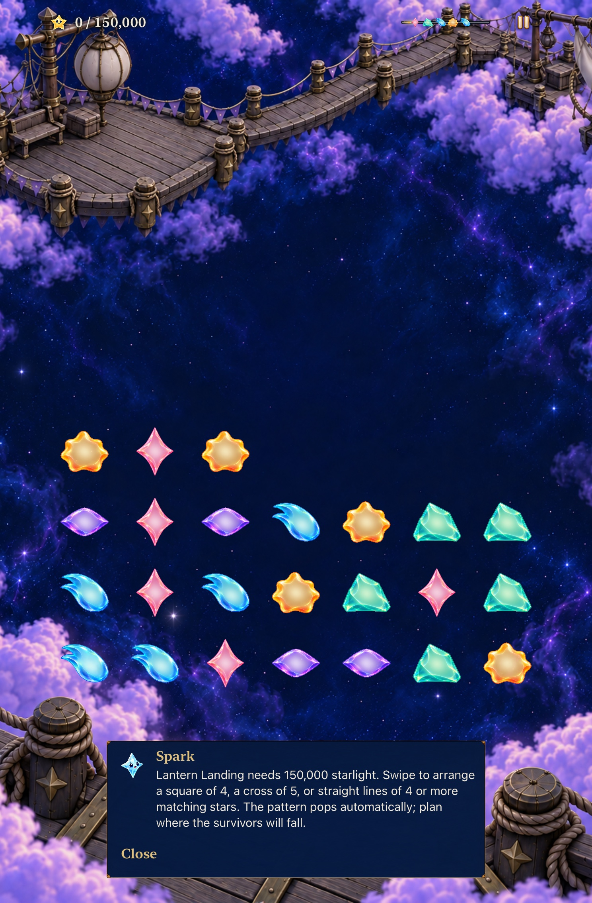

# Keep the Story instructions when play begins

**Result:** Verified for selected development acceptance · **Owner:** Queue coordinator · **Date:** October 22, 2026

Goal 1 of the [ten-goal experience queue #240](https://github.com/lbeezr/starfall/issues/240) keeps the current Story action and objective visible after Begin. [Leaf #242](https://github.com/lbeezr/starfall/issues/242) owns this slice. Entry selected the correct Lantern/Ribbon guide, but the normal handoff called `togglePause()`, replacing it with the generic “Clear matching stars” startup reaction just as play began. Human comprehension remains unmeasured in #206.

`FallingSkyStore` now publishes the existing saved-round challenge guide when manual clears are disabled. Open Sky and retained manual rounds keep their original start reaction. Pause, clock admission, opening presentation, rules, persistence and restore dismissal remain with their existing owners. No catalogue, resource, dependency, project-membership or Core change is part of this correction.

## Player promise and comparison

On the first live board, the player can read the destination, exact objective, swipe action and automatic-pattern consequence. The ordinary journey is Home → Story → visit → Entry → Begin. Compare a current Lantern/Ribbon start with Open Sky and retained revisions 1–2; preserve the intentional paused state after restoration.

The baseline hosted regression observes `guide.started` instead of the saved-round pattern guide for both locations. The native baseline reaches the actual board and fails its target-text assertion after capturing that generic reaction. The retained/manual hosted sibling passes. These are two failed test cases and one passing case, not twelve separate failures: twelve assertions occur inside the parameterized Story case.

During verification, main independently adopted revision 4's four-star straight lines and a new roadmap. The candidate rebased cleanly onto `93ae893a`; [source-inputs.json](source-inputs.json) records the actual authoritative base SHA. The original native baseline used `62cee06f` and revision 3. The startup-selection branch was unchanged by that upstream rule update. Final checks use revision 4 and its existing guide; retained saved rules continue to choose their own line wording. No enjoyment or balance comparison is inferred from the two sources.

## Source and environment

[Exact app/test inputs](source-inputs.json): candidate source commit `ef1b94af2e515e42327026f360fb1615ab2e20fe`, snapshot `b6da26761e94`, computed build identity `dev.0acb9d128e`; Simulator label `dev.local`. The three changed Swift files are the Store and its hosted/native regressions. Later evidence/index edits do not affect the app or tests; publication compares their hashes and the clean Git tree.

Xcode 27.1 (`27A9275`), macOS 27.0.1 arm64, iOS 27.0 (`24A434`) Simulators. The coordinator reserved already-booted iPhone 17e `4103C352-DFC2-493E-A224-DE4CE3D50889` and iPad mini (A17 Pro) `EDE6B5F3-53C9-4703-B3D8-E654BEFA22A0` for bounded runs, then leaves them booted. They are not physical-device evidence. Raw logs/results live under `/private/tmp/starfall-ten-goals-20261022/`; DerivedData/Core scratch paths reuse `/private/tmp/starfall-factory-gameplay-20261022/` owned by this chat.

## Verification

| Check | Result |
| --- | --- |
| Core after current-main integration | 236 passed, zero failures/skips, 20.2 seconds. |
| Affected hosted | 70 passed across dialogue, flow and archive classes; zero failures/skips. |
| iPhone native | Three passed: startup default, AX3XL read-through until Close, and growth/non-scoring inspection; zero failures/skips. Full phone command 87.3 seconds. |
| iPad native | Three passed: both startup text sizes and the existing fresh four-star-line clear/restore journey; zero failures/skips, 161.8 seconds. |
| Debug / Release | Current-main test build and normal arm64 Release passed. |
| Hygiene, diff, local links/source identity | Checked at integration; exact native summaries and retained-capture hashes in [verification.json](verification.json). |

Hosted cases assert both new locations' actual guide/objective, unchanged game and deadline, pause/resume, paused restore without a repeated opening, and unchanged survival/original/retained manual start semantics. Existing committed-chain tests demonstrate a useful production-rule exchange. Native tests use real controls and verify that inspection changes neither board nor score; the tablet sibling also clears a real four-star line and restores its committed result. This is a selected subset, not a complete development or RC matrix.

### Commands

Core: `swift test --scratch-path /private/tmp/starfall-factory-gameplay-20261022/CoreBuild --jobs 2` with standard authorized compiler-cache access.

Native build uses `xcodebuild build-for-testing -project Starfall.xcodeproj -scheme Starfall -configuration Debug`, the reserved phone destination and existing DerivedData, `-parallel-testing-enabled NO -jobs 2 ARCHS=arm64 ONLY_ACTIVE_ARCH=YES CODE_SIGNING_ALLOWED=NO`. Execution uses `test-without-building`, the corresponding reserved destination, `-collect-test-diagnostics never`, and a unique result bundle. Phone selectors:

```text
-only-testing:StarfallAppTests/SkyDialogueTests
-only-testing:StarfallAppTests/SkyFlowStateTests
-only-testing:StarfallAppTests/SkySaveArchiveTests
-only-testing:StarfallUITests/SkyFlowInteractionTests/testStoryStartupExplainsTheActualPatternAction
-only-testing:StarfallUITests/SkyFlowInteractionTests/testLargestTextStoryStartupRemainsReadableUntilDismissed
-only-testing:StarfallUITests/SkyFlowInteractionTests/testCurrentStoryGrowthGuidanceMatchesAutomaticPatterns
```

Tablet uses the two startup selectors plus `StarfallUITests/WorldJourneyInteractionTests/testFourStarLineFromFreshLanternClearsAutomaticallyAndRestores`. Release uses the generic iOS Simulator destination, ReleaseDerivedData and the same explicit architecture/signing settings. `scripts/simulator-command.py` bounds each Apple command and retains its receipt; no test assertion, timeout/skip gate or normal-motion requirement was weakened.

### Failed preparation retained

- A new task-owned simulator could not boot because 5,181 user processes plus CoreSimulator's 300-process buffer exceeded the 5,333 limit. That first attempt compiled but executed zero tests. Other simulators were not shut down without permission.
- The initial sandboxed Core command stopped before tests because the standard module cache was unwritable. The authorized cache-access invocation passes; no dependency or source workaround was added.
- The expected-failure baseline subsequently executed on the booted phone, but Xcode stalled for over five minutes finalizing its result. Only that run's verified process group was stopped. Its assertion log is retained as reproduction; its incomplete bundle is not a successful command or accepted complete baseline result. Final candidate bundles complete with diagnostics collection disabled and report all counts/zero skips.

## Inspected appearance and limits



**Inspected final-source native still, iPad mini / default text.** The whole guide and Close fit above the scene edge. The [phone initial viewport](dev-93ae893a-wip-b6da26761e94__story-start__iphone-17e__default-text.jpg) shows the objective, action and automatic consequence; its final survivor hint extends below that bounded reading viewport. The [AX3XL reading end](dev-93ae893a-wip-b6da26761e94__story-start__iphone-17e__ax3xl-reading-end.jpg) shows the last words and reachable Close after scrolling. JPEG exports preserve original dimensions. Captures establish sampled appearance, not animation quality, physical comfort or learning. Actual VoiceOver and minimum-OS/physical acceptance retain their existing owners and stage policy. No manual phone installation is part of this goal.

## Queue handoff

The durable order and exact prompts are on #240; issues #242–#251 track its ten outcomes. After this slice's verified main merge and #242 completion, activate movement-trust #243 against current main. Its read-only scout found a short internal-boundary release without correction; that source hypothesis still needs production-adapter/native reproduction. Goal 3's old scouting witness must also be rechecked against revision 4. Reuse existing #210/#236–#238 work rather than duplicate it. Project processing/visibility remains #220; issue closure is separately verified.
