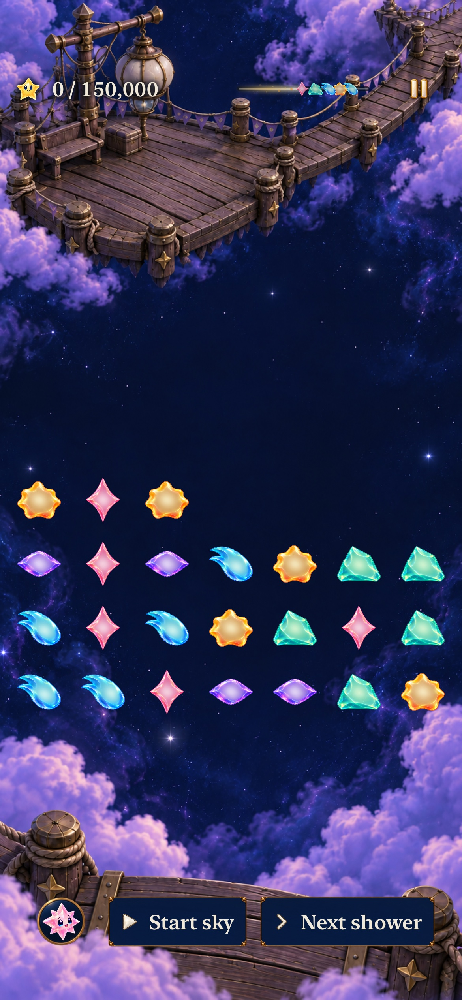
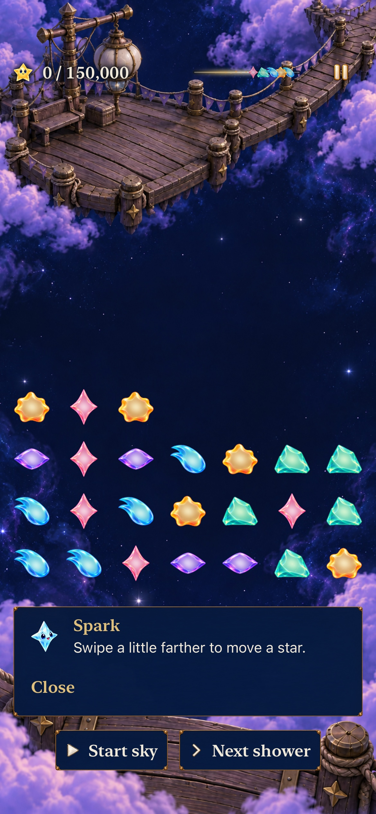

# Explain an incomplete swipe and keep the next move usable

**Result:** Source-bound development acceptance · **Owner:** Queue coordinator · **Date:** October 22, 2026

[Goal 2 / #243](https://github.com/lbeezr/starfall/issues/243) follows merged Goal 1 in [queue #240](https://github.com/lbeezr/starfall/issues/240). An eligible contact could move two points across an internal cell edge, remain below the swap threshold, and end silently. The same cancellation also affected diagonal movement whose individual axes stayed below the threshold while its total distance exceeded tap slop. These are incomplete gestures, not evidence of dropped legal moves or a measured physical miss rate.

The production input session now names this unconsumed cross-cell release separately. The surface cancels its contact and says, “Swipe a little farther to move a star.” Consumed swaps retain their committed feedback; stale/invalid/lifecycle cancellation stays silent. Same-cell taps, swap thresholds, four-direction destinations, Core rules, clocks, saves and normal animation remain with their existing owners.

## Acceptance and comparison

Player promise: a short attempt gets one useful explanation, and the next contact can still move a star. The smallest situation is the current Lantern opening, paused through ordinary controls: start one point inside a cell rim and release one point beyond it. Compare the identical gesture before/after, then make a real non-scoring exchange. Contrasts cover same-cell drift, outward rejection, consumed successful/gravity-return swaps, invalid timestamps and six lifecycle boundaries.

The unmodified-main baseline fails one hosted method containing sixteen phone/tablet × four-rim × sample-delivery cases; three contrasting methods pass. A real UIKit gesture fails the new-message assertion in the normal Story app and retains a screenshot without correction. The diagonal sibling separately fails before its pending-state classification is corrected. No change to eligibility or threshold is inferred from these failures.

## Tested source and checks

[source-inputs.json](source-inputs.json) identifies source commit `2c738d4ed2b064a1ec9624da41b82cfb4ef13d66`, snapshot `75cb5b40c3f2`, build fingerprint `dev.3671aba5cf`; Simulator displays `dev.local`. Base main is `45ee2c2d`. Documentation/evidence edits are outside build inputs; publication verifies the same clean source tree and hashes.

Final results: **236 Core, 83 hosted, five phone native and two tablet native passed; zero failures/skips. Debug/Release, hygiene and diff checks pass.** Phone command 130.7 seconds; tablet 60.0 seconds.

Environment: Xcode 27.1 (`27A9275`), macOS 27.0.1 arm64, iOS 27.0 (`24A434`), iPhone 17e and iPad mini (A17 Pro) Simulators. [verification.json](verification.json) records exact counts, selections, failures and capture hashes. Raw outputs stay in `/private/tmp/starfall-ten-goals-20261022/`, with task-owned DerivedData/Core scratch under `/private/tmp/starfall-factory-gameplay-20261022/`.

Core uses `swift test --scratch-path /private/tmp/starfall-factory-gameplay-20261022/CoreBuild --jobs 2`. Native commands use the shared `Starfall` scheme/project, Debug, the selected installed Simulator, arm64, `ONLY_ACTIVE_ARCH=YES`, `CODE_SIGNING_ALLOWED=NO` and `-parallel-testing-enabled NO`. Build uses `build-for-testing -jobs 2`; execution uses `test-without-building -collect-test-diagnostics never` with unique result bundles. `scripts/simulator-command.py` bounds each command. Release uses `build -configuration Release -destination 'generic/platform=iOS Simulator' -jobs 2` and the same architecture/signing settings.

Phone selection: complete hosted `TraceInputPolishTests`, `SkyDialogueTests`, `SkyTechniqueStoreTests`; native `SkyFlowInteractionTests/testShortStorySwipeExplainsHowToCompleteTheMove`, `testLargestTextShortStorySwipeKeepsFeedbackReadable`; and `SkyTechniqueInteractionTests/testUpwardFallBackExplainsGravityAndAllowsNextMove`, `testQuickDirectionalSwapDoesNotRequireDestinationCell`, `testSettingsAndBackgroundLeaveGesturesReadyWithoutRetoggling`. Tablet runs the default short-swipe method and the gravity-return method. This is an affected subset, not a complete development/RC matrix.

Hosted checks use production surface sampling, including final-only delivery and diagonal drift, then real current Lantern/Ribbon stores to preserve committed movement/gravity-return messages. Native checks use actual UIKit gestures and family-specific source/destination assertions. Existing full-motion, quiet, buffering and interruption siblings preserve their original behavioral checks. Catalogue validation and normal Release packaging cover the added typed key/resource entry; existing target membership is unchanged.

## Verification refinements and limits

Two candidate native attempts failed in newly authored test assumptions after the correction was visible: first the test expected the board's shower/rule summary to change after a non-scoring rearrangement; then it assumed an occupied opening destination was empty. Source review of the exact authored opening and existing committed exchange witness corrected both. The final test checks that the two actual families exchange positions and score stays fixed. These failed attempts remain recorded separately; they are not reported as app regressions or successful acceptance.

The diagonal sibling initially retained the pending state's tap-distance guard. Its failing reproduction established why cross-cell move classification must precede same-cell tap slop. Non-swappable rejection keeps its existing explanation. No assertion, motion setting, timeout or skip gate was weakened.

**Before:** main `45ee2c2d`, same native short gesture, ordinary text. The retained board has no corrective bubble.

**After:** snapshot `75cb5b40c3f2`, ordinary iPhone text. The correction is outside the playfield. [Largest-text reading](dev-3671aba5cf__story-short-swipe__iphone-17e__ax3xl.jpg) and the tablet capture are inspected separately from touch/state assertions. JPEG exports preserve original pixel dimensions.

Adopt the correction in the normal app; no comparison route remains. [#206](https://github.com/lbeezr/starfall/issues/206) retains actual thumb-intent, comprehension and comfort observations. Screenshots do not establish animation quality or learning. Actual VoiceOver, minimum-OS, sustained physical performance and device delivery are separate acceptance; this goal installs nothing on the physical phone. After verified merge/issue completion, activate setup-discovery #244 against current main.
