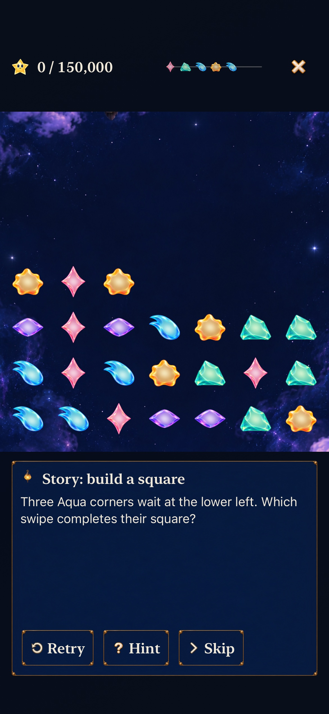

# Practice a current Story square and its falling follow-up

**Result:** Selected development acceptance · **Owner:** Queue coordinator · **Date:** October 22, 2026

[Goal 3 / #244](https://github.com/lbeezr/starfall/issues/244) adds one optional first Tutorial chapter using the real current Lantern opening and input surface. It asks the player to find three Aqua corners; the exact swipe remains behind Hint. Completing the square clears it automatically, then falling Rose survivors make a second square. [Queue #240](https://github.com/lbeezr/starfall/issues/240) retains the ordered individual merges. This creates an opportunity for discovery; it does not establish human learning or transfer.

The previous 21 chapters teach Open Sky and historical restoration. They remain intact, including the manual swap-then-tap square. The new introduction names both rule families. The new chapter is disposable, has no rain clock or archive capability, and stops at the taught setup rather than awarding a world repair. Existing Store, scene, geometry and persistence owners are reused.

## Player and native component contract

- **Initial:** current 24-star Lantern opening, an unanswered square clue, Hint, Retry and Skip. Details/coordinates are hidden.
- **Hint:** the existing control reveals “Swipe left from row 6, column 3” and the automatic-square/survivor explanation. Retry hides this answer again. Older chapters keep their existing disclosure behavior.
- **Choice and consequence:** actual Core exchange `(1,2) → (1,1)` produces two square phases, 5,000 then 10,000 points, eight physical light and sixteen survivors. No shower or forecast change occurs. A legal `(3,0) → (3,1)` exchange changes the arrangement but awards zero and asks for Retry. Inspection cannot complete the chapter.
- **Return:** Retry recreates the exact opening; background, Retry and chapter changes retire held/buffered input and old callbacks. Exit restores the selected chapter in the existing index, then the unchanged saved round/world.
- **Assets/layout:** no new image, texture, font or target membership. Reuse the decorative Story glyph, `SkyTutorialGuide`, native buttons, theme and bounded reading area. Native helpers require full action targets; the inner guide remains scrollable at largest text. Quiet presentation keeps the same committed outcome.

## Source-bound comparison and verification

[source-inputs.json](source-inputs.json) separates the initial source commit `ca8b758681f98f774aa7024be0d3ec745d3771ba`, base main `086df438`, snapshot `9f588ce0b663`, fingerprint `dev.384efe43c5`; Simulator displays `dev.local`. Documentation/evidence changes are outside build inputs. Publication compares the clean local Git tree and all recorded app/test input hashes.

Main then independently merged [chain audio #262](https://github.com/lbeezr/starfall/pull/262). The integrated source is `663c20cc6f8456d398361c032db3b7e224cc453d`, base `50734834`, fingerprint `dev.0587678fcf`. All eight practice/Core/test input hashes remain identical. Normal practice, all affected hosted tests, native audio/committed phase checks and Debug/Release are rechecked on that integration. Initial largest-text/tablet/old-chapter results and captures keep their original source labels; they are not relabeled as the audio integration.

Integrated-source checks: **55 hosted plus one real-input phone practice flow and six hosted scene/receipt/cancellation checks pass, zero failures/skips. Debug/Release pass.** Core/package source is unchanged from the 239-test pass. The ordinary practice repeats with the new audio; earlier largest-text/quiet and tablet outcomes retain their original source.

Before rebuilding, the already verified main binary (`dev.3671aba5cf`, matching main `086df438`) passes the existing native Tutorial/Story preservation journey and supplies the old introduction capture. This is a passing baseline with no current-Story chapter, not a failed app or a fabricated before state. The new chapter adds the opportunity directly; no alternative route remains.

Initial checks: **239 Core, 40 hosted and five native phone/tablet tests pass with zero failures/skips. Debug/Release, hygiene and diff pass.** Phone 371.3 seconds; tablet 173.4 seconds.

Environment: Xcode 27.1 (`27A9275`), macOS 27.0.1 arm64, iOS 27.0 (`24A434`) iPhone 17e and iPad mini (A17 Pro) Simulators. [verification.json](verification.json) records counts, selectors, source/capture hashes and results. Core tests cover every chapter, exact phase sets/survivor identities, current rules, historical definitions and saves. Hosted practice tests cover actual Store actions, no archive/world writes, retry, stale hold/buffer/presentation callbacks and current attempts after interruption. Catalogue/presentation tests verify the clue/answer/completion distinction and preserved older instructions.

Native tests exercise normal Story → Tutorial → new chapter → inspection → non-scoring alternative → Retry → background/return → decisive real swipe → 15,000-point result → unchanged ordinary round/world. Largest-text Calm also opens the worked Hint and verifies Retry hides it. Separate old tap/swap/trace and largest-text introduction journeys retain their prior outcome assertions. Full-motion and quiet checks establish committed behavior separately; screenshots do not establish animation quality or enjoyment.

Core command: `swift test --scratch-path /private/tmp/starfall-factory-gameplay-20261022/CoreBuild --jobs 2`. Native build/execution use the shared `Starfall` scheme/project, Debug, installed Simulator destinations, arm64, `ONLY_ACTIVE_ARCH=YES`, `CODE_SIGNING_ALLOWED=NO` and no parallel testing. Build uses `build-for-testing -jobs 2`; tests use `test-without-building -collect-test-diagnostics never` with unique bundles. The bounded `scripts/simulator-command.py` wrapper retains receipts. Release builds the normal scheme for generic iOS Simulator with the same architecture/signing settings. Raw outputs remain in `/private/tmp/starfall-ten-goals-20261022/`.

Phone selectors: complete hosted `SkyTutorialPresentationTests`, `WorldJourneyTests`, `SkyDialogueTests`; native `WorldJourneyInteractionTests/testCurrentStorySquarePracticeLetsThePlayerChooseAndPreservesTheirRound`, `testLargestTextCurrentStorySquarePracticeKeepsHintOptionalAndRoundSafe`, `testTutorialRealTapSwapTraceRetryAndExitPreserveRound`. Tablet uses the ordinary new-practice method and `testLargestTextTutorialScopeFromHomeAndStoryPreservesRound`. This is an affected subset, not the complete development/RC matrix.

## Inspected native slice

**iPhone 17e, ordinary text:** the real opening, unsolved clue and three native actions fit. [AX3XL reading end](dev-384efe43c5__story-square__iphone-17e__ax3xl-clue-end.jpg) exposes the entire clue through the existing scrolling surface with reachable Hint. The optional coordinate answer was also inspected; its additional detail continues below that sampled viewport and its final line was not captured. [Tablet completion](dev-384efe43c5__story-square__ipad-mini-a17-pro__complete.jpg) shows the exact 15,000 score, sixteen survivors, causal explanation and Next. These are native stills from the recorded source, not animation or human-learning evidence.

## Acceptance limits and next action

Adopt this bounded optional chapter under #244's explicit authorization. [#210](https://github.com/lbeezr/starfall/issues/210) and [#206](https://github.com/lbeezr/starfall/issues/206) retain the unperformed human-study decision, learning/transfer and physical-input observations. No comprehension, enjoyment, actual VoiceOver, minimum-OS, sustained device-performance or physical-delivery acceptance is claimed. A future change to the current Lantern opening/rules must reconsider this lesson's exact witness; the existing deterministic tests intentionally expose that drift.

After this slice's verified individual main merge and issue completion, activate causal-cascade Goal 4 / #245. Read-only scouting found its cause/fall/next-pop mechanism already implemented; verify the current-source slice and inspect evidence before proposing additional effects. Goal 8 / #236 separately owns the rising musical phrase.
