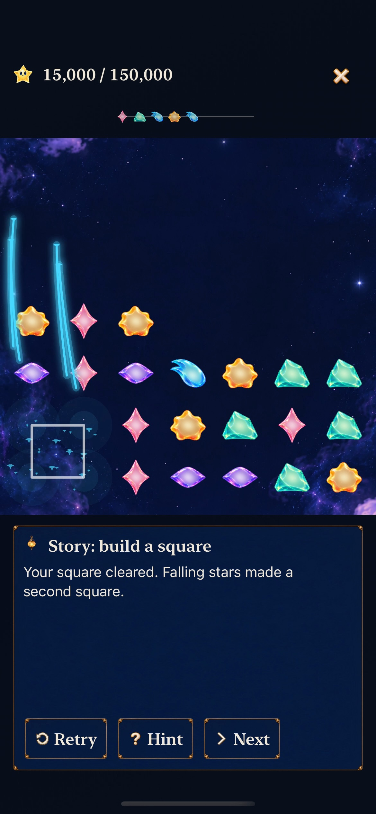

# Keep the existing causal cascade and verify its complete consequence

**Result:** Existing behavior verified for selected development acceptance · **Owner:** Queue coordinator · **Date:** October 22, 2026

[Goal 4 / #245](https://github.com/lbeezr/starfall/issues/245) is satisfied by the current mechanism; this batch changes no product code. On merged Goal 3 main `ae7724487341b7c5596ce3f57c5d220f99d3324e`, a real swipe completes an Aqua square, that clear lets survivors form a Rose square, and the second clear leaves sixteen stars with exactly 15,000 points. The source and sampled native recording show no material causal defect that warrants another effect or speculative timing change. Human comprehension and satisfaction remain unmeasured.

This is an acceptance/report merge within [queue #240](https://github.com/lbeezr/starfall/issues/240), as its prompt permits when the outcome is already implemented. Goal 3 supplies the optional playable setup and explanation; the independently merged [#262 audio work](../chain-audio-2026-10-22/README.md) supplies its bounded rising phrase. No new route, save, rule, reward or asset is introduced.

## What the player can observe

The coordinator inspected nine ordered frames from one normal Simulator recording of actual controls, at movie times 75.500–78.000 seconds. The recording is 124.937 seconds, 1170×2532, and is retained only as disposable local evidence. These are samples of a running app, not a claim of continuous playback inspection or physical smoothness.

| Moment | Observation |
| --- | --- |
| 75.500–76.100 | Contact identifies the moved Aqua; the exchange completes the lower-left square. |
| 76.400 | Four Aqua stars disappear together; cyan particles and an outline mark their source. |
| 76.700 | Lower survivor positions form the Rose square. The first fall's complete path is not sampled. |
| 77.000 | The Rose square clears; other survivors occupy intermediate falling positions. |
| 77.300–78.000 | The sixteen-star result settles; pink collection effects connect the second clear to the score. |

**First pop, actual movie time 76.398.** [Survivors form the Rose square](dev-0587678fcf__cascade__iphone-17e__survivors.jpg), then [the second pop](dev-0587678fcf__cascade__iphone-17e__second-pop.jpg), from the same recorded input. Direct Apple-framework frame extraction preserves the original dimensions. These stills support sampled chronology; the real scene tests below establish ordering and settled positions.

The HUD commits the exact final total at 76.100 before effects finish. It remains 15,000 throughout; the recording shows no repeated award. The practice explanation likewise describes the committed two-square result early. No separate numeric phase callout is readable in these practice samples, so individual receipt timing is established by hosted checks rather than these stills. That observation alone does not establish a comprehension defect or justify another timing policy.

## Ownership and disconfirming checks

Core `SkyResolutionPhase` stores each phase's source board, exact cleared set, settled survivors and award. The scene presents those committed identities in order. Store phase callbacks publish cumulative receipts; they never award another score. The first/second Lantern phases award 5,000/10,000, with cumulative receipts 5,000/15,000. Current Ribbon retains its three-phase 30,000 witness.

Six existing hosted scene/receipt/cancellation checks pass on the identical integrated runtime. A real `SKView` test observes a survivor between its initial and settled positions, requires first-pop removals before the second pop, and verifies the second pop begins at the settled coordinates. Replacement rejects old callbacks; quiet mode settles once, supplies one aggregate receipt and never reawards after resume. The current audio/Store test independently clears a later line for 5,000, total 20,000, and resets the chain/accent to its opening. Exact next-action outcomes and saved state remain committed-owner checks; physical rapid-input comfort is not inferred.

Normal phone and largest-text Calm tablet practice both pass through actual controls: inspection, non-scoring alternative, Retry, background/return, decisive swipe, exact score/survivors and return to the unchanged ordinary round/world. This compares the same production opening across presentations, while the wrong alternative and next independent line supply contrasts. Quiet mode's missing effects do not change its committed result.

## Source and verification

[verification.json](verification.json) records source hashes, movie/frame hashes, real test counts and environment. Runtime fingerprint is `dev.0587678fcf`; Simulator displays `dev.local`. The six phase checks and 55 hosted practice/audio checks ran on clean integrated source `663c20c`; every recorded app/test/Core input is identical on merged main `ae772448`. The two new real-control runs and recording use that merged main. Core 239, Debug and Release acceptance from Goal 3 is reused with explicitly unchanged inputs; documentation-only work does not need another unrelated build.

Environment: Xcode 27.1 (`27A9275`), macOS 27.0.1 arm64, iOS 27.0 (`24A434`), iPhone 17e normal and iPad mini (A17 Pro) AX3XL/Calm. Native runs: **two passed, zero failures/skips**. Phase selection: **six passed, zero failures/skips**. These remain selected subsets; no aggregate full-matrix or human benefit claim is made.

Commands use the existing `scripts/simulator-command.py` wrapper, `xcodebuild test-without-building`, shared Starfall scheme/project, Debug, installed destinations, existing task-owned DerivedData, no parallel testing, diagnostics collection disabled, arm64 and unsigned Simulator products. Normal selector: `WorldJourneyInteractionTests/testCurrentStorySquarePracticeLetsThePlayerChooseAndPreservesTheirRound`; quiet selector: `testLargestTextCurrentStorySquarePracticeKeepsHintOptionalAndRoundSafe`.

Phase selectors: `NativeInputWindowTests/testRecipeCascadeShowsPopThenFallThenNextPop`, `testRecipeCascadeReplacementAndQuietModeDiscardRemainingCallbacks`; `StarlightCelebrationTests/testCausalReceiptsUseEachPhaseBoardAndGrowTheCommittedAward`; `FallingSkyStoreTests/testSceneQuietCompletionWithoutPhaseCallbacksGetsOneAggregateReceipt`, `testInterruptedOpeningAndCascadeRejectStaleCompletionsAndReceipts`, `testQuietCascadePublishesOneAggregateReceiptAndNeverReawardsOnResume`. Independent-action reset is in `QuietTuckPlayerTests/testCurrentStoryPhaseAccentsKeepCommittedAwardsAndSoundPreferences`. Native capture uses installed `simctl io recordVideo --codec=h264`, bounded to 180 seconds and gracefully finalized by SIGINT to its own process group; the receipt reports exit 0. Temporary Swift/AVFoundation extracts exact-time frames without a new dependency. Raw commands/logs/movie stay in `/private/tmp/starfall-ten-goals-20261022/`.

Keep this implementation. At #206's actual player session, observe whether the source square, falling follow-up and reward are recognized without coaching, then refine an evidenced weak link. Actual VoiceOver, physical timing/listening, minimum-OS and sustained performance remain separate. Next activate pressure/recovery Goal 5 / #246; its verified natural Core witness identifies a useful full-column recovery without changing cadence, forecast disclosure or rules.
