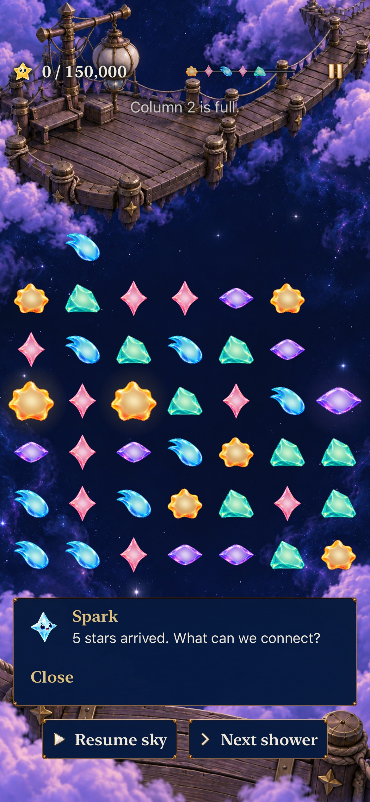

# Notice a full column and recover real space

**Result:** Selected development acceptance · **Owner:** Queue coordinator · **Date:** October 22, 2026

[Goal 5 / #246](https://github.com/lbeezr/starfall/issues/246) adds a persistent native status for full columns in automatic Story rounds. It sits below the score, independently of player-paced dialogue. A committed scoring clear that creates room appends the recovered column names to the unchanged exact result. No forecast columns, cadence, supply, rules, archives or new saved state change.

Hypothesis: naming the crowded space and then the space recovered makes this consequence available to understand. The actual mechanical response is verified; human recognition and recovery comfort remain [#206](https://github.com/lbeezr/starfall/issues/206) questions. A full column does not imply inevitable loss: a matching small top star can grow there.

## Same position, contrasting choices

New Lantern revision 4, no exchanges during the first four showers, reaches heights `[6,7,6,6,6,6,4]` and zero points. The native baseline on main `daf00b93` fails exactly at the absent status; the new cue reads **Column 2 is full.** It never says where the next stars will land or predicts certain loss.

| Choice from that committed board | Actual outcome |
| --- | --- |
| Call shower 5 without arranging | An arrival blocks in column 2; the ordinary terminal result takes ownership. |
| Exchange Core `(0,1) → (0,2)` | A four-Rose line clears for exactly 5,000. Column 2 drops from height 7 to 3; forecast and shower count stay unchanged. |
| Call the same shower 5 after the clear | All arrivals fit; play continues with 5,000 points. Columns 1, 4 and 6 are now full and named truthfully. |

Ribbon's plural witness names three full columns and the actual 50,000-point recovery. Retained automatic revision 3 gets the same truthful board status; historical manual rounds and Open Sky keep their own guidance. Open Sky seed 14 at showers 18→19 demonstrates actual matching-top growth in a full column without loss or a false recovery announcement.

## Inspected native comparison

**Combined source `01c1a32`, computed `dev.64151f9500`, iPhone 17e, ordinary text/normal motion:** the cue occupies its own header row above the unchanged stars. Compare the [actual unchanged-main before state](dev-0587678fcf__pressure__iphone-17e__before-full.jpg), which has the same four-shower board without a status. The [committed recovery](dev-64151f9500__pressure__iphone-17e__recovered.jpg) preserves the exact award and names the newly empty column; next-shower controls remain outside the board.

The [AX3XL Calm reading end](dev-64151f9500__pressure__ipad-mini-a17-pro__ax3xl-recovery-end.jpg) exposes the complete recovery sentence, Close and both manual controls after the seven-second hold. The upper board is scrolled partly out of view as expected; this is a reading sample, not a full-board density claim.

## Native component and lifecycle contract

`SkyPressureCue` reads public committed heights. Store exposes one computed value; the existing header renders wrapping `StarfallStatusText`. There is no timer, queue, persisted warning, hidden-column forecast or new asset. The same native text works in normal/quiet layouts; terminal results withdraw it. Deliberately paused reading bypasses automatic receipt expiry; normal active play retains its six-second result duration. Existing dialogue selection retains its ID, speaker, priority, duration, score and phase receipts before appending recovery. Restore recomputes the status and never replays a recovery event.

The selected Store checks preserve automatic player-paced instructions, quiet parity, committed save-before-presentation, background suspension, restore pause/deadline and stale completion silence. Native real swipes prove recovery rather than directly setting score. The original startup check remains selected.

## Verification context and limits

Initial pressure source `85ae62fb`, fingerprint `dev.da244ef58a`. Driver correction `3a61081` changes the new test’s ordering; product correction `8851018` prevents expiry during deliberate pause. Final test source `0198894`, computed fingerprint `dev.88af345dea`; the Simulator product displays `dev.local`. [verification.json](verification.json) records source hashes, exact selectors, counts and capture provenance. Documentation is outside runtime inputs.

Main independently merged [Map/Places progress #265](https://github.com/lbeezr/starfall/pull/265). Integration source `01c1a329a221567b5a5ee017992c9738d64fe910`, snapshot `74fe250ee978`, computed fingerprint `dev.64151f9500` preserves both features. Source conflicts were limited to two documentation insertions and both entries remain. Combined acceptance: **75 hosted and two native phone/tablet pressure journeys pass, zero failures/skips; Debug/Release pass.** Earlier acceptance adds four phone interaction/expiry/restore/overflow tests and the largest-text tablet journey, all passing. Earlier active-expiry/paused-dismissal evidence keeps its `0198894` source: the overlay and its driver are byte-identical after map integration.

Environment: Xcode 27.1 (`27A9275`), Swift 6.4, macOS 27.0.1 arm64; iOS 27.0 (`24A434`) iPhone 17e and iPad mini (A17 Pro) Simulators. Core: **239 passed**; affected hosted dialogue/reward/scene checks: **47 passed**, zero failures/skips. Debug `build-for-testing` and Release normal-target builds pass. Native and capture results are recorded in the verification record.

The first largest-text quiet attempt failed the new test's first-shower condition: it read the guide before pausing, allowing a real automatic arrival. Its sampled recording shows growth before the asserted wave. The corrected driver freezes through the existing menu before reading and asserts an actual zero-shower start. The app’s clock and assertions are unchanged. That attempt then exposed a real reading defect: the six-second result timer still collapsed the paused message while the largest-text reader scrolled. The overlay now expires timed receipts only during active play; deliberate pause keeps them open until Close. Final acceptance holds the recovery longer than six seconds before reading through it, and exercises active expiry/reopen separately with a real 15,000-point result. An earlier temporary baseline export also lacked its project (build exit 66); the corrected clean export built before the native comparison. Both native failures remain in the record; no timeout, rule or assertion is weakened.

Commands use the shared normal `Starfall` scheme/project, Debug simulator destination, arm64, `ONLY_ACTIVE_ARCH=YES`, `CODE_SIGNING_ALLOWED=NO`, `-parallel-testing-enabled NO`. Tests use `test-without-building -collect-test-diagnostics never` with unique bundles; `scripts/simulator-command.py` supplies bounded receipts. Release uses generic iOS Simulator and its separate DerivedData. Core runs `swift test --scratch-path /private/tmp/starfall-factory-gameplay-20261022/CoreBuild --jobs 2`. Raw logs/bundles stay disposable under `/private/tmp/starfall-ten-goals-20261022/`. Hygiene, diff and local documentation links are checked before publication.

Native stills establish inspected layout, not continuous motion, physical thumb comfort, actual VoiceOver, sustained performance or human comprehension. No phone installation is implied. Adopt the bounded status/recovery slice; revisit recognition and pressure comfort in #206 before balance changes. Continue with Goal 6 after the individual merge.
