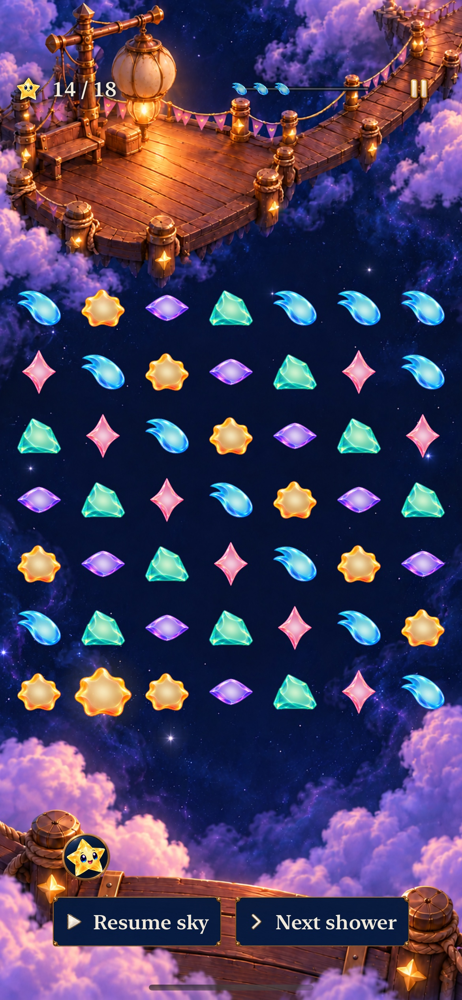
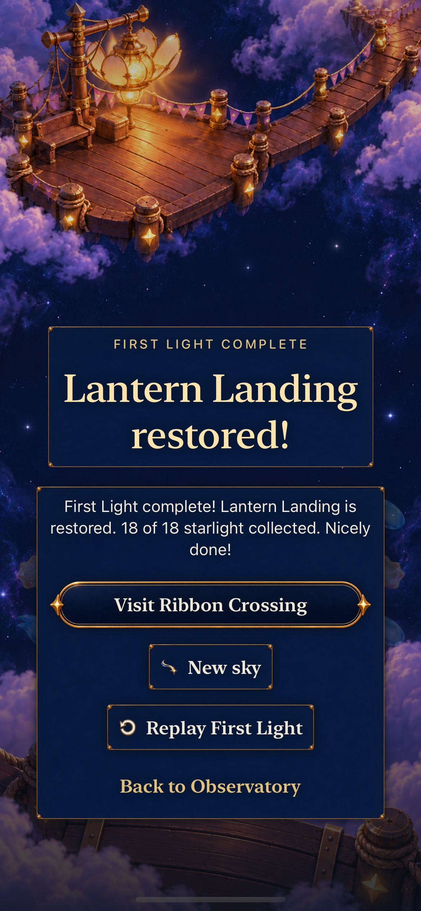

# Let an earned Lantern repair point to the next place

**Result:** Selected development acceptance · **Owner:** Queue coordinator · **Date:** October 22, 2026

[Goal 6 / #247](https://github.com/lbeezr/starfall/issues/247) retains Lantern's existing paintings after a native sparse/full review, then reuses [#237](https://github.com/lbeezr/starfall/issues/237) to improve the final payoff. An earned repair names the immediate ready, unfinished successor: **Visit Ribbon Crossing**. The button opens the existing map with that destination selected. Browsing, cancellation and relaunch preserve the repaired Lantern round; Begin alone replaces it.

The art audit uses isolated historical 18-light fixtures to sample the shared renderer at exact milestones. It does not establish current-rule completion. The separate current Lantern full-round check supplies that evidence. No painting, star geometry, rule, target, supply, cadence, archive or world schema changes.

## The earned visual change already reads

The [level-design kit](../../design/level-design-kit/README.md), camera/scale contract and [Lantern atlas](../../design/WORLD_ATLAS.md#01--lantern-landing--a-light-that-means-welcome) govern the review. Existing families retain their painted camera, connected dock, supports, route and scale; there is no repaint or reliance on an unverified layout export. Native cell frames and actual ordinary/grown bodies establish the current fit directly.

Two native audit cases pass with **30 captures**: five paintings × sparse 21/full 49 stars on phone portrait and both tablet orientations. Active samples at 0–75% assert actual occupied count separately from 49 accessible cell targets, exact score/percentage, unchanged corner/center frames across milestones and density, enabled cells and reachable menu. At 100%, the existing terminal ceremony dims stars and withdraws cell targets; these are full-board result contexts, not active-board readability claims. [milestone-audit.json](milestone-audit.json) records every raw capture's source/hash/time and the 15 unchanged packaged paintings.

| Painting | Native observation, both densities/families |
| --- | --- |
| 0% | Closed, unlit lantern; connected dock and onward gangway remain recognizable. |
| 25% | A small flame appears and warms the dock near the mast. |
| 50% | Globe and route/post fittings light while the center stays clear for stars. |
| 75% | Bright closed chamber and stronger reflected light prepare the final opening. |
| 100% | Petals open into a distinct silhouette, visible above/beside terminal panels. |

**Driver `276b35b`, runtime `dev.64151f9500`, iPhone 17e, ordinary text/normal motion:** dense stars remain below the essential repair detail. Sparse and full samples show the same registered dock/lantern. Still images establish composition, not continuous crossfade quality or physical contrast.

Two additional normal-motion native cases exercise actual 25→50 and 75→100 progress through the production four-light tap, settings/background/restore, canceled replacement and Replay. The [before-winning clear](dev-64151f9500__lantern__iphone-17e__earned-before-75.jpg) and [earned generic ending](dev-64151f9500__lantern__iphone-17e__earned-generic-ending.jpg) are the actual baseline for the navigation refinement, rather than direct terminal fixtures.

The known minor tablet fitting issue remains: one portrait main-dock fitting and one landscape post go lit25 → dark50 → lit75. The main lantern progresses cumulatively, with no observed primary cue hidden by UI/crop or full-star silhouettes. [Portrait 50%](dev-64151f9500__lantern__ipad-mini-a17-pro__portrait-dense49-50.jpg) preserves its context. Retain the paintings while fixing the higher-impact final handoff; the next tablet artwork revision must correct that fitting and compare all five states/crossfades, as recorded in [ENGINEERING](../../ENGINEERING.md).

**October 23 preview erratum:** The linked `portrait-dense49-50` JPEG above contains21 stars despite its filename. The original raw49-star attachment is separately recorded in [milestone-audit.json](milestone-audit.json), SHA256 `2eeb16cae56764143d7186c71b573427cc8046ceb9605193af68bd942ab07075`, and visibly contains49 stars. The published preview supports fitting/painting inspection, not full-board readability. Image bytes and original manifests are preserved. The [later cohesion correction](../cohesion-goal-07-cumulative-light-2026-10-23/README.md) resolves those fittings with its own current-source native evidence.

## One existing action, truthful eligibility

`SkyOnwardSnapshot` derives the immediate successor from a valid winning game and recorded local completion. The destination must have ready content, be enterable and unfinished. It ignores the browsed selection, never skips a completed/unbuilt successor, and says Visit rather than claiming a new unlock. Loss, Free Play, unrecorded repair, completed successor and Sunwheel→unbuilt Bell keep generic Map behavior.

The associated destination intent is revalidated on invocation. `SkyFlowState.openOnward` admits a copy of flow, writes the explicit selection, then publishes navigation only on success. Stale, covered, inactive, unsettled or duplicate actions make no mutation; a selection failure leaves flow and the exact round intact. The actual terminal route remains `.playing` while rendering its won result. Map → Entry Back → Map Back restores that same result through the existing origin; only Begin commits a fresh current Ribbon visit.

The existing primary button, identifier, native style and result layout are reused. No asset, new component family, target member, clock, save field or alternate route is introduced. [#238/#265](https://github.com/lbeezr/starfall/pull/265)'s separate current-objective/retained-progress card is preserved.

**Candidate `8da83d9`, runtime `dev.60afb687d3`, phone ordinary text:** the same actual historical 14→18 clear now names Ribbon without covering the opened lantern. The [largest-text tablet action](dev-60afb687d3__lantern__ipad-mini-a17-pro__ax3xl-onward.jpg) wraps within its native target; secondary actions continue below this viewport and remain scrollable. The [largest-text phone](dev-60afb687d3__lantern__iphone-17e__ax3xl-onward.jpg) also exposes the full named target and passes the same complete handoff. This is control/appearance evidence, with the full navigation tested separately.

## Source-bound verification

The artwork/baseline binary is unchanged main `27252f66`, fingerprint `dev.64151f9500`, with audit driver `276b35b03f063bd4a15fec039f69b905a5d2892a`. Initial candidate product is `8da83d9`, fingerprint `dev.60afb687d3`; driver correction `45690ba` changes only a terminal score-label expectation. The Simulator product displays `dev.local`; computed fingerprints and exact source hashes remain separate. [verification.json](verification.json) records final source, selectors, pass/failure counts and capture provenance.

Current selected checks: **239 Core and 79 hosted pass, zero failures/skips; Debug/Release pass.** Hosted scope includes full SkyFlowState, WorldJourney, RestorationFlow and SkyDialogue suites: current/historical/restored wins, immediate successor/fallbacks, failed/stale admission, exact round bytes and Begin-only replacement. The default phone and largest-text phone/tablet journeys all pass actual 14→18 repair, named destination, selected Ribbon card, canceled Entry, return to the result, relaunch and explicit Begin at zero current-Ribbon points.

The first new native attempt failed because its test expected the short play-HUD score label on the terminal spoken-result surface. It observed the exact correct 18-of-18 result inside Sunny's full sentence. The corrected test compares that complete exact sentence through cancellation and restore; the app and assertions are not weakened. Preserve that failed setup in the verification record.

The separate current revision-4 Lantern round passes **75 real exchanges and 22 showers**, earning exactly **151,000 / 150,000**. Its [ending capture](dev-60afb687d3__lantern__iphone-17e__current-151000-ending.jpg) and restored result both name Ribbon; Replay/Free Play staging preserve their existing behavior. Native full-round acceptance uses real adjacent exchanges and manually called showers with the clock deliberately paused. It establishes deterministic reachability and the current large-point ending, not real-time human difficulty or enjoyment. Full-round results are recorded separately from art fixtures and short input witnesses.

Environment: Xcode 27.1 (`27A9275`), Swift 6.4, macOS 27.0.1 arm64; iOS 27.0 (`24A434`) iPhone 17e/iPad mini (A17 Pro) Simulators. Commands use the shared `Starfall` project/scheme, Debug `build-for-testing`/`test-without-building -collect-test-diagnostics never`, arm64, `ONLY_ACTIVE_ARCH=YES`, `CODE_SIGNING_ALLOWED=NO`, no parallel testing and unique result bundles. Release builds generic iOS Simulator in separate DerivedData. `scripts/simulator-command.py` supplies bounded receipts; raw outputs remain disposable in `/private/tmp/starfall-ten-goals-20261022/`. Core: `swift test --scratch-path /private/tmp/starfall-factory-gameplay-20261022/CoreBuild --jobs 2`.

## Decision and remaining acceptance

Adopt the bounded named handoff and retain current paintings. Hypothesis: making the earned next place explicit gives the repair a clearer consequence. Human recognition, satisfaction, physical contrast/comfort, sustained performance and actual VoiceOver remain unmeasured and keep their existing owners. The 1,198-line native journey suite retains its cohesive private helpers for this slice; the next helper/setup expansion must extract focused journey support/tests with membership/count checks. No new architecture or balance trial is inferred. Continue Goal 7 after this individual merge.
