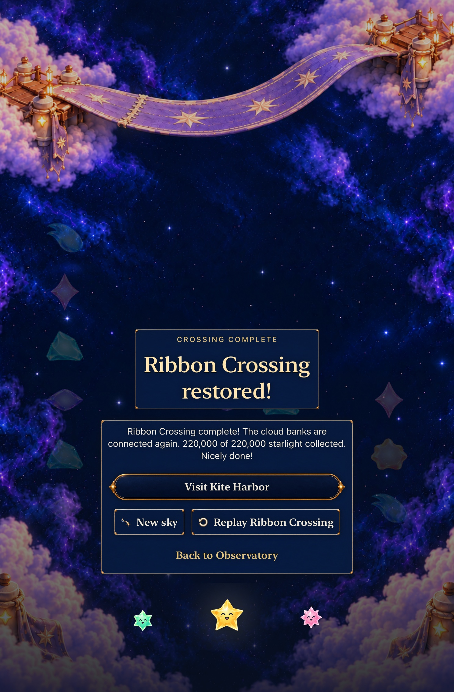
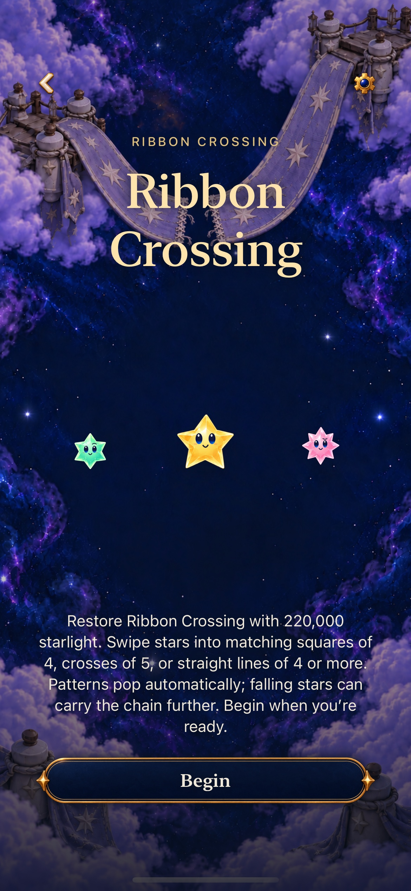
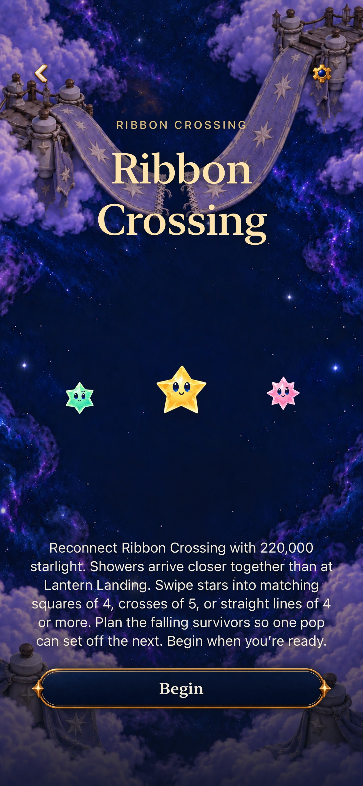
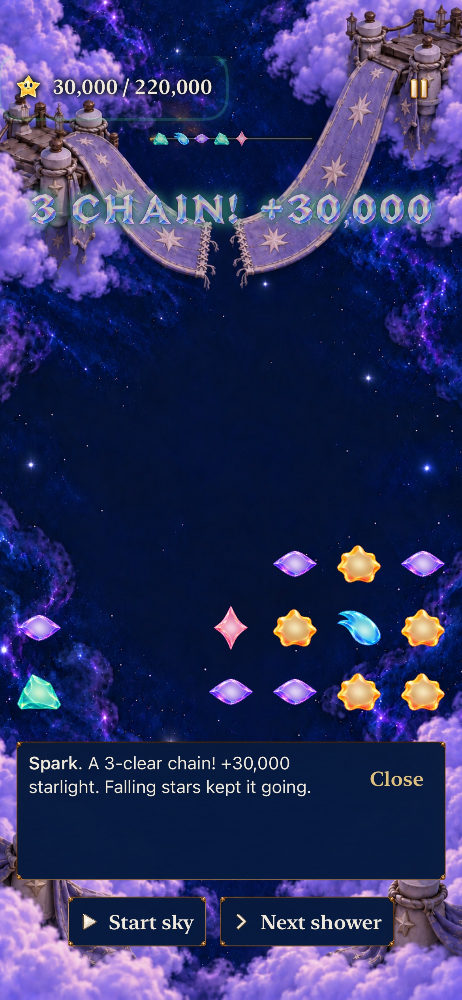

# Let Ribbon explain the decisions its existing board already offers

**Result:** Verified — selected development acceptance · **Owner:** Queue coordinator · **Date:** October 23, 2026

[Goal 7 / #248](https://github.com/lbeezr/starfall/issues/248) makes Ribbon’s existing tempo and survivor planning explicit in Entry, startup and same-round Replay. The current authored board already develops Lantern’s square→survivor pattern into a three-clear opening; the copy previously hid that contrast. No rule, opening, supply algorithm, target, save or replay definition changes.

| Current revision 4 | Lantern Landing | Ribbon Crossing |
| --- | --- | --- |
| Objective | 150,000 points | 220,000 points |
| Automatic shower interval | 6 seconds | 4 seconds |
| Opening stars | 24 | 25 |
| Lower-left opening exchange | Two clears, 15,000 points | Three clears, 30,000 points |

Both use the same deterministic mixed-supply algorithm with distinct authored seeds. Different seeds do not imply a new supply system. Revision 3 retains seven-star full-line wording; older manual stories keep their own instructions.

## Selected direction and disconfirming checks

The selected change names closer showers and invites the player to plan where surviving stars fall. An extra worked lesson would reveal the opening unnecessarily; tuning the opening, supply or clock lacks human balance evidence. Entry is player-paced and Replay preserves the old round until Begin.

The native slice compares an ordinary reversible zero-score exchange and its inverse with the decisive three-clear setup. Exact 49-cell snapshots, score and zero showers distinguish arranging from earning. Canceling Replay then Continue retains the exact committed post-chain board and 30,000 points. A separate full current-rule native round verifies the 98-exchange/32-shower route, win, same-rule replay, natural idle overflow and restored result. Paused/manual-shower reachability does not establish real-time difficulty or enjoyment.

## Verification context

Source `4218cc2ce1af9ecab10f221b72db9178ec479cc9`, product `642bcc57`, computed fingerprint `dev.a591c1b9bb` (Simulator label `dev.local`), clean build inputs. The independent mastery evidence/Core-test merge `8298d6c` is integrated with byte-identical app, Core and hosted/native input paths; combined Core passes **241 tests, zero failures/skips**. Earlier pre-integration Core passed 239. **25 affected hosted and two new phone native cases pass, zero failures/skips; Debug and Release pass.** The separate full Ribbon native check passes on iPad mini: **98 exchanges, 32 showers, exactly 220,000 / 220,000**, same-rule Replay, natural idle overflow at zero points, restored loss and fresh-sky Entry. Total selected native: **three, zero failures/skips**.

[verification.json](verification.json) records source hashes, result counts and actual capture provenance. Native inventory is 198 UI/441 hosted methods, not a full-matrix pass. Commands use `scripts/simulator-command.py`, Debug `build-for-testing` and `test-without-building -collect-test-diagnostics never`, shared Starfall scheme/project, arm64, no signing, no parallel testing, two build jobs and the existing DerivedData. Hosted selection: `StarfallAppTests/SkyDialogueTests`; native selection: `StarfallUITests/SkyFlowInteractionTests/testRibbonIdentityExplainsTempoAndSupportsDeliberateOpeningChoices`, `testLargestTextRibbonIdentityKeepsChoiceAndReplayReadable`, and `testCurrentRibbonWinReplayAndFullSky`. Release builds generic iOS Simulator in separate DerivedData. Core uses `swift test --scratch-path /private/tmp/starfall-factory-gameplay-20261022/CoreBuild --jobs 2`. Raw logs/xcresults remain disposable under `/private/tmp/starfall-ten-goals-20261022/`.

Environment: Xcode 27.1 (`27A9275`), Swift 6.4, macOS 27.0.1 arm64, iOS 27.0 (`24A434`) iPhone 17e and iPad mini (A17 Pro) Simulators. No rule/archive/resource-membership change. Hygiene and diff checks run again at final staging. A preparation text-replacement script initially asserted because its global match was ambiguous; it made no change. The corrected scoped edit uses the existing native Replay scrolling helper. A first sandboxed result-summary query lacked Apple cache permission; the same query succeeded with authorized tool access. Neither was an app/test failure.

Normal-motion tablet completion uses actual current rules, not a terminal fixture. The existing next-place handoff names Kite Harbor. [Same-round Replay](dev-a591c1b9bb__ribbon__ipad-mini-a17-pro__flow-ribbon-replay-explanation.jpg) explains the preserved opening and Begin boundary.

## Actual before and after

Actual prior Entry: driver `45690ba`, runtime `dev.60afb687d3`, ordinary phone text. Its native frame and board context are the same production route; it was captured during Goal 6's earned onward journey.

Candidate `4218cc2`, runtime `dev.a591c1b9bb`, ordinary text/normal motion. The whole Entry text and Begin fit. [AX3XL reading end](dev-a591c1b9bb__ribbon__iphone-17e__entry-end-largest.jpg) reaches the final sentence and full Begin through scrolling. The title/start of that long Entry is a separate viewport. The [live default startup](dev-a591c1b9bb__ribbon__iphone-17e__start-default.jpg) is also scrollable and shows only its initial text; AX3XL initially prioritizes the board, with guidance farther below. No full live-guide read-through is claimed here.

The exact 30,000-point receipt follows the actual lower-left exchange, after a reversible non-scoring alternative. [AX3XL result reading](dev-a591c1b9bb__ribbon__iphone-17e__chain-largest.jpg) exposes the complete receipt, Close and manual shower controls. All eight raw phone samples were inspected; eight selected images (including baseline and tablet endings) are retained without pixel resizing. Existing [pressure/recovery](../game-goal-05-pressure-recovery-2026-10-22/README.md) covers both Story definitions and is reused with unchanged Core/store/pressure owners, separate from this full-round route.

Screenshots establish the Entry reading path, initial live-guide viewport and post-chain receipt, not player comprehension or continuous motion quality. The initial live-guide screenshot is deliberately followed by pause before long reading or arrangement comparisons: Ribbon’s real four-second clock must not silently change the witnessed opening.

Adopt the three catalogue changes with their stable IDs, speaker, help priority and player-paced duration. No alternate route or asset family remains. Revisit whether players recognize and use the difference in [#206](https://github.com/lbeezr/starfall/issues/206); listening, physical comfort and actual VoiceOver remain separate. Continue Goal 8 only after this individual merge.
